---
{
  "citation": false,
  "google-scholar": false
}
---

# Foundations of scientific research in the sport and exercise sciences {#sec-foundations}

James Steele

*Steele Research Limited, UK*

## Introduction {#ch01-introduction}

This is a book about *research methods*. Specifically, a book about research methods in the *science*[^ch01-1] of sport, exercise, and related areas. Most of the chapters in this book will cover specific topics and methods that contribute to, and are intended to help you with *doing,* scientific research in these fields. But, naturally, a starting point prior to that, would be to consider the question's *"what is 'research'?", "what is 'science'?"*.

Now, many of you dear readers may already have some conception of what you think research, science, or scientific research are. Mention of the words might conjure images in your mind of sitting in a library and perusing stacks of books and articles from its archives[^ch01-2]. Or it may bring to mind an individual wearing a white coat in a lab tinkering with specialised equipment or strange liquids in test tubes, exerting control experimentally over the objects of their interest. Maybe you think about someone embedded in an environment observing and recording carefully the behaviour of the individuals within it and their interactions with one another. Perhaps you see someone interviewing another person, interacting with them, asking questions, listening intently to their answers, and recording their thoughts. Some of you may see 'research' and 'science' as being synonymous with one another. Research being a systematic approach to problem solving, to producing knowledge, and isn't science exactly that? Perhaps, perhaps not.

Many have offered definitions for what they consider to be sport and exercise *science* [@gleasonDefiningSportScientist2024a; @gleasonDefiningSportScientist2024]. However, most of these authors have considered the question of what the disciplinary focus of the sport and exercise sciences is as opposed to the question of what the *science* part actually entails. There is debate as to whether we should consider the methods followed, and thus research conducted, in these substantive disciplines to be *science* at all [@ryallNotionScienceSport2011; @fosterScientificDiscoveryIts2016; @piskSportScienceOntological2014].

In contrast to the more specifically methods focused chapters to come later in this book, this chapter is aimed at the introduction and clarification of important foundational concepts; or, at the very least, making you aware of the philosophical background and debates surrounding them. To forewarn you, there will not be a clear-cut answer waiting at the end of the chapter regarding what "scientific research" is. Sure, we will discuss some broad categories of "research" within the broadly conceived "sciences" as well as introduce some of the methodological approaches that can be adopted and kinds of research activities performed. But if it is an answer to the question "what is scientific research?" that you seek then you are looking in the wrong place[^ch01-3]. Indeed, in this chapter I have attempted to avoid as far as possible being prescriptive in the way I present things. Instead, this chapter will invite you on a journey inward where you consider and reflect on your position as a researcher. You may not realise it right now but much of what you will do as a researcher in the sciences is fundamentally influenced by the particulars of the philosophical assumptions that you bring along for the ride, knowingly or otherwise. It is through considering and reflecting on these assumptions that you will come to an answer as to what your research, your science, is. So, my sincerest apologies in advance dear reader... this first chapter is all actually about *philosophy*; the study of fundamental questions via rational and critical inquiry. My task is to make it clear why you should care about, and try to understand, this as the starting point for your research.

## Why should you care about philosophy as a sport and exercise scientist? {#ch01-why-should-you-care-about-philosophy-as-a-sport-and-exercise-scientist}

> *"A knowledge of the historic and philosophical background gives that kind of independence from prejudices of his generation from which most scientists are suffering. This independence created by philosophical insight is---in my opinion---the mark of distinction between a mere artisan or specialist and a real seeker after truth."*
>
> ::: {.quote-attribution}
> Albert Einstein, Letter to Robert Thornton [-@einsteinLetterRobertThornton1944]
> :::

Despite the common modern perception of scientists that philosophy is entirely different from, and in some ways antagonistic to[^ch01-4], science, the two share a long and intertwined history. Indeed, a key precursor to modern conceptions of science was in fact a branch of philosophy. Natural philosophy was the common term for the study of physics (i.e., nature), a broad term that included many of the physical sciences we have today (e.g., botany, zoology, anthropology, and chemistry as well as what we now call physics[^ch01-5]). Here I want to briefly make the case that, whether you like it or not, philosophy forms a fundamental part of scientific research, that understanding and embracing it can have an important and productive impact upon your research, and ultimately why you, as a student of the sport and exercise sciences, should care about philosophy.

Parry [-@parryMustScientistsThink2005], in discussing whether sport and exercise scientists should think philosophically about their science, offers two key arguments in the affirmative[^ch01-6]. Firstly, and as mentioned above, philosophy is not simply a different subject from science, or even maths, history, and the rest. It is constitutive of them and with reference to them. Philosophy encompasses philosophy of science, philosophy of mathematics, philosophy of history etc. Each substantive area is only adequately understood when explored with at least some attention to philosophical considerations[^ch01-7]. Secondly, although the activities of philosophy are sometimes engaged in by scientists in their substantive work (e.g., of conceptual clarification, criticism, and the examination of assumptions, presuppositions[^ch01-8], and justifications), this is often without explicit exposure to understanding these procedures. Whilst it is itself a an empirical question as to whether education in philosophy might help scientists in doing their science[^ch01-9], I can say I am reasonably certain it has helped me as a researcher and I believe I am not alone in this regard or in thinking that it might help others (e.g., see Weinberg [-@weinbergViewsAxiologyScience1970]; Meehl [-@meehlPhilosophyScienceHelp1993]; Laplane et al. [-@laplaneWhyScienceNeeds2019]; Thorp [-@thorpTeachPhilosophyScience2024], Weisman and Masharawi [-@weismanPhysiotherapysPhilosophicalPhobia2027]). Without an understanding of the tools of philosophy, scientists are trained to be little more than technicians without an understanding of why they are doing what they do. The philosopher of science Karl Popper perceived what he believed to be a worrying trend in this regard and one which seems to have continued to this day:

> *"In this context, one point should be mentioned, a point which I think may be connected with the present* \[1968\] *crisis of the universities. It is this. More and more technicians are needed, and as a consequence, more and more Ph.D students are trained only as technicians. Often they are trained only in measuring techniques. And they are not even told what more fundamental problems are to be solved by the measurements they are doing for their doctor\'s thesis."*
>
> ::: {.quote-attribution}
> [@popperMythFrameworkDefence1995]
> :::

In the following sections of this chapter, I will outline some of the key philosophical concepts that make up the typical structure of the sciences and discuss their interrelationships (figure 1). Grix [-@grixIntroducingStudentsGeneric2002] refers to these as the '*building blocks*' that students need before they then begin to train and understand scientifically their substantive disciplinary traditions. Many research methods textbooks within the sport and exercise sciences focus primarily on the introduction of methodologies, specific methods, and the handling and analysis of data they generate whilst omitting explicit introduction to the more foundational concepts of *ontology* (what there is to know about) and *epistemology* (how can we know about it)[^ch01-10], and the various philosophical traditions that are comprised of different ontological and epistemological positions. This *'methodology-led'* or *'methods-led'* approach to research training is unfortunate as, in my opinion, it resigns learners intending to become scientists to unknowingly become primarily technicians[^ch01-11]. Instead, *'question-led'* research from a firm foundation of the ontological and epistemological assumptions brought to the table seems a far more logical approach to this game we call science.

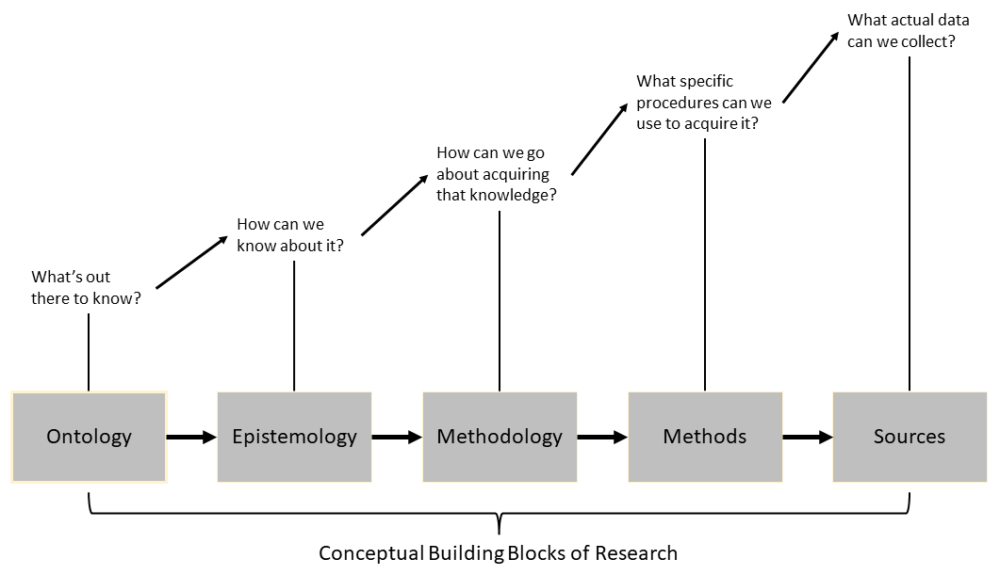

**Figure 1.** The conceptual building blocks of research and their interrelationship (adapted from [@grixIntroducingStudentsGeneric2002; @hayPoliticalAnalysisCritical2002])

As Peter Caws [-@cawsPhilosophyScienceSystematic1965] distinguished in his classic introductory text on the topic, *The Philosophy of Science: A Systematic Account*, we can divide it into four main branches: ontology, the theory of being; epistemology, the theory of knowledge; *logic*, the theory of inference; and *axiology*, including ethics and aesthetics, the theory of values. Though explicit coverage of ontology and epistemology is often found wanting in most introductory research methods texts, both logic and axiology are perhaps even more neglected. As such, this chapter introduces the main branches of the philosophy of science, as well as the typical kinds of research questions and activities that may flow from these, and finally an overview of the kinds of questions and activities they engender along with the broad methodological traditions that consider the methods to be employed in research and which are covered in the remainder of this book.

So dear reader, there are compelling reasons why philosophy should matter to you. Engaging with philosophy goes beyond the realm of being a mere technician skilled in designing studies, collecting and analysing data, and reporting on findings. You will of course learn all about these topics too throughout the chapters of this book. But learning about philosophy is about equipping yourself with more than just these practical abilities; it is about arming yourself with the rapier sharp and powerful tools that philosophers possess. Embracing philosophy has the potential to transform you into a true *scientist*.

::: book-box
**Box 1.** Reasons to care about philosophy in scientific research.

A\) Philosophy provides historical context to modern science and its various branches and can thus help scientists to understand and appreciate the evolution of their respective fields.

B\) By engaging with philosophy, learners can move beyond being mere technicians who are only capable of designing studies and handling data and can instead become real seekers of knowledge with a deep understanding of the foundational concepts of their field.

C\) Studying philosophy can help learners improve their communication skills and become better at articulating complex scientific concepts and theories.

D\) Philosophy can help learners come up with more creative and innovative research ideas, including theories, models, study designs, analyses etc., as it encourages checking of assumptions, lateral thinking, and outside-of-the-box problem-solving strategies.
:::

## Ontologies and epistemologies and their role in science {#ch01-ontologies-and-epistemologies-and-their-role-in-science}

> *"The practice of science depends on a set of metaphysical and epistemological commitments that are so commonplace that they rarely rise to the level of explicit consideration or discussion, at least among scientists."*
>
> ::: {.quote-attribution}
> [@schwartzCreationDestructionValue1990]
> :::

Ontology, followed by epistemology, are necessarily the starting points for all research; by which I mean deliberate activities aimed at the generation of knowledge. From these, and given the research question to be addressed (or indeed even the questions that can be asked), one's methodological positions, methods, and interpretations of data logically flow. Understanding your own positions regarding these are therefore essential to determining the approaches that should be taken in the pursuit of your own research. This is also essential given the intersubjective and social nature of science as a broader undertaking. As mentioned, the tools of philosophy include conceptual clarification, criticism, and the examination of assumptions, presuppositions, and justifications. Scientific researchers often discuss and debate amongst one another regarding the research they conduct, observations they make, and theories they hold. But, without an understanding of the ontological and epistemological foundations of someone's work, the assumptions, or presumptions they begin from, we can find ourselves talking past one another.

For instance, a researcher or practitioner working from a position of behaviourism, a psychological approach that focuses on observable behavior and its relationship with environmental stimuli and grounded in the philosophy of logical positivism[^ch01-12], may be interested in explaining athlete learning. Any critique from a researcher or practitioner working from a position of constructivism, who states that the behaviourist researcher does not consider the influence of unobservable psychological and social structures, may be dismissed by the behaviourist as irrelevant. To them these are not relevant concepts to consider based upon their ontological and epistemological position. Roberts and Potrac [-@robertsBehaviourismConstructivismSports2014] present this example highlighting that without clear dialogue laying out our own, and trying to understand others, philosophical assumptions we can easily talk past one another (figure 2). Many scientists are unaware of the nature of the implicit ontological and epistemological positions that they adopt[^ch01-13].

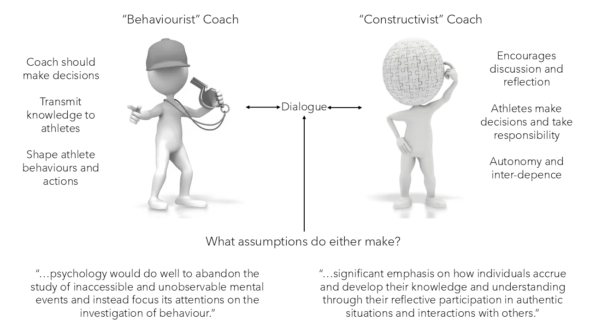

**Figure 2.** The differing perspectives and underlying philosophical assumptions from a "Behaviourist" Coach and a "Constructivist" Coach (adapted from [@robertsBehaviourismConstructivismSports2014]).

So, what are *ontology* and *epistemology*? These seem like big scary words but, despite several thousand years of philosophical debate and arguments for and against different assumptions regarding them, their definitions are fortunately relatively simple. Let's define them first and then explore some of the varying positions regarding them and the philosophical traditions they refer to.

### Ontology {#ch01-ontology}

In its simplest form ontology regards 'what there is' and from the perspective of the scientific researcher forms the assumptions about what the objects of their inquiry are; that is, what things are out there that we can attempt to obtain knowledge of. Within philosophy more broadly ontology is a main branch of what is called metaphysics which has many other branches such as cosmology which addresses very big picture questions such as the origin of the universe itself. More specifically though, ontology is about reality and how it is structured; what it is made up of, what it contains, how are these things structured, and how do they relate to one another? For the researcher of sport and exercise science, indeed any science, understanding ontology is about understanding what you think makes up the reality that you are trying to investigate.

It is important that you can understand, acknowledge, and explicate the ontological position that you operate from. You need to be able to answer the question, whether you are explicitly asked it or not[^ch01-14], *"what do I assume is the nature of the reality that I am trying to investigate?"*. For example, you might use terminology to refer to concepts such as 'force', 'strength', or 'self-efficacy' in the questions you ask and the research you conduct. Do you consider these to be actual 'things', 'objects', that really exist? Do their definitions *"carve nature at its joints"* as the metaphor from the Greek Philosopher Plato's *Phaedrus* suggests? Or are they merely convenient fictions, lines drawn to differentiate between parts of reality much like country borders on a map, useful for a current purpose but not contingent on their 'really' being a corresponding 'truth' to them in reality?

In reflecting about your ontological position there is one thing to keep in mind; it is inherently assumptive. We cannot go out and empirically test these assumptions to have knowledge of whether they are 'true'. The Philosopher of Science Roy Bhaskar[^ch01-15] calls this idea of reducing questions of ontology to those of epistemology the *epistemic fallacy*[^ch01-16]*.* It is worth stating clearly here that it is absolutely fine to embrace the subjectivity of your ontological position. You may hold a particular intuition about it; a belief, or a tendency to believe, or a feeling that something seems to be the case. It is also perfectly acceptable to be unsure about it and to reflect upon it from time to time. It is also no problem to adopt different positions because of this reflection over time or because in a particular context there are non-epistemic values (i.e., values not pertaining to knowledge or its generation such as moral or aesthetic values) that lead to a given choice regarding ontology[^ch01-17]. But, for any given question we attempt to answer through research, we must start somewhere or forgo the journey of moving from thinking about reality to trying to produce knowledge about it altogether. It is only after this question of *what we assume there is for us to know about* has been asked and answered can we move to the task of asking what, and how, we can *know* about this reality.

### Epistemology {#ch01-epistemology}

We must consider what there is that we may be able to know about before we consider how we come to know things, how we produce knowledge. Epistemology follows logically from ontology, and this is exactly what epistemology is; *"what we can understand, and how we can understand it, regarding the reality that we assume we are confronted with?"*. Where knowledge is typically considered in its traditional analysis to be *justified true belief* [^ch01-18] about the reality we contend with, epistemology then refers to theories of knowledge; how it is we go about producing it[^ch01-19]. For the researcher of sport and exercise science, and again any science, understanding epistemology is about understanding how you can come to obtain knowledge about the reality that you are trying to investigate.

The nature of knowledge is dependent on firstly the ontology we assume, and secondly on the ways in which we assume we can come to justifiably obtain it. Some believe that scientific knowledge, the theories that it produces, is aimed at representing and attempting to explain truthfully, or as close as possibly, the nature of the reality that we wish to understand; that scientific research seeks out the truth of matters. Others though see scientific knowledge as purely instrumental; that is to say more or less useful for a particular purpose but not more or less true. Some deny that there even is such a thing as truth that we might aim to know.

Similarly, to ontology, it should be clear that the epistemological stance we adopt too will impact the nature of the research we conduct and thus the views on data, phenomena, and theories that we hold. Indeed, it can impact the very aim of our research.

### Frameworks for understanding ontological and epistemological positions {#ch01-frameworks-for-understanding-ontological-and-epistemological-positions}

As you might suspect there are many nuanced positions that can be adopted with regards to both ontology and epistemology, and thus in combination they can give rise to an assortment of philosophical traditions. You may have come across some of the names of many traditions already. Objectivism, subjectivism, interpretivism, positivism, phenomenology, transcendental realism, critical theory, critical rationalism, post-positivism, post-modernism, hermeneutics... every philosopher seems to want to come up with their own named brand for the framework they offer. Such a range of terminology can leave learners confused and feel that philosophy is overly complex, perhaps even complex for complexities sake. But, to let you in on a little secret... many of these traditions have key elements in common that allow us, much to the offence of the philosophers themselves I would imagine[^ch01-20], to group them simply across a two-by-two contingency table. So, lets simplify things and boil down ontology and epistemology each to two basic positions[^ch01-21].

Regarding ontology we can distil it to the two opposing positions of *realism* and *anti-realism.* These positions are relatively self-explanatory and pertain to assumptions regarding whether they think there are objective answers to the basic question of ontology "*what exists?"*. A realist assumes there is an answer to this and, whilst not verifiably so as noted above[^ch01-22], they assume that there is in fact a real world filled with objectively definable things that exists out there independent of their own subjective experience. The realist may believe that there are indeed "joints" at which we can carve nature into the objectively true *things* that it is made up of, or they may not. Contrastingly, the *anti-realist* denies an answer to this question or at the very least denies that if there is a reality independent of our knowledge of it then it cannot exert influence on our knowledge claims which are purely about our subjective experience. In this sense the anti-realists think that no one attempt to carve up reality is truer than any other. Of course, as noted there are myriad nuances to these positions[^ch01-23] which we will touch on below.

For epistemology, whilst again there are nuanced positions existing between these poles, we can broadly categorise it into *objectivism* and *subjectivism.* For the objectivist there is no assumed barrier to the production of knowledge; it is simply the case of making observations of reality and from this truthful knowledge about it can be justifiably attained. The subjectivist is more sceptical instead thinking that our observations, and thus knowledge, are influenced by a variety of things and therefore it does not necessarily follow that truth emerges in some neutral and objective manner and it may even be the case that our epistemic status precludes us from ever knowing whether things are REALLY the case.

So, as mentioned and given we have two positions for ontology (realism and anti-realism) and epistemology (objectivism and subjectivism), we can create four categories in a two-by-two table: realism/objectivism, realism/subjectivism, anti-realism/objectivism, and anti-realism/subjectivism. Let's explore each of these categories[^ch01-24] in turn and some of the common philosophical traditions they describe. I will do my utmost to avoid being prescriptive here about which positions I think you *should* adopt[^ch01-25]. Instead, I want you to consider them all and think for yourself about which to adopt. Some argue for a form of 'practicalism'; that questions of ontology and epistemology don't matter so much for practicing researchers. That you can adopt whichever position you find convenient for a given purpose. This maybe fine at the methods step of research to an extent but, regarding your fundamental positionality with respect to ontology and epistemology, this makes little sense given their logical precedence. You should consider ahead of time your positionality regarding them and strive to be coherent in your application of them.

### Philosophical traditions in science {#ch01-philosophical-traditions-in-science}

Broadly speaking, though as mentioned there are a variety of flavours that subtly differ from one another, we will group philosophical traditions into three broad positions[^ch01-26] (table 2): Positivism, Constructivism, and Critical Realism. You'll notice that in table 1 the ontological and epistemological positions are noted and are aligned to each philosophical tradition as they are typically held by them. In addition, there is a further column pertaining each traditions analysis of causes. We'll get to this as we introduce and summarise each of the traditions but in essence it considers whether each position considers causes to be part of their ontology or not.

Inevitably, as already mentioned, there is far greater nuance to the views of the various players in these philosophical traditions that I can provide here without risking boring you with dialectical analysis. Westbrook [-@westbrookPragmatistFamilyRomance2008] offers a thought regarding the varied thinkers within the pragmatist philosophical tradition that could be easily applied across most if not all philosophical traditions that end up with broad labels, that they are *"...less as a well-defined, tightly knit school of thought than as a loose, contentious family of thinkers who have always squabbled, and have sometimes been moved to disown one another."* So instead, I offer a little background and summary of each which might prompt you to want to explore further in the future.

+--------------------------------+--------------------------------+--------------------------------+-----------------------------------------+
| **Table 1.** Ontological and epistemological commitments and analysis of causes in different philosophical traditions                      |
+================================+================================+================================+=========================================+
| **Tradition**                  | **Ontological Commitment**     | **Epistemological Commitment** | **Analysis of Causes**                  |
+--------------------------------+--------------------------------+--------------------------------+-----------------------------------------+
| *Positivism*                   | Realism                        | Objectivism                    | Patterns/constant conjunction of events |
+--------------------------------+--------------------------------+--------------------------------+-----------------------------------------+
| *Constructivism*               | Anti-realism                   | Subjectivism                   | Mental models                           |
+--------------------------------+--------------------------------+--------------------------------+-----------------------------------------+
| *Critical Realism*             | Realism                        | Subjectivism                   | Mechanisms/tendencies                   |
+--------------------------------+--------------------------------+--------------------------------+-----------------------------------------+

#### Positivism {#positivism}

The term *positivism* was introduced by Auguste Comte who, inspired by Scottish philosopher David Hume's empiricism, skepticism, and naturalism, became one of the first philosophers of science in the modern sense and wanted to capture the qualities he valued *positively* in his philosophy. Comte attempted to explain the development of human knowledge through his "Law of Three Stages" and is also hailed as the founder of the field of Sociology with his introduction of *Social Physics* applying the methods of the natural sciences to social phenomena. He held that in the procession towards scientific knowledge there was the need to rid it of theological and metaphysical ideas. In the early twentieth century a group of influential philosophers, logicians, mathematicians, and scientists collectively known as the Vienna Circle[^ch01-27] built upon Hume and Comte's philosophy uniting it with new developments in logic. They placed a strong emphasis upon the importance of logical and linguistic analysis of the justification of scientific claims from empirical observation taking on the name of the logical empiricists, though the term logical positivism is often seen nowadays[^ch01-28].

As noted, positivists take the ontological stance that the world consists of real things and that epistemologically we can gain objective knowledge about this reality. Specifically, positivists typically hold that there are general facts and universal laws that describe reality, and we can come to know them through a process of verification via empirical observation. This realism holds that facts and laws are universal and independent of us as subjective observers. The objective epistemology of the positivists, and more specifically the logical empiricists/positivists, was primarily one of *verification*. Verificationism, or the principle of verification, was aimed at removing metaphysical statements from their philosophy by focusing on what conditions led to statements that contained meaning. For them a statement was meaningful, which is to say it pertains to something true, only if it is true analytically or is empirically verifiable via observation through our senses or methods to enhance them such as the technical tools of different sciences (e.g., the telescope in astronomy). Statements that are true analytically are those which are true logically such as tautologies i.e., true by definition; for example, the statement "all bachelors are unmarried men" is definitionally true and equivalent to saying, "all unmarried men are unmarried men". Alternatively, the statement must be empirically verifiable. For example, the statement "the sun will rise tomorrow" has meaning because we can determine the truth or falsity of the statement by waiting until tomorrow and observing whether indeed the sun rises. This is often called the analytic-synthetic dichotomy following the terminology introduced by philosopher Immanuel Kant.

Epistemologically, under the tradition of positivism, scientific theories are seen as objective descriptions of the universal laws that make up reality. Hacking [-@hackingRepresentingInterveningIntroductory1983] provides a summary of the key tenets of positivism. Our knowledge, the descriptions of universal laws, can be verified, or indeed falsified, through observations which refer to the constant conjunction of events. From this perspective there are no causes per se which exist in nature[^ch01-29], only the constant conjunction of events (i.e., one event is invariably followed by another, not that there are some unseen forces called "causes" that produce this constant conjunction) which we can observe and describe via universal law. As such, the positivist downplays the role of explanation and does not consider there to be deeper answers to questions such as 'why?' or 'how?' beyond the description of the regularly occurring phenomena[^ch01-newton-hypotheses]. Lastly, and similarly to causes, positivists do not typically permit the inference from observations to other underlying unobservable theoretical entities that might 'explain' observations[^ch01-30]. Constructs are defined only by their specific operational forms i.e., each and every kind of operation we perform to observe something defines the construct that we observe [@bridgmanLogicModernPhysics1927]. This is not to say that they necessarily believe these things to not exist, but that they are not legitimate objects of science. The real things that science can produce knowledge of to them are those which are observable through such operations and, via induction[^ch01-31] and verification we can come to know the structure of nature's laws.

#### Constructivism {#ch01-constructivism}

The view of constructivism is that both reality and scientific knowledge are a human and social construction. Constructivism as a term has been used in many different ways at different points in time across philosophy, and also sociology and education, though in general was a reaction against the dominant positivism of the early to mid-20^th^ century. For example, the Swiss child psychologist Jean Piaget developed the 'constructivist' theory of learning, contrasted with the similar term yet different theory of 'constructionism' by Seymour Papert. We will focus on constructivist thinking in the philosophical sense here and consider its ontological and epistemological commitments.

I have perhaps been somewhat unfair up till this point in saying that constructivists are anti-realist in their ontology, even entertaining solipsism i.e., the view that only the self can be known to exist, or in the extreme idealism i.e., that reality is fundamentally constructed in our minds. Some constructivists do explicitly adopt extreme ontological positions. For example, Ernst von Glasserfield was a key proponent of radical constructivism and made clear *"It is the primary and most essential aspect of radical constructivism that it deliberately and consequentially avoids saying anything about ontology, let alone making any ontological commitment"* [@vonglasersfeldKeyWorksRadical2007]. But most constructivists would be more likely to adopt a *relativist* position regarding ontology which asserts that reality is a finite subjective experience and not distinguishable from this experience. In this way of thinking about ontology, reality *is* experience and vice versa. Thus, the position goes beyond the possibility that two observers might merely subjectively experience an objective external world differently. Instead, it holds that the worlds they experience, whilst different, are in fact both real. Constructivists do not necessarily deny the existence of a world external to us, but they do not equate it with reality instead seeing it as just one thing which can influence our individual realities. As such, there are as many realities as there are subjective observers to experience them and the purpose of epistemology from this ontological position is to understand the subjective experience of reality and its multiple 'truths'.

The subjective epistemology of constructivism that follows from this relativist ontology is then necessarily one of relativism. If reality is always constructed from the relative position of a given subjective observer, then knowledge of it is too and is always filtered through the unique lenses of that individual. Different observers may have different realities and interpretations of these thus having different subjective knowledge. Examples often given are bistable (i.e., reversing) illusions such as the Rubin Vase (figure 3).

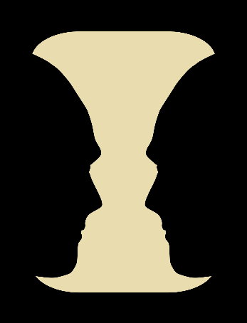{fig-alt="A bistable image that can be seen as a vase or two faces in profile."}

**Figure 3.** A Rubin Vase -- this bistable illusion can be seen as either a light vase upon a dark background, or two dark silhouettes of faces looking at one another with a light background.

Within such images there is no 'true' perception of what the image is really of. Relativism then to an extent sees knowledge as fallible, a statement claiming truth might be wrong; though, given its ontological position it is difficult to see exactly how this is determined and some claim that instead there are many 'truths'. Interestingly, although the positivists downplayed explanation, within constructivism a similar inductive approach is employed yet aimed explicitly at explanation. Working 'upwards' from details of particular cases to adduce theories capturing the relevant patterns and relationships within them. However, there is not claim to 'truth' regarding such explanations except contextually so for the given 'reality' that they regard. Theories are typically seen by constructivists as being pragmatic, of instrumental value, as they appear to solve problems and allow us to predict things[^ch01-32]. The historian of science[^ch01-33] Thomas Kuhn [-@kuhnStructureScientificRevolutions2012] was influential in convincing many scientists of relativism and that scientific knowledge was contained within, and determined by, the conventions of a given theory or paradigm which was deemed incommensurable with another[^ch01-34]. As such, the knowledge within subjectivist epistemology focuses upon explaining discourses, meanings, and experiences of the knowing subjects -- us.

#### Critical Realism {#ch01-critical-realism}

Critical realism broadly speaking and the many philosophical positions that adopt its main views was, similarly to constructivism, a reaction to the predominant positivist thought in the early to mid-20^th^ century. Two key philosophers of science who were, largely independently[^ch01-35], influential in addressing what was thought to be the naïve realism[^ch01-36] of positivism were Karl Popper [-@popperLogicScientificDiscovery2002] and Roy Bhaskar [-@bhaskarRealistTheoryScience2020].

Ontologically, as the name suggests, those within the broad tradition of critical realism do hold that there is a reality independent of us as observers of it and that this objective reality is the target of our research and science. Popper's ontology was structured as what he referred to as World 1, 2, and 3, and Bhaskar structured his into what he referred to as the intransitive and the transitive objects of knowledge. The World 1 and 2 of Popper's ontology referred to the realm of structures, states, and processes that the natural sciences look to study, and the realm of mental states and processes respectively. But Popper only delineated these in a chronological sense; before there were conscious beings capable of experiencing mental states there were still all sorts of other objective things. In modern science the two are part of the broader ontology of 'things we research' and the interaction of them encompasses both the natural and social sciences and rejects old notions of Cartesian dualism[^ch01-37]. For Bhaskar, his intransitive objects of knowledge offer essentially the same idea and encompassed an ontological stratification[^ch01-38] that he called the *real* (i.e., the domain of causal powers and mechanisms) and the *actual* (i.e., the domain of actual phenomena and events caused by the underlying mechanisms)[^ch01-39]. Both philosophers agreed that science begins with a realist ontological position; that the knowledge we generate is *of* the things that really make up reality.

Popper's World 3, and Bhaskar's transitive objects of knowledge are where our *empirical* experiences and observations of the other worlds as well as the products of their epistemologies are situated. It is home to the scientific theories we offer as explanations of reality as ideas themselves. Unlike the positivists though who sought certain knowledge through verification, the critical realist embraces the inherent uncertainty and fallibility of the knowledge we produce of reality. We will touch more on the specific modes of inference used in their epistemology in a section below, but here it is sufficient to say that critical realists are typically comfortable with theories that postulate the existence of unobservable entities that might explain the phenomena we observe, including the proposed underlying causal powers and mechanisms that tend to produce actual phenomena. Bhaskar even specified that whilst, as it appears to us, reality is comprised of our empirical experiences of the events and structures occurring out there in reality, it is the underlying causal mechanisms of these that are the most important targets of our knowledge and theories. The key for both though was that our knowledge was not free from our subjective discourses, meanings, experiences, and values. Thus, all our knowledge is fallible and not the product of purely detached observation. The aim was to acknowledge this (i.e., that when taken literally all our theories are false) and strive for theories that get as close to the truth as we can, to have high verisimilitude or truth-likeness, and to always hold them as tentative explanations of reality that one day we hope may be proven wrong[^ch01-40].

#### Don't overthink the labels but do think about your position. {#ch01-dont-overthink-the-labels-but-do-think-about-your-position}

As I mentioned in the preceding section, there are almost as many named philosophical traditions as there are practicing philosophers. So, don't get bogged down in trying to determine how best to label yourself in that regard. Instead, try to just think carefully through the different positions you take regarding your ontological and epistemological assumptions. The differentiation between the causal realm, actual realm, and empirical realm are useful to aid in breaking down your reflection on these matters and seeing which "Worldview" best reflects your position. The exercise below gives a task to think through this and figure 4 provides a simple example I've used in initially introducing these concepts when teaching[^ch01-41]. If I were to let go of my coffee cup I would notice that it falls to the ground (figure 4.1). This is an empirical observation; it is this sort of thing that we'd usually call *data* in our research. If I were to do it again (and again, and again) I may start to notice that it appears to be a consistent pattern that letting go of my coffee cup is associated with it falling to the ground (figure 4.2). I might infer this constant conjunction of events (let go of my coffee cup, it falls to the ground) to be an actual phenomenon that I can describe. Then I might begin to consider why it happens and develop a theory that acts as an explanation for the phenomenon (and each unique observation of the events it describes occurring) such as the law of universal gravitation (figure 4.3). Though, this underlying cause is not directly observable.

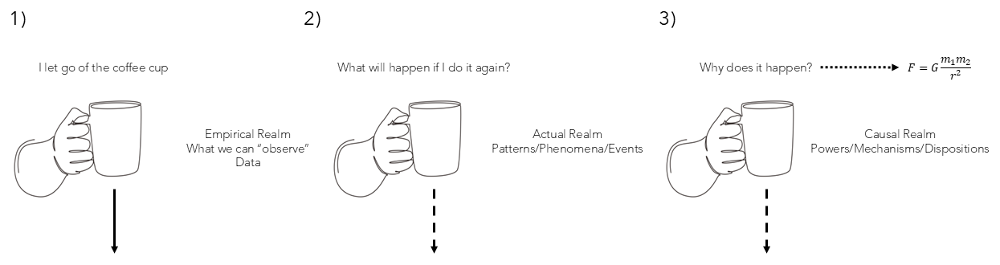

**Figure 4.** Example demonstrating the differentiation between the 1) empirical realm consisting of what we can "observe", the data we use in our research, 2) the actual realm where we notice patterns of constant conjunctions of events i.e., phenomena, and 3) the causal realm where we infer there are underlying causal powers or mechanisms that might explain the phenomena and observations.

::: book-box
**Exercise: Where do you position yourself ontologically and epistemologically?**

As a task now, reflect on what we've covered to this point. The different descriptions of the philosophical traditions and how they relate to different ontological and epistemological positions. Below you will find a figure with an example of a research topic and our current scientific understanding of it: skeletal muscle hypertrophic adaptation to exercise (from [@robertsMechanismsMechanicalOverloadinduced2023]). You'll also see three descriptions of different worldviews. Yucel [-@yucelScientistsOntologicalEpistemological2018] used these descriptions and similar diagrams\* to the one below to encourage scientists to reflect on their ontological and epistemological positions.

Read the worldviews and think about the example below. Which worldview best fits your positions? How does your position relate to the diagram below? Think about whether you consider scientific research to "discover" or "create", what you think about the nature of "uncertainty" and "truth" in science, the role that science plays in "society". Discuss your views with colleagues and see if you can discern where one another's positions lie with respect to ontology and epistemology.

- Worldview 1:

<!-- -->

- Theories are constructed from data. The patterns they purport to describe are purely constructed in the minds of scientists. We cannot know if theories map onto real patterns in nature. If theories make reliable predictions, they are accepted. There is no place for "truth" in science.

<!-- -->

- Worldview 2:

<!-- -->

- Theories are constructed from data to describe real patterns in nature. We cannot directly observe these patterns, but we can infer them from the data we collect and analyse. Science can give us no knowledge of causal powers because we cannot gather empirical evidence about them. Causal powers are part of the realm of metaphysics (i.e. outside of the physical world) and thus are outside the realm of science.

<!-- -->

- Worldview 3:

<!-- -->

- Theories are constructed from data to describe real patterns in nature. We cannot directly observe these patterns, but we can infer them from the data we collect and analyse. We can also infer from these patterns the causal powers that give rise to them, even though these causal powers are not entities in themselves, and we can have no direct empirical evidence of them.

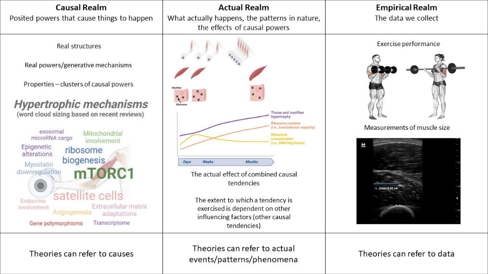{fig-alt="Skeletal muscle hypertrophy shown across the causal, actual, and empirical realms."}

*\* Yucel used the examples of photosynthesis and evolution by natural selection -- if the example above doesn't resonate with you feel free to check out [Yucel's paper](https://philpapers.org/rec/YUCSOA) and examples for this task.*
:::

## The Axiology of Science - what values do we hold as scientists? {#ch01-the-axiology-of-science---what-values-do-we-hold-as-scientists}

To this point we have focused only on a limited portion of the broader topic that is the Philosophy of Science. Hopefully it is clear that the topics covered should indeed be of interest to you and improve your ability to do your research; thinking about what there is, whether you can obtain knowledge of it, and how you might be able to create knowledge of it. But you might be thinking, why should I care about this topic of *axiology,* the theory of values? Why should I care about values? Well, Alvin Weinberg I think put it quite clearly when he wrote:

> *"...whether it is conducted at the level of the individual scientist who decides to do this rather than that, or at the level of the research director who sets a whole laboratory on this course or that, or at the level of the Bureau of the Budget, which directs a whole nation\'s science policy one way or another -- in every instance \[science\] involves questions of value. Is it more important, or more valuable, or somehow better, to do this rather than that, to support high energy physics rather than nuclear physics, or oceanography rather than space science?"*
>
> ::: {.quote-attribution}
> [@weinbergViewsAxiologyScience1970]
> :::

Whilst it may not be obvious, axiological issues are at the very least implicit in the practice of science[^ch01-42], and to an extent can influence even the ontological and epistemological positions we take and how we apply them. Whilst the findings of research are interpreted in light of our positions regarding ontology and epistemology, we sometimes face in science the choice between two or more seemingly valid ontological positions [@ludwigOntologicalChoicesValueFree2016; @reydonHowIncorporateNonEpistemic2022] or theories[^ch01-43] that equivalently explain the empirical evidence and yet are logically incompatible with one another[^ch01-44]. Two theories may be structurally and procedurally different yet result in the same predictions regarding what we should empirically observe, and lo' and behold we find our observations corroborate these predictions. How do we choose between the theories in this situation where the evidence is unable to differentiate them? We appeal to *values* including our particular explanatory interests as well as ethics and even aesthetics. Some argue it is a matter of *taste*. Einstein favoured *beauty* in scientific theories. Popper strove for *simplicity*. The biologist Peter Medawar valued the explanatory or clarifying power and originality of a theory. Values help bridge the gap in theory choice which is itself a complex form of value judgement. Some of those values are *epistemic* and pertain to our epistemological position[^ch01-45]. But some are broader than this with practical implications.

Science and research aim to tell us what *is,* whereas values are aimed at what *should or ought to be;* but we cannot derive one from the other[^ch01-46]*.* This means that science cannot ultimately tell us what we should do, even in the case of *doing science* itself, although it can inform our reflection for doing so. Some might argue that conversely, we should not let our values illegitimately influence our scientific practices. However, as we have seen, science cannot stay wholly value free. Normative ethical values such as regard for human and animal welfare influence research agendas and scientific practices including the methods we employ[^ch01-47]. Other non-epistemic values might also influence our epistemic practice. For example, when the consequence of making an error is high, the standard of evidence to draw conclusions is generally set higher[^ch01-48].

We too hold our own sets of values, perhaps influenced by our backgrounds and experiences, that may affect our actions as individual scientists. But this is where transparency and embracing our positionality in not only ontology and epistemology, but also our personal and cultural values, can help to improve our science. In fact, from a collective point of view, a diversity of positions in scientific communities can be viewed as a worthwhile value in and of itself. This so called *intersubjectivity,* or *collective objectivity* as it sometimes referred to, ensures transparent, critical discussions between individuals to enable a better identification of errors, or situations in which personal preferences or interests might override evidence [@longinoScienceSocialKnowledge1990; @reissScientificObjectivity2020].

Many views on what should constitute values in science have been shared over the years. Robert Merton's [@mertonSociologyScienceTheoretical1973] sociological norms and counter-norms of science are a famous example (table 2).

+--------------------------------------------------------------------------------------------------------------------------------------+--------------------------------------------------------------------------------------------------------------------------------------+
| **Table 2.** Mertonian Norms and Counternorms of Science                                                                                                                                                                                                                    |
+======================================================================================================================================+======================================================================================================================================+
| **Norms**                                                                                                                            | **Counternorms**                                                                                                                     |
+--------------------------------------------------------------------------------------------------------------------------------------+--------------------------------------------------------------------------------------------------------------------------------------+
| *Communality*                                                                                                                        | *Secrecy*                                                                                                                            |
|                                                                                                                                      |                                                                                                                                      |
| Common ownership of scientific goods including findings, materials, data etc. Openness and transparency                              | Scientists do not share their scientific goods. Closed and opaque.                                                                   |
+--------------------------------------------------------------------------------------------------------------------------------------+--------------------------------------------------------------------------------------------------------------------------------------+
| *Universalism*                                                                                                                       | *Particularism*                                                                                                                      |
|                                                                                                                                      |                                                                                                                                      |
| Scientific validity is evaluated on its own merit independently of the sociopolitical status/personal attributes of its participants | Scientific validity is assessed based on the reputation and status of individuals or research groups                                 |
+--------------------------------------------------------------------------------------------------------------------------------------+--------------------------------------------------------------------------------------------------------------------------------------+
| *Disinterestedness*                                                                                                                  | *Self-interestedness*                                                                                                                |
|                                                                                                                                      |                                                                                                                                      |
| Motivated by knowledge and discovery to contribute to a common scientific enterprise                                                 | Motivated by individual benefits where science is treated as a competition amongst scientists                                        |
+--------------------------------------------------------------------------------------------------------------------------------------+--------------------------------------------------------------------------------------------------------------------------------------+
| *Organised skepticism*                                                                                                               | *Organised dogmatism*                                                                                                                |
|                                                                                                                                      |                                                                                                                                      |
| Claims in science, even one's own work, are exposed to critical appraisal by the community before being accepted into the canon      | Scientists invest their career in promoting their own claims, findings, theories, and innovations without self or community critique |
+--------------------------------------------------------------------------------------------------------------------------------------+--------------------------------------------------------------------------------------------------------------------------------------+

A more recent set of *intellectual virtues* in science and scholarship where presented by Scwartz [@schwartzScienceScholarshipIntellectual2022] who argues that we should try to internalise our values, pursue them for their own sake, and to practice acting on them regularly. The virtues he notes are:

- Love of truth[^ch01-49]

  - *"Scientists, scholars, and students need to love the truth to be good at what they do. They need to love the truth because discovering it is the point of their efforts, and because knowing the truth matters."*

- Fair-mindedness

  - *"Fair-mindedness enables us to face the limits of what we know; it encourages us to own up to mistakes. And it enables us to acknowledge uncongenial truths about the world."*

- Perseverance

  - *"Scientists, scholars, and students need the intellectual virtue of perseverance, since little that is worth knowing or doing comes easily."*

- Courage

  - *"Scientists, scholars, and students need intellectual courage, too. They need it to stand up for what they believe is true, sometimes in the face of mass disagreement from others, including people in authority like their professors or journal editors."*

- Perspective taking and empathy

  - *"Scientists, scholars and students need to be able to take the perspective of others, and empathize. This is especially true in an age in which almost all substantial work is collaborative."*

- Wisdom

  - *"Finally, scholars, scientists and students need the virtue that Aristotle called practical wisdom. Any of the intellectual virtues I have mentioned can be carried to an extreme. Wisdom is what enables us to find the balance..."*

Again, I do not want to seem prescriptive in my presentation of values in science and research. But, whether you agree with his values or not, Schwartz's [@schwartzScienceScholarshipIntellectual2022] point that we should cultivate our virtues through active practice is one we should be able to agree upon; we should walk the walk rather than just talk the talk. I would add further that we should be actively reflexive around our values similarly to our other positions.

### Embracing positionality in all research through reflexivity and reflection {#ch01-embracing-positionality-in-all-research-through-reflexivity-and-reflection}

The term *positionality* in research is used to refer to the position that you adopt in relation to the task of engaging in research. It is your worldview or 'where you are coming from'. It concerns the ontological and epistemological, and indeed other (e.g., values, personal characteristics, social position, experiences, and beliefs), assumptions discussed above and where you situate yourself in these regards.

Traditionally positionality is often somewhat hidden. Rarely do you find researchers explicitly stating their ontology and epistemology when you read their work. An exception to this might be in *qualitative* research where it is more common to state positionality in ontology and epistemology, though perhaps more common to state it in regard to other social and personal factors that could have influenced the research [@bergerNowSeeIt2015; @holmesResearcherPositionalityConsideration2020]. But there have been more recent calls to state positionality more clearly even in *quantitative* research [@jamiesonReflexivityQuantitativeResearch2023; @thorgaard-rasmussenReflexivityQuantitativeResearch2022].

*Reflexivity* is important to aid in understanding your positionality as a researcher. It refers to the conscious active acknowledgement and appraisal of your beliefs, biases, and assumptions both before, during, and after the research process. *Reflection* is like reflexivity, and encompasses it, but takes the purely retrospective view of these things considering what might have been overlooked during the research process. If positionality refers to what we know and believe, then reflexivity is about what we actively do with this knowledge.

A good positionality statement[^ch01-50] in its most basic form acknowledges openly the researchers ontological and epistemological positions regarding the research being conducted. But, where appropriate, it also reflexively considers values, personal characteristics, social position, experiences, and beliefs as they pertain specifically to the research at hand[^ch01-51].

::: book-box
**Exercise: Writing a Positionality Statement**

*Purpose:*

The goal of this exercise is to articulate your positionality---your personal, social, and philosophical context that informs your understanding of the world, what is real and how you can come to know about it (ontology and epistemology)---and how this might influence your research approach and interpretation of results.

*Instructions:*

1\. Identify your Positionality:

Begin by outlining your key personal and social identities and experiences that might be relevant to the research topic you are pursuing. This could include aspects such as your age, race, gender, sexuality, socio-economic status, nationality, education level, and so on. You might find some aspects more relevant than others to your research but try to be comprehensive at this stage.

2\. Outline your Ontological and Epistemological Beliefs:

Next, identify and articulate your ontological position (your beliefs about the nature of reality and being) and your epistemological position (your beliefs about the nature of knowledge and how it can be acquired). For example, do you believe there is a single knowable reality or, multiple subjectively constructed realities? Do you believe knowledge is objective and can be discovered, or is it subjective, fallible, and constructed by you as the researcher?

3\. Reflect on how your Positionality Influences your Research:

Reflect on how your personal and social identities, as well as your ontological and epistemological beliefs, might shape your approach to research and the interpretation of findings. Do you lean towards quantitative or qualitative methodologies (more on these in [chapter 4](04-quantitative-data-collection.qmd), [chapter 5](05-quantitative-analysis.qmd), [chapter 6](06-interviewing.qmd), and [chapter 7](07-qualitative-analysis.qmd) - so you may want to return and engage in more reflexivity then)? How might your background and beliefs affect the research questions you pose, the theories you draw upon, the data you collect, or the conclusions you reach?

4\. Write your Positionality Statement:

Using your reflections from the previous steps, write a positionality statement of approximately 250-500 words. This statement should clearly articulate who you are, your worldview (ontological and epistemological positions), and how these factors might influence your research.

5\. Peer Feedback:

Exchange your positionality statement with a partner. Each partner should read the other's statement and provide constructive feedback. Does the statement clearly articulate the author's positionality and its potential impact on their research? Are there aspects of positionality that are missing or could be further elaborated?

Remember that a positionality statement is not a fixed or definitive document. It is a living reflection of your worldview and should evolve as you progress through your research and continue to learn and grow.

*Example*

Here is an example of a positionality statement written by myself:

*My position as a white, middle-class, heterosexual, cis-gendered male in my mid-to-late thirties at the time of writing, coupled with my geographical location in the United Kingdom, English as my first language, and my physical able-bodiedness, inevitably creates a unique lens through which I perceive the world and conduct my work. My personal circumstances and role as a researcher originating in sport and exercise sciences puts me in a unique position, and I am acutely aware of the opportunities it has likely influenced. It has afforded me access to and inclusion within various communities and groups and inevitably influenced the kinds of research I am able to conduct, and likely the kinds of research questions I even think to ask or want to ask.*

*Ontologically, I align myself with realism, the belief that an independent reality exists, separate from our conceptions and interpretations. Within that independent reality I include the unobservable contents of other subjective knowers minds; that is to say I don't merely assume that there is my mind and the external objective world, but that the subjective experiences of others are indeed part of the independent reality that exists. I also assume the reality of underlying causal powers and mechanisms that give rise to the phenomena we observe in addition to the reality of postulated theoretical entities. This includes the notion of emergence, that concepts at different levels of explanation can be real and causally efficacious. I recognise that while this reality is independent, our access to it is invariably mediated by our perceptual and conceptual perspectives and the social influences that frame our understanding. This aligns with my adoption of the critical realist perspective, which marries the idea of an in principle knowable reality with the recognition of the limits of our knowing in practice.*

*Epistemologically, I hold a subjective fallibilist position, acknowledging that our grasp on knowledge is tentative, liable to revision, and shaped by individual perspectives. I believe our understanding of reality is fallible, and while we may strive for objectivity, our interpretations are invariably influenced by our subjective perspectives. This leads me to a continuous quest to critique and improve upon our current understanding of reality, informed by the belief that we can never truly attain a complete or definitive account. Whilst I accept that in the context of discovery there is a difficult to pin down creativity to scientific theorising, I subscribe to the falsificationist position in the context of justification that we can never prove our theories are true descriptions of reality as it is, but we can attempt disprove them; though, I also acknowledge the difficulty of this given the under-determination of theory by evidence. As such, I am open to methodological plurality in what constitutes the methods we use in science dependent on the epistemological context.*

I recognise the importance of open critique, debate, and the pursuit of objective truth within the constraints of our individual and collective subjectivities. I strive to challenge assumptions, both my own and those embedded within the academic fields I am a member of, as part of a continuous process of reflexivity in knowledge generation and refinement. By and large I hold and try to cultivate those virtues listed by Schwartz [-@schwartzScienceScholarshipIntellectual2022]: Love of truth, fair-mindedness, perseverance, courage, perspective taking and empathy, and wisdom.

In essence, my positionality including my ontological and epistemological beliefs, though complex and nuanced, guide my research. They influence what questions I consider asking, how I pose those questions, interpret findings, and contribute to the broader knowledge base in my field.
:::

## Logic, reasoning, and inference as a key part of science {#ch01-logic-reasoning-and-inference-as-a-key-part-of-science}

Logic, which might be defined as the theory of reasoning or inference, plays a considerable role in scientific research. It is a non-empirical field much like mathematics or the other areas of philosophy already discussed, and yet similarly to these has major implications in our ability to draw conclusions regarding our empirical world. To say logic is the theory of reasoning is not to say that it is about the *actual* cognitive (or other) processes involved in the mind of a human (or non-human) subject when they engage in reasoning. It is about *inferring* and the form of *inferences* that we make; that is to say, how we draw conclusions from premises.

### Types of inference {#ch01-types-of-inference}

There are three key types of inference that are typically employed within scientific research. Some of these are formally valid[^ch01-52], others are not. And yet, all three are often applied in practice by scientists though at different stages of the broader process of scientific research. Each presents some kind of value in its own way.

#### Deductive Inference {#ch01-deductive-inference}

This form of reasoning starts with a general statement(s), referred to as the premise(s), and examines the possibilities to reach a specific, logical conclusion. If something is true of a class of things in general, it is also true for all members of that class. For instance, \"All men are mortal. Socrates is a man. Therefore, Socrates is mortal.\" If the premises are true (\"All men are mortal. Socrates is a man"), then the conclusion is guaranteed to be true ("Therefore, Socrates is mortal\"). This is the nature of deductive reasoning.

**Figure 5.** Deductive inference. The premise of the argument is that all men, such as in this image, are mortal. Further, Socrates (the fellow with his arm raised), is indeed a man. Thus, Socrates must too be mortal... and in this case it is subsequently confirmed when he drinks the hemlock and dies. Image: The Death of Socrates by Jacques-Louis David (1787), reproduced under intellectual commons

#### Inductive Inference {#ch01-inductive-inference}

In contrast to deductive reasoning, inductive reasoning makes broad generalizations from specific observations. The premises of an inductive logical argument indicate some degree of support (inductive probability) for the conclusion but do not ensure its truth. This form of reasoning often involves patterns and draws a conclusion from observed data. For example, \"I\'ve only ever seen white swans. Therefore, all swans are white.\" This conclusion may be likely based on the observation, but it\'s not guaranteed.

{fig-alt="White swans on water."}

**Figure 6.** Inductive inference. The premise of the argument is that you have only ever seen white swans. Thus, you conclude, that all swans are white. But this is not guaranteed from the structure of your argument as even though you have only ever seen white swans, there may still be non-white swans out there you have not seen. Image: White Swan on Water by Yevgen Buzuk (2020), reproduced under intellectual commons.

#### Abductive Inference {#ch01-abductive-inference}

Abductive reasoning starts with an incomplete set of observations and proceeds to the likeliest possible explanation for the group of observations. It involves forming a conclusion from the information that is known. Abductive reasoning is often used in the formation of explanatory theories. For instance, \"The lawn is wet. But if it rained last night then of course the lawn would be wet. Therefore, there is reason to suspect that it rained last night.\" This conclusion seems to be a reasonable explanation, but other factors could have caused the lawn to be wet (e.g., someone may have used a garden hose, it could be dew condensed from the moisture in the air etc.).

{fig-alt="Drops of dew on grass."}

**Figure 7.** Abductive inference. You begin your argument with the statement that the grass is wet, supported by observation. You consider what sort of explanation would account for this statement. For example, you argue that if it rained last night then it would follow that the grass would be wet. Thus, there is reason to suspect that it rained last night. But this is not guaranteed as other explanations may also be reasonable e.g., the grass was watered by someone using the garden hose. Image: Green grass by Eberhard Grossgasteiger (2020), reproduced under intellectual commons.

In summary[^ch01-53], deductive reasoning seeks certainty, inductive reasoning seeks probable generalisations based on past observations, and abductive reasoning seeks the possible explanation given a certain set of observable data. Let us examine each in a little more detail before looking to bring them together cohesively in a holistic description of how they might all find a place in scientific research.

### Deduction in science {#ch01-deduction-in-science}

When valid, deductive reasoning in science is where the truth of the premise(s) guarantees the truth of the conclusion(s). Within science its application is often referred to as hypothetico-deduction [@hempelPhilosophyNaturalScience1967]. Karl Popper [-@popperLogicScientificDiscovery2002], who was introduced earlier, was famous for proposing in his *Logic of Scientific Discovery* a particular hypothetico-deductive approach which leveraged a specific form of deductive argument in order not to *confirm,* but to *falsify* scientific theories.

First, let's introduce four forms of deductive argument called implicative syllogisms[^ch01-54] involving premises sometimes referred to as theoretical or universal statements (i.e., general explanations or generalisations regarding phenomena and events) and basic statements (i.e., particular empirical observations of phenomena and events or data itself), and the conclusions drawn from these via reasoning. Two of these are valid forms of deductive inference, whilst the other two are not. Table 3 presents the structure of these arguments (and their fancy Latin names) using the examples of scientific theories (though could also involve generalisations of phenomena e.g., "all men are mortal") and particular empirical observations. Each involves a major premise of the form *if-then*, and a minor premise of the particulars we observe, followed by the conclusion drawn (*therefore*).

+--------------------------------------------------------------------------------------------------------------------------------------------------+--------------------------------------------------------------------------------------------------------------------------------------------------+
| **Table 3. Examples of deductive arguments**                                                                                                                                                                                                                                                        |
+==================================================================================================================================================+==================================================================================================================================================+
| **[Modus ponens (valid)]{.underline}**                                                                                                           | **[Modus tollens (valid)]{.underline}**                                                                                                          |
|                                                                                                                                                  |                                                                                                                                                  |
| If my [scientific theory]{.underline} is a true description of the world, then we will observe a [particular empirical observation]{.underline}. | If my [scientific theory]{.underline} is a true description of the world, then we will observe a [particular empirical observation]{.underline}. |
|                                                                                                                                                  |                                                                                                                                                  |
| My [scientific theory]{.underline} is a true description of the world.                                                                           | We do not observe a [particular empirical observation]{.underline}.                                                                              |
|                                                                                                                                                  |                                                                                                                                                  |
| *Therefore*, we will observe a [particular empirical observation]{.underline}.                                                                   | *Therefore*, my [scientific theory]{.underline} is not a true description of the world.                                                          |
+--------------------------------------------------------------------------------------------------------------------------------------------------+--------------------------------------------------------------------------------------------------------------------------------------------------+
| **[Denying the antecedent (invalid)]{.underline}**                                                                                               | **[Affirming the consequent (invalid)]{.underline}**                                                                                             |
|                                                                                                                                                  |                                                                                                                                                  |
| If my [scientific theory]{.underline} is a true description of the world, then we will observe a [particular empirical observation]{.underline}. | If my [scientific theory]{.underline} is a true description of the world, then we will observe a [particular empirical observation]{.underline}. |
|                                                                                                                                                  |                                                                                                                                                  |
| My [scientific theory]{.underline} is not a true description of the world.                                                                       | We observe a [particular empirical observation]{.underline}.                                                                                     |
|                                                                                                                                                  |                                                                                                                                                  |
| *Therefore*, we will not observe a [particular empirical observation]{.underline}.                                                               | *Therefore*, my [scientific theory]{.underline} is a true description of the world.                                                              |
+--------------------------------------------------------------------------------------------------------------------------------------------------+--------------------------------------------------------------------------------------------------------------------------------------------------+

First let begin with *Modus ponens* which is one of our logically valid forms of deductive argument. The conclusions necessarily follow from the premises. If our scientific theory is true, then it entails that the world works in a particular way and thus we will observe certain things because of that. Now, whilst logically valid, this form of deductive argument is difficult if not impossible to employ in science. It comes back to the epistemic fallacy earlier mentioned in that we can never know for sure whether the initial major premise that our theory is true, is indeed the case.

On the other hand, *Modus tollens*, another of our logically valid forms can be employed and indeed was the focus of Popper's falsificationist epistemology of science. In this form, we similarly assume (albeit tentatively) the premise that our scientific theory is a true description of the world and that it entails us observing certain things as a result. Our theory makes certain predictions about the world that we can go out and attempt to observe. But our minor premise is that we do not in fact observe what our theory tells us we should were it true. The result is that we can *reject* the major premise of the truth of our theory and instead say that it is *false.* It should be noted that our theory could entail that there are certain things we should *not observe* and, in this case, if we observed them then it would mean our theory is false. The logical form is the same in this case and in fact it is this that Popper deemed the riskiest test of a theory. If the theory 'survives' the test, then Popper argues we can continue to assume (tentatively) that our theory was a true description of the world[^ch01-55].

The remaining two forms are invalid, and yet one is still very commonly seen being applied by scientists. With *denying the antecedent* even if our theory is not a true description of the world that does not mean we will not observe something it entails. There could be other premises (i.e., other theories) that lead to particular observations given that our premise (i.e., our theory) is false. *Affirming the consequent* is the form that most people fall prey to. In this case, whilst we observe what our theory predicts we should observe assuming it to be true, we cannot conclude from observing this that our theory is indeed true. There could be again other explanations for the observations that we make and further there's no guarantees that we won't observe something different in the future. It's worth noting that, whilst affirming the consequent is an invalid deductive form, it may still be an acceptable inductive inference in that it is probable our theory is true. This may be why the form of reasoning is applied so often by scientists.

The forms described above show which are valid, and which are invalid, forms of deductive inference. But, alongside the validity of deductive arguments there is also the soundness of them to consider. An argument is valid if and only if its conclusion(s) follow from its premise(s). Where an arguments premise(s) is true it can be said to be factually correct, though could still be an invalid form of argument (see above). But only where an argument is both factually correct and of valid form do the logicians refer to it as *sound*[^ch01-56].

### Induction in science {#ch01-induction-in-science}

Despite the strength of deductive logic due to its formal validity ensuring that a conclusion(s) follows from a premise(s), in particular the application of Modus tollens, and the *Problem of Induction* formulated in the 1700s by David Hume[^ch01-57], inductive inference is still commonplace in science with many philosophers arguing that scientific inference is inherently[^ch01-58] inductive [@carnapLogicalFoundationsProbability1967; @jeffreysScientificInference1973; @keynesTreatiseProbability2004; @reichenbachTheoryProbability1971]. As noted, inductive reasoning aims to derive a general conclusion from a set of particular empirical observations and provides not certainty regarding the truth of that conclusion, but only that it is probable.

The key method used to reach inductive conclusions is that of *enumerative induction.* This relies on the *number* of instances of particular empirical observations that support or verify it where the more supporting instances that are found increase the strength of the conclusion. Induction is often claimed to be a mode of reasoning used in the development of scientific theories as explanations from particular empirical observations[^ch01-59]; however, as we shall see in the next section this is perhaps more appropriately what is called abductive inference. Inductive inference is largely limited to drawing generalisations about classes of phenomena or events from particular empirical observations and not in building our explanatory theories of them [@bungePlaceInductionScience1960]^,^[^ch01-60]. We might observe 100 white swans and conclude that "all swans are white" or "the next swan we observe will also be white"[^ch01-61], but this inductive inference does not aid us in constructing an explanation for why this is the case[^ch01-62].

What about in the case of existing scientific theories then? How is induction employed? The form is typically as follows:

> All [particular empirical observation]{.underline} so far has matched the predictions of my scientific theory.

*Therefore*, my [scientific theory]{.underline} is probably a true description of the world.

Essentially, in the case that we have a theory that makes certain predictions, enumerative induction is used in the seeking of positive instances where those predictions are indeed observed empirically. The more we observe things our theory predicts the more we gain confidence in our theory as being an accurate description of the world. Such confirmation or corroboration though does not ever guarantee the validity of our general conclusions regarding the theory.

### Abduction in science {#ch01-abduction-in-science}

As has hopefully been made clear, deductive inference is employed in the case of validly testing our scientific theories with the aim of falsification. If the theory fails and we do not observe what it predicts, or we observe things it fundamentally rules out, then we are justified in rejecting it[^ch01-63]. When theories pass the tests we make, meaning that our observations match the predictions of the theory, inductive inference is employed to tentatively confirm or corroborate our theory. But, the employ of deductive inference assumes an existing theory to test, and as we have seen inductive inferences do not necessarily 'yield' theories as explanations for phenomena or events as the inferences pertain merely to the class of phenomena or events themselves an existing theory might predict. But scientific research does often seem to be aimed at explaining things, going from factual premises, particular empirical observations, to explanations of *why* we have observed them i.e., scientific theories. This type of inference is called *abduction.*

The modern form of abductive inference began with the work of Charles Sanders Peirce[^ch01-64] who saw abduction as the studying of observational facts, phenomena and events, and the devising of a theory to explain them. It is where our first ideas of *why* something seems to be the way it is come about. The general form of abductive inference as put forth by Peirce was as follows:

> We have the [surprising fact (phenomena or event)]{.underline}, supported by a [particular empirical observation.]{.underline}
>
> But, if a particular [scientific theory were true,]{.underline} the [surprising fact (phenomena or event)]{.underline} and [particular empirical observation]{.underline} would follow as a matter of course.
>
> *Hence*, there is reason to suspect my [scientific theory]{.underline} might be a true description of the world.

Here, the scientific theory is understood to be an explanation for why a surprising phenomena or event actually exists. But this surprising fact does not follow from the theory alone. It comes from a combination of the theory and relevant background knowledge used to develop it as an explanation. Finally, we do not take the theory to be true in this kind of inference, but instead we see it as a plausible candidate for further investigation.

Peirce's abduction was intended to be the first step in generation of scientific theories and after this the application of inductive and deductive inference was applied to corroborate or falsify the predictions of this theory. Today it is also quite common to hear the phrase "inference to the best explanation" as synonymous with abduction though Thagard [-@thagardComputationalPhilosophyScience1988] differentiated between three forms of abduction: existential abduction, analogical abduction, and inference to the best explanation.

*Existential abduction* is primarily aimed at postulating the existence of previously unknown objects. As such it is essentially inference aimed at expanding the category of things included in one's ontology. This in particular includes the existence of currently unobservable theoretical entities (e.g., atoms, forces, dark matter, phlogiston, genes, viruses, fitness, strength, motivation, effort etc.) and these concepts might form part of the broader theories we use to explain phenomena. These postulated entities much like the theories themselves become testable. We can consider the observable consequences that would be entailed by the existence of such entities even if they themselves are unobservable at least at the present time. At some stage they may even be made observable through technological advancements in observational tools. Some may end up passing tests and being corroborated, others may end up in the waste bin of science after falsification.

*Analogical abduction,* as might seem clear from the name, employs past cases of theorising with similar structure and applies them to new situations i.e., we make an analogy. In essence, where a similar set of phenomena in another field that is better understood exists, then one can "borrow" explanatory principles or auxiliary theories from that field to inform one's own. For example, within sport and exercise, variations of "periodisation theory" have heavily borrowed from a range of theories in adjacent fields of biology and motor behaviour [@steeleMythPeriodisation2023]. Analogical abduction can go hand in hand too with existential abduction essentially saying, "maybe there is a theoretical entity, similar to that in another field, that explains the phenomena we observe here".

Lastly, *inference to the best explanation* is aimed at evaluating competing theories. Although deduction perhaps presents the strongest approach for this comparative purpose where we have multiple competing theories that make opposing predictions, often in science we do not have the benefit of multiple strong theories of this kind. With inference to the best explanation, we instead accept the theory that is judged to provide a better explanation of the phenomena we observe than its rivals do. There have been various suggestions as to what we should use as criteria in judging the best explanatory theory including unificatory power, precision, elaboration of causal mechanisms etc. [@liptonInferenceBestExplanation2003]. Thagard [-@thagardComputationalPhilosophyScience1988] gave a detailed account referred to as The Theory of Explanatory Coherence and more recently Maier et al. [-@maierComparingTheoriesIsing2024] developed an account referred to as the Ising Model of Explanatory Coherence[^ch01-65]. Recently, abductive inference was explicitly employed in considering causal explanations for the possible performance enhancing effects of different drugs included on the World Anti-Doping Agencies banned list [@breenfeldtandersenAbductiveInferenceApproach2021].

### A holistic view of inference in science {#ch01-a-holistic-view-of-inference-in-science}

Each of the types of inference presented here differ in their forms, and in their targets. Historically, particularly in the case of deductive vs inductive inference, they have been presented at odds with one another in so far as what their value in science is. Yet, the fact of the matter is that scientists often find themselves in practice employing all three at different times and in different contexts in the process of conducting their research. Figure 8 which has been adapted from Yucel [-@yucelScientistsOntologicalEpistemological2018] shows a useful framework to assist you in thinking about the nature and dynamic practice of scientific inference in a holistic manner.

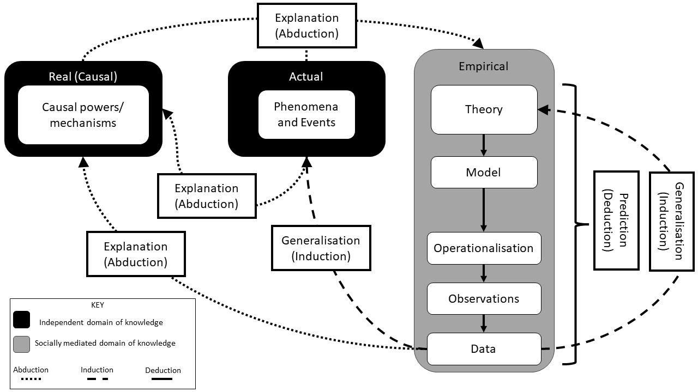{fig-alt="Taxonomy of descriptive research activities, reproduced from Gerring."}

**Figure 8.** A holistic framework for viewing scientific research and inference (adapted from Yucel [-@yucelScientistsOntologicalEpistemological2018])

Such holistic approaches to scientific inference are sometimes called *retroduction*, particularly by critical realists[^ch01-66]. Figure 8 though does not need to be viewed exclusively from a critical realist perspective, though it lends itself well to it. For example, the domain of the real where unobservable causal powers and mechanisms are posited as explanations might be of interest to the critical realist and the aim of their science; but for a positivist or constructivist this may be seen as off limits and inaccessible for their account of science or at most merely a pragmatically useful narrative. The real, and actual, realms are what are considered the dimensions of knowledge independent of the knowledge constructed about them. The empirical realm however is where the socially mediated dimension of knowledge sits, and the knowledge produced and objects within it are influenced by social and personal factors. An anti-realist may see only this part of the framework as being relevant to their science.

Figure 8 gives some insight into the complex and iterative construction of scientific theories[^ch01-67]. The empirical observations we make and data we produce can be used to abductively postulate underlying causal powers and mechanisms to explain them directly[^ch01-68]. We can too inductively infer from these data to make generalisations about phenomena and events, and then further abductively infer from these to causal explanations. These phenomena and events, and/or causal powers and mechanisms, then become the things to be explained by the theories we construct. Our theories entail certain models which we can operationalise in research to generate empirical hypotheses and go on to produce observations and data. If our theories are false, we can determine this deductively by testing whether their predictions bear out the expected data. If they do bear out, we may then wish to inductively infer that the theory probably is true, or at least has been corroborated, insofar as it is a description of the actual phenomena and events it explains.

::: book-box
**Exercise: Logic Evaluation in Scientific Claims**

Purpose:

The objective of this exercise is to enhance your understanding of logical structures in scientific claims by analysing a specific claim from a scientific article and determining whether it follows a deductive, inductive, or abductive reasoning pattern.

Instructions:

1.  Select a Scientific Article:

    a.  Choose a scientific article or research paper that contains a clear and specific claim. Ensure the article is relevant to your field of study and complexity appropriate for your current level of understanding. If it is too difficult, try to find a simpler paper and claim to evaluate first.

2.  Identify the Claim:

    a.  Read the selected article and identify a specific claim or hypothesis presented by the authors. The claim should be concise and clearly stated.

3.  Define Logical Structures:

    a.  Review the overviews of deductive, inductive, and abductive reasoning above.

        i.  Deductive Reasoning: Start with a general statement or premise and deduce specific conclusions.

        ii. Inductive Reasoning: Start with specific observations and infer general principles or conclusions.

        iii. Abductive Reasoning: Formulate the best explanation for observed phenomena based on available evidence.

4.  Analyse the Claim:

    a.  Analyse the selected claim and determine which logical structure it follows (deductive, inductive, or abductive).

    b.  Consider the language used, the evidence provided, and the overall structure of the argument in making your determination.

5.  Provide Evidence:

    a.  Provide specific examples or quotes from the article that support your analysis of the logical structure employed in the claim.

6.  Discuss and Share Findings:

    a.  Discussion your analyses and reasoning for classifying the claim into a specific logical structure with your peers.

    b.  Think critically and debate, especially if different students interpret the logic differently.

7.  Reflection:

    a.  Reflect on the importance of recognizing different logical structures in scientific claims. How does understanding the logic behind a claim contribute to your ability to critically evaluate scientific literature?
:::

## Research activities and methodologies {#ch01-research-activities-and-methodologies}

Up to this point we have introduced a range of foundational philosophical concepts in science, and why they are important for you as budding researchers. By now though you might be eager to understand what kinds of *research activities,* *methodologies,* and ultimately methods, actually make up the sport and exercise sciences, or indeed any science. Whilst specific methods will be detailed in the remaining chapters of this book, this section will introduce, admittedly very broadly speaking, three kinds of research activity along with the sorts of questions that engender them in addition to the broad methodologies that are used in the sciences when conducting research [@howellIntroductionPhilosophyMethodology2013]. These questions are the kinds which you might look to ask, and hopefully answer, as a scientist and the kinds of activities that you can engage in. The broad methodological strategies taken, including quantitative, qualitative, and mixed, I will in particular try to break down with respect to some of the simplistic dichotomies that are often presented to students and get you to instead consider the foundations covered up to this point in helping direct your chosen strategies.

### What kinds of research questions can you pose? {#ch01-what-kinds-of-research-questions-can-you-pose}

We can roughly categorise the kinds of questions that you might pose in scientific research as being questions regarding *description*, *prediction*, or *explanation* [@shmueliExplainPredict2010; @hofmanPredictionExplanationSocial2017; @hofmanIntegratingExplanationPrediction2021]*.* Broadly speaking, research can also fall into either the theoretical and/or applied/technological context i.e., 1) theory development, 2) theory appraisal, and 3) applied and technological[^ch01-69] research, following Paul Meehl's distinction [@harlowProblemEpistemologyNot1997]. The first two are inherently linked to one another as should be obvious from their names; we develop theories and appraise whether they are fit for purpose whatever our positionality entails that purpose to be. The latter, applied and technological research, may or may not be linked to the former two and in some cases, this may depend only on the intention of the researcher regarding how to use the results of such research[^ch01-70] and, as should be clear by now, their particular ontological commitments. As with most things though, there's not necessarily a neat scheme to classify any of these questions as either sitting within the theoretical or technological context; there can be overlap between them. But let's try to provide an overview to aid you in thinking about the kinds of questions you might pose during your research.

#### Description {#ch01-description}

One key activity that forms an essential part of science is *description* and this is the case irrespective of your particular ontological and epistemological commitments i.e., whether you wish to describe empirical experience or generalizable phenomena and events for their own sake or for later explanation*.* Sadly, in the current climate of research such exploratory work is often referred to with disdain as 'mere' description [@gerringMereDescription2012]^,^[^ch01-71]. And yet, myriad works that are explicitly descriptive, such as the observation and inference of phenomena, have garnered Nobel prizes [@bonettoLostIdeaPsychology2023]. Such research which deals with specific cases, or documents consistent empirical observations and infers phenomena, is crucial for the formation of concepts that form the building blocks of theory [@scheelWhyHypothesisTesters2021a]. Descriptive questions can also be posed in purely technological contexts such as asking whether a particular intervention is associated with a particular outcome (we might wish to say it *causes* the outcome dependent on our ontological commitment there, but we don't necessarily need to be able to *explain* how it does). Descriptive research is not limited to particular methods either and often combinations of textual, numerical, and visual documentation are used. Gerring [-@gerringMereDescription2012] explains that the kinds of activities that description involves aim at making an argument about the world which answers a *what* type of question (e.g., when, whom, out of what, in what manner etc.). They are about what is, or what was. He provides a useful taxonomy to aid in thinking about the kinds of descriptive research activities that one could go about engaging in (see figure 9).

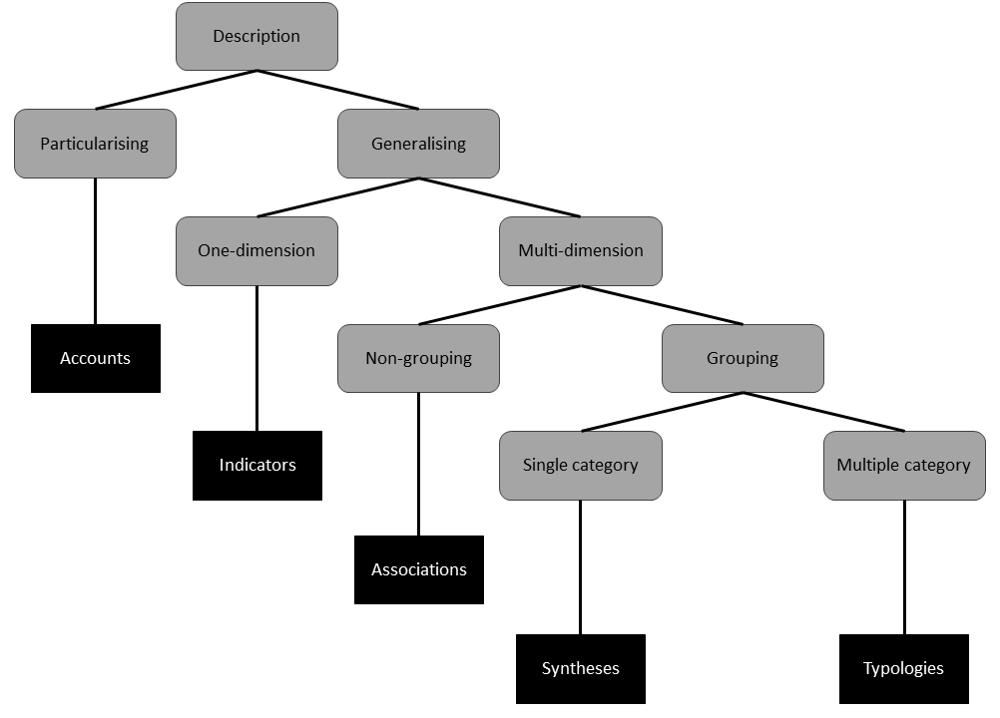

**Figure 9.** Taxonomy of descriptive research activities. Reproduced from Gerring [-@gerringMereDescription2012].

Descriptive research can pertain to the particulars of a specific case, or sample, and Gerring [-@gerringMereDescription2012] refers to these activities as being that of providing an *account* when the intention is not to generalise beyond the specifics of that case. In the sport and exercise sciences an example might be where elite athletes who are very specific cases are described (such as world record holders or champions [@jonesPhysiologyWorldRecord2006; @bellPhysiologicalProfileMultiple2017; @abeSkeletalMuscleMass2018]), and is common in the broad area of ethnographic research. Note, whilst explicitly particularizing descriptive research is not intended to draw generalising inferences, that does not mean that this kind of description itself is necessarily not inferential. Often the 'facts' about particular cases that are described are obscure and come from inference from a range of evidence sources or broader background knowledge (for example, think of the range of evidence typically used to infer the facts of a particular criminal case).

Other kinds of descriptive research activities are typically aimed at generalization in that they pertain explicitly to a class of *things* under study. This may or may not be inductively inferential depending on whether the description is made from a sample from the broader class of things under study which are intended to be described, or from the entire population. For example, the intention may be to describe elite athletes in a certain sport, however that is defined. The sport may be very popular (e.g., soccer) and thus have a large population that fall into that class, or it could be more niche (e.g., chess-boxing[^ch01-72]). In the former case it might be very unrealistic that you could access and describe every individual athlete in that class, but in the latter, it might be more reasonable given the size of the class is smaller. Generalisation is of course a matter of degree and the class to which you wish to generalise. It is not only applicable to the idea of taking samples of individual *persons* and inferring to the population from which they were drawn. For example, though a single performance by a single athlete can only be described in terms of what occurred on that particular occasion, examining multiple performances by the same athlete allows you to make generalisations about the performance of *that athlete.* The class of thing which you are describing in this case may only be the performance of a single athlete, but on examining more than a single event you may have the intention to generalise. It should also be noted that embracing the aim of generalized description does not mean you have to neglect description of the particulars of single cases. These are important points to realise particularly for those who work in applied scientific fields such as sport and exercise science and find themselves working with individuals.

Gerring [-@gerringMereDescription2012] carves up generalizing descriptive work then based on its dimensionality. Essentially how many features or characteristics are you observing and reporting on in describing the class of things you are interested in? Where you are only interested in describing single feature(s)[^ch01-73] the research is unidimensional and Gerring [-@gerringMereDescription2012] calls this activity identifying *indicators.* For example, research may describe the practices of coaches or athletes in a particular sport [@ebbenStrengthConditioningPractices2001; @ebbenStrengthConditioningPractices2005; @simenzStrengthConditioningPractices2005; @shawContemporaryTrainingPractices2022; @androulakis-korakakisMinimumEffectiveTraining2021]. This type of research goes hand in hand with the formation of concepts in that it is about *defining* and *labeling* the classes of things by specific and shared attributes such that they are differentiated from other classes of things, or to identify if they share similarities with already described classes of things. Where descriptive work explores multiple features, and has the aim of describing how they relate to one another, Gerring [-@gerringMereDescription2012] calls this research activity *associational.* Whilst such research is often imbued with causal interpretations [@haberCausalLanguageStrength2018; @haberCausalAssociationalLanguage2022], the description of empirically occurring patterns is important in and of itself and depending on your ontological position can either be left as purely descriptive, or possibly explanatory, depending on how you treat causes ontologically and the methods used to identify the associations.

Where descriptive research takes various features across dimensions and attempts to group them into a higher-level category, this can be said to be either a *synthesis* or *typology* again dependent on the number of the higher-level categories produced. One contentious example of synthesis is the determination of what diverse features cohere such that we might classify an athlete as being 'elite'[@mckayDefiningTrainingPerformance2022; @swannDefiningEliteAthletes2015]. In a sense this is a means of defining a higher-level concept and determining the necessary and sufficient features for it. Where the aim is to define multiple categories, and often hierarchically, the result is a typology or taxonomy[^ch01-74]. Examples of typologies or taxonomies come with calls for them in sport generally (i.e., to classify the more than 3000 estimated distinct categories of sport [@andersonWhoseSportIt2021]), or for example in trying to classify the distinct varieties of exercise referral schemes that are being delivered [@hansonModifiedDelphiStudy2020]. These are often developed as part of community discussions using approaches such as the Delphi method. At this level such description can aid in determining the possible boundaries and states that a system might have.

#### Prediction and explanation {#ch01-prediction-and-explanation}

In his classic text *Theory Building*[^ch01-75], Robert Dubin [-@dubinTheoryBuilding1978] highlights that the focus of a scientific theory is upon outcomes and interactions, both of which serve to achieve broader goals of prediction and understanding[^ch01-76]. By 'prediction' he means that, by the theory, we can foresee certain outcomes such as 1) forecast the value of one or more of the specific units that make up the system described by the theory, and/or 2) we can anticipate the wider condition or state of the system as a whole. In this sense, prediction goes one step farther than description by using the described system to make deductions about what we should observe if said description were sound. By 'understanding' he means that, by the theory, we understand or can explain how two or more of the units in the system described by the theory interact with one another, how they are related and through what mechanism(s). Note, referring back to Meehl's technological and theoretical contexts, questions of prediction can also sit somewhat atheoretically within the technological context where we may ask questions such as whether a particular test predicts a particular outcome, or whether we can predict a particular outcome because of exposure to a particular intervention.

Ideally, strong theories are able to give us both predictive power and deep understanding. But not all theories offer this. Here are two contrasting examples. Despite knowing now that Newtonian physical theory does not offer the deep understanding we thought it did, having been superseded by modern theories in physics, it still offers incredible predictive power at least over a specific range of phenomena and events. Opposite of this might be the theory of evolution by natural selection developed conjointly by Charles Darwin and Alfred Russel Wallace which offers deep understanding and explanatory power, yet little predictive power (or at least not that which we are able to easily test). Lin [-@linScientificValueExplanation2023] provides these and other examples (see figure 10a), and also makes the case that, though there is a tendency for scientists to favour explanatory power over predictive accuracy, good scientific theory should endeavour to achieve both goals (figure 10b).

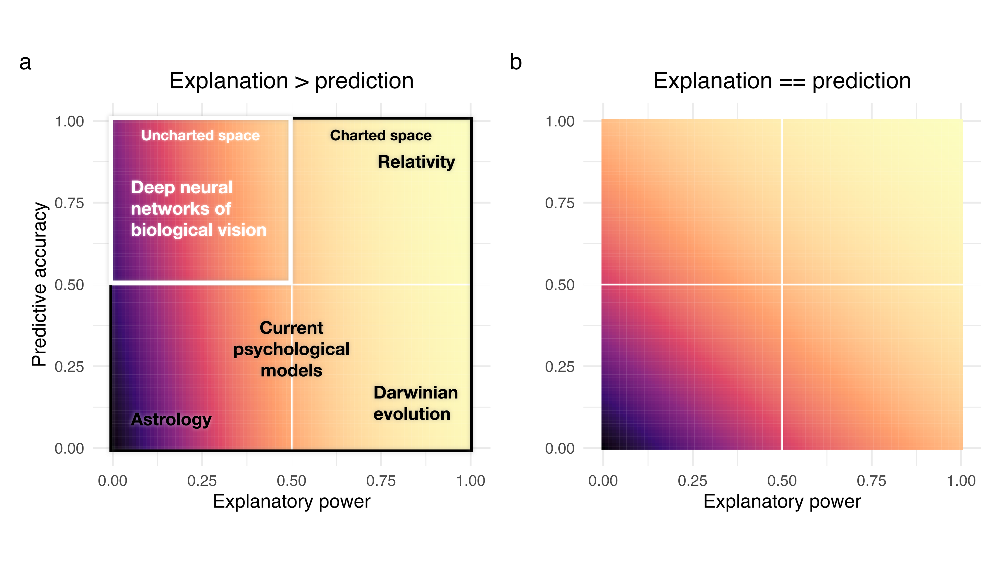

**Figure 10.** Scientific value of theories with different degrees of two qualities: explanatory power and predictive accuracy. (a) Typical valuing of explanation over prediction, such that theories with greater explanatory power are preferred. (b) Alternative value function that values both qualities equally. Hotter colours denote greater scientific value, whereas cooler colours denote less scientific value. From Lin [-@linScientificValueExplanation2023], reproduced under CC-BY-4.0 International Licence.

As noted, Dubin [-@dubinTheoryBuilding1978] presented a widely used method for accomplishing his books namesake; theory building. He emphasized the theory-research cycle as consisting of eight stages, half of which pertain to the research activities involved in *theory development* (and which he considered to fall under the auspices of *descriptive research* with respect to the use of empirical observations in the development of theory), and half of which pertain to the research operations aimed at *theory testing* or *appraisal.* Figure 11 shows these eight stages. These methods have been summarised by numerous other authors [@fryCongruenceContingencyTheory1987; @holtonGeneralResearchProcess2007; @lynhamQuantitativeResearchTheory2002; @scheelWhyHypothesisTesters2021a] but Box 2 provides a brief overview.

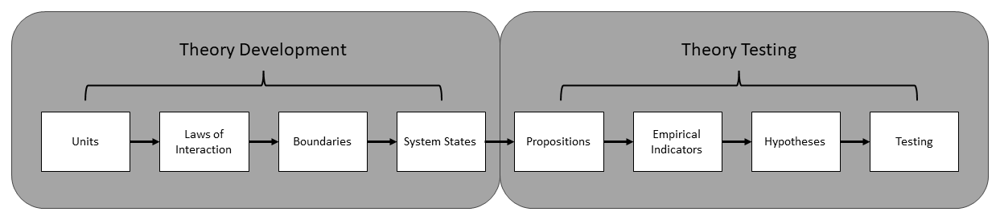

**Figure 11.** The eight stages of theory-research in Dubin's [@dubinTheoryBuilding1978] Theory Building methodology.

::: book-box
**Box 2.** An overview of the eight stages of Dubin's Theory Building methodology

[Units]{.underline}

Dubin used the term units to denote the 'things' that go into our theory. The objects of inquiry. The things that science deals with. Of course, what exactly these things are and where they reside are dependent upon your ontology[^ch01-77], hence why it is important to think about this a priori. Although the more neutral term 'unit' is preferred by Dubin, in essence he means *concepts*[^ch01-78]. Thus, the stage of determining the units that will become the building blocks of theory is one of conceptualization.

[Laws of interaction]{.underline}

By 'laws of interaction' Dubin refers to the links between the units used to build our theory. How they are related to one another. Without these links between them, lists, even hierarchies, of units amount to only taxonomic models[^ch01-79].

[Boundaries]{.underline}

For a theory to represent some empirical system, some part of the world that we are interested in understanding and predicting, it must have specified boundary conditions corresponding to that empirical system[^ch01-80]. It must have constraints. That is, it must have *boundedness*. The limiting values of units that are possible in the theory must be known logically[^ch01-81]. We must be able to answer questions such as *who, where, and when*[^ch01-82] the theory is postulated to be applicable [@busseBoundaryConditionsWhat2017]. This is important as it makes clear and explicit the limited portions of the world for which the theory is postulated to hold; the part we cast our net[^ch01-83] over. It specifies *the possibilities* that the theory entails.

[System states]{.underline}

A system state is a condition of the system described by the theory in which the units involved represent a particular condition of the system as a whole[^ch01-84]^.^ A system *state* is a condition in which all the units take on characteristic values that persist through some period of time, regardless of how long that period lasts. All the units in a system in a particular state are said to be determinant, meaning that they are observable and distinctive for that particular state. It is worth noting initially that not all theories specify states for the system they describe. It is entirely possible to develop theories of systems in which states are overlooked or those which in essence have only one state and so therefore the notion of state can be properly ignored.

[Propositions]{.underline}

The propositions of a theory are essentially a kind of truth statement, and follow the propositional logical deductive forms introduced earlier. As such, the truth of them pertains only in so far as they are *valid* with reference to the proposed theoretical model as the premise. At this stage we are only concerned about whether we have validly deduced them from the theory. We do not need yet to worry about their *soundness* i.e., whether they hold some truth value in the empirical domain they represent.

[Empirical indicators]{.underline}

This is the first time the theory begins to touch reality, whatever it is that we consider that ontologically to be. Propositions are about the values that units in the theory take on. Thus, we must have some means of identifying whether units indeed take on those values deductively entailed by the theory. This is what Dubin refers to as *empirical indicators*. In essence these are the methods or operations by which we make observations of the units our theory refers to.

[Hypotheses]{.underline}

Dubin offers a quite simple definition of a hypothesis in so far as it pertains to a theory. We have already noted that a theory entails certain propositions, but that these are merely deductively inferred truth statements about the theory. A hypothesis instead is that part of the theory that has been merged with the empirical indicators identified for its units. It is defined as the predictions the theory makes about values of its units when those empirical indicators are used as operations for observing those units[^ch01-85].

[Testing]{.underline}

A major, though not the only, function of empirical research and observation is to test the propositions and operationally defined hypotheses implied by a given theory. Empirical research can be intended to act as a test of whether or not the observable conditions in the world correspond with, or differ from, those predicted by the theory.
:::

#### Different uses of statistics and different questions posed about the same model {#ch01-different-uses-of-statistics-and-different-questions-posed-about-the-same-model}

Meehl [-@meehlAppraisingAmendingTheories1990] offered several useful distinctions to help us differentiate our scientific from our statistical thinking wherein the latter is often one of many possible tools to aid us in the former. For example, the distinction between a theoretical hypothesis and the statistical hypothesis which we use as an operationalisation in order to test a theory. Meehl [-@meehlCliometricMetatheoryActuarial1992; -@meehlClinicalStatisticalPrediction1954] also distinguished between different conceptualisations of statistics which link back to the presentation of descriptive research compared with explanatory research, and that predictive research can straddle both. The *discriminative-validating* use of statistics limits itself to inference with minimal theoretical conceptualisation such as to relationship between two empirical operations that are taken no deeper than a first level of abstraction e.g., that a previous injury defined in a particular manner which is reliably determined by some set of operational criteria is highly predictive of the occurrence of that same defined injury at a later point in time. This he contrasts with the *causal-theoretical* use of statistics wherein the statistical summaries that are computed with respect to our data are taken to be indicative of some underlying theoretical for which we wish to make inferences.

Another way of thinking about the distinction, and also the possible overlap, between these questions is to consider a typical statistical model, such as a regression model, as they are often employed in empirical research to try to *map onto* the underlying theoretical model that we are interested in i.e., to represent the 'true' or proposed processes that led to the generation of the data observed. You will be introduced more thoroughly to the idea of using such models and how they can be used for different goals in [chapter 5](05-quantitative-analysis.qmd). For now, let us consider a very simple theory that merely says some variable $y$ is 'caused'[^ch01-86] by some variable $x$ among other things*.* We can describe this theoretical system with a simple linear regression model applied to some data we collect on the two variables $x$ and $y$ in the form $\widehat{y} = \widehat{a} + \ \widehat{\beta}x$, where $\widehat{y}$ is our predicted value of $y$, $\widehat{\beta}$ is our estimate of the effect of $x$ (or its relationship to $y$), and $\widehat{a}$ is our estimated constant where $x = 0$ (i.e., the value we expect $y$ to take when the value of $x$ is zero). Hoffman and colleagues [@hofmanIntegratingExplanationPrediction2021; @hofmanPredictionExplanationSocial2017] consider the prediction-explanation distinction in addition to description and suggest that a statistical model, such as our regression model, could fit into either of four categories depending on the goals of the researcher:

1.  A researcher interested in only description can simply report the association between $x$ and $y$ without any recourse to theoretical statements of causes or laws or claims to predictive accuracy regarding the population the sample of data was drawn from.

2.  A researcher interested in primarily explanation might be interested more in the coefficient $\widehat{\beta}$ and using the data collected and the statistical models estimate of this testing whether a particular effect entailed in an explanatory theory is rejected or corroborated.

3.  A researcher interested in primarily prediction instead might be more interested in the prediction $\widehat{y}$, and its accuracy in new data, when the prediction is made from the data collected and the statistical model employed.

4.  And finally, a researcher interested in both explanation and prediction might be interested in both whether their estimate of $\widehat{\beta}$ rejected or corroborated the effect that their theory entailed, and whether the a priori predictions of $y$ given by their theory reject or corroborate it in the data sampled.

But, ultimately all these goals, description that leads to theories providing explanation and prediction, can be considered of importance depending on your positionality.

### Research Methodologies {#ch01-research-methodologies}

What then are the broad strategies of methods in which you can go about performing research to answer the questions that you pose? Methodologies are often classified under two key categories: quantitative and qualitative. There is also the approach of so called "mixed" methodologies which courts both quantitative and qualitative and will be touched on at the end of this section. In later chapters you will be introduced more thoroughly to both quantitative and qualitative methods such as data collection and analyses in research, as well as having some of the philosophical topics introduced in this chapter reiterated and expanded upon in their own way by the other contributors to this book. Here though, in the spirit of the generally non-prescriptive approach I have taken regarding philosophy, I will introduce these methodologies and attempt to do so in a way that doesn't foster the overly simplistic dichotomies between them that students are usually presented with. As you will find, most of these are fallacious and more to do with differences in the typical ontological and epistemological assumptions that researchers who gravitate towards these methodologies hold. As such, debate regarding methodologies often results from the incommensurability of the philosophical positions held by researchers in the social sciences [@murphyQualitativeResearchMethods1998; @sechrestQuantitativeQualitativeMethods1995] as opposed to any inherent incommensurability between methods. Indeed it has been argued that this may come largely from the conflation of "paradigm" and "method" where the former has been used to refer to philosophical positionality and the latter to the specific operations performed in undertaking research [@syedMixedMethodsResearchPsychology2025; @symondsDeathMixedMethods2010]. In fields where the philosophical positions of communities of researchers are perhaps more homogenous [@yucelScientistsOntologicalEpistemological2018], pluralism in methodological approaches is far less fraught with debate and an instrumental view of which to use and when is typically more accepted [@murphyQualitativeResearchMethods1998]. For example, Sechrest and Sidani [-@sechrestQuantitativeQualitativeMethods1995] note that fields such as evolutionary biology and astronomy have, throughout their history, employed diverse methods ranging from precise quantitative observations and estimations of phenomena through to naturalistic and nonquantitative observation. Hopefully I will be able to stress that, whilst you may find your particular choice of ontological and epistemological (or even axiological) assumptions lead you to find the two methodologies of quantitative and qualitative incommensurable (i.e., inherently different and incomparable) with one another for the investigation of a particular topic, the choice of methodology is largely determined by your philosophical positions *and* the nature of the research question you are seeking to answer. As Sechrest and Sidani state:

> *"Many of the problems that are perceived to exist between proponents of quantitative and qualitative research appear to us to stem from misunderstandings and misstatements of the positions involved\... The differences, in our view, have to do with the details, with exactly what is observed by whom"*.
>
> ::: {.quote-attribution}
> [@sechrestQuantitativeQualitativeMethods1995]
> :::

I won't cover arguments regarding the fundamental ontological and epistemological positions that influence the approaches one takes to methodology, and particularly the debates between them framed largely in a comparative manner of quantitative *versus* qualitative research[^ch01-87]. Indeed, this has mostly been covered implicitly in the relevant sections above. Instead, I will first highlight the nature of the objects of inquiry, types of data, and the relationship to approaches to analysing data that these two methodologies typically involve before then focusing on three simple dichotomies with the aim of breaking them down to show what the key differences are, and are not, between quantitative and qualitative methodologies: inductive versus deductive; particularizing versus generalizable; and subjective versus objective. These are not an exhaustive list of the dichotomies often presented in debates about the two methodological paradigms and others have been discussed elsewhere such as by Reichardt and Cook [@zotero-item-20381], and which have been more implicitly touched upon throughout this chapter already. Hopefully, this will help you avoid the inane methodological debates and turf wars that plague research methodologies[^ch01-88].

#### Methodologies, objects of inquiry, and types of data {#ch01-methodologies-objects-of-inquiry-and-types-of-data}

To begin with, qualitative and quantitative methodologies are typically contrasted by the objects of inquiry, types of data produced as a result of our observations, as well as the manner in which that data is analysed [@syedMixedMethodsResearchPsychology2025]. For example, qualitative research is often characterized by a focus on participants experiences and meanings and typified by its data consisting of words which are then interpreted with respect to the qualities that are thought to be represented by the data. This may be something like the transcribed verbal utterances of someone who has been interviewed, or from a focus group involving conversation between people, it may be the content of a corpus of text, or perhaps the verbal or written description of the observed behaviour of something such as an athlete or coach[^ch01-89]. Contrastingly, quantitative research is often characterized by a focus on things which can be measured and represented in numeric form and often, at least in modern science, analysed such that inferences about these quantities can be drawn from it using statistical methods. This could be the number of times a particular event occurs, it might be the value obtained on a measurement tool, or it might be the self-reported experience of an individual on some scale. We could broaden this characterization of the two methodologies to their namesakes by stating that qualitative research is interested in qualities, and quantitative research is interested in quantities[^ch01-90]. However, dichotomizing qualitative and quantitative research based simply on the types of objects of inquiry it approaches, i.e., the concepts and constructs, the resultant type of data produced, and the manner in which it is analysed, is also not quite that simple and easily shown to be mistaken with an example.

A researcher conducting an interview with an athlete may be interested in identifying the discrete themes or topics that arise as meaningful, and that are different from one another in quality, through that particular method of observation. But they may also wish to consider questions about the quantity of these themes; how often are they mentioned, or to what degree are they emphasized as meaningful? Whilst the methodology of choice and methods employed might influence the data type produced, it is not necessarily the case that the topic or objects of inquiry are inherently qualitative or quantitative unless it literally is the case that only qualities or only quantities are of interest. Further, it is not necessarily the case that merely because either qualitative or quantitative data are captured that analysis has to be limited to drawing inferences regarding qualities or quantities respectively. Syed and Westberg [-@syedMixedMethodsResearchPsychology2025] nicely highlight that the nature of the data produced and nature of the analysis performed can be independent of one another leading to four broad quadrants of combinations of data and analysis (see figure 12). Whilst the colloquial (at least within the language used by the community of scientists) reference to research involving both quantitative data and quantitative analysis as being "quantitative research" and vice versa that involving qualitative data and qualitative analysis as being \"qualitative research" is convenient and appropriate, it's of course possible to have mixing of the two dimensions. We can take data of a quantitative nature and apply methods that are used to infer the existence of particular qualities such as the statistical methods of factor analysis (particularly exploratory [@haigExploratoryFactorAnalysis2005]) and other taxometric methods to distinguish categorical (discrete taxa) from dimensional (continuous) things [@zotero-item-20408]. Conversely, particularly when dealing with large bodies of qualitative data it is not uncommon at all to codify and represent that data in some quantitative sense for use in statistical modelling as is often performed with textual analysis exploring not only mere frequencies of term use but their semantics and topics [@silgeWelcomeTextMining2017].

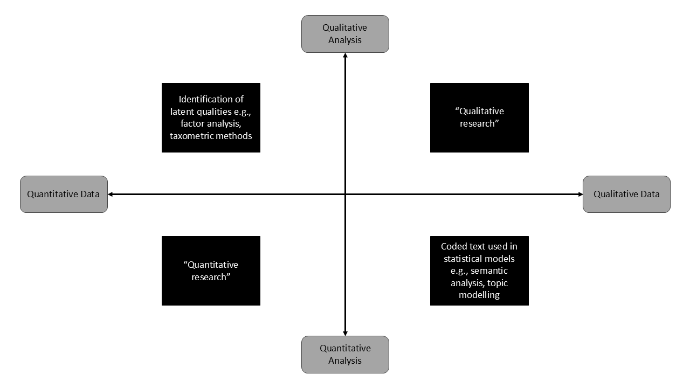

**Figure 12.** A schematic showing data and analysis as independent dimensions, each varying in its quantitative and qualitative properties and creating four quadrants of combinations of types of data with types of analysis. From Syed and Westberg [@syedMixedMethodsResearchPsychology2025], reproduced under CC-BY-NC-4.0 International Licence.

It is ultimately the case that the manner in which the concepts are defined, and the nature of the research question asked about them, influences the methodological approach (or more specifically the methods) you take; are you interested in differences in kind, or differences in the degree, or both, of these different kinds of things? These things you are interested in, the objects of your inquiry, could be discrete entities or they could be different attributes, capacities, characteristics of the entities that you are interested in. You could be interested in the degree or number of these discrete entities, or the magnitude of these attributes or capacities. Ultimately, unless there are fundamental philosophical positions that lead to a particular methodology, the choice of methodology then is one of the nature of the question being asked and the objects of inquiry as they are defined conceptually.

#### Inductive versus deductive {#ch01-inductive-versus-deductive}

It is not uncommon to find that qualitative methodologies are presented as inherently inductive, whilst quantitative methodologies are presented as inherently deductive in nature. We have already covered logic in science above in [the discussion of logic and inference](#ch01-logic-reasoning-and-inference-as-a-key-part-of-science) in some detail. But as a brief reminder, inductive logic begins with specific observations before proceeding to infer generalisations from these whereas deductive logic begins with general premises and then proceeds to infer the implications of these. Hopefully it is clear from figure 8 in that section too that neither methodology is *necessarily* inductive or deductive in nature. Whilst it *may* be the case that descriptively speaking most qualitative research is inductive in nature and most quantitative is deductive, Murphy and colleagues [@murphyQualitativeResearchMethods1998] provide several examples from health research in their review of qualitative and quantitative methods that highlight that neither logic is the sole domain of either methodology. As an example from sport and exercise, Budzynski-Seymour and colleagues across a programme of research [@budzynski-seymourInfluencePublicHealth2021; @budzynski-seymourCanEarthsMightiest2021; @budzynski-seymourPhysicallyActiveExperience2022; @budzynski-seymourFeltWasActually2023; @YouveGotFriend] examined the factors influencing children's engagement with physical activity and the role of entertainment experiences. These studies involved both exploratory descriptive and hypothesis testing focused quantitative work, in addition to exploratory qualitative work where key themes were initially developed and then formalized into a proposed theoretical framework which was subsequently tested deductively in further qualitative work. Neither qualitative nor quantitative research has a monopoly on the kinds of logic of inference which can be employed. It is perfectly possible to engage in broad exploratory and descriptive quantitative or qualitative work, draw inductive inferences about generalizable phenomena from this, (abductively) go on to develop formalized theories that yield deductive propositions whether about the qualities and/or quantities of interest, and then go on to test these in further empirical work.

#### Particularising versus generalisable {#ch01-particularising-versus-generalisable}

Another common dichotomy encountered in the contrasting of qualitative and quantitative methods is that the former is fundamentally aimed at the generation of knowledge regarding particulars of events, individuals, contexts, and their interactions, whereas the latter is aimed at generating knowledge that is generalisable. Now, we have already discussed this in the context of descriptive research in [the discussion of descriptive research](#ch01-description) where you will note that it was not at any point claimed that one or the other methodological approach was necessarily particularising or generalisable; but this does not just apply to descriptive work and can apply more broadly to work aimed at prediction and explanation too. Typically, when we talk about generalisability, we are referring to what can be termed *statistical-probabilistic generalisability* and indeed this is essentially what was discussed in the section on descriptive research with regards to drawing inferences about the broader class of things from which you have sampled observations. Considering this kind of generalisability[^ch01-91] though we are not in principle limited to the application of quantitative methods and data. Whilst we often have to limit our observations to a sample from the population or class of things we are interested in, and often in qualitative research we find that samples are smaller (both in terms of numbers of individual observations and contexts/conditions in which we make them) than what might be possible to achieve in most quantitative research which can impact our ability to generalise, this is more a consequence of the logistic difficulties with collecting different types of data. The collection and analysis of many kinds of qualitative data through methods such as interviews for example is typically more laborious than for many kinds of quantitative data. But this is not always the case. Some kinds of qualitative data can be easier to collect and use such as corpi of existing documents, whilst some kinds of quantitative data can be difficult to collect such as invasive physiological measurements. However, whilst resource constraints always impose some barrier to what we can achieve irrespective of the methods used when it comes to sampling empirical observations, there is nothing in principle to stop us from applying either qualitative or quantitative methods at either small or large scale. Although uncommon in sport and exercise research, large scale interview studies aimed at generalisation of findings have been conducted across varied fields with different benefits and challenges [@mcalearneyEmbeddingBigQual2023; @huntEmbarkingLargescaleQualitative2011; @pittsBenefitsChallengesLargescale2022]. Also, within sport it is quite common to find quantitative case-study research aimed at the particulars of individuals or events; for example, analysis of world record events such as Usain Bolt's 100m record [@eriksenHowFastCould2009][^ch01-92]. Again, whether your research is aimed at particularisation or generalisation is a consequence of nature of the question being asked and the objects of inquiry.

#### Subjective versus objective {#ch01-subjective-versus-objective}

A final dichotomy we'll consider is the oversimplified contrasting of qualitative and quantitative research in terms of the former being subjective and the latter objective. To start, it is often not clear whether it is the case that what is being referred to as either subjective or objective is the phenomena of interest or the methods used to investigate it. For the latter we can hopefully quickly dismiss of this given you have already read above the sections on epistemology and that it is indeed an epistemological question as to whether knowledge is objective or subjective and as such whether the methods by which we go about producing it are also objective or subjective. Considering the former, let's take as an example that we are interested in some aspect of the phenomenology of someone i.e., their subjective, conscious, lived experience[^ch01-93]. Now, this is an inherently subjective and difficult object of inquiry to grapple with and much has been written about this; for example, Thomas Nagel's famous essay [@nagelWhatItBe1974] *"What is it like to be a bat?"* is a classic which highlights these difficulties. We can observe behaviours including the communicatory behaviour of individuals who may tell us about their experience, but at some fundamental level we can never access *what it is like to be them*[^ch01-94]*.* Philosophers such as Daniel Dennet [@dennettWhosFirstHeterophenomenology2003] however argue that this doesn't mean we cannot produce knowledge of their experiences and his approach of heterophenomenology, or the *"...phenomenology of another, not oneself"*, views the individual themselves as essentially the observation device we use to learn about their subjective experiences. And, just like any other tool for observation, there can be error involved: they may lie, they may be inaccurate in their description or unable to communicate it, they may be unable to attend to the element of their phenomenology in which you are interested. But you must take their self-reports and interpret them much like any other kind of observations, and those self-reports do not necessarily have to be communicated in any specific language; they can be words, numbers, imitation of some behaviour, interpretive dance etc. Returning to our example, let's say that we are interested the experience of something like *effort*[^ch01-95]. Now, this is an inherently subjective phenomenon, but we could go about utilising either qualitative or quantitative methods of investigation. We could ask people about their experiences; we could ask them if they are, or are not, experiencing effort, or to describe in words what it is like to experience the effort that they have, or we could provide them with a scale and ask them to either verbally report or physically point to the number they feel best reflects their experience. We could do all of this. For example, Okhamafe and colleagues [@okhamafeMeaningTenUpper2025] recently investigated experimentally the effect that different types of referential anchor participants were asked to use had upon participants perception of effort during physical tasks. They both asked participants to rate their perception of effort using a scale but also asked the participants about their experience in so far as the particular referential anchors they chose when given freedom to do so and how that affected their experienced effort. Whilst the object of inquiry can be subjective or objective, we are again not always limited to having to adopt a particular paradigmatic methodological approach to investigating it.

#### The pragmatism of a mixed methodology {#ch01-the-pragmatism-of-a-mixed-methodology}

Although not an exhaustive examination of the various debates regarding qualitative and quantitative methodologies, hopefully at this stage you will have begun to think about whether or not your particular philosophical position takes you more towards one than the other, or if you find that your positionality can accommodate both you may find yourself wanting to take a more pragmatic approach to your research. As mentioned, this latter perspective is often referred to as *mixed methods* research[^ch01-96], wherein neither qualitative nor quantitative methods are given prominence, but both are considered as tools in the toolbox for a researcher to use where they are most appropriate. The adoption of such a methodological approach has been advocated for within the sport and exercise sciences before [@haggerNeverTwainShall2011].

The "mixing" of methods[^ch01-97] in research design can occur in various places [@syedMixedMethodsResearchPsychology2025]: the sampling (e.g., quantitative and qualitative data are collected from the same participants), the analysis (e.g., directly connecting the quantitative and qualitative data or analyzing the same data source both quantitatively and qualitatively), and/or the interpretation (e.g., the meaning of the results relies on the integration of the quantitative and qualitative analyses). Syed and Westberg [@syedMixedMethodsResearchPsychology2025], though aimed at psychological researchers, provide a useful introduction to different research designs for combining quantitative and qualitative approaches, including triangulation, embedded, explanatory, and exploratory. I would recommend the reader refer to Syed and Westberg's paper in addition to the various resources they (and I) have cited here for further detail. But figure 13 provides a graphical depiction of these methods and what follows are some brief descriptions of them.

For both triangulation and embedding designs typically the general principle followed is the examination of whether different sources of data and analysis, both in type and in terms of the methods used to capture the data, converge upon the same or similar interpretations regarding the substantive objects of inquiry. Quantitative and qualitative methods can be actively employed for this purpose prospectively in the design of research or can be used retrospectively or opportunistically in terms of their integration and interpretation. For example, it is not uncommon for a researcher to conduct a study using exclusively quantitative or qualitative methods but to then go on and interpret their results considering results produced through research using the other methods (perhaps even by other researchers) and include this in their discussion and interpretation. The key difference between the triangulation and embedded designs is primarily to do with the relative weighting given over to either the quantitative or qualitative components in the following interpretation of findings. In triangulation both methods are weighted relatively equally whereas in embedded research typically one is added to "augment" the other so to speak though playing a less weighty role in the interpretive work.

In contrast to the focus of the triangulation and embedded designs being the convergence of interpretation between methods, primarily differing in their weighting of the methods, explanatory and exploratory are typically primarily quantitative or qualitative focused respectively where this component precedes the application of the other method for a particular purpose. For the explanatory design the quantitative component is completed first and then the results of this inform the design and conduct of a later qualitative component whose purpose is to attempt to offer some explanation for the quantitative findings[^ch01-98]; to help answer, or offer possible hypotheses for, the various *why* questions that might arise from the quantitative findings and which could be explored further. The exploratory design is essentially the reverse of this where the aim is to first explore the construct or phenomenon of interest such that subsequent quantitative research can be informed and designed appropriately given its nature.

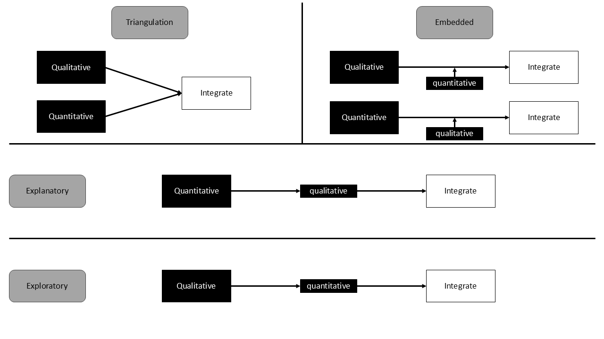

**Figure 13.** Graphical descriptions of the four major mixed-methods designs, indicating the sequencing and weighting of the quantitative and qualitative components relative to one another. Adapted from Creswell and Plano Clark [@creswellDesigningConductingMixed2007] by, and taken from, Syed and Westberg [@syedMixedMethodsResearchPsychology2025], reproduced under CC-BY-NC-4.0 International Licence.

## So, what is "scientific research"? {#ch01-so-what-is-scientific-research}

This is as far as we go for the foundational ideas that are important for understanding and engaging in scientific research in the field. I reiterate my apologies for how philosophical (and long) things got, but that's par for the course as they say. You can avoid it if you want, but I think you'll be impoverished in your science if you do.

Speaking of science... after all that, what is this game we call science? The so called "demarcation problem", how to distinguish scientific work from pseudo-, non-, or un-scientific work, has troubled philosophers as far back as Aristotle [@hanssonSciencePseudoScience2021]. There are both descriptive (what *is* the thing that everyone seems to call "science"), and normative (what *ought* we call "science") elements to the debates on the topic. Various philosophers have offered ideas on how to distinguish science from other activities, some of which we have touched on implicitly in this chapter. For example, the logical positivists verification principle[^ch01-99], the falsification principle of Popper, or the epistemic norms of Merton. As you can probably tell by now, there's hardly a single way to go about playing the scientific game and Laudan has commented on the fact that debates regarding the "demarcation problem" have perhaps rightly fallen into demise [@laudanDemiseDemarcationProblem1983]. Some such as Feyerabend go so far as saying science is inherently anarchistic in its methods and anything goes [@feyerabendMethodOutlineAnarchistic2020]. Lastly, the notion of "family resemblances" introduced by the philosopher Ludwig Wittgenstein has been explored to understand the number of categories of activity we call "science" which exhibit strong similarities and overlaps among the diverse scientific disciplines [@irzikNewDirectionsNature2014].

At least at this stage in history, there is no one Scientific Method™ to rule them all[^ch01-100]. You were indeed forewarned of this in the introduction. There is no clear prescriptive answer here for you, only the imperative to think carefully about the various topic presented and how you might seek to apply them to your research efforts. Think about your ontological and epistemological positions. Think about the values you hold and how they influence your research. Carefully apply appropriate logic to the arguments you make, and in interpreting the arguments of others. And remember not to get stuck in dogmatic ways of thinking. There is value to be found in holism and considering the various approaches to knowing that have been discussed.

The rest of this book will also encourage you to do the same. As you read each chapter which will cover a range of specific methods in greater detail, you should think carefully, critically, and continually reflect on the foundational assumptions that you bring to the table whilst you attempt to play this fascinating game, we call science.

## Acknowledgements {#ch01-acknowledgements}

I would like to thank my co-editor Eimear Dolan, and Jennifer Murphy for their feedback on the first version of this chapter.

[^ch01-1]: Whilst there are of course other kinds of research, for example historical research, that could be conducted in sport and exercise, and indeed have been [see @massengaleHistoryExerciseSport1997], we focus on what is broadly considered, and referred to as, "scientific" research here (though notably you will find that is not so clearly defined as you might expect).

[^ch01-2]: Or, more likely nowadays, searching the internet and scrolling through page after page of content from digital archives (or more likely by the time this goes to press it will be prompting large language model to do this and summarise it for you... hopefully this chapter will to some extent inoculate you from the possible downsides of contracting out such activities to these tools).

[^ch01-3]: Indeed, to a large extent the so called "demarcation" problem (what is, and is not, science) has fallen into demise within the philosophy of science [see @laudanDemiseDemarcationProblem1983]

[^ch01-4]: For example, well known scientists such as Neil deGrasse Tyson and Richard Dawkins have been outspoken critics of the value of philosophy.

[^ch01-5]: Isaac Newton\'s book *Philosophiæ Naturalis Principia Mathematica* [-@newtonPhilosophiaeNaturalisPrincipia1687] (English: *Mathematical Principles of Natural Philosophy*) reflects the use of the term *natural philosophy* in the 17th century

[^ch01-6]: Actually, his arguments regard what a philosopher might have to offer in the sport and exercise sciences. But philosophers, like other methodologically inclined experts including statisticians, that take a substantive interest in these fields are few and far between unfortunately. So, I co-opt the arguments here to instead say why *you* should take an interest in philosophy and apply it to your work (though if you can work directly with philosophers then you certainly should).

[^ch01-7]: To adapt Socrates famous dictum *"The unexamined life is not worth living"*, it could be said that the unexamined science is not worth doing... though, that's of course the perspective of an author (namely, me) trying to convince you of the importance of philosophical introspection and critical thinking so you might take that with a pinch of salt.

[^ch01-8]: A presupposition of an argument pertains to an element of a proposition (either the premise or conclusion) and is a necessary condition for the truth of the argument or for some component of it to have a referent. A assumption on the other hand pertains to the whole argument and is integral to the inferential structure of the argument [see @plumerPresumptionsAssumptionsPresuppositions2017].

[^ch01-9]: Although some work does suggest it might at least make people better thinkers [@prinzingStudyingPhilosophyDoes2025]

[^ch01-10]: Although Fryer [-@fryerShortGuideOntology2020], in his book, *A short guide to ontology and epistemology*, notes once seeing a tweet along the lines of *"if you know what ontology and epistemology are without googling, then there's a 100% chance you're a douche"*. So maybe don't laud your newfound understanding of them as a result of the next section too readily over your peers.

[^ch01-11]: I should note that there is nothing inherently bad about being a 'just' a technician... in fact in today's fact paced modern world there are actually calls for a greater delineation of expertise and roles within big team science. The European Organization for Nuclear Research (CERN) is a great example of this, and other fields such as psychology have called for a move towards this [@forscherBenefitsBarriersRisks2023]. In the meantime, and even for those whose aspirations lie more along the technical pathway, I do believe that at least some training in philosophy can be beneficial to enhance awareness of the larger scientific enterprise that we are engaged in.

[^ch01-12]: See a more comprehensive explanation of this as well as other philosophical traditions such as constructivism in the sections below.

[^ch01-13]: Yucel [-@yucelScientistsOntologicalEpistemological2018] presents an interesting piece of research exploring scientists ontological and epistemological views elicited through semi-structured interviews.

[^ch01-14]: And often, at least in PhD viva examinations, you are explicitly asked this question and that of your epistemological commitments. Below I argue that you should think about using explicit positionality statements regarding these commitments for transparency.

[^ch01-15]: More on him and his ontological and epistemological positions below.

[^ch01-16]: Bhaskar [-@bhaskarRealistTheoryScience2020] however offered what he called the 'transcendental argument' for a realist ontology which held the logical form known as 'Affirming the Consequent'. Essentially: If the world has certain XYZ ontological properties then scientific experimentation is possible; scientific experiment is possible; therefore, the world has XYZ ontological properties. Later we will touch on valid and invalid forms of logical argument. Traditionally, transcendental arguments take the form of "modus ponens" or "modus tollens" which are valid in structure. Come back to this footnote afterwards and see if you can spot the flaw in Bhaskar's argument.

[^ch01-17]: For example, Ludwig [-@ludwigOntologicalChoicesValueFree2016] provides a convincing argument to challenge the so called "value-free ideal" even in the ontological choices we make.

[^ch01-18]: Whilst the traditional analysis is still by and large widely accepted, it is not without problems and there are many alternative analyses of knowledge [@ichikawaAnalysisKnowledge2024].

[^ch01-19]: Contrastingly, *methodology* refers to theories regarding how research should proceed, and *methods* the specific procedures undertaken, in the process of producing justifiable knowledge.

[^ch01-20]: As I said, there are nuances between the various positions but often there are considerable similarities, and the differences are more often of 'degree' than of 'kind'. They are perhaps more or less extreme in certain matters along a spectrum of positions, probably reflecting the personal sensibilities of the philosopher.

[^ch01-21]: Fryer [-@fryerShortGuideOntology2020] follows this approach in his short guide.

[^ch01-22]: This view has also been called "quetism" in so far as it pertains to metaphysical realism and Corti [-@cortiScientificRealismReality2023] provides an argument that demonstrates it is possible to adopt an agnostic stance regarding metaphysical realism i.e., whether things, everyday objects or unobservable entities often used in scientific theories, REALLY exist independent of our minds (though typically it is taken as an unproblematic assumption), and yet still be a realist regarding scientific theories and their entities as referring to our best current description of the epistemic world we have access to. Note that it's possible for one to adopt an anti-realist metaphysical stance and yet a form of scientific realism (see the thought experiment about "Alice the solipsist" in the paper cited). For now, though, other than signposting to this more nuanced discussion, I want to keep things relatively simple and will treat the scientific realism introduced here as assuming metaphysical realism.

[^ch01-23]: See this video from Vsauce [["Do Chairs Exist?"]{.underline}](https://youtu.be/fXW-QjBsruE?si=VDwFpNC7xwAKfz5W) for a great overview of various perspectives on ontology and also mereology i.e., the study of part-whole relationships.

[^ch01-24]: I am however going to exclude one -- anti-realism/objectivism -- similarly to [@fryerShortGuideOntology2020]. As he notes, it can perhaps be considered contradictory in the first place to assume no independent objective reality but think we can produce objective knowledge (though again see Corti [-@cortiScientificRealismReality2023] mentioned in the previous footnote who highlights that even in the case of metaphysical anti-realism our epistemic approaches could be adopted to produce 'objective' knowledge of a reality that is entirely mind produced).

[^ch01-25]: Though later I will be clear about what mine are for the purpose of transparency. That way you can appraise the extent to which you think I may have been balanced in my portrayals of them.

[^ch01-26]: This is also the categorisation that both Fryer [-@fryerShortGuideOntology2020] and Yucel [-@yucelScientistsOntologicalEpistemological2018] adopt. It's worth noting though that even this language and grouping might (likely) upset some philosophers and writers on these topics. For example, Levers [-@leversPhilosophicalParadigmsGrounded2013] refers to constructivism as taking a critical realist ontological position alongside epistemological subjectivism. I would encourage you dear reader to try to see past the hodgepodge of confusing and often contradictory labels and try to grasp the key ideas.

[^ch01-27]: Because they were based in Vienna and regularly met in coffee shops and eventually the mathematics department of the University of Vienna (see Edmonds [-@edmondsMurderProfessorSchlick2020] for a fascinating history of the Vienna Circle).

[^ch01-28]: Although, few of the founders of many of these ideas in philosophy adorned the label of logical positivism, one was A. J. Ayer [-@ayerLanguageTruthLogic1952] who espoused the *verification principle* that was broadly accepted within the wider movement. The first use of the term 'logical positivism' though came in Blumberg and Feigl [@blumbergLogicalPositivism1931] on introducing the new philosophical movement in Europe to American audiences.

[^ch01-29]: Though even within the logical positivist tradition there was and is variety in how causality is typically conceived (for example, see McGuinness [-@mcguinnessFriedrichWaismannCausalityLogical2011]).

[^ch01-newton-hypotheses]: Sir Isaac Newton's famous statement "*Hypotheses non fingo*", a Latin phrase meaning "*I frame no hypotheses*" (or "*I feign no hypotheses*") with respect to gravity is often pointed to as a example of his refusal to speculate on its underlying cause.

[^ch01-30]: For example, and to return to our earlier behaviourist researcher, it would not be permissible from their position to infer from overtly observed behaviour to unobservable mental representations of motivation. Instead, the initiation of a behaviour is defined as motivation itself. Even the operation of asking a person and having them self-report their "motivation" to perform a behaviour would be considered merely as a behavioural event (their utterance or other method of behaviourally communicating) and not necessarily reflective of some unobservable mental experience. So goes the old behaviourist joke... two behaviourists meet each other at a conference, and one says to the other "You're doing well, but how am I?".

[^ch01-31]: We will discuss different kinds of inference including induction in the sections below.

[^ch01-32]: There is affinity here with the tradition of pragmatism (see [@hickmanJohnDeweyPragmatism2009]). Irribara [@torresirribarraPragmaticPerspectiveMeasurement2021] in presenting a pragmatic perspective on measurement nicely summarises the central ideas of pragmatism: the primacy of practice, fallibilism, anti-skepticism, the historical and social nature of knowledge, the anti-representational stance, and the conceptualization of our theories as tools.

[^ch01-33]: Some refer to Kuhn as a philosopher of science, yet he saw himself as more a historian documenting how science progressed.

[^ch01-34]: Conventionalism of one form or another has been at the heart of many controversies in science including those regarding the nature of time itself by Albert Einstein and Henri Bergson [@canalesPhysicistPhilosopherEinstein2015].

[^ch01-35]: The views of Karl Popper and Roy Bhaskar were in many ways very similar in their core positions regarding ontology and epistemology, though with some subtle differences in how they arrived at them and nuances between their overarching philosophies. Bhaskar's writing came later though and mostly ignored Popper's prior work.

[^ch01-36]: The notion that we could obtain objective knowledge of reality as it really is merely through observation.

[^ch01-37]: René Descartes (1596 -- 1650) was a French philosopher, scientist, and mathematician who famously defended the idea of substance dualism as an ontological position; that is, reality is comprised of two separate kinds of things -- mental and physical.

[^ch01-38]: Bhaskar's ontology which stratifies three levels, the real, actual, and empirical, is also congruent with the ontological stratification of Nancy Cartwright's philosophy: capacity (Bhaskar's real), law (Bhaskar's actual), and fact (Bhaskar's empirical) [@parvulescuRoyBhaskarsCore2020].

[^ch01-39]: Note that Bhaskar also saw these as being stratified across levels of explanation. For example, different levels of reality might contain different causal mechanisms for the phenomena and events that occur e.g., physical, chemical, biological, psychological, psychosocial, behavioural, social, cultural. Mechanisms, phenomena, and events at a lower level can create the conditions for mechanisms, phenomena, and events to 'emerge' at higher levels, and these are not over-determined or merely epiphenomenal (i.e., they are not explained by just describing the lower-level elements but they are genuinely explanatory themselves and causally efficacious). See also the idea of 'real patterns' as discussed by the philosopher Daniel Dennett [-@dennettRealPatterns1991] or the tangled hierarchy of the 'strange loop' that Douglas Hofstadter presents [@hofstadterAmStrangeLoop2008; @nenuDouglasHofstadtersGodelian2022].

[^ch01-40]: Paul Meehl wrote a lovely poem embracing this titled [*Verisimilitude*](https://meehl.umn.edu/publications/unpublished-material):

    *It makes a fellow cheery*

    *To be cooking up a theory;*

    *And it needn't make him blue*

    *That it's not exactly true*

    *If at least it's getting neary.*

[^ch01-41]: Notably because I usually have a coffee cup in my hand whilst pacing the room and teaching (note, I usually don't actually drop the coffee cup unless it's empty).

[^ch01-42]: Though, the so called "value-free ideal", the distinction between questions of fact (*"what is the case in the world?"*) and questions of value (*"what should be the case in the world?"*) according to Weber's classic portrayal has continued to be debated [@betzDefenceValueFree2013; @johnExampleIPCCDoes2015].

[^ch01-43]: To give an extreme example the *ABC of Behaviour Change Theories* [@michieABCBehaviourChange2014] purports to describe *"... 83 theories of behaviour change, identified by an expert panel of psychologists, sociologists, anthropologists and economists as relevant to designing interventions"*.

[^ch01-44]: Referred to as the Duhem-Quine Thesis (after Pierre Duhem \[1861-1916\] and W.V.O. Quine \[1908-2000\]), contrastive underdetermination, or the underdetermination of theory by evidence.

[^ch01-45]: For example, we might favour the role that facts and objectivity play in our appraisal of theories [@stamenkovicFactsObjectivityScience2022], or we may wish to consider the importance of social justice such that knowledge itself is defined accordingly to act towards that end [@haslangerWhatKnowledgeWhat1999].

[^ch01-46]: The Scottish Philosopher David Hume \[1711-1776\] first articulated this is-ought problem, sometimes referred to as *Hume's Law* or *Hume's Guillotine.* It is the thesis that an ethical or value judgement cannot be inferred based on purely descriptive factual statements.

[^ch01-47]: Note, such normative ethical values often come from the scientific communities themselves as a result of discussion and debate quite independently of the formal institutional review boards or ethics committee process imposed to regulate institutionally situated scientists activities (see Schneider [-@schneiderCensorsHandMisregulation2015]).

[^ch01-48]: This touches upon the concept of errors in statistical inference which are explained more fully in the [chapter on quantitative analysis](05-quantitative-analysis.qmd).

[^ch01-49]: Or "truths" depending on one's ontological and epistemological position.

[^ch01-50]: Whilst positionality statements are argued to be in the spirit of openness and transparency and will aid researchers to better interpret others work, some have been critical of calls for statements to be included as standard in scientific research [@savolainenPositionalityItsProblems2023]. In particular this pertains to the inclusion of the latter set of positions (e.g., values, personal characteristics, social position, experiences, and beliefs) where Savolainen et al.[-@savolainenPositionalityItsProblems2023] argue that statements in this regard do not serve their purpose, being necessarily influenced by positionality themselves; by focusing on positionality they miss the true source of bias in research (i.e., a failure to adhere to a collective scientific ethos); and lastly, that they are potentially harmful as they might undermine the norms and practices in place that safeguard the integrity of scientific research.

[^ch01-51]: See Jacobson and Mustafa [@jacobsonSocialIdentityMap2019] for a framework on transparent reporting of these positional characteristics.

[^ch01-52]: Within the field of logic an argument is 'valid' if and only if it takes a form that renders it impossible for the premises to be true, and yet the conclusion be false. It pertains only to the structure of the argument though. So, it is not necessary for an argument to actually have premises that are true, only that it must have premises which, if they were true, would guarantee the truth of the conclusion. We will see then that this applies only to certain forms of deductive inference though, whilst they are not formally valid, we can still gain value from other inferential methods.

[^ch01-53]: Here's a nice short [[video]{.underline}](https://www.youtube.com/watch?v=jX3OXwpEpl8) that summarises these three kinds of reasoning and inference.

[^ch01-54]: Essentially that their form *implies* whether they are valid or not.

[^ch01-55]: Or more accurately that it has been corroborated and is close to the truth i.e., has a high degree of verisimilitude, even if taken literally it is false.

[^ch01-56]: This raises an interesting point with respect to scientific research; if in practice we can only employ Modus tollens as a valid form of deductive argument, but we can never know the facts of the premise regarding whether our theory is a true description of the world, then does this mean that deductive inference in science is valid yet unsound?

[^ch01-57]: Hume essentially laid out what we have noted already: that inductive conclusions are not valid. Hume even argued that it is incorrect to say that a claim made based upon inductive inference is "probable" as this requires the assumption that the past necessarily predicts the future. Despite his formal arguments against inductive inference, Hume acknowledged that everyone does, and must, make such kinds of inferences; what the philosopher George Santayana [-@santayanaScepticismAnimalFaith1924] called our *animal faith*.

[^ch01-58]: Contrastingly, Popper [-@popperRealismAimScience2013] argued that there wasn't even such a thing as inductive inference; that it is a myth. In cases where it seems like someone was engaging in inductive inference, they are in fact beginning with a set of premises and engaging in some form of deductive inference.

[^ch01-59]: For example, "grounded theory", a systematic methodology largely employed in qualitative research, claims to construct hypotheses and theories from the collection and analysis of empirical data; though, it makes use of both inductive and abductive logic as discussed next.

[^ch01-60]: Although, inductive inferences about phenomena or events regarding likely statistical distributions and corresponding parameter values even in univariate cases (e.g., inferring what the mean and standard deviation of a particular value might be in the population from which a sample was taken) could be argued to be at least "...an itty bit theoretical..." as Paul Meehl might have said.

[^ch01-61]: Philosophers seem to have some affinity with matters of an ornithological variety. Take for example the interesting Paradox of Confirmation, or Raven Paradox, formulated by Carl Gustav Hempel which demonstrates a further issue with inductive logic: Observing objects that are neither black nor ravens may formally increase the likelihood that all ravens are black even though, intuitively, these observations are unrelated (see [here](https://plato.stanford.edu/archives/win2016/entries/hempel/#ParCon)). Bird is the word.

[^ch01-62]: This is why the positivists in their application of induction focused upon empirical generalisations and further tended not consider causal explanations to be relevant above and beyond the inductive inferences regarding constant conjunctions of events that could be described by general laws.

[^ch01-63]: Though even this is not quite as straight forward as this in practice. We will touch on this briefly below and it relates back to the underdetermination of theory by evidence, the Duhem-Quine thesis, we noted in a previous footnote.

[^ch01-64]: Note, his surname is pronounced similarly to "purse".

[^ch01-65]: Based on the Ising model of studying phase transitions.

[^ch01-66]: For example, see the paper by Mukumbang [-@mukumbangRetroductiveTheorizingContribution2023] on retroductive theorising and mixed methodologies.

[^ch01-67]: You can see an example of the application of this holistic approach in a lecture I have recorded describing some of our work on developing and testing a theory of adaptation over time to resistance training. See [The value of strong theory in exercise science for both research and practice](https://youtu.be/39Ajm1dwFx0?si=PsI-XC_lCNvDxif5).

[^ch01-68]: For example, we could posit a theory that encompasses the entire "data generating process" as it is often referred to including both the underlying substantive elements in addition to synthesis with the auxiliary theories regarding our observation operations (e.g., measurement theories) such that we can "explain" the process of how specific observations (i.e., data) come to be in addition to the broader phenomenon and events which they reflect.

[^ch01-69]: Note that when Meehl [@harlowProblemEpistemologyNot1997] used the term "technological" to refer to what, in the context of the question being asked, might be considered somewhat atheoretical and related to purely *prediction* or *intervention* questions e.g., does this or that test result predict whether someone goes on to become a world class athlete? Or, does is this intervention associated with better results than that intervention for this particular outcome? Whilst these could be theoretically driven questions (e.g., this test informs us about a particular construct we believe to be causally involved in determining whether someone becomes a world class athlete, or we have reason to believe that this intervention affects a particular causal mechanism that produces the outcome of intervention moreso than the other intervention), we can ask and answer them simply as they are presented. It may be that the answers to these questions go on to be then subsequently used in the development of theory or perhaps are identified as contexts for which a particular theory makes predictions and could act as tests of that theory in a postdictive manner.

[^ch01-70]: Though Meehl [@harlowProblemEpistemologyNot1997] disaggregated the two contexts for the purposes of developing his approach to theory appraisal, he maintained that there might be reaggregation of them. For example, Mook [-@mookDefenseExternalInvalidity1983] in discussing the relevance of external validity of sample and settings in research notes that whether this is important to consider depends largely on whether a researchers intention is to 1) draw inferences from the applied sample and setting that they have investigated and generalise them to the population of both from which they have drawn these, or whether it is to 2) draw inferences regarding the generalisability of a particular theory from which they have derived propositions about the results which should be observed in their applied sample and setting and for which the research is intended to act as a test of the theory. I touch on this also at the end of this [lecture](https://youtu.be/39Ajm1dwFx0?si=yKpSlSLeKNFoBcWq).

[^ch01-71]: Robert Dubin [-@dubinTheoryBuilding1978], who's theory building methodology is touched on below, also argued that descriptive research should be given far greater esteem as a respected activity of scientists alongside theory development and appraisal.

[^ch01-72]: Note, I don't actually know how many chess-boxing athletes at the elite level there are, but I am sure it is less than for soccer.

[^ch01-73]: This can apply to describing multiple features if you do not explicitly explore how they relate to one another.

[^ch01-74]: Typology and taxonomy are somewhat synonymous with just subtle differences in use and popularity as terms dependent on the field. As such, this classification and description of descriptive research overall could be called either.

[^ch01-75]: Dubin's book is hard to get hold of nowadays. My physical copy is one of my prized possessions considering how hard I had to look to track it down, and that I think the methodology presented is incredibly valuable. But, you can borrow it from the Open Library on the Internet Archive [here](https://openlibrary.org/books/OL5679343M/Theory_building.), and there have been several papers written summarising his approach [@fryCongruenceContingencyTheory1987; @holtonGeneralResearchProcess2007; @lynhamQuantitativeResearchTheory2002; @scheelWhyHypothesisTesters2021a] which I also briefly describe below.

[^ch01-76]: There are other considerations that some think important for the goals of theory [@dimaggioCommentsWhatTheory1995] such as: clarity vs defamiliarization, focus vs multidimensionality, and comprehensiveness vs memorability.

[^ch01-77]: Are these 'things' underlying causal powers and mechanisms, are they generalisable phenomena and events, are they empirical observations and data? Or are they all of these? In the case of building theories, and emphasizing the agnosticism that I want to stress here with regards to ontological assumptions, Chao [-@chaoModelsLinguisticsModels1966] specified their "... notion of thing to range from dated sense-data, to physical events, to material objects, and to arbitrary classes of things and organized classes of things, so that my thing can be any thing." \[my emphasis\]

[^ch01-78]: Concept formation is an important part of research. We have written a paper considering what the desirable qualities, the *desiderata*, of concepts might be that may be useful in thinking about this [@skauDesiderataDefiningConcepts2025].

[^ch01-79]: Dubin is careful to note that his use of the word *only* here does not indicate inadequacy. Descriptive research such as development of taxonomies, what units there are to explain by way of inclusion in our theories, is also an important scientific task as noted already. The word *only* here merely refers to incompleteness in a theoretical sense.

[^ch01-80]: Absent of course the hallowed 'Theory of Everything' (TOE) pursued by some in modern physics, we are indeed limited to theories in which boundaries must be maintained. Whilst not quite the same, a step towards it is what physicists call the Grand Unified Theory (GUT) combining the boundaries of models for the electromagnetic, weak, and strong forces. Sport has seen its own attempts at creating, and lively debate regarding, a GUT [@glazierGrandUnifiedTheory2017; @buttonSportsScienceNeeds2017; @cardinaleCommentaryGrandUnified2017; @cobleySolidSwingContact2017; @hackfortCommentaryGrandUnified2017; @lopez-felipDesideratumGUTFunctional2017; @reinMaybeTadEarly2017; @sandsMosaicConflationModel2017; @seifertUnderstandingConstraintsSport2017; @williamsSearchingHolyGrail2017; @glazierGrandUnifiedTheory2017a].

[^ch01-81]: Note, refer to the discussion of deductive logic earlier in this chapter. The theory must be *valid* in the sense that we can deduce clearly from the premises of its structure what the possible values of units can be. It must be coherent. This is not the same as saying it is *sound* though in that the premises are known to be true.

[^ch01-82]: The question of *when* is important to consider but often overlooked. Particularly in the social and behavioural sciences there may be what are known as 'cohort effects' whereby empirical regularities observed may not be universal but instead are unique to a particular population given the period of time and contextual factors of that. Indeed, this has been argued to be the case for many if not all social science theories [@gergenSocialPsychologyHistory1976] and even noted as influencing factors such as the behaviour of athletes and coaches for an example in sport and exercise [@steeleMythPeriodisation2023].

[^ch01-83]: Popper noted that theories are *"...nets cast to catch what we call "the world": to rationalize, to explain, and to master it. We endeavour to make the mesh ever finer and finer."*

[^ch01-84]: The Austrian economist Friedrich Hayek's work on The Theory of Complex Phenomena is a relevant idea here [@hayekTheoryComplexPhenomena1999]. He discusses that theories can be tested not only based on predictions they make about individual 'point-wise' values of units, but on the 'complex patterns' that are predicted to emerge from systems.

[^ch01-85]: Meehl [-@meehlAppraisingAmendingTheories1990] makes a further distinction between the theoretical hypothesis, which is what Dubin refers to here, and the statistical hypothesis such as we might operationalise in order to provide a test of our theory. One way of thinking about this distinction is to consider what is required to bring substantive scientific theories to bear on empirical observations. We must specify how theoretical concepts relate to observable indicators and introduce auxiliary theories and assumptions about measurement, experimental conditions, and other relevant processes. Observations also involve measurement error and other sources of variation, while estimates derived from samples introduce sampling uncertainty. Statistical models help us represent these sources of variation and assess the evidence for predicted relationships. A statistical hypothesis can therefore express an empirically assessable consequence of a theoretical hypothesis, conditional on the auxiliary assumptions connecting the theory to the particular investigation. The theoretical hypothesis concerns the substantive entities, processes, or relationships proposed by the theory; the statistical hypothesis concerns a specified feature of the resulting probability model, such as a population mean difference or correlation. Imagining observations made without measurement error can help clarify the relationship between these levels, provided we also imagine that the required auxiliary assumptions hold. Even under those conditions, however, the statistical consequence remains distinct from the substantive theory that helps explain it.

[^ch01-86]: Caused in 'quotes' to emphasise that we are not necessarily taking a particular ontological stance here.

[^ch01-87]: I would direct the reader to Murphy et al.[-@murphyQualitativeResearchMethods1998] for an excellent overview of this.

[^ch01-88]: I must confess, it is a pet peeve of mine when researchers label themselves based on their preferred methodology e.g., "I'm a quantitative researcher" or "I'm a qualitative researcher". Despite most of my work involving methods which could rightly be considered quantitative in nature, both in terms of data and analyses, I certainly do not label myself as such and see myself as just a "researcher" or "scientist" who uses methods that are most appropriate given the question and context at hand which at times also includes qualitative methods.

[^ch01-89]: Note, qualitative research isn't limited to human beings. As noted already, other fields whose objects of study are either inanimate matter or non-human animals make use of qualitative observation and description. Take for example the fact that, prior to the development of thermoscopes and thermometers we had to rely on qualitative observation and description in the study of temperature [@changInventingTemperatureMeasurement2008]. Or consider the naturalistic observational work of Jane Goodall on chimpanzees. As such, it is perhaps also not strictly speaking true to say that it is necessarily focused upon participants meanings when qualities of non-humans (whether other living animals or not) is considered.

[^ch01-90]: It is worth noting, though I will not delve into detail here, that the nature of attributes/capacities as being quantitative or not is a source of debate in the broader literature on measurement theory. For example, this has been a source of contention in the psychological sciences for decades where it is unclear if the objects of inquiry there can be rightly considered to be "quantitative". Stanley Steven's originally introduced what is known as Scale Theory of measurement in which he defined it as the assignment of numerals to objects or events according to rule [@stevensTheoryScalesMeasurement1946] and many who utilise numeric data following this see themselves as doing quantitative research. However, others such as Joel Michell [-@michellQuantitativeScienceDefinition1997] argue for the more traditional definition of measurement as the numerical estimation of the ratio of a magnitude of a quantitative attribute to a unit of the same attribute, where an attribute is defined as being quantitative where instances of it are related to one another ordinally and additively. Whilst numbers can be used to label many instances of a particular thing, it is not always the case that they meet the axioms to be able to say they are related to one another in this specific mathematical manner. I'll use the term "quantity" loosely here in this chapter to refer to research involving numeric symbols to communicate its data even though it is not strictly speaking accurate (although, I'll avoid using it when the use of numeric symbols amounts to nominal labels i.e., football numbers [@lordStatisticalTreatmentFootball1953]). Elsewhere in my own research work I typically try to be more precise in this language (for example see my work on measurement of cognitive effort [@steeleCanWeMeasure2023]) or at least clear in my assumptions (see this work on the psychophysics of fatigue [@steelePerceptionsCapacityFatigue2023a]) and so you will often find me using the broader term "operationalisation" to merely refer to the operation used for observation unless it is specifically measurement in the sense of observation of a quantitative concept. But I do not want to introduce further confusion here for the reader so will use the terminology more liberally.

[^ch01-91]: I say this *kind* of generalisability because, whilst as I have emphasised I do not want to imply that these things are necessarily tied to particular philosophical positions, the statistical-probabilistic kind of generalisability is often the kind of interest to those who are more broadly positivist or critical realist in their leanings. But other kinds of generalisability that are applicable moreso within the philosophical positions of constructivism have been discussed by Brett Smith [-@smithGeneralizabilityQualitativeResearch2018] (who has also contributed to the later chapter in this book on qualitative data collection through [interview methods](06-interviewing.qmd)) including naturalistic generalizability, transferability, analytical generalizability, and intersectional generalizability. Whilst I do not necessarily agree that the statistical-probabilistic kind of generalisability is not applicable in qualitative research inherently as, from my reading, Brett seems to suggest in his paper (I think this depends on your philosophical positionality and that whilst *most* qualitative research and researchers work from particular positions these are not necessary to apply these methods), I would encourage you to read his work and again think and reflect on your positions.

[^ch01-92]: This paper sticks in my mind from my own undergraduate days. We read a preprint version [@eriksenHowFastCould2009] of it in a biomechanics class which included one of my favourite acknowledgements sections ever thanking the pizza guy who delivered "... a very good half-n-half "Thai Chicken" and "Heavy Heaven" pizza on a late Friday night..." whilst they worked on the paper. Sadly, this was seemingly removed (presumably by some curmudgeonly reviewer/editor/copy-editor) in the final published version.

[^ch01-93]: The term phenomenology or phenomenological experience comes from the philosophical movement of phenomenology largely started by Edmund Husserl \[1859-1938\].

[^ch01-94]: Or even know if there is such a thing as *what it is like to be them* i.e., whether they have any kind of phenomenological experience or if they are a so-called philosophical zombie (see [here](https://plato.stanford.edu/entries/zombies/)).

[^ch01-95]: This is a topic that has been considerable interest of my own for a long time, particularly the difficulty of understanding the *subjective* phenomenological experience, or perception, of it and its relation to what could be called the *objective* phenomena of effort, or actual effort [@steeleWhatPerceptionEffort2020].

[^ch01-96]: Though, Symonds and Gorard [@symondsDeathMixedMethods2010] have argued that even this label might be constraining and instead of reinforcing the conflation of paradigms and methods advocate for a move towards research as a "craft" where all methods can play a role in the full research cycle (similarly to the holism of inferential approaches presented in figure 8).

[^ch01-97]: Note, some argue that where research relies on both qualitative and quantitative methods but do not actively "mix" them that this should be referred to as "multiple methods" rather than "mixed methods" particularly when the use of the methods addresses distinctly different aims or phases in a study [@creswellDesigningConductingMixed2007]. To be honest though this is somewhat of a semantic argument and in practice it is hard to imagine a researcher not even implicitly mixing their methods, or the results of those methods, in the course of their research.

[^ch01-98]: I should note that this should not be taken to imply that only qualitative methods can be used to provide explanation. It is just that, at least in the social and behavioural sciences, this is often the approach taken and the terminology used.

[^ch01-99]: Though strictly speaking this regarded the demarcation between scientific and metaphysical claims.

[^ch01-100]: ...One Scientific Method™ to find them, one Scientific Method™ to bring them all, and in the darkness bind them; In the Land of Mordor where the shadows lie.
