---
{
  "citation": false,
  "google-scholar": false
}
---

# Understanding quantitative analysis in sport and exercise science: concepts, tools and approaches {#sec-quantitative-analysis}

Tony Myers^1^, Iain J Gallagher^2^, Jacob Reading^1^

1.  *Birmingham Newman University*

2.  []{.anchor}*Edinburgh Napier University*

## Introduction {#ch05-introduction}

Sport and exercise scientists spend enormous efforts measuring performance, biochemical components and physiological processes as accurately as they can. A lot of time is spent calibrating the measurement tools used and reducing measurement error in the measurements taken. After investing so much effort collecting this data to inform key decisions, it is important not to throw away all this effort by misunderstanding or misapplying our decision-making tools. This chapter explores quantitative decision-making tools. We will look at topics such as: classical (frequentist) inference, probability, null-hypothesis significance testing, Bayesian inference, confidence intervals and credible intervals, effect size, causal effects and data visualisation. You may need to read some sections several times before they make sense, but it will be worth the effort in the end.

## What is inference and why do we need it? {#ch05-what-is-inference-and-why-do-we-need-it}

[Inference can be defined as "*something that you can find out indirectly from what you already know*". You could re-phrase this as "educated guessing". Why would we need to use "educated guessing" in science? The things we aim to measure in science are often not things we can directly observe; they are latent or hidden. For example, you might think that measuring average sprint time for an individual is easy. However, sprint time will vary from occasion to occasion even if we go to great effort to make sure conditions are the same. In such a situation we need inference to estimate the average sprint time. Inference helps us decide about whether what we are seeing is really happening or really there. The 'educated' part of 'educated guessing' comes from the way we carry inference out in science. Specifically, we don't just voice our opinion based on what we *think* about the world, but we gather evidence and use a systematic approach to inference. We are 'educated' by this process before we infer that some phenomena is or is not happening. In [Chapter 1](01-foundations.qmd), inference was described more broadly, and different types of inference, namely deductive, inductive and abductive approaches, were described]{.mark} [([Chapter 1, Logic, reasoning, and inference as a key part of science](01-foundations.qmd#ch01-logic-reasoning-and-inference-as-a-key-part-of-science)). Within this chapter, we will focus on the use of statistics (data summaries) and probability theory, which will be explained later in this chapter, to make inferences from quantitative data. In summary, statistical inference is the process of using statistics and probability theory to help reduce our uncertainty about observations in the world and inform our decisions.]{.mark}

## Philosophies and views of probability {#ch05-philosophies-and-views-of-probability}

[The definition of statistical inference above incorporates the use of probability. So, what is probability? There are three commonly used philosophies or interpretations of probability. The oldest view on probability is classical probability. This view of probability was born from 'games of chance' involving dice or cards. Classical probability is defined by dividing the number of outcomes we are interested in by the number of possible outcomes. For example, in the UK National Lottery there are 59 coloured balls in a rotating barrel. The balls are drawn at random from the barrel. For a given draw of the UK National Lottery classical probability would assign a 1/59 chance of any given ball being drawn from the barrel at one time.]{.mark}

[The second philosophy of probability is based on how often we observe an outcome over a long series of repeated observations. This philosophy of probability is called frequentism because it is based on frequencies of an outcome over many repetitions of an event. The UK National lottery publishes [frequency data]{.underline} for draws in the lottery. The plot below shows the frequentist probability for each of the 59 balls in the lottery.]{.mark}

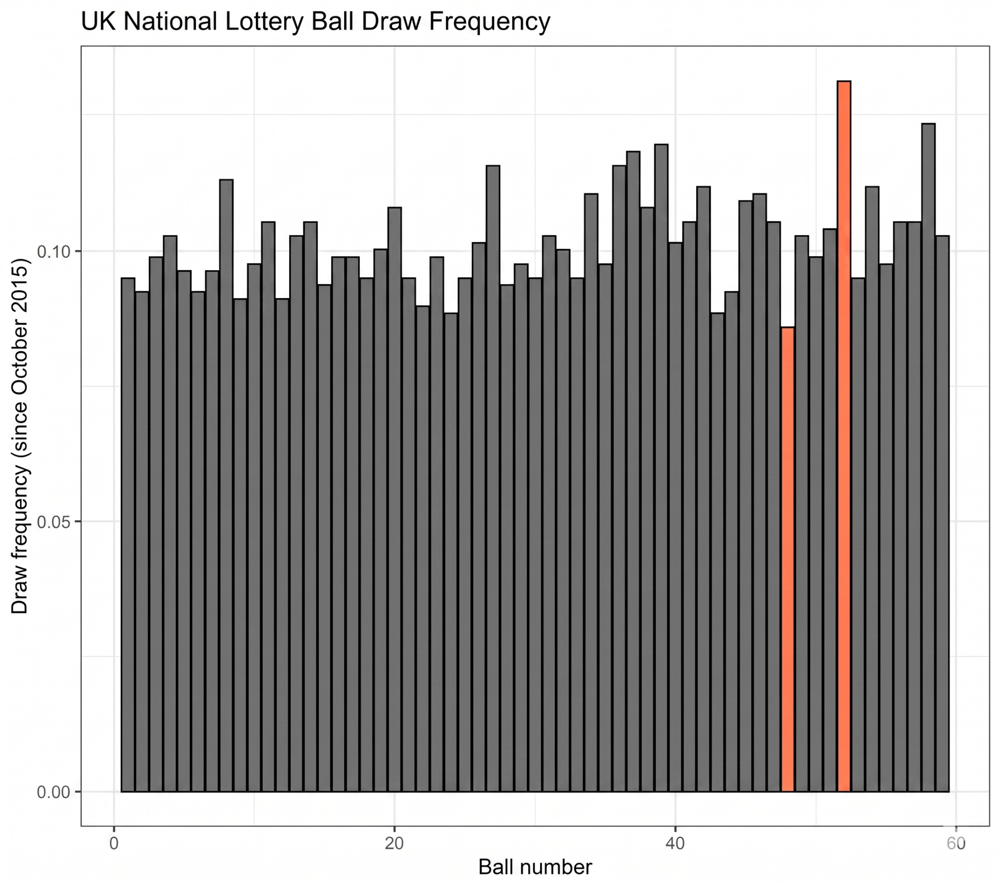

**Figure 1.** Frequentist probabilities for each ball from the UK National Lottery. Data is from October 2015 to February 2023 and covers 769 draws. The highest and lowest frequency draws are highlighted.

[As you can see from Figure 1 even though we've 'seen' nearly 800 UK National Lottery draws since October 2015 there is still quite a lot of variability in the frequency with which each ball appears. Frequentism is the dominant probability philosophy underlying modern statistical inference. This means that the statistical procedures used to examine hypotheses are interpreted based on the frequentist philosophy of probability. We'll discuss this further below when we discuss p-values.]{.mark}

[There are contexts where the frequentist interpretation of probability struggles. If we consider the probability of one-off events, then we have no 'frequency' frame of reference. For example, what is the frequentist interpretation of probability for life on Mars? We cannot observe repeats of the planet Mars because it is unique. So, when we talk about probability in a context like this, we mean something else and that something else is usually a subjective probability or degree of belief. This subjective interpretation is the third philosophical interpretation of probability. In this interpretation we consider probability as it relates to what we believe or as it relates to the *plausibility* of outcomes. We usually have some knowledge of the world and we can weigh up the probability of an outcome in the world based on what we know and assign some subjective probability to that outcome. In the]{.mark} [example of the UK National Lottery we might have a belief that some numbers are]{.mark} ['[lucky]{.underline}']{.mark} [and so we would pick those numbers more often if we played the lottery. Data like that shown above for the number frequency in the lottery might change our minds. We might decide to always include 52 (the most frequent number) and never include 48 (the least frequent number) in our lottery picks. Unlike the frequentist interpretation, subjective probability has no problem with one-off events. We can assign a probability to life on Mars based on what we believe about Mars or based on some expert knowledge (e.g. the presence of water on Mars). The subjective interpretation of probability is now most associated with a branch of statistical inference called Bayesian statistics which we will describe in more detail below.]{.mark}

## Null-hypothesis significance testing (Fisher vs NP vs NHST) {#ch05-null-hypothesis-significance-testing-fisher-vs-np-vs-nhst}

[It is important to assess the evidence in data for real-world effects. This is especially true if we are going to make some decision based on conclusions from the data we have. The most common technique for making such assessments from data is called Null Hypothesis Significance testing (NHST). NHST gives us mechanisms for calculating the probability of data *if we assume some hypothesis about the world is true*. Usually, a null hypothesis is that things are not changing e.g., two means are the same; the difference between them is zero. As you might have guessed from the name in NHST we assume a *null hypothesis* is true and we use our data to 'challenge' the null hypothesis. Note that usually we actually do not believe the null hypothesis (otherwise we wouldn't go to the bother of gathering data). Instead, we calculate the probability of the data *if the null hypothesis is true* and if that probability is low enough, we decide to 'reject' the null hypothesis (i.e., we decide the null hypothesis is not happening). If the probability evidence is not low enough, we 'fail to reject' the null hypothesis. There is some nuance here: *failing to reject is not the same as accepting*! You will read in many study reports that there is 'no effect' based on the results for NHST. But 'no effect' means we accept the null and NHST does not allow us to do that. We'll discuss this in a moment when we examine how we carry out NHST.]{.mark}

[The NHST process is represented in Figure 2 below. We start at the right by collecting some data and deciding on null and alternative hypotheses. Then we create the sampling distribution assuming null is true & use a significance level to define critical values (these are explained later in the chapter). We calculate a test statistic and finally use that test statistic to calculate a p-value. We describe the process more fully below; it's quite involved! Software does the work for us but it's still useful to be aware of the general process.]{.mark}

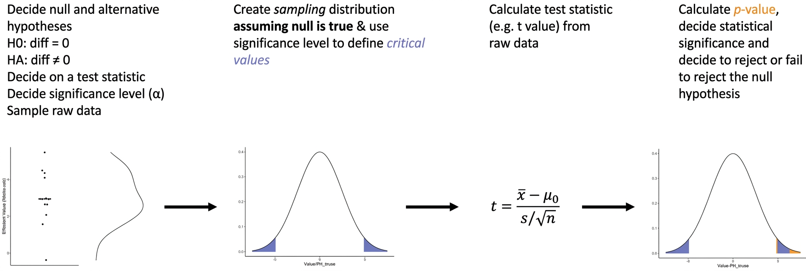

**Figure 2.** The NHST procedure. From left to right we collect some data, develop null and alternative hypotheses, create a sampling distribution based on the null hypothesis and a frequentist interpretation of probability, create a test statistic and finally calculate a p-value using the test statistic and the null hypothesis sampling distribution.

### Setting hypotheses {#ch05-setting-hypotheses}

[We'll go through each stage of Figure 2 in the text below. Let's start with an imaginary study. Suppose we carried out a study to examine the change in horizontal jump after some lower limb resistance training (e.g. back squat). We take 10 individuals and measure horizontal jump before and after 12 weeks of back squat training. We take the differences (after -- before). Our first step is to decide null and alternative hypotheses. If back squat training has no effect, then there would be a difference of zero (on average) across the study. When we use NHST we examine whether our data supports this hypothesis that there is zero difference. The zero difference is our null hypothesis. The null hypothesis is sometimes written as H0: mean diff = 0. We also need an alternative hypothesis. One obvious alternative hypothesis would be that the mean difference is different from zero. We are making no claim for direction here even though we might suspect squat training will make legs stronger. This is called a two-sided hypothesis. The alternative hypothesis is often written as HA: mean diff ≠ 0. We could also have a one-sided hypothesis (e.g. HA: mean diff \> 0), where the difference indicates squat training makes legs stronger or (e.g. HA: mean diff \< 0) where the difference is suggesting squat training decreases leg strength.]{.mark}

### Deciding on a test statistic {#ch05-deciding-on-a-test-statistic}

> Next, we have to decide on a test statistic to use. You may have come across at least some of these before. Examples include the F and the Chi squared (χ²) statistics. One way to think about test statistics is as signal to noise ratios. Test statistics quantify the amount of signal in your data compared to the amount of noise in your data. The usual test statistic for a difference in means (like our hypothetical study) is the t-statistic. The t statistic is calculated as:

> This might look somewhat impenetrable at first glance! The numerator is the difference between the mean in your data ( ) and the mean value from the null hypothesis ( ) which is usually zero. The numerator is therefore the amount of signal in your data. The denominator is the variability in your data expressed as the standard deviation ( ) divided by the square root of the number of subjects (or other experimental units) you have. This is effectively the 'noise' in your data; how much the mean difference would be expected to 'move around' if you repeated your study. If the mean difference in broad jump across our resistance training intervention was 4.7cm with a standard deviation of 3.4 and we had 10 subjects our statistic  would be:

### Deciding on error rates {#ch05-deciding-on-error-rates}

[We also have to decide on a *significance level* (sometimes called the alpha (α) level). The significance level tells us how often, over a long run of repeated studies sampling from the same population, we would claim a difference when there was not in fact a difference. This is also called a type I error. It is important that the significance level is determined *before* our study and that we stick to what we have defined. Although you could pick any reasonably low level (e.g. 0.1, 0.07 etc) it is conventional to use a significance level of 0.05. There are also situations where a significance level lower than 0.05 is appropriate. Significance levels of greater than 0.05 are rare\... but having said that remember that 0.05 is an arbitrary level.]{.mark}

[The significance level or α is not the only 'long term' consideration we have though. We could also be wrong by missing a difference when there is in fact a difference! This is called a type II error. We have to set an acceptable rate for this as well and this rate is usually represented by the Greek letter beta (β). It is conventional to set this type II error rate at 0.8 (80%) or higher. The conclusions we can come to and the error we can make are shown in Table 1.]{.mark}

**Table 1.** Decisions and errors that can be made from NHST.

  ------------ ----------------------------- ----------------------------
  Truth        NHST says do not reject H0    NHST says reject H0

  H0 Correct   No error ��                   Type I error (rate = α) ��

  H0 False     Type II error (rate = β) ��   No error ��
  ------------ ----------------------------- ----------------------------

The decisions on the level of significance, the test statistic and the type I and type II error rates are all *pre-study decisions*. It is important that you stick to them as the data is collected and analysed!

### Calculating power {#ch05-calculating-power}

If we're carrying out NHST properly then we have one more pre-study calculation to make. That calculation relates to what is called *statistical power*. The 'power' of the test is defined as the probability of detecting an effect if *there is a true effect present to detect*. That definition also hides some nuance. The main question to consider is "What do we consider a 'true' effect?" That is a *subjective* choice you have to make. You not only have to define the size of the effect (e.g. the mean difference you would consider a 'true' effect) but also the variation or noise in that 'true' effect you might expect to see. Power analysis is a field of its own and we won't go into it further here, although it has been described in some further detail along with some recommended reading in [Chapter 3](03-participants.qmd). The calculations for statistical power involve: The proposed (usually minimal) effect size you want to detect

The variation or standard deviation of that effect

The type I error rate - α

The type II error rate - β

The number of subjects or other experimental units in your study

The formula for statistical power can be re-arranged to get any one of these from the others. The usual use of power analysis is to identify how many subjects you need in your study to detect a proposed effect with a proposed variability for a given α and β rate.

The excellent [G\*Power software]{.underline} is an extremely useful graphical tool for calculating power for a range of different experimental designs. Like the other decisions we have made so far power is strictly a pre-study concept. You may have read about or be asked to calculate power for a study after you or someone else has completed it. Post-study power is not a proper use of power analysis. You can read more about the problems with post hoc power [here]{.underline}.

### Calculate a p-value {#ch05-calculate-a-p-value}

Once we have all of the above, we can actually collect data. Using α, β and the data we create a null sampling distribution (the central panel in Figure 2 above). The null sampling distribution is an assumed distribution of effects (e.g. mean jump differences) we would expect to see if we repeated our study many, many times sampling repeatedly from the same population *and* if the null hypothesis were true. This sampling distribution depends entirely on a frequentist interpretation of probability because it is based on repeating our study many, many times. Once we have defined the sampling distribution, we can define *critical values* for the test statistic. These are shown in blue in the central panel of Figure. The critical values are the values of the test statistic beyond which we would reject the null hypothesis. We use the data to calculate the value of the test statistic (e.g. a t-value). Finally, we use the test statistic and the null sampling distribution together to calculate a p-value. To do this we find the position on the x-axis of the null sampling distribution the test statistic sits at. We then calculate the area under the sampling distribution that lies beyond this point. This is the p-value and it is represented by the orange area in the rightmost distribution in Figure 2. If the p-value is below our chosen level of significance (e.g. less than 0.05) we declare our finding 'statistically significant' and reject the null hypothesis.

In essence, the process we just described involves creating an assumed distribution of test statistic sizes we would expect to see if the null was true and then seeing how well that assumed distribution supports our data or data more extreme. Why data more extreme? Well, because the p-value is the area under the sampling distribution that lies at or beyond the value of the test statistic we are getting the probability for more extreme values of the test statistic as well. The orange area in the right-hand panel of figure 2 extends from our test statistic value outwards along the curve.

#### What is a p-value? {#ch05-what-is-a-p-value}

The procedure outlined above for NHST is widely taught, widely practised and often misunderstood. The p-value is prone to misinterpretations such as 'the probability the null hypothesis is true' or 'the probability that the data result from chance alone'. Misinterpretations like these are both widespread and deceptively easy to make; they sound right which is why they are so easy to believe. In this section we take some time to explain the p-value more thoroughly and point you to some resources that explain why these misinterpretations are misinterpretations.

A p-value is simply a probability. Specifically, it is the probability of the data (or data more extreme) *if the null hypothesis is true*. In probability notation the p-value is written as:

In plain language this means 'the probability of the data (or more extreme data) *given* the null hypothesis is true'. The pipe symbol (\|) means 'given'.

#### P-value misinterpretations {#ch05-p-value-misinterpretations}

As noted above a common misunderstanding of the p-value is that it tells you the probability of the null hypothesis; this is wrong. The p-value is a *probability relating to data not a probability relating to the null (or any other) hypothesis*. If you can remember that you will not misinterpret the p-value as the probability of a hypothesis.

Following on from the above misinterpretation another common misunderstanding (widely stated unfortunately) is that the p-value tells you the probability that 'chance' alone is at work; this is also wrong. 'Chance alone' is a hypothesis (the null hypothesis) and we said above the p-value relates to your *data not any hypothesis*. So, a p-value cannot be the probability of 'chance alone'.

Misinterpretations of p-values are so widespread that in 2016 the American Statistical Association issued guidance for users and consumers of statistical inferences [@wassersteinASAStatementValues2016]. In particular the statement made six recommendations which are worth bearing in mind when you look at a p-value. These can be paraphrased as:

- The p-value summarises the incompatibility of the data with the hypothesis.

- The 'hypothesis' in question is usually the null hypothesis. Remember, the p-value does not tell you anything direct about the probability of the null (or any other) hypothesis. So what is meant by 'the incompatibility of the data with the hypothesis'? You could rephrase the above recommendation as 'if the p-value is low (\< 0.05 usually) then your *data* looks weird if the null hypothesis is actually true'. That suggests that null is probably not true.

- P-values do not measure the probability that the hypothesis (usually the null hypothesis) is true or the probability that 'random chance' produced the data. The p-value is a 'statement' about the data in relation to a specified hypothesis.

- As noted above, if the p-value is low (\< 0.05 usually) then your data look weird *if the null hypothesis is true* but remember you *do not* get a probability the null is true or false. The p value is the probability of the data not of the hypothesis. If you can remember that p-values are probabilities relating to data you'll be much less prone to this misinterpretation.

- We should not use 'bright line' statistics (e.g. p \< 0.05) alone as the basis for decisions or scientific conclusions.

- The p-value tells us about the 'weirdness' of our data if the null hypothesis is true. They do not tell us anything about how important a proposed effect might be in the real world or if an effect is real. The key distinction here is that *statistical significance is not the same as 'matters in the real world'*. Just because something is 'statistically significant' it does not mean it will have any important effect or is a reproducible effect. You have to decide yourself whether what you see is real.

- Proper inference requires full reporting and transparency. Do not cherry pick results to report or engage in other questionable research practices.

[Questionable research practices]{.underline} (QRPs) are practices that can occur when designing, conducting, analysing, and reporting results from studies. QRPs may lead to biased results. QRPs include only publishing statistically significant findings. This is termed the 'file drawer' problem; non-significant results are rarely reported. The file drawer problem is exacerbated by p-hacking or manipulation of data (e.g. dropping points or testing only specific subsets) to achieve statistical significance. These clearly bias the scientific literature since all studies look like successes. There is also a problem with creating a hypothesis after carrying out statistical testing (termed HARKing or Hypothesising After the Results are Known). Proper statistical interpretation requires full transparency about what was done at each stage of the research process.

The p-value (or statistical significance) *does not measure the size of an effect or the importance of a result*. Statistical significance is not real-life significance.

A low p-value is not a measure of, for example, how big a difference there was in a study and as we noted above a p-value does not tell you anything about real world importance.

A p-value alone *does not provide good evidence regarding a model or hypothesis*. The p value provides limited information about the null hypothesis (the only hypothesis usually tested).

Although we may get a low p-value and decide to reject the null hypothesis that is not necessarily useful. It is often the case that the null hypothesis was likely not true anyway (a strawman hypothesis) and so there is limited value in 'rejecting' it. Similarly, our alternative hypothesis is often so vague as to be pretty much meaningless. What does it mean for an effect in the real world to say that it is 'not equal to zero'? Not much really; it could be huge; it could be tiny. The interpretation of all results in science depends on human judgement. We have to look at the effect and make a judgement. There is very good guidance and advice on statistical misinterpretations in [@greenlandStatisticalTestsValues2016].

### Why NHST has a 'user interface' problem? {#ch05-why-nhst-has-a-user-interface-problem}

In software design user interface (UI) problems are issues or difficulties using software that can lead to a poor user experience. One of the reasons the results of NHST are so often misinterpreted is that NHST is actually a hybrid of two separate systems which have different interpretations of the p-value and indeed of how we should use statistical testing. These systems were developed in the 1920's and 1930's. They are Ronald Fisher's s*ignificance testing* approach and Jerzy Neyman and Egon Pearson's *hypothesis testing* approach. The conceptual differences in Fisher's and the Neyman-Pearson approaches are summarised in the table below (adapted from [@hubertyHistoricalOriginsStatistical1993].

Whilst the technical aspects that differ between the two approaches are beyond our scope, we can see two differences immediately highlighted in Table 2. Firstly, Fisher only concerns himself with a null hypothesis (H~0~) whereas the Neyman-Pearson technique uses both null and alternative (H~1~) hypotheses. Secondly, Fisher has no concept of type I or type II error and therefore no concept of power. Each of the two techniques give rise to p-values but the exact meaning of those p-values is different depending on which procedure you use.

In Fisher's approach the p-value describes the compatibility of the data derived statistic with the null hypothesis. If the p-value is very low then you can say that if the null was true then your data look 'weird'. In this case Fisher suggests you repeat your study. Fisher does not directly address the probability (or the frequency) that you have made a mistake; there is no formal (i.e., mathematical) concept of type I or type II error. Fisher's approach is good for ad hoc research (i.e., a single study where you want some indication of whether the approach or idea is worth pursuing). An example in sport might be some new strength training regime. You might run a small study with some athletes to examine if the training programme increases strength enough to be worth it. If p \< 0.05 and the change in strength was large enough you might consider repeating your study.

**Table 2.** Differences between Fisher's significance testing and NP hypothesis testing.

  --------------------------------------------------------------------------------- -----------------------------------------------------------------------------------------------------------------
  **Fisher's test of significance**                                                 **NP null hypothesis test**

  State H~0~                                                                        State H~0~ and H~1~

  Specify a test statistic and a distribution for the test statistic based on H0.   Specify a test statistic and a distribution for the test statistic based on H0.

  Collect data and calculate the value of the test statistic.                       Specify type I error rate (α) and type II error rate (β) and calculate power for your study based on H0 and H1.

                                                                                    Use α and β to determine a "rejection" region for H0.

  Determine the p-value                                                             Collect data and calculate the value of the test statistic.

  Reject H0 if p is small; otherwise "fail to reject" H0.                           Reject H0 if p is small; otherwise "fail to reject" H0.
  --------------------------------------------------------------------------------- -----------------------------------------------------------------------------------------------------------------

In the Neyman-Pearson approach a p-value below the α level (assuming proper power analysis etc) means you can say that you would not make a type I error in more than 1-α (exact) repeats of the study. This concept of the *frequency* of errors means the Neyman Pearson approach is useful for *repeated sampling research* using the same population and tests. Continuing our strength training example after a successful trial, as discussed above, you could use the values from that trial to carry out proper power analysis with defined type I and type II errors and use the NP approach to design and analyse a second trial. If the p value from this was below your chosen α level (e.g., 0.05) that would give you some confidence that repeatedly applying the strength training technique on new athletes you are coaching would improve performance by some defined amount in e.g., 95% of trials using athletes (samples) from the same 'population'.

NHST combines the above approaches, but individuals may use a more or less Fisher or NP approach to NHST when they interpret their studies. For example, mistaking a p-value derived from Fisher's approach, (your data looks weird if the null is true) with a p-value derived from the NP approach (you will see results like this or more extreme results with a frequency of 1-α if all your assumptions are correct and you sample from the same population) is easy under NHST because NHST does not discriminate between these two different p-values. In the end you have to be aware of the experimental design used and interpret the p-value accordingly. We'll leave this part of the chapter with Figure 3 below which was posted to twitter by data scientist A. Jordan Nafa. This figure may seem rather pessimistic. NHST is useful but you should be aware of what an assessment of evidence by NHST means. Hopefully the text above has made that somewhat clearer.

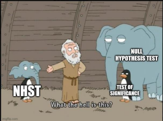

**Figure 3.** Conceptual image of NHST

## Bayesian inference {#ch05-bayesian-inference}

Bayesian inference takes a different view of probability than the methods described so far. Probability is defined more closely to how most non-statisticians define it, as an expression of plausibility ---the chance of something happening. In this sense, it is a mathematical expression of uncertainty and reflects our level of belief and expressed by any number between zero and one--- or transforming this to a percentage between zero and 100% --- which indicates how strongly we should believe something is true based on the information we have available. So, rather than probability being considered as something external to us, Bayesian conceptions of probability are seen as personal or subjective in the sense they depend on the available knowledge an individual has.

Let's look at a simple example, we are intending to go for a hike in the countryside and want to decide on what to wear by deciding the probability of rain today. We can use some frequency evidence; it has not rained at all this week, nor has it rained on this date for at least the past three years. Using this frequency data, it would be reasonable to assign a low probability of it raining this afternoon. However, we can do better than just using these frequencies and use some other information too. Suppose we looked at the weather app on our phone --- which was generally reliable --- and it predicted no rain today, it would be reasonable to lower our probability of rain further (see Figure 4 below).

  ------------------------------------------- -------------------------------------------
     

  ***Figure 4.** Weather app*                 ***Figure 5.** Sky overhead*
  ------------------------------------------- -------------------------------------------

However, if we had access to additional information our probability assignment may change. Suppose we looked outside and saw dark clouds overhead (see Figure 5). With this additional information we should reasonably raise our probability of rain. In addition to their subjective nature, these probabilities are also objective in the sense that they do not depend on the personality of the user or any personal hopes, fears, value judgments, or other feelings regarding the formulated propositions [@jaynesProbabilityTheoryLogic2003].

While Bayesian probability differs from frequentist probability, it also offers similar opportunities for hypothesis testing and estimating specific values that you are interested in, known as parameters, it just does this distinctly different. Bayesian inference starts with some knowledge, belief or educated guesses about the probability of an event occurring or the probability of obtaining values for something we are investigating (prior probability). We then observe what happens (likelihood) and update our knowledge or initial guess based on what happens (posterior distribution).

Let\'s examine a simplified example of how we update knowledge by using the probability of success for a football team. Given our initial knowledge about the team and how likely the team is to perform is highly uncertain, we assign equal probability to the team winning or losing --- a uniform distribution (see Figure 6 below).

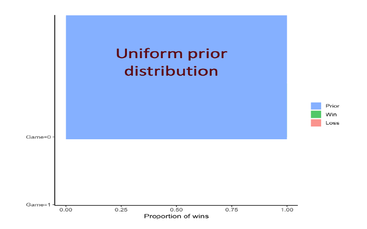

**Figure 6.** Uniform prior to assign equal prior probability to all proportions of the team winning or losing.

Each time the team plays and wins or loses, we update our knowledge until after 10 games we have a probability of success. In the example below, from complete uncertainty, we end up with a probability of 0.7 or a 70% chance of future success.

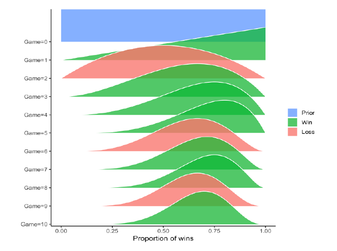

**Figure 7.** Updating knowledge proportions of the team winning or losing following each game.

Nonetheless, this probability may change again as new knowledge comes in (see Figure 7). You can get a sense of how updating knowledge works by trying out the following interactive app [Bayesian updating]{.underline}. So, as our current state of knowledge --- the posterior distribution--- is a compromise between the prior distribution and the data, as evidence accumulates, the posterior distribution changes in the light of that evidence --- the data.

The Bayesian methods owe a great deal to the brilliant 18th-century French mathematician Pierre Simon Laplace. However, the method is named after an English clergyman, Reverend Thomas Bayes. An essay published after Bayes\'s death presented Bayes\' solution to a problem of inverse probability --- using past events to determine the probability of a future event, which formed the basis for Bayes\' formula which we use in Bayesian data analysis [@bayesLIIEssaySolving1763].

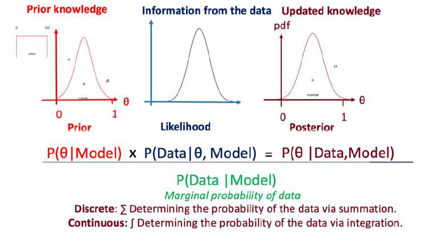

**Figure 8.** Bayes Formula used in modern Bayesian data analysis

In order to better understand Bayesian inference, let\'s examine all three components: the prior, likelihood, and posterior distribution.

### Prior knowledge {#ch05-prior-knowledge}

We capture prior knowledge in the form of a probability distribution of different values and decide on the best distribution for these values. However, to keep things simple, we will consider a normal distribution. We might have considerable knowledge about a parameter we are interested in investigating and have a strongly informative prior that includes specific knowledge such as the mean and standard deviation of likely values. However, we may have much less knowledge and use a weakly informative prior, which only contains partial information, but which is enough to give the posterior distribution reasonable bounds. For example, we may know the bounds of 10 metre sprint times --- slowest and fastest times --- but not have any confidence in actual mean values.

### The likelihood {#ch05-the-likelihood}

The likelihood can be considered a way to measure how well certain values in a statistical model fit the data we have collected. Likelihood works by fixing the data and changing the hypotheses. Therefore, it does not provide the probability that a particular estimate is true, given the observed sample, but helps determine which combination of parameter values makes the most sense or best explains the data. Likelihood helps us do that by giving a score to each combination based on how well it fits the observed data. The higher the likelihood score, the better that a specific combination of parameter values matches the data.

First, we collect and data which we considered fixed because it remains constant throughout the analysis. Next, we change the hypotheses by testing different values for the parameter we are interested in. We then calculate the likelihood scores for each of these parameter values to see how well each one fits our fixed data. The higher the likelihood score, the better that specific parameter value explains the data. Finally, we choose the parameter value with the highest likelihood score, as it provides the best estimate based on the data we have collected.

The entire likelihood function lets us look at every possible hypothesis simultaneously, and this gives us the full picture of the evidence. For example, say we were interested in estimating basketball players\' average height. We produce a statistical model with one parameter, which represents the average height. We collect height data from a sample of basketball teams. To find the most accurate estimate of the average height, we can calculate the likelihood scores for different parameter values (e.g., 190 cm, 198 cm, 201 cm etc.) and choose the one with the highest likelihood score. Say we find that 198 cm has the highest likelihood score, we conclude that 198 cm is the most reasonable estimate for the average height of basketball players. This is highest-scoring parameter value and so would be our best estimate of the average height of basketball players based on the data we have collected.

### The posterior distribution {#ch05-the-posterior-distribution}

The posterior distribution is a probability distribution that reflects our updated knowledge about the parameter we are interested in after we have collected data and determined its likelihood. The posterior distribution has to be found numerically using either an estimation method or using Markov chain Monte Carlo (MCMC) using specialist software. Given this is a probability distribution, its total area is equal to 1, with its shape determined by the range of values --- the more uncertain the estimates the wider the distribution. To try out an example of how the prior and data interact to produce a posterior distribution: [Bayesian interactive app]{.underline}.

Figure 9 shows an example for a posterior distribution of differences in sprint times between a control and intervention group. Notice that the values in the centre of the distribution are the more probable values and those in the tails of the distribution less probable (see Figure 9).

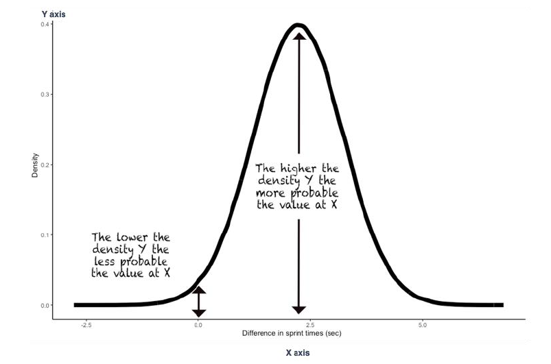

**Figure 9.** Posterior distribution of differences in sprint times.

To answer questions we are interested in, we usually summarise the posterior distribution using summary statistics (mean, median, standard deviation, quantiles) which we frequently support graphically using plots. In the example below, we can say the mean (and median) difference between groups is 2 seconds, with a 95% chance that the intervention results between 0.27 seconds and 4.19 second difference (see Figure 10).

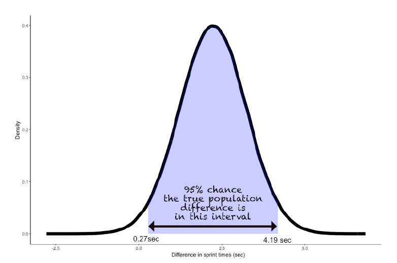

**Figure 10.** A 95% credible interval of the posterior distribution of differences in sprint times

### Bayesian parameter estimation {#ch05-bayesian-parameter-estimation}

Let's look at an example of estimating the effect of sleep deprivation on power output from a 15-minute self-paced time trial on a cycle ergometer, where the power output was dependent upon pedal rhythm. The power output was continuously monitored throughout the trials. Each trial\'s power output was averaged into segments of 60 seconds for pacing purposes, then expressed in terms of a percentage of a participant\'s average power --- so any differences between conditions would be taken into account. The three sleep conditions were 1) a control condition with a complete night's sleep, 2) a partial sleep deprivation condition where participants were able to sleep for 4 hours, and 3) a total sleep deprivation condition, where participants were awake the whole night.

The study used a repeated measures experimental design, where participants were involved in all three conditions but had 7-days to recover between each condition. Bayesian models were fitted to the data to model differences between conditions. The models ranged from traditional linear models to multilevel models that capture the effects of individuals. Each model type included prior information, ranging from uniform priors which suggest complete uncertainty, to increasingly informative priors that capture what we knew about likely differences before the experiment.

Table 3 below shows the estimates of the posterior distribution of the differences between sleep conditions. These suggest that if we are completely uncertain and use a uniform prior there is a 99% chance that total sleep deprivation had an effect on mean power output, with the most probable difference being 27.4 Watts but with a 95% chance that the population difference is between 9.06 Watt and 44.82 Watts. Incorporating our prior knowledge of what power output differences are possible, we get a slightly more conservative estimate (see Table 3 below).

**Table 3.** Comparisons of the differences in mean power tests between conditions from models with flat and informative priors.

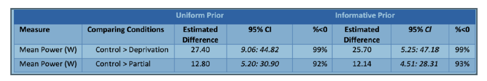

Reporting the results of these models together allows a direct comparison of the impact of incorporating appropriate prior information into models. The posterior distributions can be plotted and compared visually using draws from the posterior distribution (see Figure 11). Details of the full study can be found on [@cullenEffectsSingleNight2019].

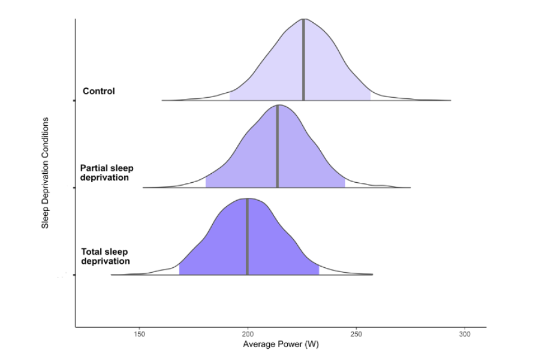

**Figure 11.** Estimates of average power (Watts) for sleep conditions

### Bayesian hypothesis testing {#ch05-bayesian-hypothesis-testing}

Like its frequentist counterpart, Bayesian hypothesis testing involves deciding whether to support a particular hypothesis or not. Rather than assuming the null hypothesis is true, Bayesian hypothesis testing compares two models --- the null model of no effect and the alternative model of an effect --- and provides a continuous scale (Bayes Factors) for deciding how likely the patterns of data collected would be under each of these models. In statistical terms, a Bayes factor is the ratio of two competing statistical models as represented by their evidence --- more formally the ratio of marginal probabilities --- and indicates how many times more likely the data are under one model than the other. Let\'s look at the example of line calls in tennis to illustrate Bayes Factors and the weight of evidence. Hawk-eye is a technology used in tennis for determining if the ball is in or out, and if a player challenges a call this technology makes the final decision if the ball is in or out of the court. When a ball touches the line in tennis it is considered in, and this is what Hawk eye needs to determine. See the three examples of three different line calls and the Bayes Factor for each (Figure 12).

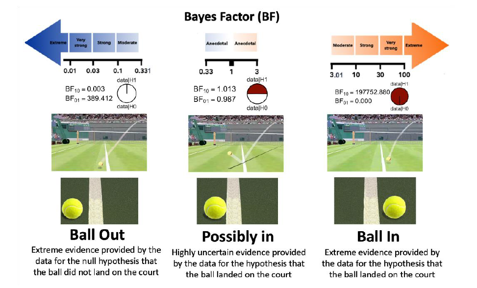

**Figure 12.** Bayes Factors as evidence the data provides for the research and null hypotheses.

Let's look at an example to illustrate how Bayesian hypothesis testing works using simulated counter movement jump height data for four groups of players from four local football teams. Group one has a mean of 40 cm ± 7 cm, group two has a mean of 43 cm ± 5 and group three has a mean of 40 cm ± 7 cm and group four 41 cm ± 7 cm. This data was deliberately simulated to show a clear difference, no difference and a more uncertain at a population level. Using [JASP software]{.underline} [@jaspJASP2024] we use this data to conduct three Bayesian independent t-tests comparing group one with group two, group one with group three and group one with group four using the default priors. You can see the results in Figure 13.

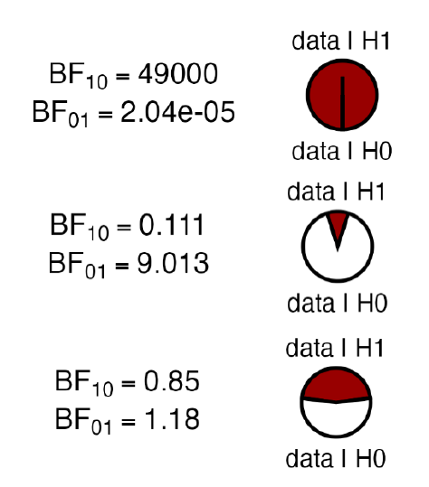

**Figure 13.** Bayes Factors for the three jump height comparisons

The first comparison shows extreme evidence of a difference, with the data being 49000 times more likely under the research hypothesis of a difference between groups than a null hypothesis of no difference in jump height between groups. The second comparison shows moderate evidence for the null hypothesis with the data being 9 times more likely under the null hypothesis of no difference, compared to a hypothesis of a difference. The final comparison shows high uncertainty with no real evidence for one particular hypothesis --- a Bayes Factor of 1 means that both the null and the research hypothesis are equally likely.

[John Kruschke]{.underline} [@kruschkeDoingBayesianData2015] proposed an alternative method of hypothesis testing using the posterior distribution and credible intervals. This method uses a predetermined region of practical equivalence (ROPE) around zero that includes values that, for practical purposes, are assumed to be equivalent to zero (or the null hypothesis) in the context being investigated. The idea behind ROPE is to acknowledge that in most real-world scenarios the null often encompasses more than just a single value and includes a range of values. This region or ROPE is determined before analysis and include a range of values around the null value (often zero) that are considered practically equivalent to the null. This range is based on domain knowledge and the specific context of the study. By defining a ROPE around a null value, researchers can determine whether the credible intervals (or highest density intervals, HDI) of a parameter overlap with this region. If the credible intervals do overlap the ROPE, it suggests that the effect might not be practically important.

To illustrate how this method compares with the Bayes Factor analysis, we can use the same simulated jump height data. By using this approach, we can only claim the research hypothesis of a difference to be true if the HDI falls completely outside of the ROPE. In the first comparison between group one and group two, this is clearly the case (see Figure 14).

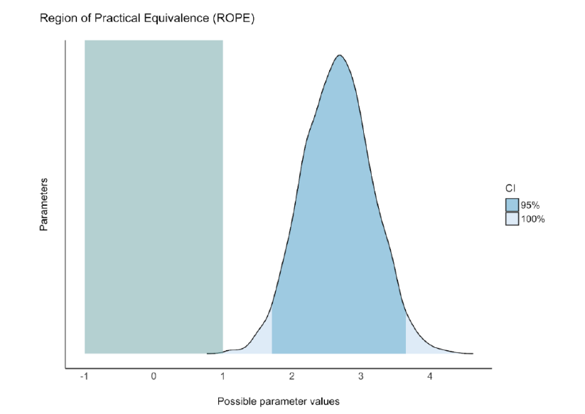

**Figure 14.** Differences fall completely outside the ROPE

Conversely, if HDI falls completely within the ROPE, the null hypothesis is supported for all practical purposes. Like the Bayes Factor comparison, this is the case when comparing group one and group three (see Figure 15).

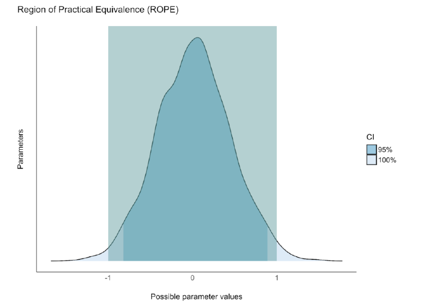

**Figure 15.** Differences fall completely inside the ROPE

When a HDI overlaps with a ROPE, the advice is to reserve judgement, and this is the case with our final comparison (see Figure 16).

So, in summary, it is important to note that the ROPE is used to interpret the results at the parameter level, not at the level of individual data points or trials. The ROPE represents a set of parameter values that are considered practically equivalent to the null hypothesis. It is not about individual data points but about the range of values the parameter (e.g., mean difference between groups) can take. If the HDI of the posterior distribution falls entirely within the ROPE, it suggests that the observed effect is not practically different from the null hypothesis and that the parameter values supported by the data are all within the range that we consider practically negligible.

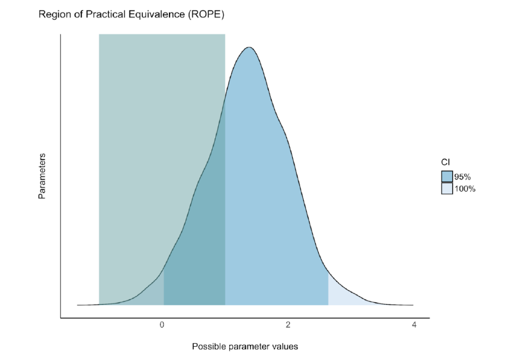

**Figure 16.** Differences fall partly inside the ROPE

### Quantifying uncertainty - confidence intervals and credible intervals {#ch05-quantifying-uncertainty---confidence-intervals-and-credible-intervals}

Quantitative methods use samples to draw conclusions about a larger group. A sample is a small group selected from a larger group that we are interested in --- it represents the larger group in some way. We estimate population values from the sample. How accurate these estimates are, is dependent on the size and how well the sample represents the population of interest (See [Chapter 3](03-participants.qmd) for further discussion of sample selection).

Bayesian credible intervals and classical or frequentists confidence intervals both provide estimates that include a range of possible population estimates, but they are interpreted differently. Let\'s illustrate this with an example. Imagine that we are investigating the effect of a new training program on 20 metre sprint times for academy soccer players. We want to estimate the average improvement in sprint time after completing the training program. Initially, we would randomly assign soccer players to either a treatment or control group - the treatment group would receive the intervention, and the control group would not. Initially, we would need to establish baseline sprint times for each participant in both the treatment and control groups. Following the treatment group's 6-week intervention programme, we had each group sprint three 20 metre sprints on an indoor 3G synthetic surface. Players would have 3 minutes of rest between sprint repetitions.

#### Confidence intervals {#ch05-confidence-intervals}

In frequentist or classical statistics, researchers compute p-values and confidence intervals, assuming that we draw the data from one of many random samples from a population of interest.

Confidence intervals are a set of population estimates (parameter values) consistent with the data that was collected and analysed. In our example, the average improvement in sprint time is likely to fall with a certain level of confidence. For example, a 95% confidence interval means that if we repeat a study many times with the same sample size and all the assumptions used to compute the intervals were correct, 95% of those intervals would contain the true average improvement. However, it does not mean that the true value has a 95% chance of being in the specific interval that we calculated from our sample. The confidence interval focuses on the long-run reliability of the estimation method rather than the probability of the parameter itself.

The width of a particular confidence interval is determined by confidence level (the percentage we are interested in e.g., 99%, 95% or 90%) and sampling error, which is in turn determined by the sample size and variation in what is measured. A 99% confidence interval is wider than a 95%, all else being equal. Therefore, it is more likely to contain the true parameter value, such as the average sprint time improvement. The below link will take you to an interactive app that calculates and visualises Frequentist confidence intervals. This is designed to give you a sense of what happens to the width of the confidence interval when you increase the sample size or when you change the percentage level. You will also see that when all else is the same, the width of an interval does not make it more likely that that specific interval will capture the true parameter value. Instead, it indicates the proportion of intervals that would contain the true parameter value in the long run, if the same sampling procedure were repeated many times. [Confidence interval shiny app.]{.underline}

#### Bayesian Credible intervals {#ch05-bayesian-credible-intervals}

A Bayesian credible interval is like a confidence interval, in the sense that it generates reasonable estimates for a given population parameter based on data analysed. Combining the data collected and our prior knowledge, the credible interval provides a range of plausible values with a particular probability that the true value of a parameter will be captured in the interval. For example, a 95% credible interval means that, given the observed data and our prior knowledge, there is a 95% chance that the true average improvement in sprint time lies within that interval. So, unlike a confidence interval, a credible interval gives a direct probability statement about the parameter itself. There are two types of credible intervals that are generally calculated and reported. The first is called the Highest Density Interval (HDI) --- where all points within the interval have a higher probability density than points outside the interval. A higher probability density means that the values of the parameter within the HDI are more likely (have higher posterior density) compared to those outside the HDI. It is important to recognise that the interval does not provide the probability of any specific data point falling within it; rather, it represents the collection of values that are most credible for the parameter.

The second credible interval, is the Equal Tailed Interval (ETI). In an Equal Tailed Interval (ETI), a specified percentage of the probability mass is allocated equally between the lower and upper tails outside the interval\'s limits. This means the interval has the same probability below the lower limit as above the upper limit. The primary distinction between ETI and HDI is its treatment of distribution tails. Specifically, the ETI maintains equal probability in both tails outside the interval, regardless of the distribution\'s shape (in a 95% confidence interval this would be the 2.5th percentile and the 97.5th percentile). Where the posterior distribution is symmetrical --- for example a normal distribution - both intervals will be the same, but if the distribution is skewed, they will be different as in Figure 17 below.

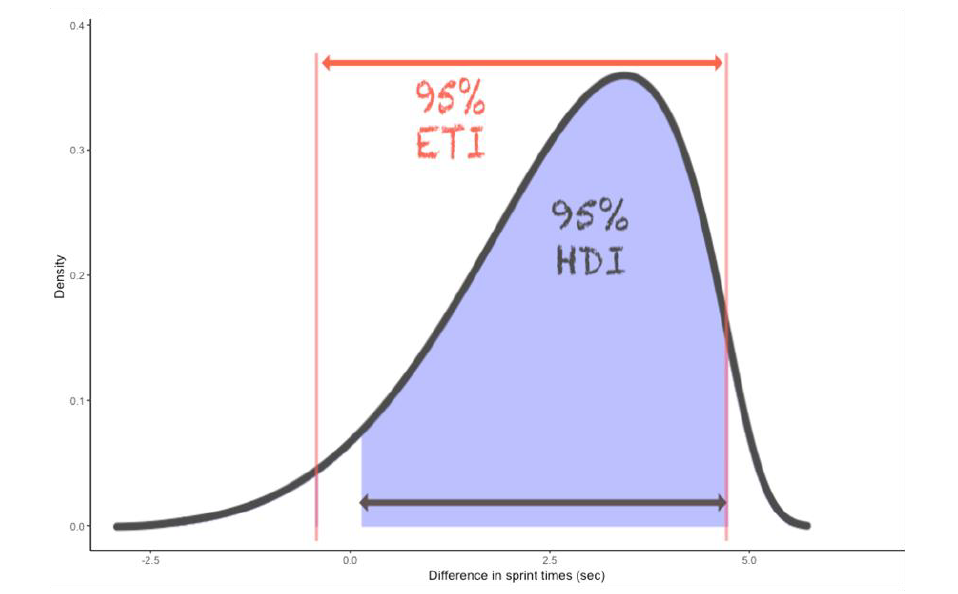

**Figure 17.** Comparing the Highest Density Interval and Equal Tailed Interval of a skewed posteriors distribution.

Use the interactive app below to look at how the Highest Density Interval and Equal Tailed credible Intervals can differ. [Credible interval shiny app]{.underline}.

### Effect size --- raw differences, standardised differences or explaining variance? {#ch05-effect-size-----raw-differences-standardised-differences-or-explaining-variance}

In sport and exercise science, it is often very important not only to determine if there has been an effect but also the size of that effect. Combined with how probable an effect is, the magnitude or size of an effect is important in determining if the effect is meaningful. There are several ways in which we decide how big an effect is. However, the importance of an effect, is ultimately down to sport and exercise scientists\' knowledge of what is being investigated**.** For example, improving speed by 0.5 seconds could be an incredibly important difference in some track running events (e.g., 100m) but would not be important to invest time or resources for marathon runners as that time difference almost never determines placings in a marathon.

The type of effect size we calculate depends on what we measure, the measurement units, and whether we want to compare the size of effect we get with other effect sizes that use different measures. In sport and exercise science, some common types of effect sizes include examining raw differences, computing a standardized difference, assessing the proportion of variance in the measured variable explained by the statistical model, and calculating odds ratio or relative risk of an event occurring.

#### Raw differences {#ch05-raw-differences}

Differences in raw values are the simplest form of effect size. For instance, you might compare the average sprint times of two groups of athletes following different training programmes. The difference in this case might 0.7 seconds for example.

#### Standardised differences {#ch05-standardised-differences}

In some cases, such as when you wish to compare effects across studies that use different outcomes, it may be useful to express standardised differences, e.g., relative to the standard deviation of the group, rather than in raw units such as time, distance or weight. For example, Cohen\'s d is a standardised measure of effect size that quantifies the difference between two groups or conditions (e.g., before and after an intervention, or between treatment and control groups) in terms of standard deviations. You calculate it by subtracting the mean of one group from the mean of the other and then dividing the result by the pooled population standard deviation.

Since we rarely know the population standard deviation, it is usually estimated from our sample data. The pooled standard deviation is a weighted average of the standard deviations from both groups. A weighted average considers the sample sizes of the groups, giving more weight to the group with the larger sample size. This provides a more accurate estimate of the population standard deviation compared to a simple average.

Cohen\'s d is widely used and useful for comparing effect sizes across different studies or variables. There are several variations of Cohen's d, e.g., to account for smaller sample sizes or when there is reason to believe that the pooled standard deviation may be biased such as when there is reason to believe that the intervention may alter the group variation. These include Hedges\' g, which adjusts for small sample sizes, and Glass\' delta, which uses only the control group\'s standard deviation for comparison.

For example, consider an experiment designed to assess the differences in perfectionist tendencies between two groups. After an intervention, we observed an average reduction of 2 points on a psychological questionnaire in negative perfectionistic concerns. The control group had a standard deviation of 1.9, while the experimental group had a standard deviation of 1.7. To quantify this difference, we can use Cohen\'s d, a measure of effect size that expresses the difference between the two group means in terms of standard deviations. Here, a lower score shows fewer negative perfectionistic concerns, which is desirable.

For a sample of 20 participants, we calculated Cohen\'s d to be 1.08 (95% CI = 0.03 to 47.43). This value of 1.08 shows that the mean of the experimental group is 1.08 standard deviations lower than the mean of the control group. In other words, the average participant in the experimental group exhibits a reduction in negative perfectionistic concerns that is 1.08 standard deviations below the average participant in the control group. How meaningful you deem this effect size to be will depend on your research question and what is expected for that particular outcome, as discussed in more detail in section 3, [Chapter 3](03-participants.qmd).

### Common language effect size {#ch05-common-language-effect-size}

The common language effect size, also called the Probability of Superiority, gives the probability, often expressed as a percentage, that a measure randomly selected from one group (for example, an experimental group) is greater than one randomly selected from another (for example, a control group).

In the example used above, a Cohen's d of 1.08 translates into a Probability of Superiority of 77.70% (95% CI=59.52% to 100%). This means that when sampling observations from each group randomly, there is a 77.7 % chance that a randomly sampled person from the control group will have a higher observed rating than a randomly sampled person from the experimental group --- with the observation that the intervention appeared to reduce negative perfectionistic concerns.

To look at raw effects, standardised effects and common language effects to see how they relate to each other and to the effect, look at the interactive app: [Effect sizes shiny app.]{.underline}

#### Cohen\'s U3 {#ch05-cohens-u3}

This effect size measure is similar to the Common Language effect size and is used to interpret the practical importance of Cohen\'s d within the context of a particular study. Cohen\'s U3 represents the percentage of the control group that falls below the mean of the experimental group. Higher values of Cohen\'s U3 show larger effect sizes and greater practical significance.

Cohen\'s U3 is useful for understanding the practical implications of Cohen\'s d. For instance, if Cohen\'s U3 is 70%, it means that 70% of the control group scores below the mean of the experimental group, suggesting a substantial effect of the intervention. Unlike measures that compare individuals sampled at random from control and experimental groups, Cohen\'s U3 focuses on the group means. As a result, the percentages produced by Cohen\'s U3 are slightly higher than those produced by the Probability of Superiority calculation, which directly compares individual scores from the two groups.

### Proportion of the variance explained or shared between variables {#ch05-proportion-of-the-variance-explained-or-shared-between-variables}

Another type of effect size examines how much variance particular predictors explain in the measured (or dependent) variable. The proportion of variance explained represents the part of the total variance that specific predictors can be attributed to. In any statistical system, we consider the total variance to be 100%. Each predictor may explain a different proportion of that variance. It is also likely that there will be some proportion of the total variance that is not explained by any predictors in the model.

For example, in the statistical test known as Analysis of Variance (ANOVA), Eta squared (***η*^2^**) measures the proportion of the total variance in the data that is attributed to a specific factor (or main effect) or interaction. It quantifies the strength of the relationship between the factor(s) and the dependent variable. For example, if we were comparing moderate to vigorous physical activity (MVPA) levels across different ages and ethnic groups, and we calculated an Eta squared (η2) of 0.05 for ethnicity, 0.07 for age, and 0.09 for the interaction between age and ethnicity. This would suggest that 5% of total variation in MVPA can explained by ethnicity, 7% explained by age and 9% by the interaction between ethnicity and age (these factors combined).

In regression, another type of analysis related to the ANOVA, R-squared **(R²)** represents the proportion of variance in the dependent or measured variable explained by the independent or predictor variable. For example, if we wanted look how well MVPA predicted Body Mass Index (BMI) we might conduct regression analysis with BMI as the dependent or response variable, and MVPA as the independent or predictor variable. If the analysis produced an R squared of 0.15, we could say that MVPA explained 15% of the variance in BMI.

In the statistical test known as Multivariate analysis of variance (MANOVA), Wilk's Lambda (Λ) tells you how each level of independent variable contributes to the model. Wilk\'s Lambda ranges from 0 to 1. A value closer to 0 indicates that the group means differ, while a value closer to 1 suggests that the group means are similar. So a smaller value of Wilk's Lambda indicates a stronger effect of the independent variable(s) on the dependent variables. The term λ in the formula\'s denominator represents the proportion of variance in the dependent variables that is explained by the model\'s effect. For example, we decide to conduct a MANOVA to compare three training regimens: High-Intensity Interval Training (HIIT), Steady-State Cardio (SSC), and Strength Training (ST). The dependent or response variables are a measure of cardiovascular endurance, Maximum Volume of Oxygen Uptake (VO~2Max~) anda measure of muscular endurance, Time to Exhaustion during a resistance exercise. The MANOVA is used to explore the differences in the combined VO2 max and Time to Exhaustion scores based on the training regimens. If we obtained a Wilk\'s Lambda value of 0.60 from the analysis, we can calculate variance explained if we use 1- Lambda (Λ), so in our example, this would be 1-0.6=0.4 or 40%. So, in this case, 40% of the variance in the combined VO2 max and Time to Exhaustion scores can be attributed to or explained by the training regimen and the remaining 60% down to other factors not considered in the study.

To get a sense of what variance explained means, look at the Figure 18 below:

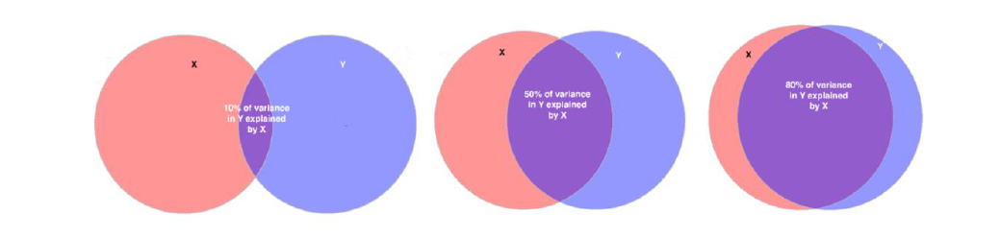

**Figure 18.** Variance explained

#### Ratios {#ch05-ratios}

Ratios express the relative magnitude of two quantities, indicating how much of one there is compared to the other. See Figure 19 below for a simple series of examples. Two types of ratios that are commonly used as effect size measures in sports and exercise science include the odds ratio (OR) and log response ratio (LRR).

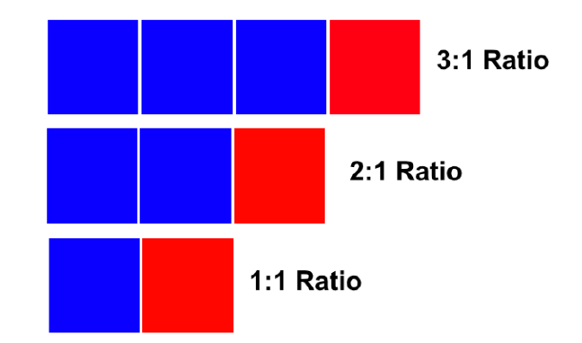

**Figure 19.** Examples of ratios

#### Odds ratio (OR) {#ch05-odds-ratio-or}

Sometimes in sports and exercise science, we have a measured variable that has just two categories --- something happened (labelled 1) or it didn\'t happen (labelled 0), *e.g.,* an athlete either experiences a particular injury or they don't. This is known as a binary variable because there are just two outcomes (1 and 0). One of the metrics we get after analysing this data (using logistic regression for example) is called an odds ratio. It describes the relationship between an independent variable (e.g., a risk factor) and a binary outcome (e.g., injury). An odds ratio of 1 means that the likelihood of either event happening is equal. An odds ratio greater than 1 indicates an increased likelihood of the outcome, while an odds ratio less than 1 indicates a decreased likelihood. Figure 20 illustrates this using a fictitious example of predicting injury using three factors, *i.e.,* whether or not there was recovery time between matches, the total seasonal training volume and weekly training volume.

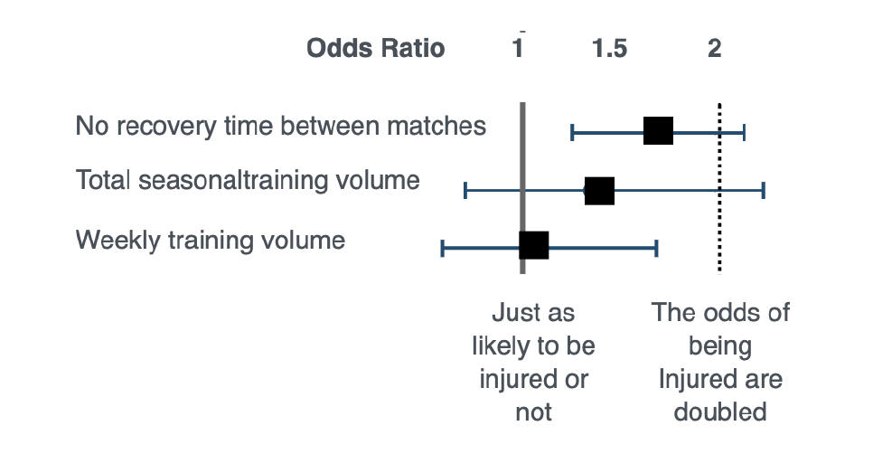

**Figure 20.** Odds Ratio and their confidence intervals for predictors of injury

#### Log response ratio (LRR) {#ch05-log-response-ratio-lrr}

Another ratio that researchers can use as an effect size is the log response ratio (LLR). This is the natural logarithms of the ratio of the mean of the treatment group and the mean of the control group (LRR = ln(Xtreatment/Xcontrol)).

If you are unfamiliar with logarithms, they are the inverse operation to exponentiation. For example, you can find the natural logarithm (ln) of a number by raising the base \'e\' (approximately 2.72) to a power that produces that number. If we have ln(a) = b, it means that e\^b = a. In the LRR, the natural logarithm helps to linearise ratios and make the interpretation of proportional changes easier.

This effect size is appropriate for outcomes measured on a ratio scale - so that zero represents the absence of the outcome as a whole. Studies that measure test scores, attitude measures, or judgments do not have natural scale units or a true zero, so the response ratio is not appropriate. When data is appropriate, there are two versions of the LRR reported, LRR-increasing (LLRi) and LRR-decreasing (LRRd). For LRR-increasing (LRRi), positive values are attributed to improvements in performance or therapeutic outcomes. Conversely, for LRR-decreasing (LRRd), negative values correspond to improved performance or therapeutic outcomes. \[

For example, suppose we are studying the effect of a new medication on reducing blood pressure. The mean blood pressure in the treatment group is 120 mmHg, and in the control group, it is 140 mmHg.

> LRR Calculation: LRR = ln(120 / 140)
>
> ≈ ln(0.857)
>
> ≈ -0.154

This LRR value (-0.154) suggests a reduction in blood pressure because of the treatment. Since this is an LRR-decreasing scenario (LRRd), the negative value shows an improvement (i.e., a reduction in blood pressure). By understanding logarithms and the concept of LRR, it becomes clearer how we can interpret proportional changes and improvements in different contexts.

## Causal effects --- how do we decide? {#ch05-causal-effects-----how-do-we-decide}

Understanding what causes some things to happen and what does not, is arguably one of the most important goals of science generally --- this is the same with sport and exercise science (see Chapter 1 for further discussion of different approaches to infer meaning from observations). There are three distinct types of thinking we need to consider when considering causal effects: seeing, doing, and imagining. In the first stage (seeing), we observe and measure things to identify patterns --- looking for connections. Some of these connections might suggest a cause- and-effect relationship, while others may not. However, simply looking at the data cannot necessarily reveal cause and effect. The second stage, (doing), entails implementing intentional changes to the environment and predicting how this may influence our outcomes --- determining which changes will lead to which results. By actively changing our surroundings, we gain a deeper understanding of cause-and-effect beyond mere observation. Intervention involves actual change. It ranks higher in understanding cause and effect than simple observations.

We often make such changes in our daily lives without labelling them as "interventions." For example, when a sport and exercise scientist suggest adjusting an athlete\'s training plan to improve their endurance, they are altering one factor (the intensity and duration of training sessions) to affect another (the athlete\'s endurance level). If the sport and exercise scientist's view of the effectiveness of the new training plan is correct, the athlete\'s situation will change from \"having lower endurance\" to \"having improved endurance.\" By actively changing the training plan, the sport and exercise scientist gains a deeper understanding of cause and effect beyond mere observation.

Finally, and to more fully investigate cause and effect, we need to imagine scenarios. Imagining the possible outcomes of \"what if\" scenarios --- sometimes called counterfactual scenarios --- can be challenging, but it necessaryif we wish to really understand cause and effect. This is because data alone cannot tell us what might happen in hypothetical situations where things are different from what was actually observed. However, our minds can make educated guesses about these imaginary situations, which helps us better understand cause and effect.

The different types of research questions that researchers can ask have previously been summarised as being descriptive, predictive or explanatory (see [Chapters 1](01-foundations.qmd) and [2](02-question-and-design.qmd) and examples of commonly used designs are described in more detail in [Chapter 2](02-question-and-design.qmd). Briefly, when thinking about cause and effect relationships, we are generally referring to "explanatory" type questions. In other words, we are trying to determine whether changes in one parameter can explain changes in another. Some common methods sport scientists use to establish cause-and-effect are as follows:

### Randomized Controlled experiments {#ch05-randomized-controlled-experiments}

An experiment using control and experimental groups helps establish causality**.** Participants are randomly assigned to groups, and the experimental group receives a specific treatment --- for example, a new training method --- while the control group does not. By comparing the outcomes of these groups, we can determine whether the treatment was responsible for causing differences in performance or health. There are also a number of additional control and standardisation procedures that we can employ, beyond randomised group allocation, in an attempt to further isolate any effects seen in our outcome of interest, as being caused by the intervention itself, as discussed in more detail in [Chapter 4](04-quantitative-data-collection.qmd).

### Longitudinal studies {#ch05-longitudinal-studies}

These studies follow participants over a long period of time, collecting data on various factors and outcomes. By analysing changes in measured variables over time and controlling for confounding factors, we can identify potential cause-and-effect relationships.

### Quasi-experiments {#ch05-quasi-experiments}

We can use quasi-experimental designs where random assignment is impossible or ethical. These studies compare existing groups that differ in a specific factor (e.g., professional athletes vs. amateur athletes) and analyse the differences in outcomes to infer potential causal relationships.

### Statistical methods {#ch05-statistical-methods}

In many real-world situations, particularly in longitudinal or quasi-experimental designs, it can be difficult to effectively control or standardise potential confounding variables, and in turn, to investigate cause and effect relationships. For this reason, researchers often use statistical techniques, like regression analysis or structural equation modelling, to attempt to account for these confounding variables and better isolate causal relationships.

### Causal modelling {#ch05-causal-modelling}

Causal modelling allows researchers to represent and analyse cause-and-effect relationships using graphs. By combining this approach with experimental or observational data, we can make inferences about the causal effects of various factors on performance or health. A particularly useful approach to try to understand cause and effect relationships from non-experimental data was described by Judea Pearl ([Pearl\'s framework]{.underline}). In simple terms, causal modelling is a way to represent and analyse cause-and-effect relationships using Directed Acyclic Graphs (DAGs) and mathematical expressions (e.g., do calculus).

[Pearl and Mackenzie]{.underline} [@pearlBookWhyNew2018] discuss causality and correlation using the flow of information. Using DAGS can be useful in visualising this information flow. In DAGS, nodes represent particular variables (e.g., diet, training, or performance), and arrows represent the cause-and-effect connections between these variables.

The following series of figures demonstrates how DAGs can be used to explore causal relationships between variables. In a DAG, an open path has arrows pointing in the same direction, and the association between these variables reflects a causal relationship.

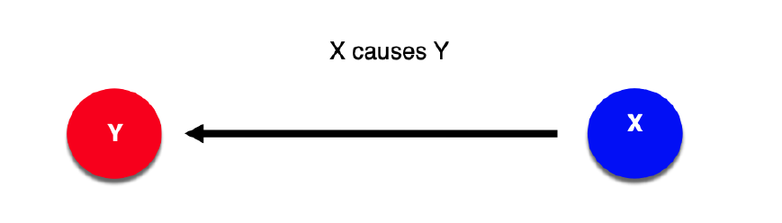

**Figure 21.** An open path on a DAG

However, two variables might be correlated either due to the causal connection (the causal path) or due to the confounding correlation (the non-causal path).

A closed (or blocked) path is a pair of variables that have the same effect in causal modelling, known as a **Collider.** In a DAG this is where two arrows meet --- they collide! (see Figure 22).

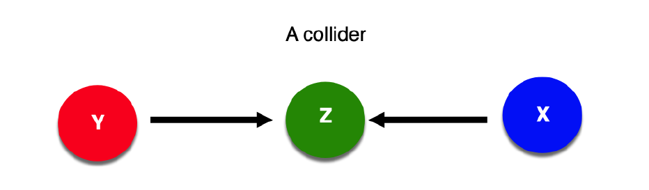

**Figure 22.** A collider in a DAG

A **Confounder** creates an open backdoor path between two variables X and Y and results from the exposure and the outcome having a common cause (see Figure 23). For example, consider the relationship between physical activity and heart health. If we do not account for age, it can act as a confounder because age affects both physical activity levels and heart health. Without controlling for age, the observed relationship between physical activity and heart health might be misleading, as it would not account for the influence of age.

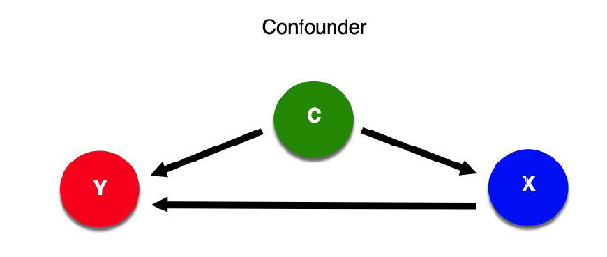

**Figure 23.** A confounder in a DAG

A **Mediator** is an intermediate variable that lies on the causal pathway between two variables and explains or clarifies the relationship (see Figure 24). For example, let\'s consider the relationship between strength training and improved sprint performance. Suppose that strength training increases muscle power (the mediator), which enhances sprint performance. In this scenario, muscle power mediates the relationship between strength training and sprint performance.

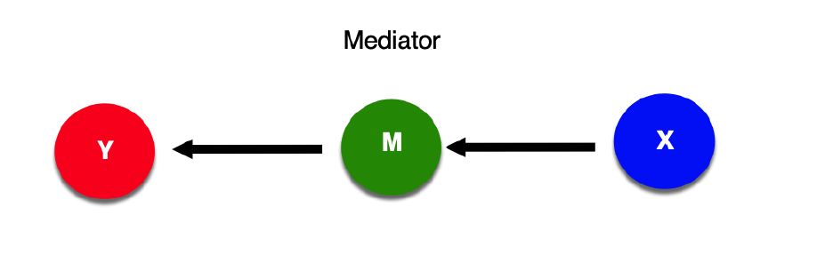

**Figure 24.** A mediator in a DAG

Let's take a simple example, if we were interested in looking at the impact of a vegan diet on strength using a DAG. First, we need to identify the relevant variables and consider their possible causal relationships. Here are some variables we might consider.

- Diet --- a binary variable representing whether the person is on a vegan diet or not.

- Protein intake --- A continuous variable representing the amount of protein a player consumes daily whether on vegan or non-vegan.

- A categorical variable representing different kinds of training regimens an individual may undertake.

- Body composition --- A continuous variable representing the body composition of the person, e.g., lean muscle mass, body fat percentage.

- Strength --- A continuous variable representing a person's strength, measured by strength tests.

In this simple example, the paths are all open with no backdoor paths (see Figure 25 below).

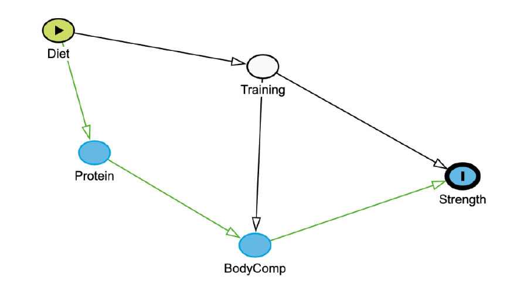

**Figure 25.** DAG for the effect of a vegan diet on strength

Here is another simple DAG example where on this occasion we need to control for a variable to make sure we analyse the causal relationship. If we wanted to look at the effect of "Experience of School Sport" on "Physical Activity", we could set up the following DAG where our exposure variable is "Experience of School Sport", the outcome variable is "Physical Activity". If we were to just regress "Experience of School Sport" on "Physical Activity (i.e. Physical Activity \~ Experience of Sport at School), we would get a biased answer. To obtain an unbiased answer we need to condition on the "Quality of Physical Education" (see Figure 26 below). In a regression model, this would mean Physical Activity \~ Experience of Sport at School + Quality of Physical Education.

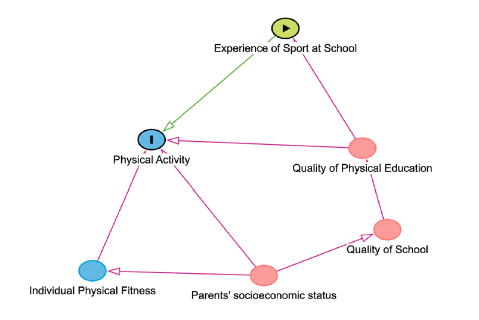

**Figure 26.** The "Experience of School Sport" on "Physical Activity" an example of the need to control for a confounder.

Click the following link for a useful introduction to DAGs and causal influences: [Casual]{.underline} [Influence: The Mixtape.]{.underline}

## Data visualization, exploratory data analysis and description {#ch05-data-visualization-exploratory-data-analysis-and-description}

Exploratory data analysis (EDA) is arguably the most important stage of any project involving statistical analysis of quantitative data and we recommend that this should be conducted prior to any formal statistical analysis. EDA involves examining our data and making sure that the data is both what we expect and that it meets the assumptions of any statistical procedure we want to use. EDA means we can avoid the '[garbage in garbage out]{.underline}' problem. We can apply EDA to both quantitative data and to qualitative data, but as this chapter is about quantitative data that is what we will discuss below.

### What do we use EDA for? {#ch05-what-do-we-use-eda-for}

There are different ways to examine quantitative data, with the two main parameters of interest generally beingthe central tendency (where the centre of the data is on the number line) and the spread (how spread out the data is on the number line). Summary statistics are one common approach. You are probably already familiar with several summaries of central tendency (e.g. mean & median) and summaries of spread (e.g. standard deviation, range). One widely used set of summary statistics is the [five number summary]{.underline}. The five number summary presents five sample percentiles: the minimum; the 25th percentile - 25% of data below this value; 75% of data above this value; the median (50th percentile) - 50% of data above; 50% of data below this value; the 75th percentile - 75% of data below this value; 25% of data above this value the maximum.

### Why is plotting best? {#ch05-why-is-plotting-best}

Numerical summaries such as reporting the mean and standard deviation, or the five number summary, are useful, but they do not tell the full story and they can hide a lot of detail in data. The best way to carry out EDA is to plot the data. One example of the importance of plotting is provided by the [Anscombe\'s quartet]{.underline}. This is a collection of four datasets which have nearly identical summary statistics. Table 4 below shows the data within each dataset, each of which have very similar means, standard deviations and (x,y) correlations. Furthermore, the regression coefficients (intercept and slope) and the R^2^ values between x & y in each dataset are also very similar.

**Table 4.** Anscombe's quartet.

+---------+---------+---------+---------+----------+----------+----------+----------+
| Dataset A         | Dataset B         | Dataset C           | Dataset D           |
+---------+---------+---------+---------+----------+----------+----------+----------+
| X       | Y       | X       | Y       | X        | Y        | X        | Y        |
+---------+---------+---------+---------+----------+----------+----------+----------+
| 10.0    | 8.04    | 10.0    | 9.14    | 10.0     | 7.46     | 8.0      | 6.58     |
+---------+---------+---------+---------+----------+----------+----------+----------+
| 8.0     | 6.95    | 8.0     | 8.14    | 8.0      | 6.77     | 8.0      | 5.76     |
+---------+---------+---------+---------+----------+----------+----------+----------+
| 13.0    | 7.58    | 13.0    | 8.74    | 13.0     | 12.74    | 8.0      | 7.71     |
+---------+---------+---------+---------+----------+----------+----------+----------+
| 9.0     | 8.81    | 9.0     | 8.77    | 9.0      | 7.11     | 8.0      | 8.84     |
+---------+---------+---------+---------+----------+----------+----------+----------+
| 11.0    | 8.33    | 11.0    | 9.26    | 11.0     | 7.81     | 8.0      | 8.47     |
+---------+---------+---------+---------+----------+----------+----------+----------+
| 14.0    | 9.96    | 14.0    | 8.10    | 14.0     | 8.84     | 8.0      | 7.04     |
+---------+---------+---------+---------+----------+----------+----------+----------+
| 6.0     | 7.24    | 6.0     | 6.13    | 6.0      | 6.08     | 8.0      | 5.25     |
+---------+---------+---------+---------+----------+----------+----------+----------+
| 4.0     | 4.26    | 4.0     | 3.10    | 4.0      | 5.39     | 19.0     | 12.50    |
+---------+---------+---------+---------+----------+----------+----------+----------+
| 12.0    | 10.84   | 12.0    | 9.13    | 12.0     | 8.15     | 8.0      | 5.56     |
+---------+---------+---------+---------+----------+----------+----------+----------+
| 7.0     | 4.82    | 7.0     | 7.26    | 7.0      | 6.42     | 8.0      | 7.91     |
+---------+---------+---------+---------+----------+----------+----------+----------+
| 5.0     | 5.68    | 5.0     | 4.74    | 5.0      | 5.73     | 8.0      | 6.89     |
+---------+---------+---------+---------+----------+----------+----------+----------+

The summary statistics are shown in Table 5 below. As far as we're concerned based on Table 5 below each dataset has the same centre, the same spread and the same correlation. If we only generated these summary statistics, we might conclude that these datasets all looked the same and had the same relationship between x and y.

**Table 5.** Summary statistics for each of the four datasets in Anscombe's quartet.

  ----------------------- -------------------
  **Summary statistic**   **Value**

  Mean of x               9

  Variance of x           11

  Mean of y               7.5

  Variance of y           4.125

  Correlation x & y       0.816

  Regression line x & y   y = 3.00 + 0.500x

  R^2^ x & y              0.67
  ----------------------- -------------------

Plotting the datasets however tells another story.

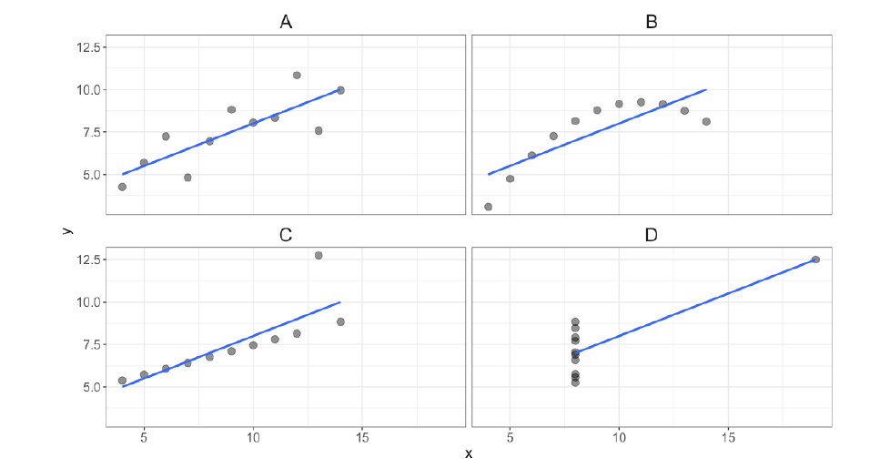

**Figure 27.** Scatterplots of the four datasets in Anscombe's quartet with a least squares regression line fit through each dataset.

The plot in Figure 27, makes it obvious that the relationship between x and y in each of the four datasets is quite different. Anscombe's quartet also illustrates the usefulness of plotting for detecting extreme values. In datasets C & D there are single values that lie away from the bulk of the data. Often the temptation is to remove these values because they are 'outliers'. However, we should really consider whether these values are realistic given the context we are working in. If the extreme values could be real then we should not remove them. A similar example but with more extreme relationships is the [Datasaurus]{.underline}.

### Useful basic plots for EDA {#ch05-useful-basic-plots-for-eda}

The graphical exploration of Anscombe's quartet provides us with more information than summary statistics alone. There are several basic plots (and many more advanced plots we won't cover) that we can use in EDA. Scatterplots like those in figure 27 are used when we want to examine the relationship between two (or sometimes three) continuous variables. We can also use colour or symbol shape in scatterplots to represent a categorical variable. For example, Figure 28 below shows the x and y values for all four of Anscombe's datasets in one plot and we have represented the 'dataset' variable by colour. If you use colour or different symbols in this way it is important to include a legend so that the reader (possibly you some weeks later!) knows what the different colours or symbols mean. Scatterplots are the basic 'go to' plot for examining relationships between continuous variables. However, it can be difficult to clearly separate points if they fall close to each other. In the plot below we can see an example at (10,8) where a red and a blue point fall on top of each other. Without colour it would be hard to tell that there are two different points here.

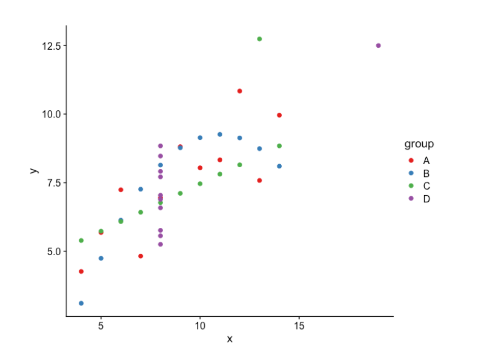

**Figure 28.** Scatterplot showing all four of the Anscombe's quartet datasets on one plot. Here could represents dataset for each point.

As noted above we are often concerned with the datasets central tendency and its spread Box-and-whisker plots and histograms are particularly useful for demonstrating these parameters.

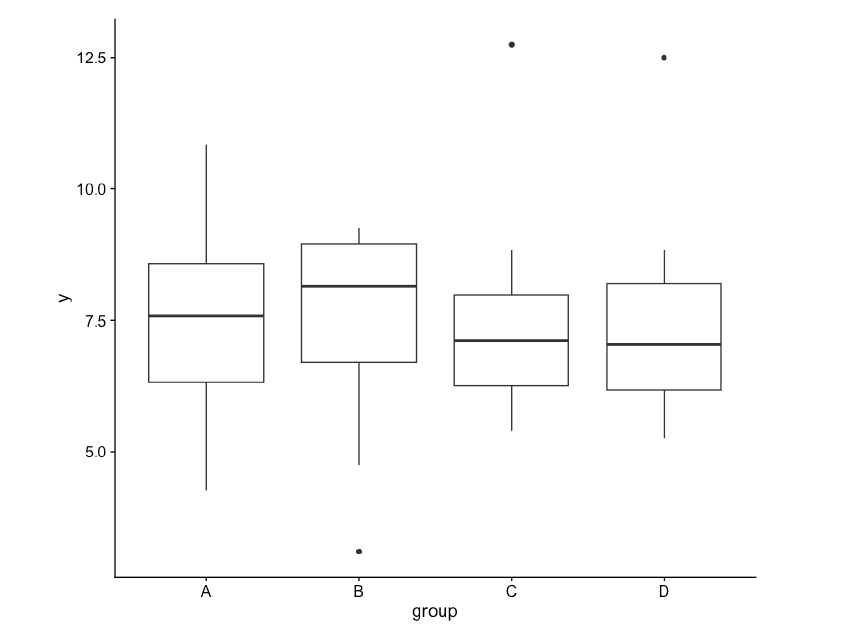

**Figure 29.** Box & whisker plots of the y variable from each of the Anscombe's quartet datasets.

Box and whisker plots are useful for examining continuous data in different categories. These plots lay out the five number summary in graphical form and indicate the distribution of the data. The central line is at the median and the borders of the box are at the 25th and 75th quartiles; 25% of the data lies below the box and 25% of the data lies above the box. The box itself spans the middle 50% of the data. The spines extending from the box indicate the minimum and maximum values. Most software that draws box and whisker plots also has some calculation to define extreme values and these are usually plotted as points. This extreme value definition is usually 1.5 times the interquartile range, although different softwares use different parameters. In Figure 29 above we can see that datasets B, C & D have 'extreme' values. We can also see that the medians are all approximately the same and that whilst datasets A, C & D are all fairly symmetrical, dataset B is asymmetrical with more low values than high values. One disadvantage of boxplots is that they do not typically show individual values (except for extreme values), although these can be added to provide additional context. Note that boxplots should not be used for smaller datasets with only a few points.

Histograms present a visual representation of the number of observations within a defined interval using bar heights. Like boxplots histograms can be used to examine the distribution of data. Figure 30 below shows a histogram of the y values from the Anscombe's quartet data. These histograms suggest that the y-values from Anscombe's quartet follow an approximately bell-shaped distribution with a central value of about 7.5 and ranging from around 2.5 to around 12.5. The bars in histograms represent the count of data in bin widths of (usually) fixed size. Software will usually choose the bin size for you, but you should be aware that different bin sizes lead to different visual representations of data in histograms. The plot on the left above has a bin width of about 0.3; the bar heights represent the number of datapoints in each 0.3-unit interval on the x-axis. The histogram on the right has a bin size of 1; the bar heights represent the number of values in each one-unit bin on the x-axis.These plots look quite different and give somewhat different impressions of the underlying data.

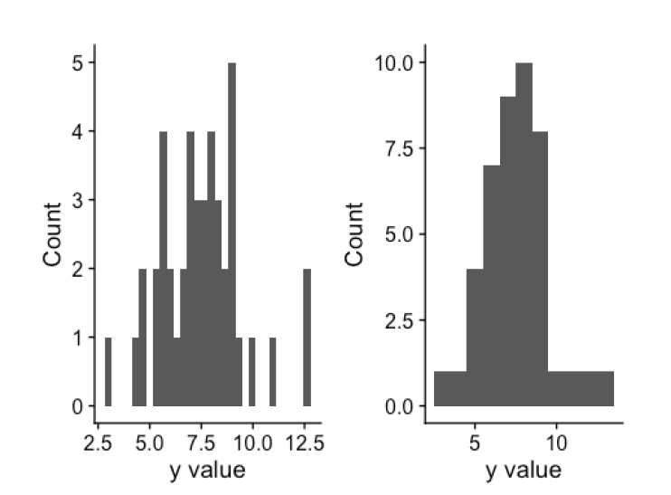

**Figure 30.** Histograms of the y data from Anscombe's quartet combined across all groups.

Barplots are often used to present a summary of data such as the mean (Figure 31; left panel). The height of the bar represents the value of the summary statistic and there may be error bars indicating the variability of that summary value. You should pay careful attention to what the error bars are. Common error bars used are the standard deviation (which tells you about variability in the data), the standard error (which tells you about variability in the mean over many study repeats) and 95% confidence intervals (which tell you about a plausible range of the mean). Note that confidence intervals, like p-values are easy to misinterpret. Confidence intervals are not the same as Bayesian 95% credible intervals! For example, you cannot say that there is a '95% probability that the population mean lies in the 95% confidence interval'. What you can say is that if you repeated your study 100 times then 95% of the intervals generated would contain the population mean. See [@greenlandStatisticalTestsValues2016] for guidance.

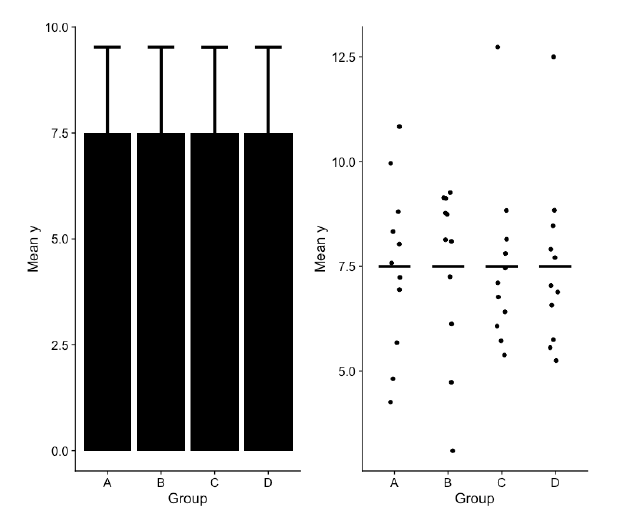

**Figure 31.** Barplot and jittered dot plot of the y values from Anscombe's quartet.

Barplots have been criticised for hiding the actual data underlying the summary statistic they represent. Barplots also imply that the data in different groups all span the same range. In the figure above the barplot suggests that data from all three groups spans a range from 0 to approximately 9.5. In the right-hand panel of Figure 31 above we have shown a jittered dotplot with horizontal bars representing the mean value. Hopefully it is clear to you that the dotplot has much more information in it than the barplot. In the dotplot we can see the individual values, we get a better sense of the range and the distribution of those values. The dot plot makes it clear that the data generally span a range from \~4 to \~12.5 but that datasets C & D have smaller ranges than datasets A & B. Although not available in all statistical software yet, dotplots are preferred as a visualisation because they make it easy to examine the underlying data, whilst simple barplots hide and possibly distort the underlying data. As such, we recommend always displaying individual data on images when feasible, not only for EDA, but also when reporting statistical outputs and results (see [Chapter 9](09-writing-and-peer-review.qmd) for further discussion of reporting results in scientific articles).

If we have data that vary over time then lineplots are useful. Below we show finishing times for the Boston marathon from 1970 to 1999 from the [OpenIntro]{.underline} datasets. We have used two curves to represent male and female average finishing times.

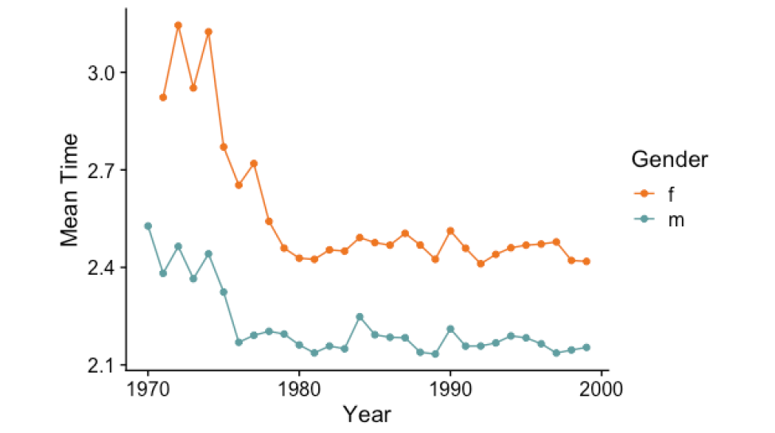

**Figure 32.** Finishing times for the Boston marathon from 1970 to 1999

The year is plotted on the x-axis and the mean finishing times are plotted on the y-axis. The points in Figure 32 represent the mean race time for each year. The addition of the lines connecting the points helps to clarify that these data are changing over time. The idea being conveyed is that there is some connection between successive points. We would not use a plot like this if we were plotting finishing times from different individuals. We might use points in that case but because there is no connection between different individuals the lines would convey a misleading message.

In summary EDA is the most important step in any data analysis project. Effective EDA means you avoid making decisions based on dubious data. Whilst summary statistics are useful, there is no substitute for plots and basic plots which can get you a long way in EDA. Further reading on choosing, constructing and intepreting commonly used data plots can be found in the paper by [Angra and Gardner]{.underline} [@angraDevelopmentFrameworkGraph2016]

## Summary {#ch05-summary}

This chapter examined quantitative decision-making tools commonly used by sports and exercise scientists. It emphasises the need for proper data analysis to advance sport and exercise science and avoid wasting efforts or making misleading claims.

The chapter begins with inference, describing how appropriate statistical inference reduces uncertainty about observations and informs decisions. Following this, classical, frequentist and subjective probability is discussed.. The chapter then explores null-hypothesis significance testing (NHST) and looks at common misinterpretations of p-values. Then, Bayesian inference is introduced, including the use of Bayes Factors and the concept of the Region of Practical Equivalence (ROPE). The discussion then moved on to approaches to quantify uncertainty using bayesian credible intervals and frequentist intervals, along with different approaches to determine effect size and their practical significance in sport and exercise contexts. The chapter then discussed causal effects, highlighting the importance of observation, intervention, but also imagination in establishing causality, and summarising commonly used methods, including . randomised controlled experiments, longitudinal studies, and causal modelling to help researchers establish cause-and-effect relationships. Finally, the chapter next covered data visualisation and exploratory data analysis (EDA), emphasising the importance of EDA in ensuring data quality and meeting statistical assumptions.

## Take-Home message {#ch05-take-home-message}

Some of the statistical concepts discussed in this chapter can be challenging. If you find certain topics difficult, do not be too concerned. Even experienced editors and researchers can misunderstand statistics and make mistakes. By taking the time to grasp and understand these concepts, you will have a head start on many researchers in sport and exercise science and related disciplines. Remember, small details can make a real difference, so paying attention to the fine print is important. It is normal to need to read some sections multiple times until they make sense, but the effort will be worth it in the end.
