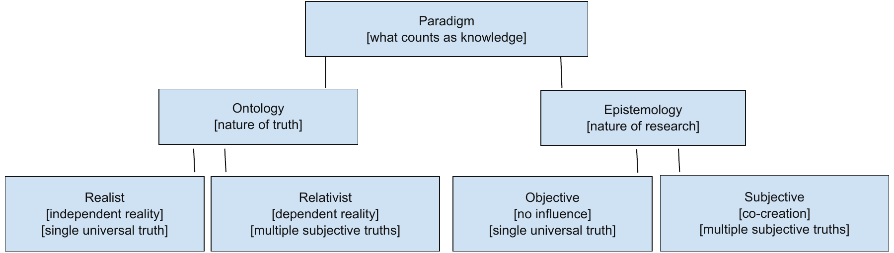
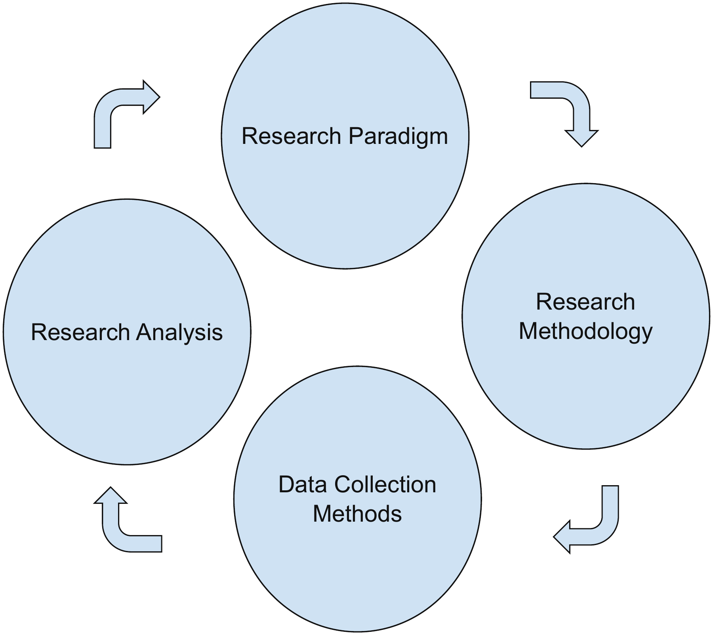
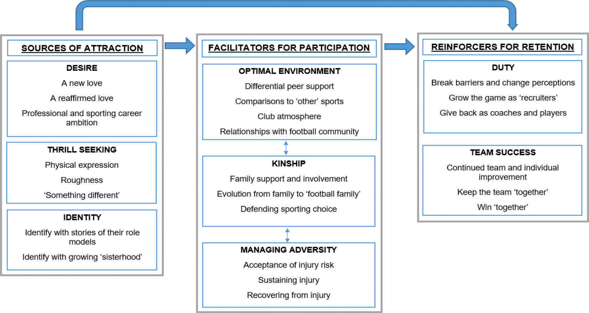

---
{
  "citation": false,
  "google-scholar": false
}
---

# Qualitative data analysis {#sec-qualitative-analysis}

*Lisa Trainor & Andrea Bundon*

[Affiliations]{.mark}

## Introduction {#introduction-3}

The previous chapter addressed a specific form of qualitative data collection that is commonly used in sport and exercise science, namely interviews. Other forms of qualitative data collection include focus groups with participants, photographs, existing texts (e.g., policy documents, news articles) oronline content (e.g., websites or social media posts). The methods of conducting an analysis of qualitative datasets are equally diverse. Qualitative data analysis encompasses a range of methods that can be used to engage with, understand, and interpret what has been collected. When setting out to complete a qualitative analysis for the first time it can often feel challenging to deal with the flexibility and ambiguity of qualitative methods. With no strict guidelines, no hard and dry rules, it can leave the researcher yearning for some guidance. In this chapter we provide a brief overview of the more common approaches to qualitative data analysis. We discuss what to consider when making a decision about the type of analytical method to employ and we draw attention to examples of the 'methods in action' so that you can see how others have designed their research and carried out their analysis. To do this, we start with a discussion of research paradigms which will set the tone and guide your research study.

## Navigating paradigms {#ch07-navigating-paradigms}

The term research paradigm refers to the set of ideas, beliefs or assumptions that underpin the method or model used to conduct research. In Chapter 1, the term paradigm was described in terms of "philosophical positionality" and various philosophical positions were described (LINK).If we think about research in general, most people will think about hypothesis testing, experiments, and clinical trials. What we might not realize is these approaches to research derive from what many consider to be *the* dominant research paradigm. In other words, we do not reflect on the underlying assumptions of the dominant paradigm, because it is so dominant! But it is important to be aware that various paradigms exist, and each have their place. Before we discuss this further, we want you to ask yourself a few questions:

- What counts as knowledge?

- What is 'truth'?

- Is there one truth? Can there be multiple truths?

- How do you gain knowledge?

- How do you find knowledge?

All of these questions get at research paradigms.

### What is a research paradigm? {#ch07-what-is-a-research-paradigm}

A **research paradigm** is a way of viewing the world, providing a framework with a set of assumptions that guide a research study [@creswellQualitativeInquiryResearch2013; @gubaCompetingParadigmsQualitative1994]. Research paradigms are essential to *all* research studies. The problem is that researchers are not often taught to think about the paradigmatic underpinnings of the research methods they employ and/or do their research in contexts where the assumptions that guide the research remain unspoken, precisely because they are shared by the majority. Why are we discussing research paradigms in a chapter about qualitative data analysis when all research studies are underpinned by a paradigmatic worldview? Well, though there are exceptions, *most* quantitative research is conducted from a positivist paradigm, which is underpinned by the belief that there is an objective reality or truth that can be assessed independent of the individual, whereas qualitative research is more likely to be conducted from multiple paradigms. This means that those researching using quantitative methods are less likely to discuss or debate how their methods align with their research paradigm (although some would argue that they should -- see [Chapter 1](01-foundations.qmd)), whereas researchers employing qualitative methods need to reflect upon and make decisions about which paradigm is best suited to their work and how this impacts their methodological decisions (including how they will analyse their data). Below, we will outline the basic components of research paradigms as well as an overview of different research paradigms. Understanding these, and the difference between types of paradigms will help you conduct methodologically coherent research including selecting the appropriate form of data analysis.

A research paradigm provides a set of assumptions regarding a general orientation to the word and what counts as knowledge [@creswellResearchDesignQualitative2014]. Each research paradigm outlines a belief about how research questions should be understood and addressed [@kuhnStructureScientificRevolutions2012]. A research paradigm is a "basic belief system based on ontological, epistemological, and methodological assumptions\'\' [@gubaCompetingParadigmsQualitative1994] 1004, p. 107)). Thus, each research paradigm is associated with a particular ontology and epistemology (see [Figure 1](#figure-ch07-1)).

**Ontology** refers to one's assumptions about the nature of truth/reality [@creswellResearchDesignQualitative2014; @gubaCompetingParadigmsQualitative1994]. Essentially, this means *what do we believe exists and how does it exist? Is there a reality that can be accessed independently* or *is reality dependent on who, what, when, and where?* Different answers to this question outline the two different ontological positions - realist (or realism) and relativist (or relativism)**.** A **realist ontology** assumes that knowledge is 'out' in the world to be found and evaluated independently, whereas a **relativist ontology** assumes that knowledge is dependent on those experiencing and interpreting it. For example, if you were studying anxiety in elite athletes, those using a realist ontology might use the Diagnostic and Statistical Manual of Mental Disorders to [measure a 'level']{.underline} of anxiety, whereas those using a relativist ontology might interview different athletes with anxiety in sport to understand the [individual experience.]{.underline}

**Epistemology** refers to one's assumptions of the nature of knowledge, that is *how* we acquire knowledge ([@gubaCompetingParadigmsQualitative1994]. We can ask ourselves *how does the researcher obtain knowledge, how is knowledge produced, what counts as knowledge, how can we claim knowledge?* Different answers to this question outline the two different epistemological positions - objective (or objectivist) and subjective (or subjectivist). An **objective epistemology** assumes that knowledge can be acquired by the researcher while keeping complete separation from the researched (e.g., the purpose of conducting a double-blind randomized controlled study is to attempt to isolate any findings to the intervention itself, independent of the perspective of either the researcher or volunteer, as described in [Chapter 4](04-quantitative-data-collection.qmd); objective facts are gathered to seek a singular universal truth. A **subjective epistemology** assumes that knowledge cannot be acquired value-free; the researcher's subjectivity unequivocally influences the creation and production of knowledge where the result is multiple subjective truths (i.e., dependent on *who* is acquiring data). Again, if we look at the example of studying anxiety in elite athletes, those using a realist ontology might use the Diagnostic and Statistical Manual of Mental Disorders to collect data because this is an [objective, valid, and reliable tool]{.underline}, whereas those using a relativist ontology might interview because they can ask [contextualized questions and co-construct knowledge]{.underline} with the participant.

{fig-alt="Recovered source diagram of research paradigms."}

**Figure 1.** Research Paradigms, Ontology and Epistemology

**Methodology** refers to how one goes about collecting knowledge - the 'gateway' to accessing truth. A research paradigm, ontology, and epistemology will inform and guide *what counts as knowledge, the nature of truth, and the nature of research.* This means that you will need to select a methodology that aligns with your research paradigm. At the broadest level the types of methodology include **quantitative** and **qualitative.** Quantitative and qualitative methods often differ in their paradigmatic assumptions, which means that they may have different guiding principles around research (see [Table 1](#table-ch07-1)), although as described in [Chapter 1, Research Methodologies](01-foundations.qmd#ch01-research-methodologies), these approaches are not necessarily as dichotomous as many may believe, and much of what is perceived as dichotomous differences often reflects the underlying paradigms from which researchers often come, as opposed to inherent qualities of these methodological approaches. If we look at our example of anxiety and elite athletes one more time, we can conduct a quantitative study by exploring the [prevalence]{.underline} of anxiety disorders in a sample of elite athletes after four years training for the Olympic or Paralympic Games, whereas we could conduct a qualitative study exploring [why and how]{.underline} elite athletes experience anxiety in sport.

Below we have outlined the main paradigmatic differences commonly observed between quantitative and qualitative research. Please note that this is not an exhaustive list and that the paradigmatic assumptions may differ from what is listed below (i.e., depending on the specific research paradigm employed), these are the 'generic' assumptions to help you get started.

**Table 1.** Quantitative and Qualitative Paradigmatic Differences

+---------------------------------------+------------------------------------------------+
| **Quantitative**                      | **Qualitative**                                |
|                                       |                                                |
| - Typically a realist ontology        | - Typically a relativist ontology              |
|                                       |                                                |
| - Typically an objective epistemology | - Typically a subjective epistemology          |
|                                       |                                                |
| - Collect numerical data              | - Collect words, stories, images as data       |
|                                       |                                                |
| - Aim to test and falsify             | - Aim to explore subjective experience         |
|                                       |                                                |
| - Typically seeking a universal truth | - Typically seeking multiple subjective truths |
+---------------------------------------+------------------------------------------------+

### Types of Research Paradigms {#ch07-types-of-research-paradigms}

Below we will discuss five of the more prominent research paradigms guiding research today. Again, this is not an exhaustive list, but rather meant as a starting point for understanding and learning about different research paradigms. To start, **research paradigms are foundational to all research studies** - this is because they dictate the nature of truth (what counts as knowledge and what claims can be made) as well as the nature of research (type of research, methodology, and methods). As mentioned above there are a number of different research paradigms that can be employed to guide your research study. Some of the paradigms are more aligned with quantitative methods whereas others are more suited to qualitative methods due to the methodological assumptions - this is why the chart above outlined generic quantitative and qualitative assumptions. The five paradigms we will discuss below include **positivist; post-positivist; interpretive/constructivism; critical/constructionism; and post-modern/structural/critical** (see [Table 2](#table-ch07-2)). Please note there are many different names for research paradigms, and oftentimes there is overlap between differently named research paradigms. As recommended in [Chapter 1](01-foundations.qmd), the most important thing is to reflect on your core beliefs and values as a researcher, to be coherent in your design and analysis and to clearly articulate your perspective in your writing.

#### Positivist \[realist ontology; objective epistemology\] {#ch07-positivist-realist-ontology-objective-epistemology}

A positivist research paradigm is often viewed as *the* dominant research paradigm. Within positivism there is the belief that there is a single reality (or truth) that can be accessed independent of the individual; in other words, a single objective truth is 'out there in the world' to be found. Common assumptions of this paradigm include determinism (cause and effect) and reductionism (reduce ideas to small testable research questions), which is why positivist research typically includes a hypothesis. It is important that the researcher remains objective, free of bias, and impartial during the research process. The aim of positivism is to test and falsify to prove a single truth.

#### Post-positivism/Critical Realism \[realist ontology; objective epistemology\] {#ch07-post-positivismcritical-realism-realist-ontology-objective-epistemology}

Post-positivism/critical realism succeeds positivism, blending components of positivism and interpretivism. In post-positivism/critical realism there is the belief that there is a single reality (or truth) that can be accessed independent of the individual *but* post-positivist/critical realists are critical of their ability to 'access' this reality (i.e., they will ask: *is it possible to know reality with 100% certainty*?) [@bhaskarReclaimingRealityCritical1989]. Further, in this paradigm there is the assumption that we should strive for objectivity, but we can never be completely objective. The aim of post-positivism/critical realism is to attempt to access the single objective truth, but with an awareness that it might not be accurate or that all answers are partial and incomplete.

#### Interpretive/Constructivism \[relativist ontology; subjective epistemology\] {#ch07-interpretiveconstructivism-relativist-ontology-subjective-epistemology}

An interpretive or constructivist research paradigm are typically the most common qualitative research paradigms. Within this paradigm there is the belief that reality (or truth) is dependent on the context, meaning that multiple subjective realities exist. Common assumptions include the notion that meaning (reality/truth) is subjective and socially constructed. The researcher plays an important role in the collection of data and the construction of findings; the researcher is 'active' and imparts their 'subjectivity' during the research process. For example, if you are having a conversation with a friend, the development and outcome of the conversation is a by-product of both people asking questions and answering questions - no one is right or wrong, rather the result 'is what it is' based on the conversation you had with the particular people you spoke to. If you were to speak to another person about the same topic, the conversation would unfold in different ways. If we switch this context to an interview, the researcher asks questions and the participant answers questions, together they 'create' data; the researcher then analyzes the data to construct findings (see [Chapter 6](06-interviewing.qmd) for further discussion of the "Craft of Interviewing"). As Grix [-@grixFoundationsResearch2004] outlines, "researchers are inextricably part of the social reality being researched, i.e., they are not 'detached' from the subject they are studying" (p.83). The aim is to understand individuals\' socially constructed realities.

#### Constructionism \[relativist ontology; subjective epistemology\] {#ch07-constructionism-relativist-ontology-subjective-epistemology}

A constructionism research paradigm assumes that one's reality is a product of one's interaction with dominant discourses in society, cultural, and specific moments in time [@burrSocialConstructionism2017]. In essence, one's reality is a result of how the world is presented or represented through language, which influences how one understands and perceives the world. This understanding varies culturally (place to place) and historically (time to time) [@burrSocialConstructionism2017]. Further dominant discourses, culturally significant broad systems of meaning [@speerGenderTalkFeminism2005], and power relations (which contribute to producing dominant discourses) also shape how one makes sense of the world. This is tied to the assumption that knowledge (reality/truth) are always tied to power [@burrSocialConstructionism2017]. Constructionism research focuses heavily on symbolic systems in society and needs to contextualize research findings. Within constructionism there is no single reality, rather reality/truth is dependent on culture, history, and discourses [@burrSocialConstructionism2017].

#### Post-Modern/Structural/Critical \[relativist ontology; subjective epistemology\] {#ch07-post-modernstructuralcritical-relativist-ontology-subjective-epistemology}

In a post-modern, structural, or critical research paradigm all social, political, cultural, and economic forces can influence one's reality (or truth). Within these paradigms there is usually a focus on power, inequality, and social change. The research topic critically views ideological forces (e.g., racism, sexism, classism, ableism etc.) and taken-for granted assumptions. Specifically, within a critical research paradigm there is often a focus on social change. To prevent further inequality and marginalization, research conducted from this paradigm is typically collaborative involving individuals who have lived experiences of discrimination, oppression and marginalization.

#### Summary {#summary-1}

We have now discussed five of the more prominent research paradigms guiding research. You will have noticed that each type of research paradigm differs in its underlying assumptions (nature of truth) and research and methodology (nature of research) (see [Table 2](#table-ch07-2)). It is important to select the research paradigm that is aligned with your methodology, and ultimately your research question.

**Table 2.** Research Paradigms

+---------------------------------------------------------------------------------------------------------------------------------------------------------------+----------------------------------------------------------------------------------------+-----------------------------------------------------------------------------------------------------------+--------------------------------------------------------------------------------------------------------------------------------+----------------------------------------------------------------------------------------------------------------------------------------------------------------------------------------------------+----------------------------------------------------------------------------------------------------------------------------------------------------------------------------------------------------------------------+
| **Paradigm**                                                                                                                                                  | **Positivist**                                                                         | **Post-Positivist/ Critical Realism**                                                                     | **Interpretive / Constructivism**                                                                                              | **Constructionism**                                                                                                                                                                                | **Post-Modern / Structural / Critical**                                                                                                                                                                              |
+---------------------------------------------------------------------------------------------------------------------------------------------------------------+----------------------------------------------------------------------------------------+-----------------------------------------------------------------------------------------------------------+--------------------------------------------------------------------------------------------------------------------------------+----------------------------------------------------------------------------------------------------------------------------------------------------------------------------------------------------+----------------------------------------------------------------------------------------------------------------------------------------------------------------------------------------------------------------------+
| **Aim**                                                                                                                                                       | Testing and falsification to prove and discover a single truth.                        | Attempt to access single truth, but critical of ability to be accurate.                                   | Understand how individuals interpret their subjective experiences in a particular context.                                     | Understand how individuals interpret their subjective experiences but with an emphasis on language, discourse, culture, and power.                                                                 | Challenge dominant understandings of knowledge with an emphasis on ideological forces, power relations, and collaboration with participants.                                                                         |
+---------------------------------------------------------------------------------------------------------------------------------------------------------------+----------------------------------------------------------------------------------------+-----------------------------------------------------------------------------------------------------------+--------------------------------------------------------------------------------------------------------------------------------+----------------------------------------------------------------------------------------------------------------------------------------------------------------------------------------------------+----------------------------------------------------------------------------------------------------------------------------------------------------------------------------------------------------------------------+
| **Ontology**                                                                                                                                                  | **Realist:** independent, objective, and single truth to be discovered.                | **Realist:** independent, objective, and single truth to be discovered but sometimes impacted by context. | **Relativist:** context dependent, subjective, and multiple truths to be constructed.                                          | **Relativist:** context dependent, subjective, influenced by culture and power, and multiple truths to be constructed.                                                                             | **Relativist:** context dependent, subjective, influenced by ideological forces, and multiple truths to be constructed.                                                                                              |
+---------------------------------------------------------------------------------------------------------------------------------------------------------------+----------------------------------------------------------------------------------------+-----------------------------------------------------------------------------------------------------------+--------------------------------------------------------------------------------------------------------------------------------+----------------------------------------------------------------------------------------------------------------------------------------------------------------------------------------------------+----------------------------------------------------------------------------------------------------------------------------------------------------------------------------------------------------------------------+
| **Epistemology**                                                                                                                                              | **Objective:** remained unbiased, utilized valid and reliable methods to collect data. | **Objective:** try to remain unbiased but will impact subjectivity sometimes.                             | **Subjective:** impart subjectivity; data is created through interaction and co-construction; findings need to be interpreted. | **Subjective:** impart subjectivity; data is created through interaction and co-construction but mediated by power relations; findings need to be interpreted with attention to culture and power. | **Subjective:** impart subjectivity; data is created through interaction and co-construction but mediated by ideological forces.; findings need to be interpreted and an emphasis placed on producing social change. |
+---------------------------------------------------------------------------------------------------------------------------------------------------------------+----------------------------------------------------------------------------------------+-----------------------------------------------------------------------------------------------------------+--------------------------------------------------------------------------------------------------------------------------------+----------------------------------------------------------------------------------------------------------------------------------------------------------------------------------------------------+----------------------------------------------------------------------------------------------------------------------------------------------------------------------------------------------------------------------+
| **Methodology**                                                                                                                                               | **Quantitative** (e.g., experimental, correlational, cross-sectional, etc.).           | **Quantitative / Qualitative**                                                                            | **Qualitative** (e.g.,content analysis, grounded theory, thematic analysis, etc.).                                             | **Qualitative** (e.g., narrative analysis, phenomenology, reflexive thematic analysis).                                                                                                            | **Qualitative** (e.g., ethnography, phenomenology, reflexive thematic analysis).                                                                                                                                     |
|                                                                                                                                                               |                                                                                        |                                                                                                           |                                                                                                                                |                                                                                                                                                                                                    |                                                                                                                                                                                                                      |
| (note: these are examples of the *most typically* applied methodologies but there are no hard and fast rules as to which designs aligns with which paradigms) |                                                                                        | (e.g., coding reliability, directed content analysis, etc.)                                               |                                                                                                                                |                                                                                                                                                                                                    |                                                                                                                                                                                                                      |
+---------------------------------------------------------------------------------------------------------------------------------------------------------------+----------------------------------------------------------------------------------------+-----------------------------------------------------------------------------------------------------------+--------------------------------------------------------------------------------------------------------------------------------+----------------------------------------------------------------------------------------------------------------------------------------------------------------------------------------------------+----------------------------------------------------------------------------------------------------------------------------------------------------------------------------------------------------------------------+

## Methodological coherence {#ch07-methodological-coherence}

The key to methodological coherence is making sure that each part of your research design paradigmatically fits with one another. We can think about methodological coherence as a '**domino effect**', meaning that your research question determines the paradigm you are operating from, the methodological design (methodology), the methods you will use to collect data, and the analysis that will guide your study. Furthermore, we would point out that while some researchers might spend their entire careers researching from a particular paradigm -- perhaps because it resonates with how they view and experience the world -- other researchers may change their paradigmatic position depending on what they are studying or the aims of a particular project. For example, a researcher could employ a critical or post-modern research paradigm and 'feminist participatory action research methods' [@frisbyPuttingParticipatoryParticipatory2005] to collaborate with women athletes from racialized communities with a focus on understanding their experiences of racism and sexism in the sport system. That same researcher could then use those findings from the work with the athletes to develop a 'cultural awareness' training for sport coaches and study the effectiveness of the training from a critical realist paradigm using pre and post intervention measures. The most important consideration is that each of these methodological elements need to align with each other to create methodological coherence (see [Figure 2](#figure-ch07-2)).

{fig-alt="Recovered source diagram of methodological coherence."}

**Figure 2.** Methodological coherence

::: book-box
*Think about it:* Consider your tentative research question - what are the underlying paradigmatic assumptions *(i.e., are you looking to test and falsify or explore multiple perspectives, are you seeking a universal truth or multiple subjective truths, what might be the best method to collect data to answer your research question?)*. These questions will help determine your underlying paradigmatic assumptions which will subsequently help you determine the type of research paradigm to employ, the methodology to select, the method to collect data, and the analysis to choose. Make sure the dominos are lined up!
:::

## Choosing the right analysis for qualitative research {#ch07-choosing-the-right-analysis-for-qualitative-research}

There are so many different types of qualitative analyses that we are unable to cover the full breadth of this topic. However, below we will outline the five most common approaches to analysing qualitative data: *1. Thematic Analysis 2. Content Analysis 3. Narrative Analysis 4. Grounded Theory 5. Phenomenology.* You will notice that each analysis is specific, drawing on particular paradigmatic assumptions and values. No one analysis will be the 'perfect' choice, rather it is a process of determining the **best suited analysis** for your research project; considering the purpose, goals, aims, and intended outcomes.

### Thematic analysis {#ch07-thematic-analysis}

Thematic analysis is one of, if not, the most common approach to analyzing qualitative data. In the broadest sense, thematic analysis refers to a process whereby the researcher examines a dataset (most commonly consisting of text from interviews with participants but the process can also be applied to other forms of qualitative data) and develops themes. Despite the popular use of thematic analysis, there is confusion surrounding its application. To start, a common misconception is that thematic analysis is atheoretical -- this is indeed not the case if you want to complete high quality thematic analysis. Rather, thematic analysis is *theoretically flexible* (or rather **paradigmatically flexible**), where different paradigms can be used to guide the application of analysis [@braunReflectingReflexiveThematic2019; @trainorDevelopingCraftReflexive2021]. Thematic analysis is best conceptualized as an umbrella term to encapsulate three *different types* of thematic analysis: **coding reliability, codebook,** and **reflexive approaches**. For a more detailed discussion on the three types of thematic analysis see Braun and Clarke [-@braunConceptualDesignThinking2022]. These types of thematic analysis are tied to specific paradigms, respectively ranging from (more) positivist (quantitative in nature) to (more) interpretive (qualitative in nature). Thematic analysis is best used for research questions that focus on personal experience and meaning making [@braunCanUseTA2021]. For example, a thematic analysis could be used to answer the question of 'how do athletes experience psychological well-being during sport injury recovery?' [@trainorRebalancingActInjured2020] or 'how do para-athletes create social change around disability?' [@haslettParaAthleteActivism2020].

#### Coding reliability {#ch07-coding-reliability}

Coding reliability approaches to thematic analysis are the most descriptive in nature and draw on values that are more aligned with aspects of quantitative research and a post-positivist research paradigm, such as eliminating bias, accuracy, reliability, searching for the 'truth' in the data, and reaching consensus. To abide by these values, there is a structured approach to coding where multiple researchers develop a codebook or coding framework to 'fit' the data to the codebook and reach consensus. In this type of thematic analysis, 'themes' are more like domain summaries meaning that they are developed early on in the process and are descriptive in nature.

#### Codebook approaches {#ch07-codebook-approaches}

Codebook approaches to thematic analysis are a blend of both coding reliability and reflexive approaches; they are still descriptive yet have some elements of interpretation. Codebook approaches are similar to coding reliability approaches in that they have a structured approach to coding (i.e., utilizing a codebook or a coding framework), but the values that underpin the approach differ. Instead of the more quantitative values listed in the above approach, this approach utilizes a codebook or coding framework to guide and direct researcher(s) engagement with the data (i.e., ensure that particular topics are explored). Using this approach, the codebook is viewed more as a 'living document' and researcher(s) may add new codes, combine codes, refine definitions of codes, etc. as they engage with the data. Rather than ensuring 'accuracy' or 'reliability' of the coding (as seen in the coding reliability approach), the codebook is used to document a process and provide an audit trail of the decisions made while analysing.

#### Reflexive approaches {#ch07-reflexive-approaches}

Reflexive approaches are the most interpretive and recursive of the types of thematic analysis. Values that underpin this approach include embracing subjectivity, multiple meanings/truths, and reflexivity. Braun and Clarke [@braunReflectingReflexiveThematic2019] outline six *iterative* phases for reflexive thematic analysis: familiarization; coding, generating initial themes; reviewing and developing themes; refining, defining, and naming themes; and writing up.

1.  [Familiarization]{.underline}: this phase requires the researcher to become familiar with their data. Strategies for data familiarization typically include transcription of interviews, reading and rereading transcripts, making analytical and reflexive notes on transcripts.

2.  [Coding]{.underline}: this phase consists of labeling segments of raw data [@braunUsingThematicAnalysis2016]. Labels can be semantic (i.e., explicit), latent (i.e., implicit), deductive (i.e., theory driven), or inductive (i.e., data driven) or a combination. The coding process is unstructured and organic (i.e., no codebook or coding framework). Researchers are advised to code the data twice; the first round of coding is used to label all data in relation to the research question, the second round of coding is used to simplify, refine codes, and amalgamate similar codes [@trainorDevelopingCraftReflexive2021].

3.  [Generating Initial Themes:]{.underline} Themes are broader "patterns of meaning, underpinned by a central organizing concept - a shared core idea" [@braunSuccessfulQualitativeResearch2013], p. 82)). Theme development is an active process whereby the researcher engages with the data to develop patterns of meaning from the data. Compared to the other types of thematic analysis, in reflexive thematic analysis themes are developed 'late' in the analytic process. The researcher works to cluster similar codes with a shared 'central organizing concept'. Further, themes can be split into sub-themes which "captures a distinct aspect of a theme but shares the same central organizing concept" [@terryThematicAnalysis2017] , p. 41)).

4.  [Reviewing and Developing Themes:]{.underline} The researcher works to ensure that their themes are distinct from one another yet also work together to tell a story of the data and answer the research question [@braunReflectingReflexiveThematic2019; @trainorDevelopingCraftReflexive2021]. Themes need to move beyond summarizing the data, they need to capture higher-level analysis that speaks to their implications and importance [@braunUsingThematicAnalysis2016].

5.  [Refining, Defining, and Naming Themes:]{.underline} In this phase researchers can refine their themes at two levels - reviewing coded data extracts and reviewing themes against the data set [@trainorDevelopingCraftReflexive2021; @clarkeThematicAnalysis2017]. Themes and sub-themes need to be defined (i.e., central organizing concepts and related facets) and named.

6.  [Writing Up:]{.underline} Producing the final report includes telling a story about the data, incorporating analytic narrative, and supplementing analytic points with data extracts (i.e., quotes from participants).

It is imperative that the researcher engages in a reflexive process in how they are shaping the construction of codes and themes. For an (illustrative) example of *doing* reflexive thematic analysis see [@trainorDevelopingCraftReflexive2021; @braunDoingReflexiveThematic2022; @terryThematicAnalysis2017; @byrneWorkedExampleBraun2022]. For further resources and examples of thematic analysis visit [[https://www.thematicanalysis.net/doing-reflexive-ta/]{.underline}](https://www.thematicanalysis.net/doing-reflexive-ta/).

::: book-box
*Method in action:* Trainor et al. [-@trainorInescapableTensionsPerformance2023] utilize a constructivist paradigm, semi-structured interviews to collect data, and a reflexive thematic analysis to explore athletes' psychological well-being during the postponement of the Tokyo 2020 Games. Two themes were developed *(1. it's part of the game: sacrifices and sacrificed, 2. (re)negotiated success and 'mastering' psychological well-being)*. Throughout the analysis we integrated narrative theory to further make sense of our findings. To ensure reflexivity, an audit trail and a reflexive journal were used throughout the entirety of the research study. The data analysis process continued long after initial themes were developed, as further engagement and perspective help to continually refine themes.
:::

### Content analysis {#ch07-content-analysis}

A content analysis is a generic term that refers to a set of methods of qualitative data analysis that focus on identifying, categorizing and organizing the 'content' of the data. Content analysis differs from thematic analysis in that the focus is on the systematic classification of data. Content analyses can differ in application based on the different paradigmatic values that underpin the specific analysis. For example, attention can be placed on the explicit text or objects in the data or more on the implicit meaning in the data. As with thematic analysis, there are different approaches to content analysis, with these approaches varying in the level of subjectivity brought into the analysis. In most cases, a content analysis involves more quantitative values and a structured approach to coding (i.e., directed and summative types). Notably, content analysis has frequently been used in projects that draw on visual data or datasets that incorporate text and image such as websites. Content analysis is well aligned with research questions that seek to determine the presence or absence of certain elements or to categorize or characterize the presence of certain elements. For example, a content analysis could be used to answer the question of 'how are diversity of body size, body shape and other sociodemographic attributes represented in social media tagged with #curvyfit and #curvyyoga?' [@webbFitspoEverySize2019] or 'how has the media coverage of female Olympians changed over time?' [@braumullerGenderedCoverageOlympic2020]. Some approaches to content analysis are also used to place attention to the structure of the content and/or the relation between different elements creating, for example, categories and sub-categories to organize the content. There are three different types of content analyses that differ in their underlying assumptions and approach to coding.

1.  **Conventional content analysis** starts with observation of the data. To develop categories, researchers engage in a process of **inductive category development** which means that the data drives the development of categories *not* pre-existing literature [@mayringQualitativeContentAnalysis2000]. Codes are defined and derived from the data. This is a process where the researcher reads through the data word by word highlighting key content, writes analytical notes (i.e., first impressions, thoughts), and then labels for codes are developed combining key content [@hsiehThreeApproachesQualitative2005]. Once initial coding is complete, codes are then separated into categories based on similarities and then clustered into categories and subcategories [@pattonQualitativeResearchEvaluation2002]. The inclusion of theory and past literature is brought into the discussion section of the paper. The purpose of this type of content analysis is to understand a phenomenon.

2.  **Directed content analysis** starts with utilizing existing theory. To develop categories, researchers engage in a process of **deductive category development** which means that pre-existing theory drives the development of categories and pre-developed codes. Codes are predefined from theory or literature but also added during data analysis. This results in a structured approach to coding. The goal of this type of content analysis is to 'prove' and 'validate' existing theory by showcasing codes and categories with descriptive evidence [@hsiehThreeApproachesQualitative2005]. Sometimes within this analysis the frequency of codes are reported.

3.  **Summative content analysis** starts with keywords, where keywords are predefined from literature but also added during data analysis. The purpose of this type of content analysis is to understand the contextual use of keywords [@hsiehThreeApproachesQualitative2005] and the underlying meaning [@morseQualitativeResearchMethods1995]. Typically, the researcher reads through the data to identify and quantify keywords and then begins a latent content analysis (i.e., underlying meaning). The researcher then attempts to understand the application and meaning of keywords.

> See [@hsiehThreeApproachesQualitative2005] paper for a more detailed overview of the different types and application of content analysis.

::: book-box
*Method in action:* Rajwani et al. [-@rajwaniCanadianNationalSport2022] positioned their work within settler colonial studies, a theoretical approach that critiques settler colonialism and colonial power structures. They describe their research as positioned with a 'naturalist' paradigm that "values contextual understanding" (a position we equate with an interpretive/constructivist paradigm). Their dataset included the websites of 49 Canadian National Sport Organizations (NSOs) that govern summer and winter Olympic sports. They used a 'summative content analysis' to explore if and how the NSOs had responded to and engaged with the *Calls for Action* published by the Truth and Reconciliation Committee (TRC). The TRC report is a key document that outlines the foundation for respectful Indigenous-settler relations and outlines various 'actions' necessary for reconciliation between Indigenous peoples and settlers in Canada (including 5 actions explicitly focused on sport/role of sport sector). The results of their content analysis resulted in three 'categories' of content found on the website: mention of TRC-aligned initiatives, mention of Indigenous programming, and mention of key search terms within equity and inclusion policies.
:::

### Narrative analysis {#ch07-narrative-analysis}

Narrative analysis encapsulates a number of different types of analyses used to make sense of, interpret, and represent data in storied form [@smithNarrativeAnalysisSport2009; @riessmanNarrativeMethodsHuman2008; @sparkesQualitativeResearchMethods2013]). Researchers use this analysis method to interpret how people perceive their reality. Within narrative analysis, there is an emphasis on stories. Stories play a key role in meaning making, where individuals draw on socio-cultural narratives to make sense of their own experiences in storied form [@smithNarrativeAnalysisSport2009]. A common assumption is that human's 'story' their lives and the self is narratively constructed [@sparkesQualitativeResearchMethods2013]. For example, if we think about an autobiography, people are using stories (to compose a narrative plot) to make sense of their experiences. Research questions best suited for narrative analysis are those that explore personal experiences of life situations. For example, 'what are athletes' experiences as they transition from junior to senior sport?' [@franckJuniorSeniorTransition2019] or 'what are the social dynamics involved to return to sport following sport-related concussion?' [@caronSocialDynamicsInvolved2021].

In narrative analysis there is a focus on the story as a whole (in contrast to fragmenting the story like in other analytic approaches - thematic analysis, content analysis, grounded theory, etc.). Researchers then can examine the content, structure, performance, or context of the whole story [@sparkesQualitativeResearchMethods2013]. More specifically, researchers can focus on the *flow* of participants' stories [@jowettRaceEthnicityAllmale2007], the *where's* (i.e., place) and the *when's* (i.e., time) of storytelling [@holsteinContextWorkingIt2004], and *how* (i.e., told or performed) and *what* is said (i.e., structure or plot) [@smithNarrativeAnalysisSport2009]. Important components of this narrative analysis include meaning created through narrative, emphasis on relational aspects, narratives as personal and social, and narratives are embodied [@sparkesQualitativeResearchMethods2013]. At the broadest level narrative analysis is split into story analyst and storytellers.

1.  **Story analyst** represents a family of narrative analysis used to collect stories and formally analyze the stories. The researcher abstractly analyzes the story, explaining different features, and examining the temporal aspects [@polkinghorneNarrativeConfigurationQualitative1995]. The focus is on *[how]{.underline}* the story is constructed to make meaning, *[who]{.underline}* was the story constructed and for what purpose, the [*sequencing*]{.underline} of events in the story, the *[cultural resources]{.underline}* drawn upon, and *[gaps]{.underline}* and *[inconsistencies]{.underline}* in the story. As a final step the researcher combines theory with participants' stories "to provide compelling, detailed, and complex depictions of the psychological and social world" [@smithNarrativeAnalysisSport2009], p. 281)). The resulting product is telling a story and how it connects to theory typically through the use of realist tales [@smithNarrativeAnalysisSport2009]. A number of specific story analyst analyses are presented in [Table 3](#table-ch07-3).

2.  

**Table 3.** Types of Story Analyst Analyses

  --------------------------------------- ----------------------------------------------------------------
  **Thematic Narrative Analysis**         Focus on themes across the whole story

  **Rhetorical Narrative Analysis**       Focus on oppositions and conflict in the story

  **Structural Analysis of Narratives**   Focus on the 'telling' of the story

  **Interactional Narrative Analysis**    Focus on the 'interactions' in the story

  **Visual Narrative Analysis**           Focus on an image (how, when, and who)

  **Performative Narrative Analysis**     Focus on delivered story (what, how, who, when, and why)

  **Dialogical Narrative Analysis**       Focus on what is told and how and effects of telling the story

  **Personal Narrative Analysis**         Focus on the internalized life stories
  --------------------------------------- ----------------------------------------------------------------

::: book-box
*Method in action:* McGannon and McMahon [@mcgannonUnderstandingFemaleAthlete2019] utilized a constructionist paradigm, narrative methodology, a story analyst perspective, selected two autobiographies related to elite female swimmers' experience of disordered eating and their recovery as a method to collect data, and analyzed the autobiographies using a narrative thematic analysis. They worked to develop themes within each of the autobiographical stories (i.e., the *what* of the story), as well as the 'turning' points in the stories (i.e., the *how's*). They also explored how autobiographies were constructed within the available cultural narratives (i.e., relational aspects). Two contrasting narratives were developed (1. performance narrative and struggle, 2. personal growth narrative), and two key turning points within the narratives (1. body and relationship turning points, 2. emotional and body acceptance turning points).

Caddick et al. [-@caddickCollectiveStoriesWellbeing2015] also utilized a narrative methodology and a story analyst perspective but collected data through interviews and participant observation and employed a dialogical narrative analysis to explore how veterans experience post-traumatic stress disorder. Caddick et al. [-@caddickCollectiveStoriesWellbeing2015] focused on how veterans told and enacted their stories (i.e., a focus on the relational aspect) to further understand how these shaped experiences of post-traumatic stress disorder and well-being. Caddick et al. [-@caddickCollectiveStoriesWellbeing2015] present a collective story and components of the collective story to share their findings. The collective story is titled "the band of brothers" and some of the dialogical components (i.e., between participants) of the story include: acceptance and belonging, camaraderie, looking out for each other, and normalizing and legitimizing suffering.
:::

3.  **Storytellers** are another family of narrative analysis that also collects stories to make meaning. The difference is that instead of abstractly examining the story, storytellers use stories as they are to analytically and theoretically draw meaning [@ellisEthnographicMethodologicalNovel2004]. Storytellers believe that "when people tell their stories, they employ analytic techniques to interpret their worlds. Stories are themselves analytic" [@ellisEthnographicMethodologicalNovel2004] p. 195-196)). The resulting product is showing a story and a theory typically through written, oral, or theatrical performances [@smithNarrativeAnalysisSport2009]. A number of specific storyteller analyses are presented in [Table 4](#table-ch07-4).

**Table 4.** Types of Storyteller Analyses

  --------------------------- -----------------------------------------------------------------------
  **Autoethnography**         Relating personal to cultural

  **Poetic Representation**   Transform data to poetic form

  **Creative Nonfiction**     Using fiction techniques to create story grounded in data

  **Ethnodrama**              Produce a play script based on interpreted stories

  **Ethnotheatre**            Transforming play script to a theatrical production

  **Visual Representation**   Presenting stories in visual form (i.e., images, drawing, films etc.)

  **Musical Performance**     Utilizing music to analyze and present findings

  **Digital Narrative**       Utilizing digital forms to construct a digital story and findings
  --------------------------- -----------------------------------------------------------------------

See Smith [-@smithNarrativeAnalysisSport2016] for a more detailed discussion of types of narrative analyses.

::: book-box
*Method in action:* Dean [-@deanJustActNormal2019] utilized an interpretive paradigm, narrative theory, and autoethnography to analyze and make sense of the (re)negotiation of his athletic identity after sustaining a concussion. Autoethnography allowed Dean to weave together journal-like entries describing what he was feeling, thinking and doing in the months following his injury along with popular discourses pertaining to concussions (and more broadly risk taking and injury in sport), and research from multiple disciplines including sociology and sports medicine. Dean [-@deanJustActNormal2019] describes the intent of his work as bringing to life the social complexities of the sport concussion experience and providing a story to 'live with' to others who have/will experience concussion.

Smith [-@smithSportingSpinalCord2013] utilized constructionism, narrative methodology, a storyteller perspective, and a creative nonfiction to explore rehabilitation of people who acquired a spinal cord injury in sport. From a storyteller perspective, the purpose is to produce an analysis *through* storytelling. In this study, creative nonfiction was used to *tell* a story to communicate results and findings. Smith [-@smithSportingSpinalCord2013] presents a short story to communicate the results of his study, which you can read in his article. The short story captures elements of disability, rehabilitation, and sport injury.

*For other examples of creative nonfiction see* [@quarmbyNarrativesMarginalisedVoices2021]*;* [@mcgannonReStoryingEmbodiedRunning2022]*; and* [@peacockInclusiveAdaptedSport2018]*.*
:::

### Grounded theory {#ch07-grounded-theory}

The goal of grounded theory is to develop a theory of psychosocial processes that reflects a dynamic and complex reality [@glaserStatusPassage1971]. This theory is 'grounded' in the data [@khanQualitativeResearchMethod2014]. Research questions best suited for grounded theory are those that focus on *social process* (action and consequence) and how they operate in specific contexts [@straussBasicsQualitativeResearch1998]. For example, 'what is the relationship between sport injury and stress related growth?' [@roy-davisGroundedTheorySport2017] or 'what are youth's experiences in sport and sport withdrawal patterns?' [@battagliaGroundedTheoryInfluences2022]. A strength of grounded theory analysis is the tools provided for analyzing processes, as well as integrating theoretical concepts with concepts from the data [@charmazConstructingGroundedTheory2006]. Important components of grounded theory analysis include the use of both **inductive** (data driven) and **deductive** (theory driven) approaches to develop theory. These processes may contribute to an abductive approach, which involves developing plausible explanations for data that are surprising, or not adequately explained by existing theory. Abductive reasoning often involves moving iteratively between empirical data and theory to refine emerging explanation(see Chapter 1, section 4 for further discussion on different forms of inference (LINK)). An important consideration is **theoretical sensitivity**, which is having an awareness of previous theory and literature, but not having pre-conceptualized assumptions about the data [@weedResearchQualityConsiderations2009]. This gives the researcher the ability to 'see' theoretical connections without prejudging explanations [@straussBasicsQualitativeResearch1998].

> There are four general strategies that apply to different types of grounded theory, mainly constant comparison, theoretical sampling, theoretical saturation, and memo writing**.**
>
> 1\. **Constant comparison** is often *the* distinguishing feature of grounded theory [@glaserDiscoveryGroundedTheory1967]. It is crucial to constantly compare data at every stage of the research process (i.e., within and across interviews), for example comparing codes to codes, identified theoretical concepts to theoretical concepts, and higher-level theoretical categories). The idea is that constant comparison is used to 'check' and 'verify' the 'accuracy' of 'emerging' theory [@glaserBasicsGroundedTheory1992]. Here you can see that the language is different, and the values of traditional grounded theory lie in a positivist paradigm.
>
> 2\. **Theoretical sampling** is a strategy used after tentative theoretical concepts have been identified [@charmazConstructionismGroundedTheory2008; @glaserTheoreticalSensitivityAdvances1978; @straussQualitativeAnalysisSocial1987] to 'seek out' further data (i.e., sampling) that can support developing theoretical categories. Each theoretical concept "earns its way into the theory by repeatedly being present in interviews" [@corbinGroundedTheoryResearch1990] , p.7)).
>
> 3\. **Theoretical saturation** is a term used to identify that the properties of a theoretical concept are 'filled' [@charmazConstructionismGroundedTheory2008; @glaserTheoreticalSensitivityAdvances1978] - in other words, there is *enough* data to support the theoretical concept. This process is necessary (once again) to 'verify' and 'test' relationships between theoretical concepts [@corbinGroundedTheoryResearch1990].
>
> 4\. Lastly, **memo writing** is a strategy used to document ideas in progress [@charmazConstructingGroundedTheory2006; @glaserTheoreticalSensitivityAdvances1978; @corbinGroundedTheoryResearch1990], which takes place throughout the entire research process.

There are different types of grounded theory, mainly **objectivist grounded theory (Glaserian -** [@glaserBasicsGroundedTheory1992] and **Straussian** -[@corbinGroundedTheoryResearch1990] and **constructivist grounded theory** [@charmazConstructionismGroundedTheory2008]. These types of grounded theory are tied to specific values and underpinnings which dictate specific application strategies and the resultant outcome.

1.  **Objectivist grounded theory** is more aligned with traditional values of quantitative research and a post-positivist research paradigm, assuming a single reality and values objectivity, verification, and generalization [@glaserDiscoveryGroundedTheory1967]. Within objectivist grounded theory coding is very systematic, where a prescriptive set of steps is outlined. For a guide to completing objectivist grounded theory analysis see [@corbinGroundedTheoryResearch1990].

::: book-box
*Method in action:* Nichol et al. [-@nicholCoachingShadowsCritically2021] describe their work as a critical realist ethnography underpinned by epistemological relativism. With the aim of understanding pedagogical (inter)actions in sport, the researchers conducted a study of a junior cricket squad in the UK. The first author described their position as somewhere between a 'play participant' and a 'focused participant observer' and carried out 182 hours of observations and 46 hours of semi-structured and stimulated recall interviews. Their findings demonstrated that there is a disconnect between the coach's perception of what is happening in practice (and the extent to which the practice is influential) and the experiences of the athletes.
:::

2.  **Constructivist grounded theory** is more aligned with traditional qualitative values, assuming multiple realities and co-construction of meaning and subjectivity [@charmazConstructingGroundedTheory2006; @charmazGroundedTheoryObjectivist2000]. However, because this type of grounded theory is based on traditional positivist grounded theory, there are still fragments of 'verification' and 'generalization'. Researchers need to be very clear about their paradigmatic underpinnings and how it is guiding their work. For a guide to completing constructivist grounded theory analysis see [@charmazGroundedTheoryEmergent2008].

> While there is much overlap between the types of grounded theory, the primary difference lies in paradigmatic assumptions which will ultimately influence how you view, interact, and present the data.

::: book-box
*Method in action:* Elliot et al. [@elliottParentsGirlsAustralian2020] utilize a constructivist paradigm, a grounded theory method, and constructivist grounded theory analysis to explore how Australian football attracts and retains girls' participation in the sport. Focused groups were used to collect data, and data analysis involved structured coding, constant comparison, category formation, theoretical sampling, and theoretical integration. Three categories were formulated (*1. sources of attraction, 2. facilitators for participation 3. reinforcers for retention*) and eight key concepts developed under the categories (*desire, thrill seeking, identity, optimal environment, kinship, managing adversity, duty, and team success*). See [Figure 3](#figure-ch07-3) of Elliott et al.'s grounded theory of attracting and retaining girls' participation in Australian Football.
:::

{fig-alt="A diagram of a team"}

**Figure 3.** Example of a developed theory from grounded theory analysis [@elliottParentsGirlsAustralian2020]

### Phenomenology {#ch07-phenomenology}

Phenomenology is the detailed study of a phenomenon, such as an event, situation, or experience. In order to understand the phenomenon in greater detail, the researcher utilizes multiple methods (i.e., interviews, observation, documents, photographs) to collect data. The focus of phenomenology is understanding how individuals subjectively experience the phenomenon [@langdridgePhenomenologicalPsychologyTheory2007; @smithInterpretativePhenomenologicalAnalysis2009; @smithInterpretativePhenomenologicalAnalysis2003]. Research questions best suited for phenomenology are those that explore experiences of considerable personal significance (i.e., transformative experiences such as personal and social identity) [@shinebourneTheoreticalUnderpinningsInterpretative2011]. For example, 'what are adult footballers' experiences and understandings of bullying?' [@newmanConceptualizingBullyingAdult2021] or 'what are Black women's experiences as applied sport psychologists?' [@hymanSistersSportPsychology2022]. There are two main types of phenomenology, descriptive phenomenology and interpretive phenomenology.

1.  **Descriptive phenomenology** is a type of phenomenology that is also used for research questions focused on personal experience and meaning making in relation to a particular phenomenon. The purpose of using descriptive phenomenology is to strictly focus on the participant's subjective experience. Descriptive phenomenology differs from interpretive phenomenology in two primary values around objectivity and truth. First, it is the belief that the researcher must remain objective and impartial, 'stripping' their prior assumption and knowledge [@natansonEdmundHusserlPhilosopher1973]. This process is often referred to as **bracketing,** which is a technique the researcher can use to actively *hold* their assumptions, preconceptions, and personal knowledge in consciousness to solely focus on the participants' experiences. This results in achieving '**transcendental subjectivity**' -- focusing on participant experience and remaining objective as a researcher [@drewReturnHusserlResearcher1999]**.** Second, it is the belief that there are aspects of experience (i.e., phenomena) that are *shared* across all people, a term referred to as **universal essences** [@natansonEdmundHusserlPhilosopher1973]. In order for there to be 'universal essences', there is an underlying assumption that 'truth' is objective and independent from the social context [@allenHermeneuticsPhilosophicalTraditions1995]. The universal essences are viewed as the 'core' of the phenomenon under investigation [@lopezDescriptiveInterpretivePhenomenology2004].

2.  **Interpretive phenomenology** is a type of phenomenology that is used for research questions focused on personal experience and meaning making in relation to a particular phenomenon [@smithInterpretativePhenomenologicalAnalysis2009; @smithDoingInterpretativePhenomenological1999]. In order to employ this method and analysis there are a few conditions that need to be met: a relatively small and homogenous sample, in-depth accounts *and* first-person accounts of participants' experiences of the phenomenon [@finlayPhenomenologyTherapistsResearching2011; @paleyPhenomenologyQualitativeResearch2017]. One of the primary beliefs underpinning this method and analysis is that interpretive phenomenology can be used to reveal 'hidden' aspects of the human experience [@spiegelbergPhenomenologicalMovementHistorical1976]**.** Interpretive phenomenological analysis moves beyond the universal essences discussed in descriptive phenomenological analysis and attends to the personal meanings of experiences that are not always visible. The focus is on the *experience* and *unconscious messaging* rather than the conscious experience [@solomonHegelExistentialism1987]**.** In other words, there is an active exploration and 'interpretation' into participants' experiences to describe the phenomenon. The values that underpin this approach are subjectivity and social context. It is the belief that there is no universal 'truth', rather each person has their own subjective 'truth' that is influenced by the social context. In interpretive phenomenological analysis the term **lifeworld** is used to describe that the world (i.e., the social context) influences individuals\' experiences, realities, and 'truths' [@heideggerBeingTime1962]. When analysing the data, researcher subjectivity is valued and incorporated to 'make-sense' of the data, while also attending to the social context in which the participants are living. Further, the researcher examines each participants' data in isolation, noting unique aspects of their experience (i.e., an idiographic approach) and then examines data across all participants (i.e., a thematic approach). Using both an ideograph approach and a thematic approach to analyze data, creating a **'dual analytic focus**', is a unique aspect of interpretive phenomenological analysis.

::: book-box
*Method in action:* Working from an interpretivist paradigm, Morais et al. [-@moraisTapFollowFitFam2022] carried out interviews with 24 social media influencers in the fitness sector and conducted an interpretive phenomenological analysis of the data. Using a two-stage coding system. In the first stage, they identified reoccurring patterns in the data and 'meaning units' in the transcripts. The second stage of coding involved clustering similar first stage codes together to develop themes. Findings from their work advanced understandings of the processes by which participants achieved microcelebrity status on social media platforms.
:::

### Software for qualitative data analysis {#ch07-software-for-qualitative-data-analysis}

While the sections above describe how various forms of qualitative analysis are 'done' we are well aware that they do not address one question that is sure to be asked by students embarking on their first qualitative study: What software should I use? First, from our perspective it is important to state that there is not a software that will 'do' the analysis. And to be clear, it is not necessary to use a software -- there is always the manual 'pen and paper' approach. This is to say that there is no 'better' or 'right' way to do analysis, you need to pick what feels right for you.

Given our earlier stated position that qualitative researchers are most likely to work from a paradigm that understands knowledge is produced through the active engagement of the researcher with their data source, it does not make sense to think that we could 'input' our data into a software program and have it produce our findings. Such an approach is more aligned with a positivist paradigm that views knowledge as something to be 'found' or 'discovered.' However, if one considers software not as a replacement for analysis by the researcher but rather as a tool that supports the researcher to engage with the data, software can be used qualitatively. We find it useful to think about this in terms of the 'technological affordances' of qualitative analysis software. Affordances references the things that are made possible or easier with technology. Below we provide some options for those seeking to understand the affordances of some of the more popular and readily available software systems currently used in qualitative research.

1**. Microsoft Word (or really any other 'word processing' software).** When considering software for qualitative data analysis many overlook the benefits of Microsoft Word. Given that much qualitative data is in text form (i.e., newspaper articles, policy documents) or easily transcribed (interviews), it is incredibly simple to combine of your data into a single Word document and start from there. The text highlight function can be used to code parts of the text -- assign a different colour to each code -- and the comment functions works well for adding analytical notes and/or labelling the different parts of a narrative (i.e., a turning point in the story). Microsoft Word is also widely used, readily available and it is simple to save a document and transfer files between collaborators. Using online version of Word (such as Microsoft's OneDrive or Teams) also allow for team members to work simultaneously on the same file, although we caution you to consider the privacy and security implications of uploading data to systems such as Google Docs and take into account your institution's policy around such matters. Microsoft Word and other word processing software is a good fit for projects with smaller data sets (i.e. we like to use it for projects with less than 10 interviews).

2**. NVivo, MAXQDA and Atlas.ti** We have chosen to group these three software systems together because ultimately they have many of the same affordances. All three are long standing software applications designed for qualitative data analysis (or some mixed methods research). What NVivo, MAXQDA and Atlas.ti have in common is that they are applications that allow you to create a 'project' and then upload various pieces of qualitative data. Think of the project as a 'folder' and each interview transcript, image, audio, or video as a file in that folder. You can then create labels (each program has their own terminology -- nodes, codes, tags are all essentially the same thing) and go through each file adding those tags to relevant sections. A click of a button and you can move between files directly to the sections that are tagged with that same label or generate a report that includes all the quotes from across the interviews tagged with a particular code. While originally these platforms required data in text form, they all now allow for the uploading of different file types. That is one of the major affordances of these platforms and one significant way they differ from Microsoft Word (sure you can copy and paste an image into Word but integrating audio or video is much more difficult). While NVivo, MAXQDA and Atlas.ti have many of the same features, they have some differences as well. For example, NVivo has no limit on the number of 'hierarchies' that can be created -- you can create a code, then a subcode, then a sub-subcode.... It also makes it really easy to combine codes or rearrange the hierarchical structure -- and go back if you change your mind. A novel feature of MAXQDA is that you can upload the transcript of a focus group or other 'multi-speaker' conversation and it will automatically code each speaker (i.e., tag the text so that you can pull out the comments from a single speaker or separate the questions asked by the facilitator from the responses of the participants). Atlas.ti was originally designed for grounded theory research and has many affordances that are helpful when coding inductively such as the ability to create codes as you go through the text rather than having to create the codes first. Though, it is important to note that all of these programs require a license, and the basic license only allows installation on a single computer making it complicated to work with a larger research team. Saving files and sending them to collaborators working off another computer is possible but some of the functions are not consistent across Microsoft and Apple operating systems or across different versions of the software. The professional versions do offer solutions for collaboration (Cloud based computing) but may not be supported by your institution and are significantly more expensive. An added bonus of all of these programs is that there is an abundance of online tutorials to get you started.

### Summary {#summary-2}

We have now covered the five most common approaches to analysing qualitative data, as well as software for qualitative data. You will have noticed that each type of qualitative analysis differs in its intended purpose and outcome (see [Table 5](#table-ch07-5)). To reiterate, it is important to select the analysis that is best suited to address your research question and the analysis that best fits your skill set.

**Table 5.** Qualitative Analysis Recap

+--------------+--------------------------------------------------------------------------------------+-------------------------------------------------------------------------------------------------------+---------------------------------------------------------------------------------------------------------------+------------------------------------------------------------------+-------------------------------------------------------------------------------------------------------------------------+
|              | **Thematic Analysis**                                                                | **Content Analysis**                                                                                  | **Narrative Analysis**                                                                                        | **Grounded Theory**                                              | **Phenomenology**                                                                                                       |
+--------------+--------------------------------------------------------------------------------------+-------------------------------------------------------------------------------------------------------+---------------------------------------------------------------------------------------------------------------+------------------------------------------------------------------+-------------------------------------------------------------------------------------------------------------------------+
| **Purpose**  | Understand and construct patterned meaning across data sets.                         | Focus on identifying, categorizing, and organizing the 'content' of the data.                         | Explore how individuals make sense of reality in storied form.                                                | Develop a theory of psychosocial processes grounded in the data. | Understand how an individual subjectively experiences a phenomenon. Typically utilize multiple methods to collect data. |
+--------------+--------------------------------------------------------------------------------------+-------------------------------------------------------------------------------------------------------+---------------------------------------------------------------------------------------------------------------+------------------------------------------------------------------+-------------------------------------------------------------------------------------------------------------------------+
| **Subtypes** | 1.Coding Reliability                                                                 | 1\. Conventional                                                                                      | 1\. Story Analyst                                                                                             | 1\. Objectivist;                                                 | 1\. Descriptive                                                                                                         |
|              |                                                                                      |                                                                                                       |                                                                                                               |                                                                  |                                                                                                                         |
|              | 2\. Codebook                                                                         | 2\. Directed                                                                                          | 2\. Storyteller                                                                                               | 2\. Constructivist                                               | 2\. Interpretive                                                                                                        |
|              |                                                                                      |                                                                                                       |                                                                                                               |                                                                  |                                                                                                                         |
|              | 3\. Reflexive                                                                        | 3\. Summative                                                                                         |                                                                                                               |                                                                  |                                                                                                                         |
+--------------+--------------------------------------------------------------------------------------+-------------------------------------------------------------------------------------------------------+---------------------------------------------------------------------------------------------------------------+------------------------------------------------------------------+-------------------------------------------------------------------------------------------------------------------------+
| **Outcome**  | Develop themes and subthemes, compliment analytic narrative with participant quotes. | Represent inductive categories, or deductive categories to validate theory, or frequency of keywords. | Represent findings in storied form (i.e., narrative, structural, performative, creative nonfiction, digital). | Produce a visual theory with categories and key concepts.        | Detailed description and exploration of a phenomena                                                                     |
|              |                                                                                      |                                                                                                       |                                                                                                               |                                                                  |                                                                                                                         |
|              |                                                                                      |                                                                                                       |                                                                                                               |                                                                  | (might have themes and subthemes).                                                                                      |
+--------------+--------------------------------------------------------------------------------------+-------------------------------------------------------------------------------------------------------+---------------------------------------------------------------------------------------------------------------+------------------------------------------------------------------+-------------------------------------------------------------------------------------------------------------------------+

[]{.anchor}

**4. Reflexivity**

Reflexivity is an important component of qualitative research. Let us think back to the paradigmatic assumptions that guide *most* qualitative research, a relativist ontology (assumes that knowledge is subjective and depends on those who experience and interpret it) and a subjective epistemology (assumes that the researchers subjectivity influences the creation and production of knowledge). Reflexivity at its most simplistic form is having an awareness of how you (as a researcher) impact the researcher process. It is not enough to just acknowledge reflexivity in qualitative research, rather the researcher needs to show *how* they attended to reflexivity and *how* they personally impacted the research process [@trainorDevelopingCraftReflexive2021]. In qualitative research (i.e., relativist ontology and subjective epistemology) the researcher is inextricably linked to their research project from inception to completion. For example, you can ask yourself:

- Why are you interested in your chosen research topic?

- What connection do you have to the research topic?

- What do you think you will find during analysis?

- How might your social position (i.e., gender, race, sex, sexuality, age, culture, personal experience, beliefs, biases, affiliations, political stances, etc.) influence the construction of the research project, the collection of data, the analysis of data, and writing of the paper? (*Note:* For further discussion on how your social position may influence your research, along with a sample positionality statement, see [Chapter 1](01-foundations.qmd)).

- How might your understanding of past literature and theories impact the questions you ask and the 'answers' you develop?

All of these questions (and the answers to these questions) are underpinned by paradigmatic assumptions, as they will guide 'the nature of truth' (ontology) and 'the nature of research' (epistemology). In order to consciously reflect on how you are impacting the research process you *need* to engage in reflexivity. The question is, how?

A few practical strategies to maintain reflexivity before, during, and after your research project:

1.  **Keep a reflexive journal \[fieldnotes and audit trail\]:** The most common strategy for reflexivity is keeping a reflexive journal. Aspects related to researcher positionality that can be attended to in a research journal include gender, age, race, socio-economic status, sexual orientation, beliefs, biases, personal experiences, and theoretical positions [@bergerNowSeeIt2015; @bradbury-jonesEnhancingRigourQualitative2007; @finlayNegotiatingSwampOpportunity2002]. Research positionality can impact access to information, relationships with participants, and construction of knowledge [@bergerNowSeeIt2015; @pillowConfessionCatharsisCure2003]. For example, Howe [-@howeTailWaggingDog2008] uses excerpts from his fieldnotes as a way of introducing the topic and setting the scene when describing the role of classification in the Paralympic Movement and how this impacts the embodied experiences of athletes. For a discussion of how to use a reflexive journal see [@olmos-vegaPracticalGuideReflexivity2023; @meyerLookingBackMove2018].

2.  **Utilize your reflexive journal during analysis:** It is one thing to keep a reflexive journal, but another thing to *use* the content from your reflexive journal to further make sense of how you are constructing findings [@trainorDevelopingCraftReflexive2021]. During analysis reflexive journal entries can be used to provide additional context, as a reminder of analytical notes and points of interests, and prompt further reflection of (unconscious) biases [@trainorDevelopingCraftReflexive2021]. For example, Rogers et al. [-@rogersPreparingPhysicalActivity2021] use fieldnotes and conversations between research team members as a primary source of data to be analysed in their work in a medium secure psychiatric hospital.

3.  **Engage in conversation with critical friends:** The use of critical friends is a common strategy for reflexivity. Critical friends (often supervisors, committee members, colleagues, etc.) are those who listen to the researcher's tentative findings and offer critical feedback [@smithDevelopingRigorQualitative2018]. The purpose of a critical friend is to challenge, offer perspective, and encourage further researcher reflexivity [@cowanImProudWhat2016]. Remember, the purpose is not to 'prove' a single truth, rather to create an awareness of the researcher's impact on the construction of findings. For example, Trainor and Bundon [@trainorDevelopingCraftReflexive2021] model the use of the 'critical friend' by including excerpts of their conversations and email exchanges as Trainor (a student) analyses the data from her graduate student work and Bundon (a supervisor) challenges her interpretation.

4.  **Write yourself into your research:** Often reflexivity (prematurely) stops at the point of a reflexive journal. Researchers should be encouraged to talk about their impact on the research process, because findings will *always* be impacted by the researcher as they play a vital role in constructing the findings. Therefore, 'embracing' reflexivity and articulating *how* and *why* findings have been constructed in a particular manner can strengthen the quality of your qualitative project. For example, Cauldwell [@caudwellFeelingBlueOrdinary2015] writes about her own experiences with using a rowing machine and particularly the emotions and embodied sensations and makes a case for finding pleasure in 'monotonous motion.'

For more complete discussions on reflexivity in qualitative research see [@bergerNowSeeIt2015; @finlayNegotiatingSwampOpportunity2002; @patnaikReflexivitySituatingResearcher2013; @pillowConfessionCatharsisCure2003; @trainorDevelopingCraftReflexive2021; @wattBecomingQualitativeResearcher2007].

## Summary {#summary-3}

In this chapter we discussed five common research paradigms ([Navigating paradigms](#ch07-navigating-paradigms)), five approaches to qualitative analysis ([Choosing the right analysis for qualitative research](#ch07-choosing-the-right-analysis-for-qualitative-research)), and researcher reflexivity ([Summary](#summary-2)). We have provided an overview of the foundational components of qualitative analysis. To recap, it is important to remember that methodological coherence should form the crux of your analysis. After reading this chapter you should develop an awareness that there are different research paradigms with specific underlying assumptions that guide a research study. Your research paradigm will determine the type of research questions you can ask, the methodology, the (best) method to collect data, and the (ideal) analysis. In this chapter we presented the similarities and differences between different approaches to qualitative analysis, as well as 'methods in action' to provide a 'real life' example. Our intention is that you begin to understand the pieces of qualitative analysis, so it is not (so) ambiguous and that you can set out to enjoy the flexibility and creativity of qualitative analysis.
