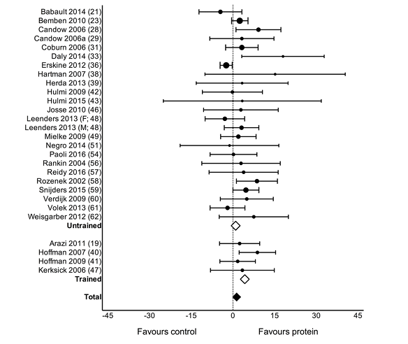
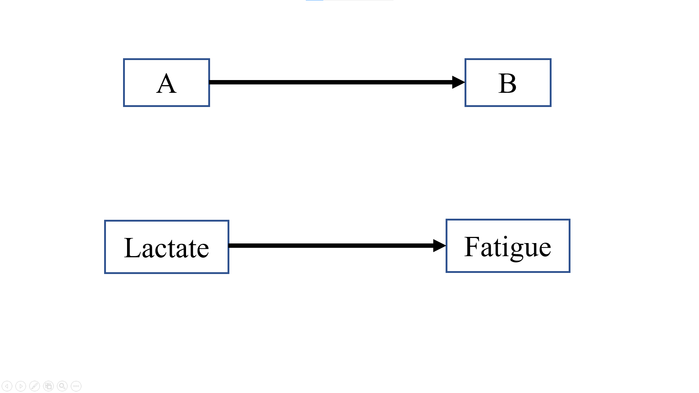
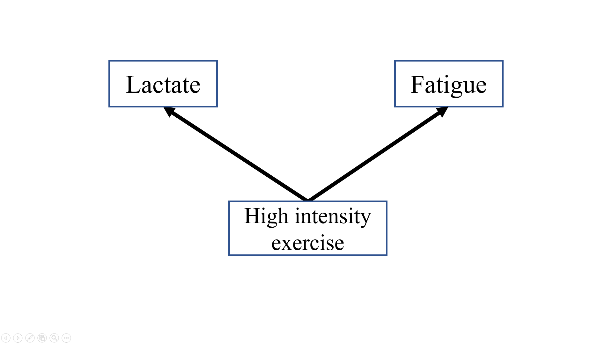
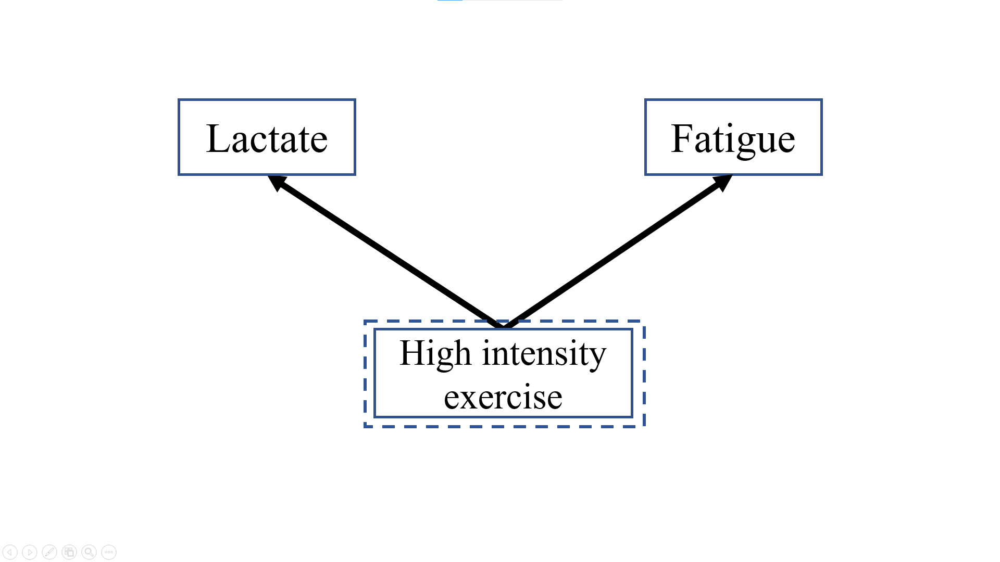

---
{
  "citation": false,
  "google-scholar": false
}
---

# Approaches to secondary research {#sec-secondary-research}

(Narrative Reviews, Systematic Reviews and Secondary Data Analysis)

*Gabriel Perri Esteves^1^, Andy Hall^2^, Leon Greig^2^, Paul Swinton^2^, Eimear Dolan^1,3^*

1.  Applied Physiology and Nutrition Research Group - Center of Lifestyle Medicine, Faculdade de Medicina FMUSP, Universidade de São Paulo, Sao Paulo, Brazil.

2.  School of Health Sciences, Robert Gordon University, Aberdeen, UK.

3.  School of Arts, Sciences and Humanities, University of Sao Paulo, Sao Paulo, Brazil.

[]{.anchor}**Introduction**

Research is a cumulative effort, with individual projects generally aiming to consolidate or advance existing knowledge. No study exists in isolation, and all research requires engagement with existing evidence or data, a process which we will refer to here as *secondary research*. This engagement may be informal (*e.g.,* considering available data on your topic of interest and using it to justify and design your study), or formal (*e.g.,* collating and synthesizing existing data to produce a new research output). Many approaches to formal secondary research and data analysis exist, ranging from narrative reviews, systematic reviews (with or without meta-analysis), to research projects that address new questions based on analyses of existing datasets. Within this chapter, we will describe different approaches to secondary research and data analysis, focusing on those most commonly used within sport and exercise science. We separate this chapter into two main sections including: 1) Literature reviews (narrative and systematic) and 2) Secondary analysis of existing data sets. We will highlight the key attributes and requirements of each approach, and link to sources that will help you develop secondary research and data analysis approaches that are suited to your own research question of interest.

## Literature Reviews {#ch08-literature-reviews}

A literature review is a type of secondary research that examines existing evidence on a particular topic or research question. The aim is usually to synthesise information, findings or ideas from multiple sources to develop an integrated understanding of the topic. By bringing together and critically examining these contributions, a literature review can identify patterns, inconsistencies, gaps in knowledge and new insights that may not be apparent when considering individual sources in isolation.

There are many different types of literature reviews, which can be broadly categorized within two main "families", namely narrative and systematic. It is important to think carefully about your research question and which family of reviews are best suited to answer it, as they are very different in both their approach and execution. We will describe both types of literature reviews in more detail in section 1.1 (narrative reviews) and section 1.2 (systematic reviews). Briefly, the main difference is that narrative reviews are much more flexible, and although there are guidelines that you can follow, they don't require a formal methodology. In contrast, systematic reviews address more focused questions, and follow a strict methodology, as described below. Examples of specific types of systematic and narrative reviews are summarized in Table 1.

Irrespective of which type of literature review you choose to write, there are some things that you should keep in mind before you start. These include:

A)  *The review should have a clearly defined scope.*

If your scope is too narrow, there may not be enough literature to make synthesis worthwhile. In contrast, if the scope is too broad, you may end up getting lost down rabbit holes, leading to a piece of work that is very wide-ranging and superficial. Striking the right balance is key. You want to make sure that your question and topic are focused enough that you can explore it in depth, but also broad enough to ensure there is enough material to write a comprehensive and detailed piece of work.

B)  *The review makes a clear contribution to existing knowledge.*

We are now at a point where review articles in sport and exercise science are very common - in some areas there are more reviews than original studies! Before you decide to work on a review paper it is important that you clearly define the question you wish to explore and think carefully about what it contributes to existing knowledge. If your paper merely echoes what has already been said multiple times previously, then it may be best to focus your time and attention elsewhere.

### Narrative Reviews {#ch08-narrative-reviews}

If you are enrolled in a university course, chances are that at some point, you will have to write a detailed review of the available literature within your topic area. Your own department and supervisor will have guidelines for this, and although the concepts that we discuss here are very similar, within this chapter we focus on writing reviews intended for publication. If you are considering whether your thesis literature review may also be suitable for publication, you may find the brief pointers in Break-Out Box 1 helpful.

> Broadly speaking, a narrative review is any literature review that collects and combines available knowledge on a topic in a descriptive and flexible manner. This definition is intentinoally broad, considering that there are many different types of narrative reviews, and the choice of which to use depends on the research question or topic at hand. For example, the most common type of narrative review in sport and exercise science is a "topic overview", whereby the author(s) collect and combine available knowledge on a given topic area. This type of narrative review often serves as a useful starting point for someone who wishes to learn more about the current state of knowledge in any given topic. Other types of narrative reviews include methodological, historical, critical or theoretical reviews (see Table 1). Given that the scope and content of narrative reviews vary so widely, it is important that you clearly define your objectives from the start. This will help to keep you on track throughout. Explaining both the main objective and scope at the beginning of your article will also help readers to decide if your paper is relevant to them.
>
> The flexibility offered by narrative reviews creates a versatile tool for addressing a wide range of research questions. It is worth remembering, however, that narrative reviews do not follow a set format, nor do they come with a "rule book". It is up to the author(s) to decide what content to include and how best to structure it, which can make writing an authoritative and representative narrative review challenging. Some recommendations that may be relevant to all narrative reviews are as follows:

- *Representativeness of available literature*

> Depending on the scope of your research question or topic area, it may not be possible to include every piece of work available, but it is important that the research you choose to include is representative. You can think of this as akin to a well-curated art gallery - it may not contain every piece ever painted, but it should give you a good idea of the artist\'s work. Of course, this is no easy task, and sometimes deciding what to leave out is more difficult than what to leave in. This is why it is important that you clearly define your scope and have a comprehensive understanding of your topic area before attempting to publish a narrative review. Without this focus and dominance, it is difficult to assess whether your piece truly represents available evidence.

- *Balanced and unbiased*

> Research in sport and exercise science is complex, nuanced, and sometimes very messy. There will be concepts that are debated, and opinions will differ. Within your narrative review, you are free to describe your own interpretation of the available literature (just as others are free to disagree with that interpretation) but this interpretation must be explained and justified. You should approach studies that support your own opinions with the same level of skepticism that you approach those that don't. It is unfortunately common for researchers to search for holes in studies that don't support their perspective whilst glossing over shortcomings in the studies that align with their opinions. This is a form of confirmation bias, which is the tendency to look out for, highlight and favor information that agrees with preconceived beliefs or values. Don't do this. You should approach all studies from the same open and neutral standpoint, and let the evidence inform your opinions, rather than letting your opinions inform your interpretation of the evidence.

**Table 1.** Overview of Different Types of Narrative and Systematic Reviews and Published Examples

+---------------------------------------------------------------+------------------------------------------------------------------------------------------------------------------------------------------------------------------------+
| **Review Type (Example)**                                     | **Brief Description**                                                                                                                                                  |
+---------------------------------------------------------------+------------------------------------------------------------------------------------------------------------------------------------------------------------------------+
| **Narrative reviews**                                                                                                                                                                                                                  |
|                                                                                                                                                                                                                                        |
| *(Reviews and synthesises existing literature on a topic in a descriptive or interpretive manner, providing an overview of current knowledge).*                                                                                        |
+---------------------------------------------------------------+------------------------------------------------------------------------------------------------------------------------------------------------------------------------+
| *Topic overview*                                              | Summarises existing research to describe the current state of knowledge on the topic area.                                                                             |
|                                                               |                                                                                                                                                                        |
| *(e.g.,* [@fyfeMinimalDoseResistanceTraining2022].            |                                                                                                                                                                        |
+---------------------------------------------------------------+------------------------------------------------------------------------------------------------------------------------------------------------------------------------+
| *Methodological review*                                       | Examines the methods and/or research practices used within a particular field or research area.                                                                        |
|                                                               |                                                                                                                                                                        |
| *(e.g.,* [@newmireSkeletalMuscleMicrobiopsy2022].             |                                                                                                                                                                        |
+---------------------------------------------------------------+------------------------------------------------------------------------------------------------------------------------------------------------------------------------+
| *Critical review*                                             | Critically evaluates existing research, ideas or arguments to develop interpretations and inform future research or practice.                                          |
|                                                               |                                                                                                                                                                        |
| *(e.g.,*[@swannOveruseSMARTGoals2023].                        |                                                                                                                                                                        |
+---------------------------------------------------------------+------------------------------------------------------------------------------------------------------------------------------------------------------------------------+
| *Theoretical review*                                          | Examines and integrates existing or new theories to explain, describe or conceptualise a particular phenomenon.                                                        |
|                                                               |                                                                                                                                                                        |
| *(e.g.,* [@shirleyLifeHistoryPerspective2022].                |                                                                                                                                                                        |
+---------------------------------------------------------------+------------------------------------------------------------------------------------------------------------------------------------------------------------------------+
| *Historical review*                                           | Traces how knowledge, theories, practices or evidence relating to a topic has developed over time.                                                                     |
|                                                               |                                                                                                                                                                        |
| *(e.g.,* [@kraemerEvolutionResistanceTraining2025].           |                                                                                                                                                                        |
+---------------------------------------------------------------+------------------------------------------------------------------------------------------------------------------------------------------------------------------------+
| *Tutorial review*                                             | Provides an instructive introduction to a particular topic, theory, method or technique.                                                                               |
|                                                               |                                                                                                                                                                        |
| *(e.g.,* [@ashfordDifferencebasedMetaanalyticProcedures2009]. |                                                                                                                                                                        |
+---------------------------------------------------------------+------------------------------------------------------------------------------------------------------------------------------------------------------------------------+
| **Systematic Reviews**                                                                                                                                                                                                                 |
|                                                                                                                                                                                                                                        |
| (Addresses a focused question, using pre-defined, explicit and transparent methods to identify, select and synthesise relevant evidence)                                                                                               |
+---------------------------------------------------------------+------------------------------------------------------------------------------------------------------------------------------------------------------------------------+
| Efficacy review                                               | Synthesises evidence to evaluate the efficacy of an intervention in producing specified outcomes.                                                                      |
|                                                               |                                                                                                                                                                        |
| (*e.g.,* [@saundersValanineSupplementationImprove2017].       |                                                                                                                                                                        |
+---------------------------------------------------------------+------------------------------------------------------------------------------------------------------------------------------------------------------------------------+
| Incidence or prevalence review                                | Synthesises evidence to estimate the evidence of new cases or events, or the prevalence of a condition or characteristic within a population.                          |
|                                                               |                                                                                                                                                                        |
| (*e.g.,* [@santosActiveCommutingBrazil2025].                  |                                                                                                                                                                        |
+---------------------------------------------------------------+------------------------------------------------------------------------------------------------------------------------------------------------------------------------+
| Qualitative evidence synthesis                                | Synthesises findings from qualitative studies to develop an integrated understanding of experiences, perceptions or perspectives.                                      |
|                                                               |                                                                                                                                                                        |
| [e.g., @francoOlderPeoplesPerspectives2015].                  |                                                                                                                                                                        |
+---------------------------------------------------------------+------------------------------------------------------------------------------------------------------------------------------------------------------------------------+
| Scoping review, sometimes called "mapping reviews"            | [Systematically maps the extent, nature and characteristics of the available evidence on a topic, including relevant concepts, theories, methods and findings.]{.mark} |
|                                                               |                                                                                                                                                                        |
| (*e.g.,* [@kellyWalkingSunshineScoping2018].                  |                                                                                                                                                                        |
+---------------------------------------------------------------+------------------------------------------------------------------------------------------------------------------------------------------------------------------------+
| Living review                                                 | Systematic review that is regularly updated as new evidence becomes available, according to predefined procedures.                                                     |
|                                                               |                                                                                                                                                                        |
| (*e.g.,* [@dohertyKeepingPaceWearables2024].                  |                                                                                                                                                                        |
+---------------------------------------------------------------+------------------------------------------------------------------------------------------------------------------------------------------------------------------------+
| Umbrella review                                               | Synthesises findings from multiple systematic reviews or meta-analyses to provide an overview of the evidence on a broad topic.                                        |
|                                                               |                                                                                                                                                                        |
| (*e.g.,* [@grgicWakeSmellCoffee2020a].                        |                                                                                                                                                                        |
+---------------------------------------------------------------+------------------------------------------------------------------------------------------------------------------------------------------------------------------------+

Table based on [@grantTypologyReviewsAnalysis2009]

**Break-Out Box 1:** Should I submit my literature review for publication?

+---------------------------------------------------------------------------------------------------------------------------------------------------------------------------------------------------------------------------------------------------------------------------------------------------------------------------------------------------------------------------------------------------------------------------------------------------------------------------------------------------------------------------------------------------------------------------------------------------------------------------------------------------------------------------------------------------------------------------------------------------------------------------------------+-----------------------------------------------------+
| **I've conducted a literature review for my research project -- should I submit it for publication?**                                                                                                                                                                                                                                                                                                                                                                                                                                                                                                                                                                                                                                                                                                                                       |
+---------------------------------------------------------------------------------------------------------------------------------------------------------------------------------------------------------------------------------------------------------------------------------------------------------------------------------------------------------------------------------------------------------------------------------------------------------------------------------------------------------------------------------------------------------------------------------------------------------------------------------------------------------------------------------------------------------------------------------------------------------------------------------------+-----------------------------------------------------+
| Most undergraduate and postgraduate research projects generally involve some form of literature review, which is used to explain, justify and inform your research question, by situating it within existing evidence. It may be tempting to try to publish all, or parts, of your review. In some situations, this can work great, in others, not so much! Ultimately, this is a decision that your supervisor will make, but there are two key questions that you should ask yourself before considering this further. These include:                                                                                                                                                                                                                                               |                                                     |
|                                                                                                                                                                                                                                                                                                                                                                                                                                                                                                                                                                                                                                                                                                                                                                                       |                                                     |
| A)  *Are you confident that you've written an authoritative piece of text?*                                                                                                                                                                                                                                                                                                                                                                                                                                                                                                                                                                                                                                                                                                           |                                                     |
|                                                                                                                                                                                                                                                                                                                                                                                                                                                                                                                                                                                                                                                                                                                                                                                       |                                                     |
| > The purpose of the literature review within your thesis is to demonstrate your understanding of the topic, and your ability to synthesize and evaluate the available literature. This is an important part of your academic development, and a critical skill to learn. Getting a good mark on your literature review does not, however, mean that your review necessarily warrants publication. Understanding and mastery are not the same thing, and before moving forward with submission you should ask yourself if you are confident that you fully understand everything that you have written; if you're sure that you haven't omitted important literature, and are confident that you can make an authoritative and worthwhile contribution to the existing evidence base. |                                                     |
|                                                                                                                                                                                                                                                                                                                                                                                                                                                                                                                                                                                                                                                                                                                                                                                       |                                                     |
| B)  *Have other reviews been written on this topic, and if yes, does your review add something of value?*                                                                                                                                                                                                                                                                                                                                                                                                                                                                                                                                                                                                                                                                             |                                                     |
|                                                                                                                                                                                                                                                                                                                                                                                                                                                                                                                                                                                                                                                                                                                                                                                       |                                                     |
| > You may have written a comprehensive and critical piece of text, but if it simply reiterates other narrative reviews then you have to ask yourself if it is worth your and the editors and the reviewers time in publishing yet another very similar work. Writing for your thesis is about demonstrating that you have learned something. Publishing a peer-reviewed article is about contributing something to the broader research community. Further details on writing a research paper and submitting it for peer-review are described in [Chapter 9](09-writing-and-peer-review.qmd).                                                                                                                                                                                        |                                                     |
+---------------------------------------------------------------------------------------------------------------------------------------------------------------------------------------------------------------------------------------------------------------------------------------------------------------------------------------------------------------------------------------------------------------------------------------------------------------------------------------------------------------------------------------------------------------------------------------------------------------------------------------------------------------------------------------------------------------------------------------------------------------------------------------+-----------------------------------------------------+

## Systematic Reviews {#ch08-systematic-reviews}

Systematic reviews are ever-increasing in popularity within sport and exercise science, and not without reason. They are commonly viewed as representing the most trustworthy assessment on a research question as they use pre-defined and objective methods to synthesize all available data on that question. Review quality can vary widely, however, and a poorly conducted systematic review can actually regress, rather than progress understanding of a given topic area. For example, a recent study found that 85% of the twenty most-cited meta-analyses in strength and conditioning research contained statistical errors [@kadlecGreatPowerComes2023]. The frequency of important errors in systematic reviews and meta-analyses is particularly concerning given that this research type is often perceived as representing the highest quality evidence on a given topic and as such are generally highly cited and frequently used to guide practice and develop recommendations. This means that mistakes that lead to erroneous conclusions can have wide-spread consequences. To quote the above-mentioned article - "*with great power comes great responsibility*", and it is your responsibility as a researcher to ensure that you have done all you can to confirm that your investigation is free of major error or biases that may influence the conclusions, or, if bias exists, that you report and discuss how much it may have impacted your findings.

Undertaking a systematic review is no small feat and there is a lot to consider. Investing adequate time in planning and piloting at the start can pay large dividends throughout the process, as it can help you to avoid time-consuming and potentially fatal errors in your review. It may be a cliche, but when it comes to systematic reviews (and research in general) failing to plan really is planning to fail! Below, we will describe seven important points that should be considered before embarking on a systematic review. This list is not exhaustive, but the points will provide you with a starting point from which to get going.

***Step One: Deciding whether or not a systematic review is the best option***

The first decision that you need to make is whether a systematic review really is the best way for you to answer your research question. As described above, systematic reviews address clearly defined research questions through comprehensively searching, selecting and synthesizing all available data on a topic. As such, and despite the name, a systematic review has more in common with an original study than with a narrative review given that it: 1) requires development of a clear research question; 2) eligibility criteria must be established to ensure that included data are suited to the research question; and 3) results are based on objective and unbiased parameters.

Two commonly used justifications to undertake a systematic review are "*because it's the strongest research design available*" (untrue -- the best research design is the one that best suits your research question) or "*because no systematic review has been done on this topic*". If the only justification that you can think of for completing a systematic review is that it hasn't been done before, it's certainly worth taking a moment to consider why that may be the case. Could it be that insufficient high-quality research is available to render it worthwhile? Or potentially the evidence is already quite conclusive, and therefore spending time and effort conducting a systematic review will make little or no difference to how that evidence is interpreted? Or could it be that the question you are addressing is simply not interesting or useful enough to warrant further investigation? A rationale that goes beyond the inexistence of a previous systematic review should be provided. For instance, can your review provide meaningful, new information surrounding the prevalence of a disease? Or can your review provide an assessment of the [efficacy]{.mark} of a sports supplement that appears promising, but where existing evidence appears somewhat conflicting? Planning, designing, implementing, and writing-up a high-quality systematic review is a time-consuming and arduous process, so it is important to think carefully about whether it really is the right option before embarking on it.

***Step Two: Defining the question***

Given that the purpose of a systematic review is to answer a focused research question, the importance of clearly defining that question cannot be over- emphasized. After all, if we don't fully understand the question, how can we hope to arrive at, and then to interpret the answer? Most ideas will start out with a broad topic area, for example, "*does vitamin D influence bone health?*", or "*does menstrual cycle phase influence exercise performance*?" An appropriate research question must be more detailed than this, and several frameworks are available to guide your thinking on this topic (see Chapter 2 for further discussion on defining your research question ([LINK]{.mark}).

Although many types of systematic reviews exist (see Table 1), efficacy reviews are commonly used in sport and exercise research (*e.g.,* does intervention X influence training outcome Y). If you are conducting an efficacy-based review of similar interventions, you can structure your question according to the PICOS (**P**opulation; **I**ntervention; **C**omparator; **O**utcome and **S**tudy Design) framework. Other acronyms are available to guide development of other systematic review types. For example, a prevalence review (*e.g.,* what is the prevalence of sedentary behaviors in older adults who live in care homes) can use CoCoPop (Condition, Context and Population). An epidemiological review (*e.g.,* do athletes with low energy availability have increased stress fracture risk?) can consider PEO (Population, Exposure and Outcome), while a qualitative review may use SPIDER (Sample, Phenomenon of interest, Design, Evaluation, Research type). Further information on different review types, and the different acronyms that can be used to guide the development of the question can be found in [@munnWhatKindSystematic2018]).

***Step Three: Defining your eligibility criteria***

Once you have clearly defined your question, you should then consider how you will choose the articles that will allow you to answer that question. That is, you need to define the criteria by which you will decide whether studies should be included in your review or not. It is useful to organize your criteria according to the same acronym that you used to define your question.

Defining eligibility criteria is no easy task, and trade-offs sometimes occur between how rigorous your criteria are and the number of studies that are available to you. A focused question requires tight and rigorous criteria. This is great if your research topic is well-researched - you can afford to be specific about your criteria. But if your criteria are so rigid that you end up excluding almost all available articles, you may be left with insufficient studies to conduct your review. There are no hard and fast rules about how to determine eligibility criteria as this will be specific to your own research question. Below we describe different factors that may be relevant using the example question "*Does protein supplementation influence resistance training induced muscle mass gains in non-resistance trained individuals*?"

### Population {#ch08-population}

The population of interest in this example question is "*non-resistance trained individuals*", but what does that mean? Do you wish to focus on males, females or will you include both? Should we narrow it to a particular age-range? How will "*non-resistance trained*" be defined? Would an endurance athlete who doesn't do much resistance training, but is very highly trained in their own sport count? Or will you focus on sedentary individuals who don't do any form of training? What about recreationally active individuals who occasionally perform some resistance exercise but don't follow a structured program? All these factors need to be considered, and a precise definition of your target population should be provided. As described above, sometimes the available literature may not allow you to be as detailed as you might like. For example, you may create a detailed profile of the desired training profile of your target population, but if most articles don't provide this information, you may end up excluding many articles, potentially unnecessarily.

### Intervention {#ch08-intervention}

Within this example, our intervention of interest comprises two main parameters including protein and resistance training, and both need to be clearly defined. For example, in relation to the protein component, are you only interested in studies that consider protein supplements, or would you also consider studies that increased protein availability via dietary manipulations? Does protein source matter? What about minimum versus maximum doses? In relation to the exercise intervention, how will resistance training be defined, and will you have specific criteria related to important factors such as intervention length, and training type, volume and intensity?

### Comparator {#ch08-comparator}

Many efficacy studies involve comparing one condition or intervention with another. For example, studies may compare the extent of change in the intervention group with that in a control group that receives no intervention, usual care, or a placebo supplement. Considering our sample question, "*Does protein supplementation influence resistance training induced muscle mass gains in non-resistance trained individuals?*", an appropriate approach may be to select studies that compare the extent of pre-post muscle mass change in two groups. Eligible studies may include studies those in which both groups undertake the same resistance training program, but one receives a protein supplement, while the other receive a placebo, or perhaps no supplement. There are no definitive answers regarding the most appropriate type of comparator that you should include, such as whether a placebo intervention is required and if so, what type of placebo is appropriate. It is, however, important that you explain and justify your choices, considering that your main comparison of interest will underpin how your eventual evidence synthesis should be interpreted. Note that at this point, we have not yet decided how study findings will be synthesised within the systematic review itself. We have only considered the types of comparisons and outcome data that original studies need to report to be eligible for inclusion.

### Outcome {#ch08-outcome}

It is important to consider that often we are interested in broad constructs, *e.g.,* endurance, strength, or body composition, which often cannot be directly measured, but instead are represented by available outcomes, each of which may vary in terms of their validity and reliability. Within this example, we have defined "muscle mass" as our outcome of interest. Muscle mass itself can't be directly assessed, but various estimation approaches exist *e.g.,* using DXA, skinfold assessment, underwater weighing, MRI, BIA or ultrasound. When deciding the eligibility criteria for your review, you need to decide whether you will accept studies that reported data using any of these approaches, or whether you will only select original studies that use what you consider to be the most reliable representation of your outcome of interest.

### Study Design {#ch08-study-design}

It is likely that multiple study designs may be available on your topic of interest and it is important to clearly define which designs are eligible for inclusion. For this example, you could consider restricting eligible study designs to randomized controlled trials, *e.g.,* participants must have been randomly allocated to the intervention or control group. You may also wish to consider whether you will restrict eligibility to parallel designs, in which each individual is randomized to only one condition, or cross-over designs, in which the same individual undertakes both interventions, with intervention order randomized. Crossover designs may be more appropriate for interventions with rapidly reversible effects, and any carryover effects can be adequately managed. Within this example, parallel designs may be most relevant due to the potential for carryover effects, particularly because resistance training may produce longer lasting changes in muscle mass, that could influence outcomes during a subsequent intervention period.

***Step Four: Developing your search and study selection strategy***

Once you have defined both your research question and your eligibility criteria, you must now consider how you will source your information. This requires a formal literature search to identify potential articles, then screening these articles against your pre-defined eligibility criteria. Many people think that running a systematic search is a relatively straightforward process, but it can actually be quite complex and nuanced, and it is definitely worth investing time in planning and piloting your proposed approach. Herein, we provide a broad overview of the process and highlight some common pitfalls and difficulties. There are many detailed resources on the topic that you should also consider reading (e.g., this chapter from the Cochrane Handbook for Systematic Reviews: [[https://training.cochrane.org/handbook/current/chapter-04]{.underline}](https://training.cochrane.org/handbook/current/chapter-04)). It may also be worthwhile to consult a specialist, *e.g.,* someone who works within your university library, before you finalize your search strategy.

A good search strategy will strike a balance between sensitivity and precision. It needs to be sensitive enough to ensure that all potentially eligible articles are detected, but it should not be so extensive that it lacks precision, and you end up wasting time screening thousands of irrelevant hits. This is not an easy balance to strike, which is why piloting and seeking advice from a search specialist is important.

Databases that index scientific articles use a very specific language, and it is one that you will have to get to grips with. To organize your search, first you need to decide your information sources. Databases, *e.g.,* Medline, PubMed, Embase, Scopus, Web of Science, Cochrane Central, Google Scholar, Sport Discus, *etc.* are digital collections of journal articles, and can be used to source articles for your review. None of these are entirely inclusive, so it is recommended to use more than one. At the same time, you need to keep your search manageable, so including every single available database may mean you spend the entire lifetime of your project running searches and screening articles, leaving little to no time to actually conduct the review. The Cochrane organisation (https://www.cochrane.org/about-us) recommends that at least three databases be used and suggests Embase, Medline/PubMed and Cochrane Central as core bibliographic databases, however you can choose which databases are best-suited to your own project based on relevance and accessibility. For example, sports based investigation may wish to use a sport specific registry such as Sport Discus. You may also wish to consider additional screening techniques, such as clinical trial registries, grey literature or forward or backward citation screening of included articles and relevant reviews.

After deciding on your criteria and databases, you need to run your searches to identify potentially relevant articles, which involves translating your research question into appropriate search terms that reflect all key concepts of interest. These search terms are words or phrases that may appear in searchable article fields, such as the title, abstract and author-supplied keywords, as well as relevant subject headings assigned during indexing. First, think of terms that are relevant to each part of your research question. A good way to find some useful keywords is to examine the keyword section of articles you already know are relevant to your search. You can also examine the terminology used in their titles and abstracts to identify relevant subject headings. Try to think of the various ways that key concepts of interest may be described and to include synonyms, alternative spellings and related terms to help capture all potentially relevant articles. Most databases provide controlled vocabularies to help you identify and retrieve articles that have been indexed within particular concepts. For example, MEDLINE uses Medical Subject Headings (MeSH), while Embase uses Emtree terms.

Once you have determined your keywords, you can then combine them using Boolean operators. These are specific operators that can expand or refine a search strategy, with the most commonly used being \'AND', 'OR' and 'NOT'. The command AND will narrow your search, *e.g.,* if you tell the database you want to search for the terms "protein AND strength", the database will retrieve records containing both terms in the fields being searched. The term OR will expand your search, *e.g.,* if you instruct the database to search for the terms "protein OR strength" the database will return records containing either term, including records containing both. The term NOT will instruct the database to exclude records containing the specified term in the fields being searched. Take some care with the term NOT, as it can lead to inadvertently excluding relevant articles that mention the excluded term, but are nevertheless relevant to your research question.

In addition to defining your keywords and combining them with appropriate Boolean operators, you will also need decide which search fields to search and whether any filters are appropriate. You may choose to include filters for the year of publication or type of article (*e.g.,* restricting results to randomized controlled trials). You can also specify which fields to search, such as the title, abstract and keywords. Of note, many database do not have access to the full text of every indexed article, so searches are often limited to these fields, although this does depend on the database and platform.

Putting it all together, a simplified search string for our example research question could be: ("resistance training" OR "strength training" OR "weight lifting") AND "protein" AND ("muscle mass" OR "lean mass" OR "fat-free mass" OR "body composition" OR muscle). Note that we have created "blocks" of similar terms and synonyms, to make sure we capture the terms we are interested in that sometimes are called different names, such as "resistance training" or "strength training". Then, note how we connected our blocks with AND, which informs the database that we want to retrieve articles that feature both resistance training (and its synonyms) and protein and muscle mass (and its synonyms). Note that, at this time, we didn't include a specific term for our population of non-resistance trained individuals. It is generally better to err on the side of being more general, instead of too specific, and so an initial search with these terms could be a useful starting point. If you end up retrieving more records than are manageable, you can always refine your search strategy. Creating an effective search string is an iterative process, and you should go back and forth to assess the results and to explore how adapting terms and filters may impact those results. You may also be interested in using artificial intelligence (AI) tools to improve your search. Although these are becoming more common, and can assist with identifying search terms and developing search strategies, their output needs to be critically checked by the review team (see Break-Out Box 2 for a discussion on the use of AI for article searching).

Once you have run your searches, you will end up with a number of hits, which you must now screen to decide if they are relevant for your review. It is likely that there will be a lot more irrelevant articles than relevant ones in your search, *i.e.,* false positives. Thus, be prepared to spend a lot of time wading through these. It is standard practice to use a phased screening approach, *i.e.,* Phase 1 generally involves quickly screening the title and abstract of included articles -- a lot of content will be clearly irrelevant, and you can quickly discard them. It is important at this stage to be inclusive and err on the side of caution, only screening out articles that you are very confident will not meet your eligibility criteria. If in doubt, keep them in and evaluate them more deeply in Phase 2, which involves retrieving the full-text of each article, and reading them in more detail to check if they align with your eligibility criteria and should be included within the review. You should record and categorize reasons for exclusion at this stage. For this purpose, it is useful to define a list of reasons for excluding articles. For instance, we could define reasons such as a) inappropriate population; b) inappropriate intervention; c) inappropriate comparator, etc. Note that these follow our PICOS criteria. Then, as you exclude articles, you can easily justify each exclusion using this list, so you can count and report them at a later stage.

Depending on the size and nature of your review, it is likely that you may end up wading through thousands or even tens of thousands of records, so you need to be organized and document each phase of the process. Software tools, such as Covidence or Rayyan, among others, can be used to organize this process. It is important to document each step of this process and report it within your final report or article, with this information usually summarized in the form of a flow diagram, with the PRISMA templates most commonly used ([[http://prisma-statement.org/prismastatement/flowdiagram.aspx?AspxAutoDetectCookieSupport=1]{.underline}](http://prisma-statement.org/prismastatement/flowdiagram.aspx?AspxAutoDetectCookieSupport=1)).

**Break-Out Box 2:** The use of artificial intelligence (AI) and large language models (LLMs) in running searches

+--------------------------------------------------------------------------------------------------------------------------------------------------------------------------------------------------------------------------------------------------------------------------------------------------------------------------------------------------------------------------------------------------------------------------------------------------------------------------------------------------------------------------------------------------------------------------------------------------------------------------------------------------------------------------------------------------------------------------------------------------------------------------------------------------------------------------------------------------------------------------------------------------------------------------------------------------------------------------------------------------------------------------------------------------------------------------------------------------------------------------------------------------------------------------------------------------------------------------------------------------------------------------------------------------------------------+-------------------------------------+
| **What are AI models and how do they work?**                                                                                                                                                                                                                                                                                                                                                                                                                                                                                                                                                                                                                                                                                                                                                                                                                                                                                                                                                                                                                                                                                                                                                                                                                                                                                                             |
+--------------------------------------------------------------------------------------------------------------------------------------------------------------------------------------------------------------------------------------------------------------------------------------------------------------------------------------------------------------------------------------------------------------------------------------------------------------------------------------------------------------------------------------------------------------------------------------------------------------------------------------------------------------------------------------------------------------------------------------------------------------------------------------------------------------------------------------------------------------------------------------------------------------------------------------------------------------------------------------------------------------------------------------------------------------------------------------------------------------------------------------------------------------------------------------------------------------------------------------------------------------------------------------------------------------------+-------------------------------------+
| At the time of writing, the use of artificial intelligence (AI) has become prevalent in many academic activities, including running searches, and it is likely that this use will increase as time goes on. Therefore, it is important to have a general understanding of what AI models are, their function, and how they work.                                                                                                                                                                                                                                                                                                                                                                                                                                                                                                                                                                                                                                                                                                                                                                                                                                                                                                                                                                                   |                                     |
|                                                                                                                                                                                                                                                                                                                                                                                                                                                                                                                                                                                                                                                                                                                                                                                                                                                                                                                                                                                                                                                                                                                                                                                                                                                                                                                    |                                     |
| AI models are a kind of neural network, which themselves are a class of machine learning models. In very simple terms, a machine learning model uses variables to predict something. A common use case is using variables such as income, age, marital status, *etc.,* to predict whether an individual is likely to pay their credit card debt on time. Credit card companies might use models such as this one when deciding what kind of card and conditions to offer to their clients. A neural network is a more complex type of machine learning model, whose architecture resembles neurons, in the sense that they receive inputs (variables), do some fancy math, and pass the information forward, eventually returning an output (a prediction or a probability value). The Large Language Models (LLMs) we have become accustomed to are designed to receive text as input, break large sentences into smaller bits (called tokens), and run their algorithms in such a way that they can predict which words are the most likely to appear next, and thus form cohesive responses.                                                                                                                                                                                                                    |                                     |
|                                                                                                                                                                                                                                                                                                                                                                                                                                                                                                                                                                                                                                                                                                                                                                                                                                                                                                                                                                                                                                                                                                                                                                                                                                                                                                                    |                                     |
| In summary, AIs based on LLMs are essentially machine learning models, which use our inputs (phrases) to predict the next word in the sentence. Although powerful, it is important to understand that these models are not magic, but rather share this simple goal of predicting what comes next. This helps us understand some of the shortcomings of AI and their potential best use cases.                                                                                                                                                                                                                                                                                                                                                                                                                                                                                                                                                                                                                                                                                                                                                                                                                                                                                                                     |                                     |
+--------------------------------------------------------------------------------------------------------------------------------------------------------------------------------------------------------------------------------------------------------------------------------------------------------------------------------------------------------------------------------------------------------------------------------------------------------------------------------------------------------------------------------------------------------------------------------------------------------------------------------------------------------------------------------------------------------------------------------------------------------------------------------------------------------------------------------------------------------------------------------------------------------------------------------------------------------------------------------------------------------------------------------------------------------------------------------------------------------------------------------------------------------------------------------------------------------------------------------------------------------------------------------------------------------------------+-------------------------------------+
| **Is the use of AI models in reviews and searching advisable?**                                                                                                                                                                                                                                                                                                                                                                                                                                                                                                                                                                                                                                                                                                                                                                                                                                                                                                                                                                                                                                                                                                                                                                                                                                                    |                                     |
+--------------------------------------------------------------------------------------------------------------------------------------------------------------------------------------------------------------------------------------------------------------------------------------------------------------------------------------------------------------------------------------------------------------------------------------------------------------------------------------------------------------------------------------------------------------------------------------------------------------------------------------------------------------------------------------------------------------------------------------------------------------------------------------------------------------------------------------------------------------------------------------------------------------------------------------------------------------------------------------------------------------------------------------------------------------------------------------------------------------------------------------------------------------------------------------------------------------------------------------------------------------------------------------------------------------------+-------------------------------------+
| While AI appears to be capable of performing many time-consuming roles with surprising outputs, much caution and consideration is needed before one applies this in the academic world. Always remember that, while you might be using something produced by an AI model, you are solely responsible for any information you include in a paper or article. AI models cannot be coauthors, and as such, it will always be your name on the line. As such, a golden rule when using AI is to only use it for tasks that you are capable of checking whether the output is adequate or not (and do check!). For instance, it wouldn't be advisable to use AI for statistics recommendations when you cannot evaluate the accuracy of those recommendations yourself, or to rely on it to write pieces of text, particularly on topics that you are less familiar with. On the other hand, it is safer to use AI for brainstorming, suggesting potential discussion topics and correcting grammatical mistakes, as you can then go on and check those recommendations yourself before applying them into your text.                                                                                                                                                                                                   |                                     |
|                                                                                                                                                                                                                                                                                                                                                                                                                                                                                                                                                                                                                                                                                                                                                                                                                                                                                                                                                                                                                                                                                                                                                                                                                                                                                                                    |                                     |
| In light of this golden rule, if you decide to use AI to assist with your searches, our suggestion would be that you follow the steps provided in the text to elaborate an initial search string. Then, you can feed that initial search string, your research question and PICOS criteria into a LLM of your preference, and ask it to critically analyse your search string and to provide feedback to refine it. Explicitly asking the model to behave as a reviewer or a critic can be useful, as otherwise models might just agree with everything you say. Remember, LLMs are trained to think of the next word in the sentence, making them particularly useful when coming up with keywords that might be associated to certain terms; or, to agree entirely with you when you ask them to! After obtaining your results, run searches comparing your original search string to the one provided by the model, and see how that affects the number of hits, the type of article that is being returned and whether those fit your criteria of interest. Also assess whether the additions made by the model make sense given what you know. This workflow might help you identifying keywords or terms you previously didn't think of including, which complements your work, rather than substituting it. |                                     |
|                                                                                                                                                                                                                                                                                                                                                                                                                                                                                                                                                                                                                                                                                                                                                                                                                                                                                                                                                                                                                                                                                                                                                                                                                                                                                                                    |                                     |
| Importantly, remember to follow the recommendations of your education institution, and be prepared to report your use of AI -- a practice that is becoming more common and even obligatory in some academic contexts and scientific journals.                                                                                                                                                                                                                                                                                                                                                                                                                                                                                                                                                                                                                                                                                                                                                                                                                                                                                                                                                                                                                                                                      |                                     |
+--------------------------------------------------------------------------------------------------------------------------------------------------------------------------------------------------------------------------------------------------------------------------------------------------------------------------------------------------------------------------------------------------------------------------------------------------------------------------------------------------------------------------------------------------------------------------------------------------------------------------------------------------------------------------------------------------------------------------------------------------------------------------------------------------------------------------------------------------------------------------------------------------------------------------------------------------------------------------------------------------------------------------------------------------------------------------------------------------------------------------------------------------------------------------------------------------------------------------------------------------------------------------------------------------------------------+-------------------------------------+

***Step Five: Data extraction and coding***

Once you have selected your articles, the next step is to extract the information that you have specified in your protocol. You can use software tools to manage this process, or else set up your own custom spreadsheet. Your spreadsheet should include a column for each individual piece of information that you consider relevant. For example, you may include information on the study itself (*e.g.,* authors, year of publication, country conducted, main study aim; study design); participant characteristics (*e.g.,* age, height, weight, training status, health status); intervention description, if relevant, *e.g.,* if doing a supplement study you may extract information on dose, duration and timing of delivery; and main outcomes (*e.g.,* pre-post mean and standard deviations for your outcomes of interest). You will need to think carefully about how you want to extract this information, and whether it may be useful to create categories and assign codes. For example, if you are considering how different types of exercise training interventions influence strength you will likely want to group all available categories into broad categories (*e.g.,* resistance, aerobic or multi-modal) and you may wish to code these within your spreadsheet to facilitate extraction and analysis (*e.g.,* 1 = resistance; 2 = aerobic and 3 = multi-modal). There is only so much information that you can include within a spreadsheet cell, so it can be useful to develop a codebook alongside your data extraction sheet. The purpose of this codebook is to describe in detail what information will be included in each cell in your data extraction spreadsheet, including whether the information will be extracted as free text, numbers (actual data from the original article) or according to pre-defined categories, and whether any transformations will be made. This step is crucial, and it is useful to spend some time developing both your spreadsheet and codebook, and then pilot testing it with a few articles, evaluating whether it captures the most important information from your selected studies. A useful tip for extracting data is to always highlight where you found the information in the original article pdf. This means that if you need to go back to double-check something, you can quickly and easily find the relevant information.

***Step Six: Data synthesis***

Once you have planned how you will extract, organize and categorize your data, you will need to synthesize the information to address the research question. The process of data synthesis involves combining individual components to create a new unified whole, and at the end of your systematic review you want to contribute something new and unified to the knowledge base - the combined sum of information that your study provides should be greater than any one of the individual parts.

Data synthesis can be done narratively (*e.g.,* organizing relevant outcomes in text, tables or figures) or it can be statistical (Note: narratively synthesizing data does not mean you did a narrative review! You can still narratively synthesize results that you have searched and extracted following a systematic review approach). Meta-analysis is a form of statistical synthesis, whereby estimates from individual studies are pooled with the goal of better representing the available literature. Results from a meta-analysis are typically described through tables and plots, with the most common being a forest plot. A forest plot summarizes results by showing the point estimates from each study using dots, with vertical lines on the left and right sides typically representing the 95% confidence interval from each individual study. The overall pooled estimate based on these studies is often displayed with a diamond shape, whereby the center of the diamond represents the pooled estimate based on the studies located above it while the left and right sides of the diamonds represent the estimate of uncertainty, *e.g.,* the 95% confidence interval of this pooled estimate (see [Chapter 5](05-quantitative-analysis.qmd) for further information on how to calculate and interpret effect sizes and confidence intervals). Forest plots may also display other important information, such as sample size in each study, treatment length, and supplementation dose, among others. An example forest plot based on a meta-analysis evaluating the influence of protein supplementation on resistance training induced gains in muscle mass in healthy adults [@mortonSystematicReviewMetaanalysis2018] is provided in Figure 2. Note that the two hollow diamonds in the figure represent the pooled estimate for the trained and untrained groups while the filled diamond represents the pooled result across all studies, irrespective of group.

**Figure 2.** Example of a forest plot from Morton et al. [-@mortonSystematicReviewMetaanalysis2018], showing point estimates from individual studies (the dots), 95% confidence intervals from individual studies (the vertical bars), and pooled effects for the total population (the black diamond) and the subgroups of studies that included untrained and trained (the hollow diamonds).

Carrying out a meta-analysis requires an understanding of statistics and experience with analysis software. If you don't have these skills yourself, we recommend that you collaborate with a colleague who does, as they are complex and take time to learn. If you are interested in learning the basics of meta-analysis, there are free and accessible materials and software that can help you with this. For example, the "Doing meta-analysis in R" textbook teaches the basics of meta-analysis in R, a statistical language that is implemented in free programming software ([[https://bookdown.org/MathiasHarrer/Doing_Meta_Analysis_in_R/]{.underline}](https://bookdown.org/MathiasHarrer/Doing_Meta_Analysis_in_R/)). The website for the R package "metafor" is also a great resource, with many practical examples of typical problems you may encounter and how to deal with them, alongside R code that will get you through the process ([[https://www.metafor-project.org/doku.php/metafor]{.underline}](https://www.metafor-project.org/doku.php/metafor)).

***Step Seven: Determining certainty in your estimates***

The trustworthiness of your data synthesis will largely depend on the quality and relevance of each individual study. An important function of a systematic review is to identify gaps in the literature and to make recommendations for future research and practice. Systematically evaluating potential sources of bias in included studies, and using this to determine how certain you are about your results is essential to doing this. A commonly used approach for determining the strength/certainty in systematic review estimates is known as GRADE (Grading of Recommendations, Assessment, Development and Evaluation). This tool was also created by the Cochrane organisation, and they have a series of handbooks, training videos and articles that can guide you through each phase of the process ([[https://training.cochrane.org/grade-approach]{.underline}](https://training.cochrane.org/grade-approach)). Briefly, the initial certainty rating is likely to be based on the study design that you selected when deciding your eligibility criteria. For example, in efficacy reviews that are based on randomized controlled trials, certainty will usually start out as "high". This can then be downgraded according to five different criteria, as described in Table 2, leaving you with an overall certainty rating of "high", "moderate", "low" or "very low" for each of your meta-analytic outcomes. Finally, while many believe that GRADE can only be used if a meta-analysis is conducted, recommendations have been made for using GRADE when a systematic review without a meta-analysis is conducted [@muradRatingCertaintyEvidence2017].

**Table 2.** GRADE Criteria

+-------------------+---------------------------------------------------------------------------------------------------------------------------------------------------------------------------------------------------------------------------------------------------------------------------------------------------------------------------------------------------------------------------------------------------------------------------------------------------------------------------------------------------------------------------------------------------------------------------------------------------+
| **Potential downgrading criteria:**                                                                                                                                                                                                                                                                                                                                                                                                                                                                                                                                                                                   |
+-------------------+---------------------------------------------------------------------------------------------------------------------------------------------------------------------------------------------------------------------------------------------------------------------------------------------------------------------------------------------------------------------------------------------------------------------------------------------------------------------------------------------------------------------------------------------------------------------------------------------------+
| Risk of bias:     | This refers to the potential for systematic issues in the design, conduct, or analysis of a study that could distort its findings. Different tools are available to assess risk of bias within different study designs, e.g., the Risk of Bias 2 (ROB2) for randomized trials [@sterneRoB2Revised2019] and ROBINS-I (Risk of Bias in Non-randomized Studies of Interventions) for non-randomized trials [@sterneROBINSIToolAssessing2016]. The Joanna Briggs Institute (JBI) also hosts various tools to critically appraise various study designs (https://jbi.global/critical-appraisal-tools). |
+-------------------+---------------------------------------------------------------------------------------------------------------------------------------------------------------------------------------------------------------------------------------------------------------------------------------------------------------------------------------------------------------------------------------------------------------------------------------------------------------------------------------------------------------------------------------------------------------------------------------------------+
| Inconsistency:    | This refers to unexplained differences in the direction or magnitude of effects across studies. While some variation between studies is to be expected, substantial variation between studies that employ similar interventions, that cannot be adequately explained by differences between these studies may reduce confidence in the overall findings.                                                                                                                                                                                                                                          |
+-------------------+---------------------------------------------------------------------------------------------------------------------------------------------------------------------------------------------------------------------------------------------------------------------------------------------------------------------------------------------------------------------------------------------------------------------------------------------------------------------------------------------------------------------------------------------------------------------------------------------------+
| Indirectness:     | This refers to the extent to which the available evidence matches the research question of interest. Indirectness may arise when available studies differ from the question in terms of population, intervention, comparator or outcome.                                                                                                                                                                                                                                                                                                                                                          |
+-------------------+---------------------------------------------------------------------------------------------------------------------------------------------------------------------------------------------------------------------------------------------------------------------------------------------------------------------------------------------------------------------------------------------------------------------------------------------------------------------------------------------------------------------------------------------------------------------------------------------------+
| Imprecision:      | This refers to the extent to which the available evidence allows a sufficiently precise estimate of the effect. Imprecision may be a concenr when confidence intervals are wide enough to include effects that would lead to meaningfully different conclusions, e.g., they encompass positive, negligible and negative effects.                                                                                                                                                                                                                                                                  |
+-------------------+---------------------------------------------------------------------------------------------------------------------------------------------------------------------------------------------------------------------------------------------------------------------------------------------------------------------------------------------------------------------------------------------------------------------------------------------------------------------------------------------------------------------------------------------------------------------------------------------------+
| Publication bias: | This refers to the extent to which the published evidence does not fully or fairly represent all relevant studies. For example, studies with statistically significant or favourable findings may be more likely to be published, potentially leading to an overestimation of the effect.                                                                                                                                                                                                                                                                                                         |
+-------------------+---------------------------------------------------------------------------------------------------------------------------------------------------------------------------------------------------------------------------------------------------------------------------------------------------------------------------------------------------------------------------------------------------------------------------------------------------------------------------------------------------------------------------------------------------------------------------------------------------+

***Step Eight: Protocol registration and/or publication***

The more time that you spend planning and piloting each of these seven steps, the smoother your actual review should run. There are several checklists available that can guide you on what information should be included both in your protocol, and in your actual review, with the PRISMA (Preferred Reporting Items for Systematic Reviews and Meta-Analyses) checklist and related guidance [@pagePRISMA2020Statement2021] commonly used.

Prior to implementing your systematic review protocol, you should consider registering it. The purpose of pre-registration is to increase the transparency and rigor of your research by establishing a clear plan before any data are collected. A number of pre-registration platforms with standardised templates are available, *e.g.,* PROSPERO is a platform that posts pre-registration for systematic reviews that have health-related outcomes ([[https://www.crd.york.ac.uk/prospero/]{.underline}](https://www.crd.york.ac.uk/prospero/)) or the Open Science Framework (OSF): [[https://osf.io/]{.underline}](https://osf.io/). Currently, pre-registering your systematic review protocol is recommended practice, but it is becoming a requirement for more journals. @pieperWhereProspectivelyRegister2022 provides a detailed description of the different websites available for registering systematic reviews [@pieperWhereProspectivelyRegister2022].

Some of the main concerns that people have about pre-registering their study protocol is that it might impede their ability to change their plan, adapt the plan according to new information, or that someone will see the protocol and start the same study themselves. However, it's important to keep in mind that protocol pre-registration is intended only to increase transparency around the process and to guide the planning stages. It should not be viewed as an endpoint, but rather, as a well-planned first version of an evolving document. Post hoc modifications are usually required as the process continues - particularly for larger, more complex, reviews, and you shouldn't be afraid to adapt your plan in accordance with new findings or information. The important thing is to be transparent about why and how these changes occurred, by document them, and report them in your final report. Sometimes the only adequate explanation for these changes will be "because I didn't think of it earlier" and that is reasonable. As scientists we need to normalize this as we're all human, science is an iterative process, and because the alternative to transparency is hiding key information from your readers.

## Secondary Data Analysis {#ch08-secondary-data-analysis}

Primary data are collected to address a specific research question. In contrast, secondary data are data that were originally collected for another purpose, and are subsequently used to address a specific research question. This means that a dataset can be considered both primary or secondary, depending on who is analyzing it, and for what purpose. The most common forms of secondary data analysis include repurposing the dataset from original studies to address a secondary question, or through the use of repositories that include large datasets that can be used by researchers to address a wide range of questions. For example, the National Health and Nutrition Examination (NHANES) is a large US study that collects a wide range of health-related variables from the US population. Consequently, this dataset can be used to address a multitude of research questions ([[https://www.cdc.gov/nchs/nhanes/index.htm]{.underline}](https://www.cdc.gov/nchs/nhanes/index.htm)). Another commonly used approach in sport and exercise research is to use training and performance data routinely collected by sports clubs and teams.

As the sharing of smaller data sets collected by individual researchers or research teams becomes more common in many areas, including sport and exercise science, this opens further opportunities for secondary data analysis. For instance, imagine research investigating the role of exercise training in protecting against age-related bone loss, but that also collected data on nutritional intake and fat free mass. Even though the main outcome of the study is bone health (*i.e.,* the primary data analysis), the data could provide interesting information on relationships between diet and fat free mass, or even other measurements, that could also be investigated by the same, or another, research team.

Secondary analysis provides many opportunities, but it also brings challenges and may not be appropriate in all situations. In the next sections, we describe both advantages and challenges of secondary data analysis, which should be weighed before deciding whether it is the best approach for your research question.

### What are the advantages of using secondary data? {#ch08-what-are-the-advantages-of-using-secondary-data}

The advantages of using secondary data-sets are many, including improving reproducibility and replicability of results; reducing research waste by allowing pooling of data to increase statistical power to estimate small effects; and increasing research value by applying different insights and techniques to the original data [@allenCorrectionOpenScience2019b; @hicksOpenScienceReplication2023; @ioannidisIncreasingValueReducing2014]. The main and often cited advantage of secondary data is that it allows for a more cost and time efficient use of available resources [@boslaughSecondaryDataSources2009]. Collecting data can be a very expensive and time-consuming process for both participants and researchers alike. As such, it is important that available data are used in the most efficient and comprehensive way possible.

Another advantage of secondary data that more closely relates to large surveys and datasets, such as the NHANES or the UK Biobank, is the range of variables that can be collected. Many original studies collect a modest number of variables of interest. Large surveys, on the other hand, frequently measure many outcomes across different domains, including demographics (*e.g.,* age, sex, education status, ethnicity), anthropometry (*e.g.,* body weight, height, circumferences, girths, and data from imaging scans), biochemical analyses (*e.g.,* blood biomarkers, proteomics and metabolomics), physical activity (*e.g.,* reported time spent sitting, walking, or doing moderate or vigorous physical activity, or measurements using accelerometry or other technologies), and clinically relevant information (*e.g.,* drinking and smoking status, presence of chronic and infectious diseases, medication use etc). Furthermore, while smaller studies often use convenience samples, that is, a group of individuals that were easily accessible to the research team, large survey data is comprise a representative sample of the overall population. This is achieved through different sampling techniques that help ensure the information collected from that sample closely resembles the distribution of the overall population.

Secondary datasets may be particularly useful in sport and exercise, given that many populations can be hard to access. For instance, it can be difficult to access and conduct data collection with elite athletes. Data sets collected with elite and high-level athletes are therefore often limited with the potential for secondary analyses to extract as much meaning as possible highly valuable. The greater specificity and ability to address nuanced research questions is the principal advantage of smaller and more diverse secondary data. Whilst these data will often be limited in sample size, there may be opportunities to obtain multiple similar data sets so that analyses can be checked across samples or combined using what is known as individual participant data meta-analyses to better address research questions with greater statistical power.

### Challenges of secondary data {#ch08-challenges-of-secondary-data}

Although secondary data analysis can bring many opportunities, it also brings challenges. When you use a secondary dataset, you are restricted to existing information, and you must think carefully about whether the available data can really address your research question. For example, you may wish to use data from a large survey such as NHANES to explore sex differences in physical activity patterns, but in many cases, these surveys assess physical activity using self-reported questionnaires, which although useful to broadly categorize physical activity levels, may lack specific detail on individual habits. Often there are trade-offs between the amount of data available and the validity or precision of that data. Large datasets often comprise impressive sample sizes, but if the available data are inadequate to effectively address your research question it may be best to design an original study and collect data that is better suited to your purpose.

Another potential difficulty is that data derived from large surveys may require additional expertise in data management and analysis. For instance, consider a large dataset containing 1,000,000 observations (rows of data) across 3,000 variables (columns of data). It would be very difficult to maintain, clean and analyze data within commonly used environments like Google Sheets or Microsoft Excel. Other programs such as R, Python or MatLab may be better suited to handling these large datasets. In such cases, you may need to collaborate with someone that has expertise in statistical programming and data analysis, or to develop these skills yourself.

Finally, there are challenges associated with over-analysis of secondary data. As sample size increases so does statistical power, which is the probability of statistical tests detecting an effect of a given magnitude when it exists. With very large samples, even very small differences or associations are more likely to reach statistical significance, but the clinical or practical relevance of these effects must be considered. For example, Facebook once conducted a study involving 689,003 users to investigate whether exposure to positive or negative emotional content in their News Feeds influenced the emotional language they subsequently used in their own status updates. The researchers reported statistically significant effects in both experiments [@kramerExperimentalEvidenceMassivescale2014]. For example, when positive content was reduced, the proportion of negative words in users status updates increased by 0.04 percentage points compared with the control condition, corresponding on average to approximately 4 additional negative words per 10,000 words written. Although the finding was statistically significant, the effect was extremely small at the individual level, raising questions about its practical significance and how it may translate to the individuals emotional state or wellbeing.

It is also important to consider the potential for inflated error rates in larger datasets where multiple tests are often conducted. For example, it is common to employ a Type 1 error rate of 5% (p \< 0.05) in sport and exercise research. This means that when the null hypothesis is true, and the test's assumptions are met, the statistical procedure has a 5% probability of incorrectly rejecting the null hypothesis. As such, the greater the number of statistical tests conducted, the greater the probability of obtaining at least some spurious results, a problem associated with multiplicity. There are certain statistical procedures that can reduce error inflation due to multiplicity, such as adjusting the significance threshold or p-values in accordance with the number of tests conducted. Exploratory studies of secondary data sets involving multiple comparisons are more likely to have larger error rates than a tightly controlled study designed to test a specific and clearly defined hypothesis. This risk can be reduced by distinguishing exploratory from confirmatory analyses, prespecifying primary hypotheses where possible, and interpreting findings in light of the number of comparisons conducted.

**Break-Out Box 3:** Preparing for your secondary data-set analysis

::: book-box
**Important steps to prepare for secondary data analysis**

**Define your research question(s)**

As with any research project, your first step should be to define the research question you want to answer as clearly as possible. The same acronyms described in both [Chapter 2](02-question-and-design.qmd) and [Systematic Reviews](#ch08-systematic-reviews) of this chapter (*Step Two -- Defining the Question*) can also be useful here, *e.g.,* PICOS, PEO, CoCoPop. An example of a research question could be: "Is there an association between physical activity levels and type 2 diabetes prevalence in adolescents?". The details of this question could be further interrogated using the PECO acronyms (Population, Exposure, Comparator, Outcome), where the *population* of interest is adolescents with T2 diabetes, the *exposure* is their physical activity level, the comparison of interest could be the association between their physical activity level and whether or not the individual has T2 diabetes, while the main outcome of interest is the presence of T2 diabetes (or perhaps its severity). This is similar to the PICO described in [Systematic Reviews](#ch08-systematic-reviews), but intervention is swapped for exposure, considering that the researchers are not investigating a deliberate intervention, but rather observing the potential effects of a specific exposure (in this case physical activity level).

**Specify the population you're interested in;**

In this case, the This is the case with the population that we're interested in our example, which would be adolescents with type 2 diabetes. This means that we would also need to define an acceptable age range to characterize adolescents, which could be, in this example, 10 to 19 years old.

**Specify the variables of interest;**

Once you have a clearly defined research question, most of the important information directly flows from that. Given the example research question described above, at a minimum, you will need information on physical activity level, type 2 diabetes prevalence and age. You should also think about other variables that may be relevant to more fully answer this question. For example, it may be useful to think about potential confounding variables that may influence the relationship between physical activity and T2 diabetes risk, e.g., demographic, anthropometric or nutritional information. You should also consider whether you will want to conduct any sub-group analyses, e.g., to compare whether similar relationships are observed for both boys and girls. Formal modelling approaches including the development of a directed acyclic graph (DAG), can be employed to help you to identify potential variables of interest, as described below in Section 3.3.

**Identify which source of secondary data may provide the variables that you require;**

Once you have determined what variables are required, you will need to find a dataset that has these variables. This might be one of the most challenging steps, as sometimes the variables you require may not be available. As you work more and more with secondary data, this process will become easier, as your awareness of available sources grows. It is also important to consider that secondary data analysis is often exploratory by nature, and as such, you may end up completing multiple iterations of this preparation process, or even work your way backwards. For instance, you could already be familiar with a given dataset, and attempt to formulate an interesting research question from the available variables. As with all research projects, transparency around your decision-making and planning process is key, and you should both report this and weight your own research process when considering your findings.

**Understand the nature of the secondary data you're working with;**

Whether you followed the straightforward preparation process, or did it backwards, it is key that you understand the nature of the data you are working with. You should have awareness of:

- Where did the data come from? How was the population from the survey selected? Is it a convenience sample from a randomized trial, or is it a representative sample of the entire population?

- How were the data collected? What methods did they use and are these methods adequate considering your research question?

**Carefully read documentation associated with your dataset and its variables**

To answer all of these questions (and more), the accompanying documentation, which is available for large datasets and surveys, is a must read. The documentation will contain information on how variables were collected, how they were coded (*i.e.,* the names each variable receives in the dataset and what the numbers in individual cells mean), and other additional details that might be relevant. It is important to not overlook these details, as there may be nuances related to the variables that could make or break your analysis. For example, it is common for datasets to code the lack of an answer as "99" or "9999". If you were to take the mean of these values without first removing the occurrences of "9999", it could severely affect your results! Secondary datasets from individual studies may not have a dedicated documentation, but you can also obtain details on the methods used by referring to previous publications from that same study, by accessing a codebook, or by directly contacting authors.

**Proceed to data exploration and analysis.**

After these steps, you will be prepared to initiate your statistical analyses! This might be the most challenging part of the process, as it requires a lot of expertise. You might have colleagues that specialize in this area and can aid you during your analysis. Alternatively, you could try to learn how to proceed with these analyses yourself. While teaching about statistical analyses is not the aim of this chapter, there are several books and resources which can help you with survey analysis, an example being the book "Complex Surveys: A Guide to Analysis Using R" written by Thomas Lumley ([[https://www.wiley.com/en-us/Complex+Surveys%3A+A+Guide+to+Analysis+Using+R-p-9780470284308]{.underline}](https://www.wiley.com/en-us/Complex+Surveys%3A+A+Guide+to+Analysis+Using+R-p-9780470284308)). Chapter 5 of this book, which covers information related to quantitative data analysis may also be useful (LINK).
:::

### Causal inference considerations {#ch08-causal-inference-considerations}

In [Chapters 1](01-foundations.qmd) and [2](02-question-and-design.qmd), different types of research questions are described, broadly categorised as either descriptive, predictive or explanatory. Secondary data analysis is often used to answer descriptive or predictive question, and is frequently based on observed associations or correlations between variables. "Correlation does not imply causation" is a sentence that you've probably heard before, meaning that just because two variables (A and B) are associated (that is, knowing information about A allows you to partly predict B), does not mean A directly causes B. This relates to the concept of causal inference, which is the process of determining the independent effects of one variable (the cause) on another (the effect).

An example of this is could be consideration of a reported correlation between the number of shark attacks and ice cream sales. Given this correlation, one could assume that shark attacks lead to more ice cream sales (or that buying ice-cream may increase your risk of being attacked by a shark). The truth, of course, is that both shark attacks and ice cream sales are higher during the summer, which explains this spurious association. Another example, more specific to the field of sport and exercise, is the relationship between lactate and muscle fatigue. Early investigations into the causes of muscle fatigue observed a strong association between lactate and fatigue, such that during intense exercise, lactate concentrations increased alongside perceived effort, eventually culminating in fatigue. This association contributed to the historical hypothesis that lactate accumulation directly caused muscle fatigue. Subsequent research has, however, challenged this explanation, demonstrating that muscle fatigue is a complex and multi-facted phenomenon (REF), and that lactate may actually be an important metabolic fuel that can support energy production during exercise (REF). Rather than necessarily causing fatigue, increased lactate concentrations reflect the metabolic demands of high-intensity exercise. As such, although lactate and fatigue are closely correlated, this does not establish that lactate directly causes fatigue.

One way to visualize complex interactions and hypothesised causal pathways is through directed acyclic graphs (DAGs). These were introduced in [Chapter 4](04-quantitative-data-collection.qmd), and we will briefly summarise them again here, considering their particular relevance for secondary analyses of large data-sets. DAGs represent hypothesised causal relationships between variables, using arrows to indicate the proposed direction of causal relationships (*i.e.,* directed), and no closed loops permitted, considering that no variable can be the cause of itself (*i.e.,* acyclic). Here we will summarise a simple DAG using variables A and B, or lactate and fatigue, as an example of how they can be developed.

**Figure 3.** Simple DAG illustrating a potential causal pathways between variable A and B, and between lactate and muscle fatigue

Figure 3 describes a simple DAG, whereby variable A (lactate) is assumed to directly influence variable B (fatigue) as represented by the direction of the arrow. But as summarised above, we know that the relationship between these variables is more complex than this, and a more accurate representation may be as follows:

**Figure 4.** DAG illustrating confounding bias caused by high intensity exercise, a common cause of both lactate accumulation and muscle fatigue

In this updated DAG we see that high intensity exercise directly increases both lactate production and fatigue. There is no arrow from lactate to fatigue, however, indicating that there is no causal link between them. One piece of information that DAGs can help visualize is that, when two variables share a common cause, even if there is no direct link between them, they are still likely to be associated with each other. This is a form of **systematic bias,** typically referred to as **confounding** [@hernanStructuralApproachSelection2004]**.** In short, this means that if we don't account for the "hidden" variable (in this case high intensity exercise) we end up getting a distorted picture of reality, and because the bias is consistent, we call it systematic. In the DAG, you can imagine this as the flow of association moving from lactate, to high intensity exercise, to fatigue. This confounding can be blocked by "conditioning" on the variable that causes confounding (you can think of this as accounting for the variable\'s effects). This can be symbolized by a square box around that variable.

**Figure 5.** DAG illustrating conditioning on a confounder variable in order to remove confounding bias

In this case, you can imagine the box "blocking" the flow of association that would exist through high intensity exercise. In practical terms, conditioning can be done by stratification of the variable that causes confounding, which means that we look into the association between lactate and fatigue within different levels of exercise intensity (say, low, moderate and high intensity). Another option is by adding the variable as a covariate in a multivariable regression analysis, which involves assessing the association between lactate and fatigue while holding exercise intensity constant, or after the association between exercise intensity and fatigue are already accounted for.

The above represents a simple and brief introduction to common concepts in causal inference and DAGs, which are important considerations to make when working with observational data, as it is more prone to bias and confounding effects, as opposed to experimental studies, in which an intervention or treatment is often randomized and measures to present systematic bias such as confounding factors are often controlled for. As such, making causal conclusions from observational data is challenging and not always possible, but attempting to visualize assumptions around variables of interest can help reduce bias involved with your analysis. If interested in causal inference and DAGs, we recommend returning to Chapter 5 from this book, which focuses on statistical methods; the chapters from Modern Epidemiology on Causation and Causal Inference and Causal Diagrams; and the online course by Miguel Hernan: "Causal Diagrams: Draw Your Assumptions Before Your Conclusions" ([[https://learning.edx.org/course/course-v1:HarvardX+PH559x+2T2022/home]{.underline}](https://learning.edx.org/course/course-v1:HarvardX+PH559x+2T2022/home)).

## Summary {#summary-4}

Secondary data analysis involves the use of existing data to address new research questions, and can take many forms, including narrative reviews ([Literature Reviews](#ch08-literature-reviews)), systematic reviews (with or without meta-analyses; [Systematic Reviews](#ch08-systematic-reviews)) and the use of available datasets or surveys to address secondary research questions (Section 3). These approaches have substantial potential to allow for cumulative research progression, and to optimize use of available data. With opportunity comes challenges, however, and the importance of clearly defining your question, and planning your secondary study accordingly cannot be over-emphasized. Throughout this chapter we have described key attributes of different approaches to secondary research, along with important steps involved in planning and conducting research of this kind. We encourage you to use this information as a starting point in your secondary research journey, both to better understand the range of options available to you for your own research, and to deepen your understanding and interpretation of existing secondary studies.

## Acknowledgements {#acknowledgements-1}

We would like to thank Dr. George A. Kelley, DA, FACSM (Research Professor and Director, Meta-Analytic Research Group, School of Public and Population Health and Department of Kinesiology, Boise State University, Boise, Idaho) and Dr. Joseph Matthews (Postdoctoral Research Fellow in the Department of Geriatrics at the University of Arkansas for Medical Sciences) for their constructive reviews of this chapter.
