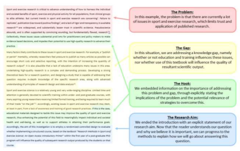
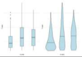
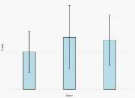
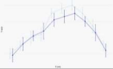
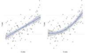
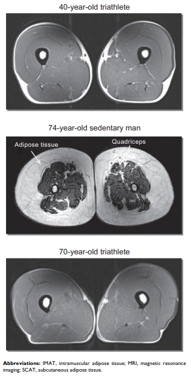
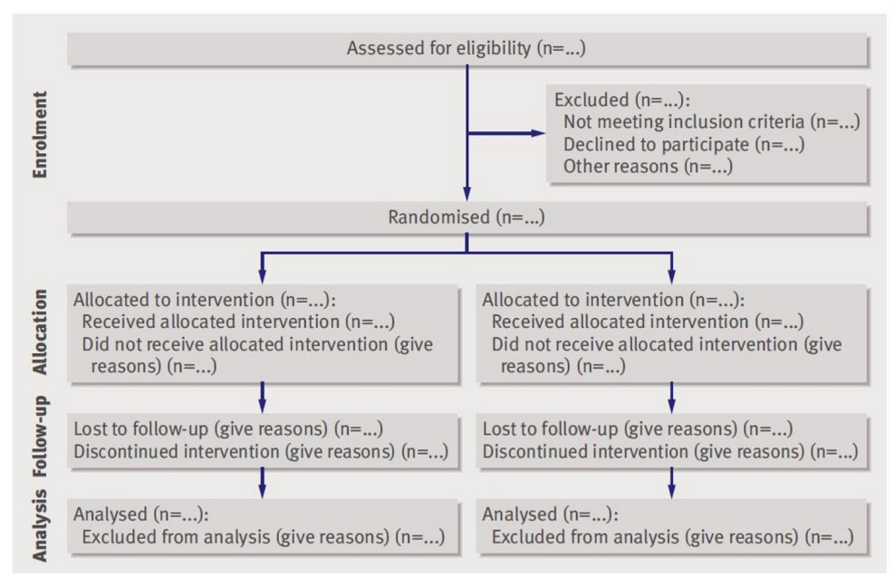
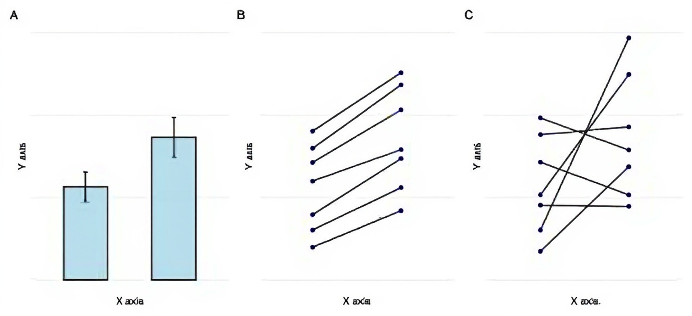
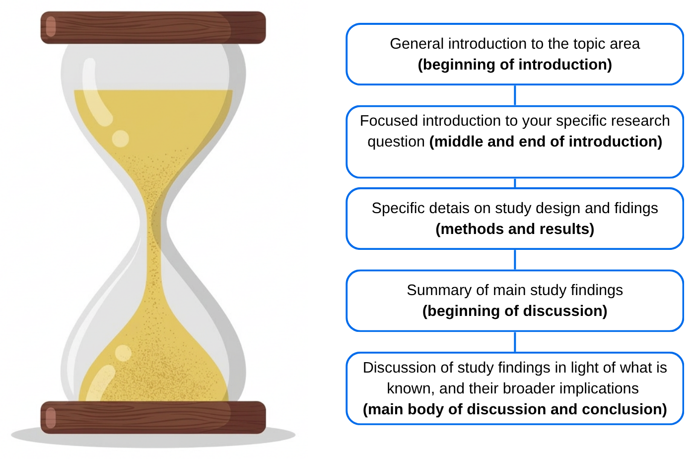

---
{
  "citation": false,
  "google-scholar": false
}
---

# Writing-up a research article and submitting for peer review {#sec-writing-and-peer-review}

*Eimear Dolan^1,2^, Nicholas Tiller^3^, Jennifer Murphy^4^, Stuart A. McErlain-Naylor^5^*

1.  School of Arts, Sciences and Humanities, University of Sao Paulo, Sao Paulo, Brazil.

2.  Applied Physiology and Nutrition Research group, Center of Lifestyle Medicine, Faculdade de Medicina FMUSP, Universidade de Sao Paulo, Sao Paulo, Brazil.

3.  Institute of Respiratory Medicine and Exercise Physiology, The Lundquist Institute for Biomedical Innovation at Harbor-UCLA Medical Center, Torrance, CA, USA.

4.  School of Biological, Health and Sports Sciences, Technological University Dublin, Dublin, Ireland;

5.  School of Sport, Exercise and Health Sciences, Loughborough University, Loughborough, United Kingdom.

## Introduction {#introduction-4}

If you have followed and implemented all steps described throughout this book, you likely now have results to share with the wider community. The most common route to sharing your research is by submitting an article to a peer-reviewed journal. The process of writing up a scientific article and submitting it for publication can be daunting and at times can feel like a "black box". In this chapter, we aim to demystify this process, and provide guidance on how to navigate it. First, we will describe the structure and content of a typical journal article ([Writing a Journal Article](#ch09-writing-a-journal-article)), before describing how the peer review process usually works ([The "Usual" Submission and Peer-Review Process](#ch09-the-usual-submission-and-peer-review-process)). Finally, we will provide some tips to help you develop your writing style and productive writing habits ([Academic Writing](#ch09-academic-writing)).

As you read this chapter, keep in mind that recommendations are based on our experience. Different journals have their own procedures, however, while different research groups also have their own approaches. As such, we encourage you to use this chapter as a guide, but to adapt our advice and recommendations in the way that works best for your research and for you.

## Writing a Journal Article {#ch09-writing-a-journal-article}

There are no hard and fast rules on the content and structure of a journal article, but most tend to follow a very similar format. In this section, we describe how to structure a journal article, and provide guidelines on the main content to include in each section. Always check the author guide for your chosen journal carefully, and make sure to structure and format your article accordingly (see [The "Usual" Submission and Peer-Review Process](#ch09-the-usual-submission-and-peer-review-process) for further information on submitting to a journal). A good way to get some ideas of the layout and detail required is to read a variety of journal articles with study designs similar to your own, and use them to form ideas of how best to layout and organize your article.

Before we get started, there are a few things to keep in mind. These are:

A.  The primary purpose of an undergraduate or many post-graduate research projects is to gain experience and training in the research process, and we recommend that you focus your attention on learning rather than publishing. While it is more common to aim for publication with postgraduate research, it is important to recognize that this may not always be feasible, particularly for masters projects, as conducting scientifically sound research is time-consuming and requires a lot of experience. Ultimately, the decision of whether to submit your research for publication lies with your supervisor. Try to manage your expectations and think very carefully about whether the work that you have completed justifies submission for publication. Remember that the primary purpose of both undergraduate and postgraduate research is to acquire skills and experience. Getting published is nice, but it's not the sole measure of success.

B.  Although the general content will be similar, journal articles differ in style to your thesis/dissertation and substantial work may be required to convert from one style to the other. One major difference is the length. Within your thesis, you need to demonstrate a thorough understanding of your subject area to convince your examining committee that you deserve your degree, and this typically involves describing every step and aspect in a very detailed manner. Journal articles, on the other hand, are likely to be read by subject experts who already have a nuanced understanding of the area and do not need detailed explanations of basic concepts. You can assume a certain amount of background knowledge, which means your article will be generally be shorter and more focused than your thesis. Shorter does not mean simpler, however, and it can be challenging to condense everything you know down to the length of a typical journal article (approx 3000 - 6000 words, depending on article type and journal). Writing succinctly is a challenging and learned skill - as French philosopher and mathematician Blaise Pascal once said when writing to a friend "*I apologize for such a long letter, but I didn't have time to write a short one*".

### Structure and Content of a Typical Journal Article {#ch09-structure-and-content-of-a-typical-journal-article}

Most journal articles in sport and exercise science will follow the same structure *i.e.,* abstract, introduction, methods, results and discussion, each of which builds upon the previous sections and addresses a key question essential to understanding your overall research project. These are:

1 -- What is your research question and why does it need to be answered? **(Introduction).**

2 -- How did you go about answering the question? **(Methods).**

3 -- What was the answer to the question? **(Results).**

4 -- What does this answer mean? **(Discussion).**

We will now describe each of these in the order that they appear in the finished article, but when working on your own article you can work on them in the order that you prefer. For example, within Stanford University's free online "*Writing in the Sciences*" course, Dr. Kristin Sainani recommends working on a research article in the following order: Tables and figures; results; methods; discussion; introduction; and abstract. You will also notice that each of these sections centre around the research question. Without clarity on this, it will be very difficult, if not impossible, to write a coherent and compelling articles. As described in [Chapter 2](02-question-and-design.qmd), the research question can be viewed as both the foundation, and the north star of your entire research project, and the importance of investing time to adequately defining and articulating it cannot be over-emphasised.

#### Abstract (Summary) {#ch09-abstract-summary}

The abstract is a summary of the entire article. It is typically 200 -- 300 words, although word limits and structure (*e.g*., subheadings or no subheadings) vary so check the guidelines for the specific journal that you plan to submit to. The abstract gives the reader a broad overview of the study, which can help them decide whether to carry on reading the entire article. The abstract should succinctly overview your research objective, study design and methods, as well as the key results and conclusions. Although the abstract is placed first in your article, we recommend writing it last, as it is easier to summarise the key points from each of the main sections once they have been written. Don't forget, however, that it is the first contact that readers, including the editors and reviewers who will ultimately decide whether the paper should be published, will have with your work. First impressions last, and a well-structured, clear and coherent abstract sets the scene for your entire article.

#### Introduction (What is the question and why is it important?) {#ch09-introduction-what-is-the-question-and-why-is-it-important}

> The purpose of the introduction is to clearly explain and justify your research question. In this section, you need to explain your thought process around how you arrived at your research question, and why you believe it should be addressed. Most journal article word limits mean you will have approximately 400 - 1000 words for this. That is not a lot, so every word must count.
>
> One useful approach to writing your introduction is to think about the "*problem-gap-hook*" approach [@lingardJoiningConversationProblem2015], specifically:

1)  Identify the relevant *problem w*ithin your topic area that you study will tackle. You will need to first provide some general background to make sure that your readers understand where you are coming from, then to get into the details of the specific aspect of this problem that your study aims to solve.

2)  Identify the *gap* in current knowledge or practice that impedes progress on solving this problem and that your study seeks to address. The type of gap that research studies typically seek to fill include evidence, knowledge, practical knowledge, methodological, empirical, theoretical or population gaps. For example, in a study investigating a sport supplement, an evidence gap may exist if available evidence is conflicting, with some studies suggesting a positive effect, but others indicating none, or even negative results. In this case, you might justify your own research by highlighting this inconsistency and the need for more data to resolve the conflict. A knowledge gap may exist when there is no data available on your topic area. For example, a theoretical justification may support the use of some training or nutritional intervention to benefit athletic performance, but research may be required to test if this theory is transferable to real life. A practical knowledge gap may exist when an intervention has been tested in a lab setting but has never been tested in the "real world", while a population gap may exist if no study has been conducted on your particular population of interest. Lack of replication of important findings may also represent an important gap in the evidence base. The following blog post provides further discussion and examples of different types of research gaps, along with a phrasebank of sample starting sentences that you can use to articulate which type of gap your research study will address:

> [https://jennifercumming.com/2022/10/04/signaling research-gaps/]{.underline}.

3)  *Hook* your reader, by clearly explaining to them why it is important to bridge this gap. This last point is important. Just because some gaps exist in the evidence base, this doesn't necessarily mean that they need to be filled. For example, a statement such as "*previous research indicates that Supplement X does not influence performance in a 4, 5, 7 or 8 km time trial, but no study has ever investigated its effect on 6-km time trial performance*" may describe a gap in the evidence base (*i.e.,* no data on 6-km time trial performance) but do we really care about 6-km time trial performance when we already have ample evidence that the supplement had no effect on 4, 5, 7 and 8 km performance? Is there something special about the 6-km distance that may make it more amenable to supplementation than all others? If not, perhaps this is not a research gap that is worth devoting the next few months or years of your life to fill! It is also important to consider prior plausibility, namely whether or not there is a scientifically justified reason for undertaking the study. It may well be true that there are no studies evaluating the efficacy of a magic energy bracelet or super supplement on 40km cycling time-trial performance. But is there any plausible reason to think that they should work in the first place? If not, why waste time doing the study?

> You will probably spend a lot of time thinking about your research question, and discussing it with your supervisor and colleagues, but remember that your readers are not privy to your private thoughts, or to conversations that you had within your research group. If you want the reader to understand why your project is important, you need to explain it to them in a clear, concise and compelling manner. In other words, you need to "*hook"* them.

Within your introduction it is essential to explain the literature that informed development of your research question. Your research should build on previous findings, so you need to provide an accurate and balanced description of relevant evidence. Avoid going off-track though. Your introduction should be concise and focused, so don't waste time explaining things that are not relevant to your particular project. A piece of novel-writing advice from Russian writer Anton Chekov is "*Don't hang a rifle on the wall in Chapter 1 if it isn't going to go off later in the book*". The same applies here -- don't focus large parts of the introduction on topics that do not influence later sections, unless you are able to justify your decision to later neglect these aspects. It can be useful to keep your research aim somewhere close (*e.g.,* write it on a post-it and stick it on the wall behind your computer). The introduction needs to remain entirely focused on justifying this aim and nothing else. If you find yourself writing paragraphs and paragraphs of indirectly related information, you likely need to pull yourself back on track. Keep in mind that the purpose of your introduction is to inform the reader about your research question, not to demonstrate the full breadth and depth of your knowledge.

You should end your introduction with a clear statement of your aim, along with your hypothesis if relevant (see Chapters 2 and 3). You should be explicit on this point, as readers will often scan your article to search for this information, so make it easy to find. For example, start your sentence with "*The aim of this study is...."* Or "*We hypothesized that....".* If you have done your job well in the preceding paragraphs, your reader will be in no doubt about what problem your project aims to address, what gap in the evidence base you aim to fill, and why filling that gap is important. A useful exercise can be to send your draft introduction to a friend or colleague without including the aim, and ask them to guess what that aim is. If their guess closely matches your actual aim, you have likely done a good job in setting it up throughout the introduction.

Another useful exercise is to consider how much attention you have given to defining your problem, gap and hook in your introduction, by highlighting how each part of the introduction aligns to these three elements. An example of how to do this is provided in [Figure 1](#figure-ch09-1), which illustrates a sample introduction for a hypothetical study investigating whether using this book can improve the quality of research studies conducted and written-up within a university post-graduate program. We have highlighted where we have addressed the problem/gap/hook of this project and included an explicit aim at the end. This exercise of highlighting different parts of the text can be useful, as you can quickly tell if you have covered the important points, and how balanced this is. It is common for people to spend a lot of time providing general background, but to neglect to explain the research gap that the study aims to address, nor the relevance of the information to be generated. If you highlight the different parts of your text and realize that 80% is devoted to the problem, with the remaining 20% spread between explaining the gap, the hook and the aim itself, it is likely time to go back and re-think and re-balance your introduction.

**Figure 1.** Sample introduction for a hypothetical study, demonstrating the problem/gap/hook approach.

#### Methods (How did you go about answering your question?) {#ch09-methods-how-did-you-go-about-answering-your-question}

By the time they have read your article introduction, your reader should be well and truly convinced of the value of knowing the answer to your question, meaning that you can now move on to explaining how it is that you plan to go about answering that question within the methods section. Throughout this book, we have described several steps involved in developing a research proposal, and within the methods section you will explain each of these steps in detail. Your methods are the recipe that explains how you arrived at the answer to your question, and they should be written with enough detail to allow the reader to replicate your study. Arguably, this is the most important section of your research paper. Without knowing exactly what you did, readers cannot replicate nor fully understand your results, nor decide whether they agree with your interpretation of those results. Within the methods, you will not only describe what you did, but also justify why you did it.

It can be difficult to know how much detail to include, but there are guidelines and checklists available online. For example, clinical trials can follow CONSORT (Consolidated Standards of Reporting Trials) [@schulzCONSORT2010Statement2010]; systematic reviews and meta-analyses can follow PRISMA (Preferred Reporting Items for Systematic Reviews and Meta-Analyses) [@pagePRISMA2020Statement2021], while sports nutrition studies can use PRESENT (Proper Reporting of Evidence in Sport and Exercise Nutrition Trials) [@bettsPRESENT2020Text2020]. A range of guidelines are available, so choose the one that best suits your purposes. The EQUATOR network is a great resource that combines reporting guidelines and checklists for virtually every study design that you can think of ([https://www.equator-network.org/]{.underline}). We recommend consulting these guides at the planning stages of your project, as once you reach the writing-up stage, it is too late to discover that you haven't collected or recorded an important piece of information.

If you are struggling to fit all relevant information within the word limit allowed for your methods, you can present relevant background information in supplementary files. Most journals allow you to upload supplementary material alongside your article, or you can use online repositories, such as the Open Science Framework (OSF: https://osf.io/). The key word to keep in mind here is "supplementary". Your reader should be able to understand your complete design and methods from the main section, without having to go to the supplementary materials. They can, however, be a useful means of providing additional context or detail, e.g., more technical details related to your protocol, the full version of any questionnaires used, statistical codes or codebooks.

In the absence of other constraints, it can help readability if the methods are structured in chronological order (*i.e.* the order in which you did the work) and/or the order that is easiest to follow, *e.g.*, participant details presented after the study design they are to be recruited to, followed by the intervention that they will undertake). A commonly used structure, divided by subheadings, is as follows:

[A) Study design]{.underline}

First off, you must define your design, e.g., is it observational or experimental, cross-sectional or longitudinal, parallel-group of cross-over (see [Chapter 2](02-question-and-design.qmd) for further discussion of study designs). You will then provide a broad overview of how it worked, *e.g.,* describe the number of groups/conditions, the different sessions that your participants took part in, name the key outcome measures, *etc.* At this point, you are providing a general overview that will help your reader to contextualize the more detailed information that is to come. You do not need to get into a lot of detail about specific protocols or control features -- this detail comes later. A figure that overviews the entire design, and clearly demonstrates the order and timing of each element of the study can be useful -- not only for your reader, but also to help you to clearly visualize your overall study for yourself.

[B) Participants]{.underline}

Within this section, describe and justify your target population. Explain how you accessed your population and how you screened them for eligibility, including all the main inclusion and exclusion criteria. It is important that you provide the rationale for the number of participants that you recruited (see Chapter 3), as well as to describe how you accessed them. Keep in mind that research involving human participants generally requires ethical approval and this is a good place to confirm that this was obtained and to provide the reference number.

[C) Intervention]{.underline}

If your study involves an intervention, describe and justify it in detail here. At this point, you should provide all necessary detail to allow someone to replicate your study. For example, if you are evaluating a resistance training intervention, you will need to provide details of the frequency and duration of training, along with the exact content of each session. You can also provide details on how you monitored and recorded factors such as adherence to the program, or any adverse effects that occurred throughout. If your intervention or the set-up of your experimental test session are complex, it may be useful to supplement the study design figure recommended above, with another more detailed overview of the intervention or the time-line of experimental test sessions. Diagrams and flowcharts are a great way to convey complex information, so think about how to implement them throughout your article (see [The "Usual" Submission and Peer-Review Process](#ch09-the-usual-submission-and-peer-review-process).1.4 for further discussion on the use of figures to articulate complex information).

[D) Experimental test sessions]{.underline}

Many studies involve laboratory and/or field-based tests with participants. For example, you might invite people into the laboratory to conduct tests before and after an intervention, to compare the characteristics of one group to another, or to conduct a focus group to explore your participants\' experience or thoughts on some topic. Key factors to consider for quantitative and qualitative data collection are described in [Chapters 4](04-quantitative-data-collection.qmd) and [6](06-interviewing.qmd). Within this section of your methods, you will need to explain how this worked in practice. It can be useful to describe this in chronological order, by describing step-by-step what happened from the moment the participant arrived at the lab until they left. Within this section, you can also describe and justify any control or standardization procedures that you used, including pre-test instructions that were provided to the participant.

[E) Outcome measures]{.underline}

As described in [Chapter 2](02-question-and-design.qmd), outcomes are the variables used to quantify the effects or characteristics of interest in a study. For example, if you are investigating the effects of a resistance training intervention on muscle mass and strength, these are the outcomes of interest, but they must be operationalised using specific measures. Muscle mass might be measured using DXA, MRI, BIA, skinfolds, ultrasound etcs, while strength might be assessed using one, 5 or 10 repetition maximum (RM) of a particular movement, isometric or isokinetic dynamometry, grip strength etc). The methods section should explain why particular outcome measures were selected and describe in sufficient detail how each one was measured, including the equipment, protocols and any data processing steps. Depending on the number of outcomes and the length of the section, you may wish to organise this information into subsections, one for each outcome measure.

It is common in sport and exercise research to measure a range of outcomes, and it is important to justify each one. You should also define your primary outcome of interest and be clear on whether this was specified *a-priori* (*i.e.,* before the study commenced) or not. Your primary outcome will determine other factors within your study design, including your target sample size, and factors such as sample timing and control or standardization procedures. As such, it is important that your reader understands what the main focus of your study is. If you don't have a primary outcome of interest and consider all of your outcomes equally relevant, this should be stated. In this case, it is likely that you are conducting an exploratory study with no specific hypothesis. This is important information to share with your reader.

[F) Data processing and analysis]{.underline}

The outcome measures from your study will provide data (quantitative, qualitative or both) and within this part of the methods you will explain exactly how you handled and analysed these data. Approaches to quantitative and qualitative data analysis are described in [Chapters 5](05-quantitative-analysis.qmd) and [7](07-qualitative-analysis.qmd). As with all parts of your manuscript, you should describe your data analysis in enough detail to ensure that someone could take your dataset, re-run the analysis, and arrive at exactly the same results. In other words, your work should be reproducible. Providing access to any analysis code that you used (*e.g.,* as a supplementary file) is recommended. This is particularly useful for those who wish to replicate your code, as it is much easier to understand when you can see the code itself, rather than attempting to write it out in words. Some studies, *e.g.,* in biomechanics, may require a lot of data processing before you reach the analysis stage. If this is the case, it may be useful to separate this section into two -- one to describe your data processing procedures, the other to describe data analysis.

#### Results (What was the answer to your question?) {#ch09-results-what-was-the-answer-to-your-question}

The purpose of the results section is to lay out all relevant information in a way that will leave the reader with no questions about the results of the analysis performed. At this stage, don't worry about interpreting or explaining these results -- that comes in the next section -- just describe them in as clear a manner as possible.

The first step in planning your results section is to think about the broad sub-sections that you need to include. Ideally, the order of these sub-sections should align to the order of information that you provide in your methods. Most results sections start out with a description of your recruitment process and participant characteristics. You can then move onto explaining relevant information about your intervention (if you have one), including details such as adherence or any outcome events experienced. Then you can describe the results of your data analysis, organized according to the outcomes that you measured.

Once you have sketched out the overall structure of your results section you can then think about what information you want to include in each part. This will generally revolve around developing tables and figures that clearly and concisely articulate all relevant data. It is likely that you will generate a lot of data within your study (represented by numbers in a quantitative study, or words or images for a qualitative study) and it can be challenging to drill this down to a format that your reader will understand. Tables and figures are a great way to present complex information in a more easily accessible and understandable way. Tables are generally used when you have many outcomes to report, and want to present precise values. Figures are used to visually represent overall trends and patterns in the data, or to highlight particular results.

Take care not to duplicate results in your tables and figures. Individual results should only appear in one format and it is well worth investing time into considering which format works best for your data. This can be challenging, and the available options can seem endless. [Table 1](#table-ch09-1) provides a brief overview of commonly used figures, and the type of information that each one is best suited to. As with most things within this chapter, we encourage you to use these examples as a start point and then to seek out additional materials to help you plan your own results section. For example, look at a range of research articles in your topic area to see how they present their data -- what works well and what doesn't? Further information on different types of graphs and charts can be found at this link: [https://towardsdatascience.com/data-visualization-101-how-to-choose-a-chart-type]{.underline}, while Week 5 of Stanford University's "*Writing in the Sciences*" course, led by Dr. Kristin Sainani provides a great overview of this topic ([https://online.stanford.edu/courses/som y0010-writing-sciences]{.underline}).

**Table 1.** Different types of figures to visualize data

+-------------+----------------------------------------------------------------------------------------------------------------------------------------------------------------------------------------------------------------------------------------------------------------------------------------------------------------------------------------------------------------------------------------------------------------------------------------------------------------------------------------------------------------------------------------------------------------------------------------------------------------------------------------------------------------------------------------------------+-------------------------------------------+
|             | **Primary Purpose**                                                                                                                                                                                                                                                                                                                                                                                                                                                                                                                                                                                                                                                                                | **Example**                               |
+-------------+----------------------------------------------------------------------------------------------------------------------------------------------------------------------------------------------------------------------------------------------------------------------------------------------------------------------------------------------------------------------------------------------------------------------------------------------------------------------------------------------------------------------------------------------------------------------------------------------------------------------------------------------------------------------------------------------------+-------------------------------------------+
| Box Plots   | Display the distribution, variability and central tendency of a dataset. Used to compare distributions between multiple groups or categories. A useful variation of the box plot is the violin plot, which shows the distribution of each dataset.                                                                                                                                                                                                                                                                                                                                                                                                                                                 |  |
+-------------+----------------------------------------------------------------------------------------------------------------------------------------------------------------------------------------------------------------------------------------------------------------------------------------------------------------------------------------------------------------------------------------------------------------------------------------------------------------------------------------------------------------------------------------------------------------------------------------------------------------------------------------------------------------------------------------------------+-------------------------------------------+
| Bar Graphs  | Represents categorical data using rectangular bars, with par lengths proportional to the values they represent. Often used within sport and exercise science to compare groups on continuous outcomes, with bar heights typically representing group means and error bars indicating variability (e.g., standard deviation) or uncertainty (e.g., standard errors or confidence intervals). Simple bar graphs can obscure the distribution of individual observations, meaning that where possible, individual data points should also be presented (see [The "Usual" Submission and Peer-Review Process](#ch09-the-usual-submission-and-peer-review-process).1.4 and [Figure 2](#figure-ch09-2)). |  |
+-------------+----------------------------------------------------------------------------------------------------------------------------------------------------------------------------------------------------------------------------------------------------------------------------------------------------------------------------------------------------------------------------------------------------------------------------------------------------------------------------------------------------------------------------------------------------------------------------------------------------------------------------------------------------------------------------------------------------+-------------------------------------------+
| Line Graphs | Displays data points connected by lines. Useful to represent trends in data over time.                                                                                                                                                                                                                                                                                                                                                                                                                                                                                                                                                                                                             |  |
+-------------+----------------------------------------------------------------------------------------------------------------------------------------------------------------------------------------------------------------------------------------------------------------------------------------------------------------------------------------------------------------------------------------------------------------------------------------------------------------------------------------------------------------------------------------------------------------------------------------------------------------------------------------------------------------------------------------------------+-------------------------------------------+
| Scatter     | Represents individual data points on a two-dimensional axis, with one variable plotted on the x-axis and another on the y axis. Used to visualize relationships between sets of continuous variables. Trend lines or regression curves can be fit to represent trends in the plotted data.                                                                                                                                                                                                                                                                                                                                                                                                         |  |
|             |                                                                                                                                                                                                                                                                                                                                                                                                                                                                                                                                                                                                                                                                                                    |                                           |
| Plots       |                                                                                                                                                                                                                                                                                                                                                                                                                                                                                                                                                                                                                                                                                                    |                                           |
+-------------+----------------------------------------------------------------------------------------------------------------------------------------------------------------------------------------------------------------------------------------------------------------------------------------------------------------------------------------------------------------------------------------------------------------------------------------------------------------------------------------------------------------------------------------------------------------------------------------------------------------------------------------------------------------------------------------------------+-------------------------------------------+

+-----------------+---------------------------------------------------------------------------------------------------------------------------------------------------------------------------------------------------------------------+-------------------------------------------+
| Primary         | Shows the actual results from biochemical or imaging analyses *e.g.,* images of western blots, cell cultures or scans.                                                                                              |  |
|                 |                                                                                                                                                                                                                     |                                           |
| Evidence        | *Example taken from Wroblewski et al.* [@wroblewskiChronicExercisePreserves2011]*.*                                                                                                                                 |                                           |
+-----------------+---------------------------------------------------------------------------------------------------------------------------------------------------------------------------------------------------------------------+-------------------------------------------+
| Diagrams        | Flow-diagrams can demonstrate the flow of participants throughout the study. Diagrams can also be used to visualize study designs, interventions, or to demonstrate the model or theory that the study is based on. |  |
|                 |                                                                                                                                                                                                                     |                                           |
| and Flow Charts | *Example of participant flow diagram taken from Schulz et al.* [@schulzCONSORT2010Statement2010]*.*                                                                                                                 |                                           |
+-----------------+---------------------------------------------------------------------------------------------------------------------------------------------------------------------------------------------------------------------+-------------------------------------------+

One thing to keep in mind is that just as figures can be a great way to present complex information in a more easily understood format, simple figures based on mean and variation can be misleading. Take for example, the simple bar chart. [Figure 2](#figure-ch09-2) shows 3 different datasets in Panels A -- C. All have 6 similar means and standard deviations, but as you can see, their distribution varies widely and each one tells a different story. Imagine that the first bar in Panel A represents a "pre" measure and the 2^nd^ 8 bar represents the same measure taken post-intervention. The simple bar chart shown in Panel seems to imply that the post-measure is quite a bit higher than pre -- time to start celebrating -- the intervention worked! But did it really? If your results are as depicted in Panel B, then this would appear to be the case, as everyone seemed to systematically increase in the post-test. But the individual data presented in Panel C shows a different story - 3 people had a dramatic increase, 2 decreased and the other 2 stayed more or less the same. Does this deeper dive into the data change your thoughts at all about the intervention?

**Figure 2.** Example of different graphs with approximately the same mean and standard deviation, but different distributions. Image adapted from Weissgerber et al. [-@weissgerberBarLineGraphs2015].

Another interesting example of where figures based on simple summary statistics can be leading is from the Anscombe Quartet, as described in [Chapter 5](05-quantitative-analysis.qmd). The Anscombe Quarter was published in 1973 by the American statistician Francis J. Anscombe to make a simple, but very important point -- numerical summaries can be identical, even when the underlying data are certainly not [(REF).]{.mark} As visualized in [Chapter 5, Why is plotting best?](05-quantitative-analysis.qmd#ch05-why-is-plotting-best), these 4 small datasets have practically identical means, standard deviations and correlations between x and y, yet when you plot them, you can see that they actual numbers are quite different. As described in [Chapter 5](05-quantitative-analysis.qmd) an important step within data analysis should always be to plot and visualize your results. But don't keep this information to yourself. It is just as relevant to your reader as it is to you, so when feasible, always present individual data points on your graphs, and provide a copy of your raw data as a supplementary file to your article (making sure that this data is anonymized, that any information that may allow people to identify your participants has been removed, and that your participants have provided their consent to do this, confirmed within the informed consent form). If you also provide any code that you used to analyse your results, this means that you now have a fully reproducible data set.

Once your tables and figures are in order, writing up the rest of your results is quite easy. Your text should provide a high-level summary of the information presented in the tables and figures. A common mistake is to use the text to simply repeat the information presented in the tables and figures. Don't do this. Instead, think about the main points that you wish to articulate within each section and use your text for this. For example, imagine you are conducting a study that includes a group of elite athletes and recreationally active controls. Within the "participants" sub-section, you may include a table detailing all key variables, along with whether or not they differed between the groups. Within the text, there is no need to repeat all of this information, and a high-level summary of key findings is sufficient, *e.g.,* "*Participant characteristics are presented in Table 1. Both groups had similar age, height and weight, but athletes were more muscular, had a lower percentage body fat and a higher aerobic capacity compared to their recreationally active counterparts*". Where relevant, you can also report the statistical evidence supporting these comparisons, including p-values and effect sizes.

#### Discussion (what do my results mean?) {#ch09-discussion-what-do-my-results-mean}

The purpose of this section is to discuss and interpret your results, and it can either be the hardest or easiest section to write, depending on how well you know your research area and how clearly you have laid out the previous sections. The first paragraph usually summarizes the main findings from your study. The terms "results" and "findings" are often used interchangeably, but they are subtly different. A result is an objective statement of fact, e.g., "The supplement group showed a greater reduction in 30m-sprint time than the control group (between-group difference -0.30s, 95%CI: -0.45 - -0.15; p = 0.002). A finding, on the other hand, is the conclusion that you draw from that result, *e.g.,* "*Our results indicate a positive effect of supplementation on sprint time, as evidenced by the greater increase observed in the intervention group*". Once your reader has read this opening paragraph of your discussion, they should be in no doubt about what you consider your main study findings to be. They may not necessarily agree with this interpretation, as different people can look at the same set of results, and arrive at different conclusions. But differing perspectives are an inherent part of science. Your job as a writer is not to convince everyone that you are 100% right (an impossible task!). Instead, your goal should be to articulate your perspective as coherently as possible, including the underlying rationale underpinning your interpretation of study findings.

Within subsequent paragraphs, you can then expand on these findings, by discussing them within the context of other research. Do your findings align with others? Were they as you expected, or surprising? If they took you by surprise, do you have any thoughts on why that might be? What are the underlying mechanisms that may explain them? What are their implications, both for future research and for practice? This section is your opportunity to bring all of the knowledge and experience that you have gained throughout the research process together and to clearly demonstrate the relevance of your research findings. As the lead researcher, you've likely considered various interpretations of your data, but as we've mentioned before, your reader is not privy to your thoughts or to discussions that you had with your supervisor or peers. If you believe that some aspect of your results is relevant or interesting, explain this clearly to your reader -- don't leave them to guess.

A common mistake in the discussion is to treat it as an extension of either the introduction or results. All relevant results should be clearly described in the results section -- don't introduce anything new to the discussion. Instead, focus your attention on explaining what these results mean, along with how confident you are about them. This latter point is important. Look back at the hypothetical results described in [Figure 2](#figure-ch09-2). Both appear to show an overall mean increase in one group compared to the other, but imagine these were results pre and post intervention. Would Panel B or C make you more confident about recommending this intervention? It is important to use existing literature within your discussion, to explain and situate your own results. For example, if your results look more like Panel C and you have concerns about the extent of variability in your results, it would be interesting to know if this is a common feature of this particular intervention, and you can discover this by comparing your findings to others in the area.

Take care not to drift off on tangents within your discussion. Another common error that we see when reading draft discussions is entire paragraphs that explain background information, or describe the results of other studies, but without direct reference to how these apply to your own study findings. You should only refer to surrounding literature within the context of interpreting your own findings. If you realise that you have written several sentences, or even an entire paragraph without directly referring to your own study, then it is time to pull yourself back and to think about why this information is relevant to explaining your study findings. If you can't clearly articulate this, then you need to question if the information you are describing is really necessary.

No research is perfect, and all studies have limitations. In addition to using the discussion to explain what your results mean, it is also useful to provide some information about what they cannot tell. Often, people shy away from exposing weaknesses in their work, but careful consideration of study limitations actually strengthens your article and increases the reader's trust in your ability to be balanced and objective. It is a good idea to not only state the limitations, but also to consider what impact these may have on your results and their implications.

Finally, it can be useful to end your discussion with a look to the future. Where do you see this research area going next, and how do your results support this? Perhaps your hypothesis was not supported, and subsequent research should focus on identifying why. Perhaps your hypothesis was supported, laying the foundation to progress to more nuanced questions or applications. Or perhaps you believe your results warrant either direct or conceptual replication. In addition to considering how your results may contribute to ongoing research, you can also consider whether they may have practical implications, e.g., for athletes or the general public?

By the end of the article, your reader should have a very good understanding of what question you wanted to answer, how you went about finding that answer, what the answer was and what you believe that answer means. All that is left now is to tie it all together with a brief summary and conclusion. The summary part will reiterate your primary question and findings, while the conclusion summarizes their implication. This section should be short and to the point. Think carefully about what is the main message that you want your reader to take away from your article and do your best to sum this up here.

**Figure 3.** General Outline of a Research Article

*[Legend:]{.underline} The overall structure of a research article has been described as being shaped like an hourglass. The introduction starts out quite broadly, with a brief overview of the general topic, then gradually becomes more focused on your specific question. The methods and results are the narrowest part of the hourglass, where you describe the specific details of your study. The start of the discussion is also quite specific, as it summarises the main findings from your study, then gradually widens out again, until you reach the broad implications of your research findings within your conclusion.*

## The "Usual" Submission and Peer-Review Process {#ch09-the-usual-submission-and-peer-review-process}

Above, we described the structure and content of a typical research article. Now we will describe the typical steps involved in submitting it for peer-review. We have placed the term "usual" in inverted commas in the section heading, because the reality is that there is no universally standardized process. Keep in mind that different journals have different requirements, and different research groups have different approaches. So use this information as a guide, but be aware that your own experience may vary.

### Selecting a Journal {#ch09-selecting-a-journal}

Discussions on where to submit should begin early in the writing process so you can tailor your manuscript to the target journal. There are various factors to consider, including how closely your manuscript aligns with the aims and scope of the journal, whether the journal caters to your target audience, and your chances of seeing the manuscript accepted. To this latter point, not everyone can publish in *Science* or *Nature* (two high-profile journals in science and technology); moreover, the acceptance rates in premier sport and exercise science journals (e.g., *Sports Medicine*, *Medicine and Science in Sport and Exercise*, *British Journal of Sports Medicine*) are as low as \~10--20% ([[https://www.journalguide.com]{.underline}](https://www.journalguide.com)). So be optimistic but realistic and decide on a few reserves in case you do not get accepted to your first choice. Once you've settled on a journal, you need to read the "author guidelines" and ensure your manuscript conforms to word count, formatting, and citation requirements---all characteristics that vary from journal to journal, much to the annoyance of researchers around the world.

It is worth putting some time into learning about well-respected journals in your field, and your supervisor can help you with this. Avoid falling prey to "predatory journals". These outlets offer an exploitative "pay-to-publish" model characterized by short publication times and lackluster or nonexistent peer-review. Concerningly, they are appearing at a faster rate than "reliable" journals with rapidly expanding popularity: the number of articles published in predatory journals increased from \~53,000 in 2010, to \~420,000 in 2014 [@shenPredatoryOpenAccess2015]. The publishing process has many flaws, and intense publication pressures summarized in idioms like "publish or perish", alongside a highly competitive research environment, can make it tempting to bypass peer-review to expedite publication. But the poor-quality studies usually appearing in predatory journals tend to impede, rather than facilitate, replicable science. Thus, publishing your work in such an outlet may damage your reputation and hamper employment prospects. Consider also that \~60% of articles published in predatory journals receive few (if any) citations in the years following publication [@brainardArticlesPredatoryJournals2020].

It can be difficult to identify predatory journals. Some red flags to look out for include journals that send unsolicited emails requesting submissions, promise short turnaround times on peer review, and whose websites display minimal information about their processes or procedures. It can also be useful to look at the editorial board of the journal to see whether it comprises well-respected researchers in your area. It is challenging for early-career researchers with less experience in the publishing process to spot these red flags and to differentiate reputable from less reputable journals; so, discuss your journal options with your supervisor and more experienced members of your group before making a decision on where to submit.

### Submitting Your Article and Peer Review {#ch09-submitting-your-article-and-peer-review}

Most journals have an online submission site that you can upload your manuscript to. There, it will first be assessed by an editor who will act as a gatekeeper and decide if it is suitable for the journal. If they deem the manuscript to be outside the aims and scope of the journal, and/or of insufficient quality, then they may "desk-reject" it without sending it for peer review. If you pass this initial screening, the paper will be sent out for peer review. This involves a panel of other researchers, ideally experts in the field, scrutinizing your manuscript to assess the appropriateness of your study design, the integrity of your data, the clarity of your writing, and anything else deemed relevant to quality control. It is the reviewers' responsibility to highlight potential weaknesses in your study and/or areas needing further clarity.

Reputable journals use subject experts who can offer astute and constructive feedback on your manuscript, whereas less reputable journals may recruit scientists whose expertise are increasingly removed from your research theme; their feedback may therefore be less insightful, and they may even misunderstand the aim of your study. Most sport and exercise science journals currently use a blinded process, whereby neither you nor the reviewers will be aware of each other's identity. Theoretically, the aim of blinding the peer-review process is to increase objectivity and to ensure the reviews are based on the manuscript, and not on preconceived opinions about the authors. In practice, it doesn't always work like this, and there have been calls for open peer review, in the hope that this could improve transparency and accountability within the peer review process. As with all things, there are advantages and disadvantages to all approaches.

It can take several weeks or months for reviews to be returned, after which the editor will typically contact you with one of three decisions: (i) minor amendments, requiring routine edits to your manuscript to improve clarity or concision. This outcome is fairly uncommon on a first submission, so don't be disappointed if the reviewers have more substantive critiques of your paper; (ii) major amendments, requiring in-depth edits to the structure or narrative or perhaps a reanalysis of data; (iii) rejection, owing to fundamental or irretrievable flaws in the study design or data integrity. Sometimes the journal may also reject based on priority ratings. If they receive a large number of submissions, they may choose to reject an otherwise sound and interesting article simply because they have more submissions than they can publish, and other articles submitted around the same time aligned better with their aims, or were deemed to have greater potential interest to the readers. It is possible to receive an outright accept response without any request for revisions, but this is highly unusual.

It can be very disheartening to get a rejection decision, particularly if you have waited a long time to hear back from the reviewers. Hopefully the comments made will be useful, however, so try to use valuable feedback to improve your manuscript for subsequent submission elsewhere. There may be several rounds of review---each designed to incrementally enhance the quality of the final draft. The process can continue until the reviewers and editors decide that you have provided satisfactory responses to all comments. It is also possible that they may decide that the initial responses do not adequately address their concerns and decline to consider it further. This can be a frustrating outcome, particularly if you invested considerable time in preparing a response. To avoid this possibility, it is important to be as clear and comprehensive as possible in your responses to all queries raised.

When responding to feedback, show that you appreciate the time reviewers have spent on examining your manuscript; they're doing it for free, after all. And because reviewers are the arbiters of quality control---being all that stands between you and your next publication---you should, above all, be courteous. This can be difficult if you believe that they have misunderstood a core aspect of your manuscript, and as such, that their criticism is unfounded. But keep in mind that if the reviewer has misunderstood some element of your manuscript, it is possible that others may too, and you may need to rephrase something to ensure that key points are clear. Conform to reviewer requests as far as you're comfortable, but stand firm if you disagree with something. Knowing when to rebut and when to yield takes experience. Pick your battles. Primarily, keep in mind throughout the process that, once your paper is published, your name and professional reputation will forever be tied to the methods, results, and conclusions therein. So don't make any changes that you are not willing to publicly stand behind. Also consider that any errors that make it into circulation are difficult to change without a formal correction or a retraction; there's no edit button on a published paper.

The peer-review process can be challenging, but try not to take criticism personally. A study can take months or years to finish and turn into a manuscript, and having a handful of anonymous scientists cast judgment on your work, exposing potential flaws (rightly or wrongly), can be disheartening. This is an especially bitter pill to swallow early in your career when you may not be used to receiving such pointed feedback. What's more, peer review is yet to master the skill of balanced positive and negative feedback, with scales usually tipping firmly in favor of the latter. So, hold on to the knowledge that none of this is criticism of you. Embrace the process, accept the constructive feedback, and consider it the soft opening to the public exhibition of your work. The following article provides some useful advice on dealing with a difficult peer-review process:\
[[https://www.nature.com/nature-index/news/how-to-respond-difficult-negative-peer-reviewer-feedback]{.underline}](https://www.nature.com/nature-index/news/how-to-respond-difficult-negative-peer-reviewer-feedback)

Finally, it is important to know that the peer-review system is an imperfect one. Just because an article is accepted for publication does not necessarily mean that it is scientifically sound, meaning that it is important to approach the literature with a healthy dose of skepticism. Equally, just because your article is rejected does not necessarily mean that it is not a useful addition to the literature. It just hasn't found the right home yet! Having said that, and despite its imperfections, the peer-review process does generally make the paper better. People often focus on the negatives and share peer-review horror stories. They happen, but they are rare. If you approach the process with an open and constructive mindset, you can learn a lot and end up with a much-improved paper.

## Academic Writing {#ch09-academic-writing}

As you will probably be aware by now, there is a lot to think about when considering what information to include in your research article, but it is just as important to also think about how you will convey this information. Too often, people focus on other parts of the research process and just assume that they will be able to write up and communicate their ideas and findings in a clear, concise, and compelling way at the end. But it's not that easy. Writing is an essential academic skill, and as with any skill it can be honed and developed through practice and training. Many aspects of your writing style will be unique to you as an individual, but below we describe some general tips to help you develop and optimize your academic writing, including advice about writing style, crafting a paragraph, phases of the writing process, and developing writing habits that work for you.

**Table 2.** Common phrases to avoid and simpler alternatives

  ---------------------------------- ----------------------------------
  **Often unnecessary**              **Try this instead**

  in order to                        To

  the majority of                    Most

  despite the fact that              Although

  a number of                        Some

  in the event that                  If

  Utilize                            Use

  due to the fact that               Because

  with the exception of              Except

  as well as                         And
  ---------------------------------- ----------------------------------

Excessive use of acronyms and abbreviations are widespread in academic literature, but just because everyone does it does not mean that you should too. A lot of acronyms and abbreviations can hamper readability, and should be used sparingly and only if they are for common phenomena. Granted, they might help your word count, but what good is that if they frustrate your reader and leave them unable to follow your narrative? For example, of these two sentences, which do you think is easier to understand? "*HrTR + PLY+ PRT improved OAP as evidenced by increases in both LBSP and AC" or "A combination of heat and progressive resistance and plyometric training improved the overall athletic profile, as evidenced by increases in both lower body strength and aerobic capacity".* Sure, the first example is shorter, but does that really matter if your reader can't understand it, particularly a reader who may not be familiar with these terms?

### Writing structure (developing each paragraph) {#ch09-writing-structure-developing-each-paragraph}

Each paragraph should act as a "unit", conveying a single topic or idea. Each paragraph should build on the previous one, following a logical structure, and building to create a convincing and eloquent narrative. Begin each paragraph with a "topic sentence" that makes it clear what the paragraph is about. You can then continue with supporting sentences to develop the idea, and provide examples, evidence and data to support and develop the point. Finally, end your paragraph with a concluding sentence that articulates the main take-home point. The topic and concluding sentences make it easier for the reader to follow your train of thought and to contextualise the information they are reading.

When structuring your article, you may find it useful to first write the topic sentences, as this will help you to visualise your overall structure, along with the core ideas that you want to convey. You can then fill in the details afterwards. Make sure that topics are presented in a logical order, and that the connection between paragraphs is clear. Spending time brainstorming what it is that you want to convey in your article, then organising a skeleton outline of what will go in each paragraph, can be helpful when it comes to sitting down and actually starting writing.

### Phases of the writing process {#ch09-phases-of-the-writing-process}

The writing process is generally divided into three main phases - drafting, editing, and proof-reading. The drafting phase will naturally follow on from the initial skeleton outline described above, where you will work on the overall structure, and get all your ideas down on paper. This phase can be quite frustrating, as you may struggle to articulate your thoughts and ideas and what comes out on the page may not be what you envisage in your head. But don't worry -- it's just a first draft. You can't edit or refine a blank page so your first priority is just to get started.

A very common piece of writing advice is to "*write drunk, edit sober*". This phrase is often attributed to the famous writer Ernest Hemingway, although A) apparently he never actually said it, and B) he never wrote drunk. And we are not suggesting that you do either. But the point here is that when writing the initial draft, it can be useful to approach it with an open mind, freely writing whatever comes into your head without restriction or analysis. Then you can get to what is arguably the most important part of writing -- editing. At this phase you can return to your draft and consider it from a more sober, analytical perspective. You will start to structure your ideas to ensure they are organized in a logical flow, expand on important points with additional information from the surrounding literature and improve readability by correcting grammar and punctuation, and removing surplus words and text. This latter point is important. Early drafts tend to be unnecessarily long and full of clutter, which can make the text frustrating and difficult to read. As renowned writer and editor William Zinsser recommends "*Look for the clutter in your writing and prune it ruthlessly. Be grateful for everything you can throw away*". You may pass through multiple iterations before you reach a version that you are happy with. This is absolutely fine. Take as much time as you need to ensure that the final version is as clear, concise and compelling as you can make it.

Throughout the editing process, you will likely seek feedback from peers and your supervisor. It is often helpful to get early feedback, even if your ideas are still somewhat unformed. After all, it is best to catch any issues early on. It can be difficult to edit your own work, and fresh eyes can be useful to spot inconsistencies, or particularly "clunky" pieces of text, so do your best to seek feedback at various stages. It can be useful to develop a peer-feedback group with others who are at a similar stage to you, the aim being to read and comment on each other's work to get clarity and inspiration.

Eventually, you will have a final draft that you are happy with. Before submitting, proofread the paper thoroughly, by examining it for errors and mistakes in spelling, grammar, punctuation, and formatting. It can be difficult to notice small errors and inconsistencies in text you have read dozens of times. Many proofreading strategies are therefore aimed at making the errors stand out more clearly. Some people read their work aloud or listen to others doing the same. This can include automated computer read-out. Reading on a different device or from printed paper can also help things appear different. It can be useful to read the draft through a few times with varying objectives. For example, checking all topic sentences once, then checking for any unnecessary words, phrases, or sentences that can be removed. A further quick scan can identify particularly long sentences or paragraphs.

### Writing habits {#ch09-writing-habits}

Writing is an iterative process and it is likely that you will pass through multiple versions before arriving at one you are happy with. This takes time, particularly when you are new to this style of writing. You must factor this into your overall research plan and carve out time and space to allow you to focus on honing your craft. Some trial and error may be required to help you figure out your preferred approach and style. Try several approaches and figure out what works for you

A common piece of academic writing advice is to "*write as you go along*" and "*don't leave it all to the end*". It is unrealistic to think that you will simply be able to sit down and quickly write a clear, concise and compelling article at the end of your research project. Returning to our earlier point, writing is a skill that needs to be honed, and this requires that you regularly carve out time for your writing. The more you do it, the more your writing will improve.

How you actually go about this depends on you. Some people find it easier to block out an entire day or two per week to focus on writing, while others prefer multiple shorter sessions spread throughout the week. Some write best in the morning, others in the afternoon or evening. Once you have figured out your own preferred style, it can be useful to block time in your calendar. If you find it hard to avoid distractions and other commitments, then write at the start of the day before these other commitments appear. The best way to gauge progress may not be to track the number of words you produce, but rather how well you protect your writing time.

It is not only time that can affect your writing habit, but also the environment. Do you work best in silence or do you need background noise? Can you maintain focus in one environment for long periods or do you need a regular change of scenery? For some people, splitting their writing session into chunks with breaks may help avoid writing fatigue. Others may need longer, uninterrupted blocks of uninterrupted time to get the ideas flowing. There's no *one size fits all* approach.

However you choose to do it, academic writing is necessarily interrelated with academic reading. Writer David Perell says "*read to collect the dots, write to connect them*". Indeed, the best starting point for academic writing is often from a position of an abundance of semi-connected ideas or trains of thought. If you don't know what to write, then read until you have the urge to write something down before you forget it. If you don't know what to read, then write until you reach a missing link that requires further food for thought.

## Summary and Key-Points {#ch09-summary-and-key-points}

Throughout this chapter, we provide advice on how to structure a scientific article and the basic content to include in each section ([Writing a Journal Article](#ch09-writing-a-journal-article)); how to navigate the usual peer-review process ([The "Usual" Submission and Peer-Review Process](#ch09-the-usual-submission-and-peer-review-process)) and how to develop your own writing habits and style ([Academic Writing](#ch09-academic-writing)). We hope that this information can help you begin your writing and publishing journey, and we provide some recommendations in Table 3 of additional resources that can help you further develop your craft.

The process of writing and publishing a scientific article is a challenging one. The peer-review system has pros and cons, and although it is often a positive experience that ultimately improves your article, it can be challenging and at times disheartening. Keep in mind that you can only control the process, but not its outcome. So focus on what you can control by carving out time to refine and hone your writing, thus ensuring that others can fully understand and appreciate all the work that you have put into your research project.

## Acknowledgements {#acknowledgements-2}

The authors thank Dr. Kirstin Sainani and Dr. Paul Swinton for their feedback on an earlier version of this chapter, and Gabriel Perri Esteves for his help in developing example figures.
